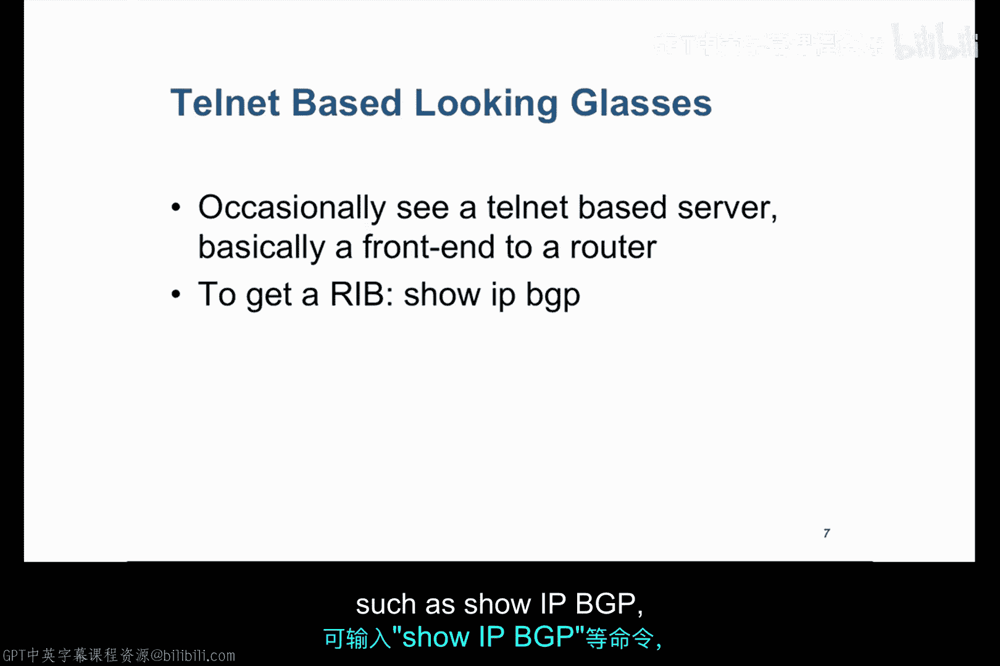
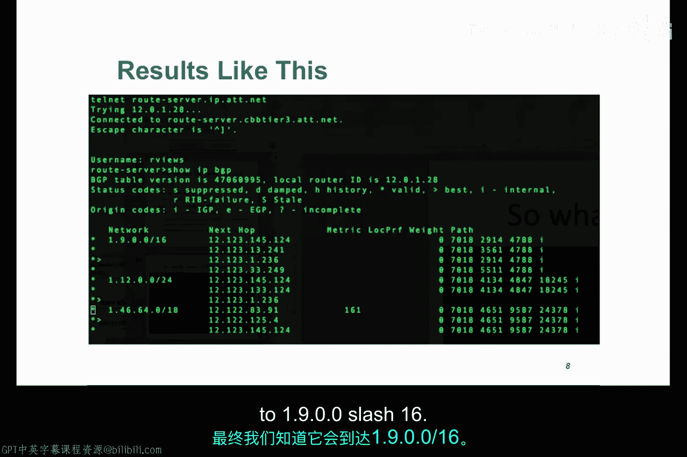
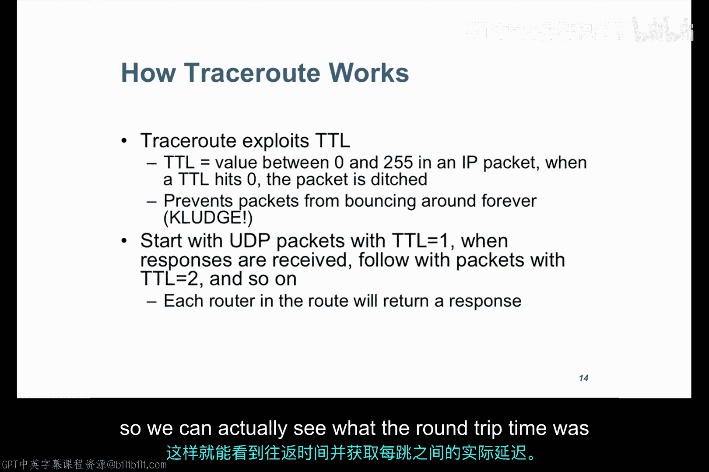
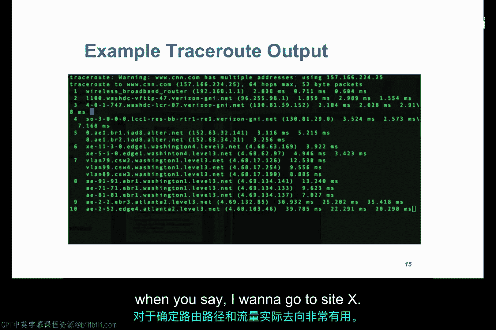
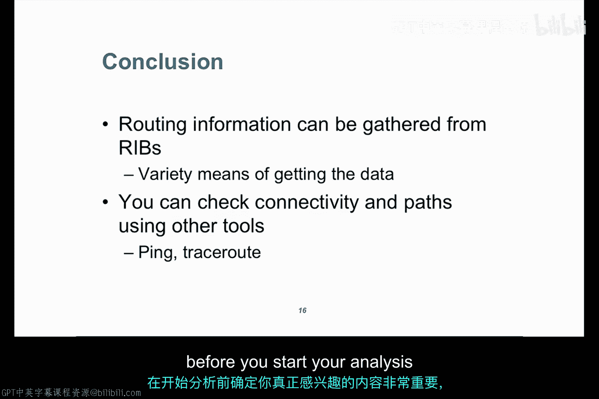

# 016：BGP源数据分析 🔍

在本节课中，我们将学习如何分析和获取路由信息。我们将介绍几种关键的数据源和分析工具，特别是用于检查网络路径的 `ping` 和 `traceroute` 工具。通过学习，你将能够列出分析路由信息的资源，并讨论如何使用这些工具。

## 路由数据源 📊

上一节我们介绍了BGP的基本概念，本节中我们来看看获取和分析BGP数据的具体资源。分析BGP数据时，可以轻松找到多种数据源。

在讨论路由时，你感兴趣的关键数据之一是**RIB文件**。RIB文件是基于路由信息的文件，通常由多种来源提供。这些来源会告诉你BGP通告、选路路径等信息。

其中两个重要的数据源是**Route Views**和**Looking Glass**。

以下是关于这两个数据源的详细信息：

*   **Route Views**：这是俄勒冈大学的一个项目。它存储了多个顶级网络运营商的BGP数据。数据以**MRT格式**存储，这是一种多线程路由工具包格式。解析该格式的工具可以在下方URL找到。这是一种紧凑且一致的格式，便于存储所有路由信息。
*   **Looking Glass**：这个术语更有趣一些。它是一个通用术语，指的是一类服务器软件，本质上是路由器的前端。它通常有两种形式：基于HTTP或基于Telnet。基于HTTP的通常有更友好的图形界面，而基于Telnet的则更偏向命令行方式。下方列出了几个HTTP服务器示例。

再次强调，当我说“友好、流畅的界面”时，我指的是真正友好的界面。很多界面会引导你：第一步，选择你想查看的源位置；第二步，选择你想要的目的地信息类型；第三步，选择获取方式，例如执行ping、traceroute或查看BGP信息等。至于Telnet方式，它更偏向命令行。你偶尔会看到这些，它们基本上是路由器的前端，你可以输入一些命令，比如 `show ip bgp`，然后获得类似下图的信息。

你在这里看到的信息基本上是一系列到达不同IP地址的路径信息。例如，要到达 `1.1.9.0/16` 这个目标网络，下一跳是 `12.123.145.124`。当然，也可能存在其他下一跳。之后，你实际上可以看到它将尝试的完整路径。我们关心的是最终目的地，但不必担心路径的每一步，只需要关注当前的下一跳是什么。这样，我们知道下一跳的IP地址，就可以将路由信息发送给它，并最终到达 `1.1.9.0/16` 网络。

## 路由非对称性与路径分析工具 🛣️

在深入工具之前，有几个关键细节需要大家了解。首先，**路由是非对称的**。如果A路由到B，它可能走一条非常短、快速、简单、低延迟的路径。而B路由回A时，可能走一条非常长、绕经新加坡和冰岛再返回美国的路径。这没关系，两者都能路由数据包。网络底层工作并不需要对称性，事实上，这是其主动设计目标之一。我们不必担心路由不对称，这其中有多种原因，例如光缆布局、对等协议等都会影响路径选择。这些是底层细节，终端用户通常不需要了解，即使活跃在此领域的人也大多无需深究。然而，BGP允许我们在给定条件下，决定如何绕路。

我们已经讨论了路由本身以及如何获取RIB信息，现在我们将花更多时间讨论人们通常用来分析从自己系统到另一系统路径的工具。

我将重点介绍的两个工具是 **`ping`** 和 **`traceroute`**。

使用这些工具时你需要什么？对于 `ping` 和 `traceroute`，你并不一定需要Looking Glass，因为可以直接从你的系统执行。但如果你想了解从日本到朝鲜或韩国系统之间的路径情况，你可能需要去一个更接近该地区的路由器，以更好地了解这两个站点之间的情况。从你这里执行 `ping` 对此帮助不大。

## Ping工具详解 📡

`ping` 是一个相当简单的基于 **ICMP** 的工具。大家可能都用过，所以我不打算花太多时间，但还是简要提一下关键细节。

`ping` 发送一个**代码为0、类型为8**的ICMP消息，这是一个**回显请求**。如果目标主机接受此请求，它将回复一个**代码为0、类型为0**的**回显应答**。你可以在回显请求或应答的数据包中编码一些状态信息，这允许你区分不同的请求，因为通常当你输入 `ping google.com` 时，你不会只发送一个ping，而是多个。这使你可以进行多次尝试。当我们说多次尝试时，并不要求每一次都完全成功。

你可以调整很多参数，例如调整ICMP消息的有效载荷大小，调整TTL值（例如，你可以设置这个ping最多只经过3跳）。通过观察不同设置下的差异，可以获取更多信息。

`ping` 也可用于一些攻击，例如经典的**死亡之ping**、**ping泛洪**、**Smurf攻击**等。我们现在不深入讨论这些细节，但希望大家知道它们的存在。有许多资源可以更详细地了解这些攻击的原理和表现。

## Traceroute工具详解 🧭

现在让我们进入 `traceroute`。`traceroute` 是另一个有趣的工具，因为它可以让你看到数据包经过的确切路径。

`traceroute` 基本上是一个路由分析和诊断工具。我的意思是，如果我们想弄清楚为什么两个点之间延迟这么高，我们可以快速做的一件事就是从一个点执行 `traceroute` 到目标点，比如 `google.com`。它会给出我们计算机到Google.com路径上每一跳之间的延迟。

它的一个美妙之处在于，你还能获得路径上每一个愿意报告其名称的路由器的列表。

`traceroute` 的工作原理是利用了IP数据包中的 **TTL** 值。TTL值介于0到255之间。当TTL降为0时，数据包就会被丢弃。这是为了防止数据包在网络中无限循环。这允许我们确定数据包从源点到目标点所需的最小TTL值。一般来说，我们不必太担心这个。但如果你确实想进行网络层面的映射和分析，这类信息是绝对需要的。

`traceroute` 开始时发送TTL为1的数据包。收到响应后，接着发送TTL为2的数据包，依此类推。路径上的每个路由器都会返回一个响应。这个响应通常包括对消息的回复，这让我们知道该路由器是什么。当然，我们还会设置一个计时器，这样我们就能看到往返时间，并获得每一跳之间的实际延迟。

所以，如果你在Linux系统的命令行输入 `traceroute`，或在Windows系统输入 `tracert`，你会看到类似下图的结果。

你可以看到这个过程随时间展开，它会告诉你每一跳花费的毫秒数，以及数据包的去向。这是一个非常有趣且有用的工具，用于确定数据是如何被路由的，以及当你说“我想访问某网站”时，你的流量实际去了哪里。

## 总结 📝

本节课中我们一起学习了如何收集和分析路由信息。

总结来说，可以通过多种方式获取BGP数据，也可以通过多种方式获取其他有用信息，例如使用 `ping` 和 `traceroute`。

在查看这些信息时，我希望大家考虑到：使用你自己的系统会给出从你系统出发的路由，而使用Looking Glass则会给出从世界其他部分观察到的路由。在开始分析之前，明确你实际感兴趣的内容非常重要，这样你才能从适当的来源收集到所需的信息。

