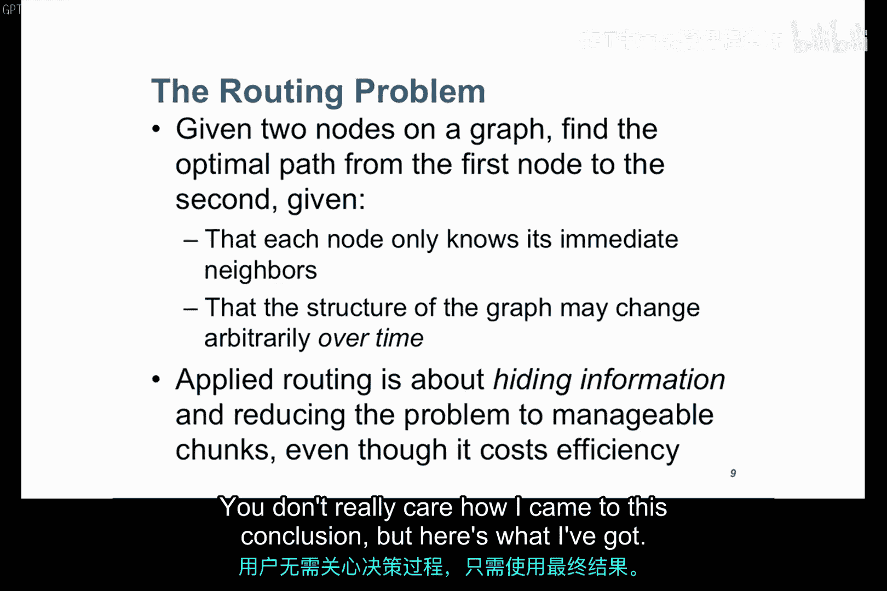

# 017：基础路由问题解析 🧭

在本节课中，我们将要学习网络路由的基本问题。我们将探讨路由在网络体系结构中的位置、为何需要路由，以及当今网络所采用的一般路由方法。理解这些基础概念是后续深入学习复杂路由协议的前提。

## 路由在网络中的位置

上一节我们介绍了课程概述，本节中我们来看看路由在网络模型中的具体位置。

你已经了解左侧的OSI模型。协议栈的每一层都依赖于其他各层正确执行其功能。例如，我们访问网页时，数据流是HTTP over TCP over IP over Ethernet over twisted pairs。每一层都必须正常运行，其上层才能正常工作。没有TCP，就无法运行HTTP。

为了帮助你理解，你也可以参考左侧的TCP/IP模型视图。路由在OSI模型的网络层或TCP/IP模型的网际层进行处理。

因此，本模块我们将主要关注和讨论这一层。

## 为何需要路由：从数据链路层说起

上一节我们确定了路由的工作层级，本节中我们来探讨为何需要路由机制。

数据链路层是第二层，它倾向于采用广播方式：每个主机都将数据“倾倒”到总线上，然后让其他所有主机尝试筛选出属于自己的信息。因此，**筛选出对特定主机有意义的信息**这项工作，必须在更高一层处理。

具体来说，我们需要基于该层之上的某些信息，来精确判断哪些信息对我们重要。这就是第三层——网络层（或网际层）的任务。

举例说明，假设所有设备都相互连接，彼此都能看到所有信息。如果我们有三个主机，这意味着需要三条连接。假设每台主机都与所有其他主机相连。

当我们加入第四个主机时，就变成了4台主机，需要6条连接。再加一台，就是5台主机，10条连接。如果持续这样增加，最终我们会得到 `n` 台主机对应 `(n² - n) / 2` 条连接。显然，让每台主机都与其他所有主机直接相连是不可行的。

更重要的是，存储每条独立连接的信息也根本行不通。我的电脑上可没有 `2³²` 个物理端口（这里指的是物理接口，而非TCP端口）。这非常困难，效率极低。

因此，我们需要一种方法将信息分组聚合，让设备能够判断自己连接了什么，并能根据连接情况将信息传递到正确的位置。

## 路由的核心思想：间接传递

上一节我们看到了全互联的不可行性，本节中我们来看看路由是如何解决这个问题的。

正确的工作方式应该是：当有人问“谁能把这条信息送到某个不同地点”时，必须有人“举手”或者说：“别担心，我知道它在哪，我会把它送到那里。”这就是路由的核心理念。

你不需要知道到达每个地点的确切路径，你只需要认识某个能说“我知道在哪，我会让它离目的地更近一步”的人。

于是我们最终得到的是类似这样的连接图：并非所有设备都相互连接，但存在许多能形成有效路径的连接。

如果左上角的设备需要发送信息到左下角，我们不必向所有人广播。我们只需以某种方式询问：“嘿，你知道这个地址在哪吗？”而知道答案或能将信息传递到下一个更接近目的地的设备，会自动响应，接过信息，并重复这个过程，直到信息到达最终目的地。

我们无需包含所有无关节点，只需包含那些重要的节点。此外，仅仅因为某条信息一次经过了某个节点，并不意味着所有信息都必须经过那里。我们可以在第二跳就做出主动选择，根据对该跳最有利的情况来路由信息。

## 路由问题的普遍性

上一节我们描述了路由的基本思想，本节中我们来看看这个问题并非网络层独有。

这不是本层独有的问题。SMTP（简单邮件传输协议）也处理同样的问题。DNS（域名系统）也有类似问题：你的本地DNS缓存服务器并不知道互联网上每一个域名和IP地址的对应关系，它只知道一部分记录，并且知道去哪里获取特定域名的更多信息。

大多数P2P（点对点）协议也有这个问题。当你研究像Pastry这样的协议时，这个问题尤其有趣，它们大量处理节点集合的本地化并优化路由，其原理是相通的。

## 路由问题的形式化定义

上一节我们看到了路由问题的普遍性，本节中我们将其形式化。

给定一个图中的两个节点，我们需要找到从第一个节点到第二个节点的最优路径。前提是：每个节点只知道它的直接邻居，并且图的结构可能随时间任意变化。

人们不喜欢思考这一点，但有一个简单的事实：互联网是不断变化的。事实上，我以前常开的一个玩笑是问别人：只要有足够的航空里程和一把镐，我就能把澳大利亚从地图上“抹掉”，这是真的还是假的？如果我去那里，开始破坏每一条通往澳大利亚海底的主要物理光缆，在我切断每一条线路时，BGP（边界网关协议）将允许我们绕过这条我刚切断的“大管道”进行路由。所以，这基本上是一个自愈系统，它不一定以最佳方式愈合，但会以一种能工作的方式愈合。

关于这一点还有另一个方面：除了物理问题，我们也可以将其应用到商业层面，来处理诸如大型电信公司这样的情况。它们被允许声明：“通过我路由信息，我将收取X美元。”如果你作为一个电信公司，可以选择通过一个收费50美元的节点和一个收费10美元的节点来路由，你很可能会尝试构建一条路径，让人们更多地通过那个10美元的连接，而不是50美元的。

当然，也存在必须使用50美元连接的情况，因为那个10美元的节点无法处理、不知道路径，或者没有到你目的地的有效路径。在这种情况下，你仍然需要通过那个50美元的节点。但所有这些细节都对用户隐藏，几乎对所有人都是透明的。

它最终归结为：这是我得到的路径。你并不真正关心我是如何得出这个结论的，但这就是我得到的，请随意使用。

## 总结

本节课中我们一起学习了网络路由的基础问题。我们明确了路由工作在OSI模型的网络层或TCP/IP模型的网际层。我们探讨了由于全互联网络在物理连接和信息存储上的不可行性，从而引出了路由的必要性。路由的核心思想是间接传递和路径选择，每个节点只需知道如何将信息送到“下一跳”。我们还看到路由问题具有普遍性，不仅存在于网络层，也出现在SMTP、DNS和P2P协议中。最后，我们将路由问题形式化为在一个动态变化的图中寻找最优路径的问题，并理解了互联网路由具有自愈和基于策略（如成本）进行选择的特性。