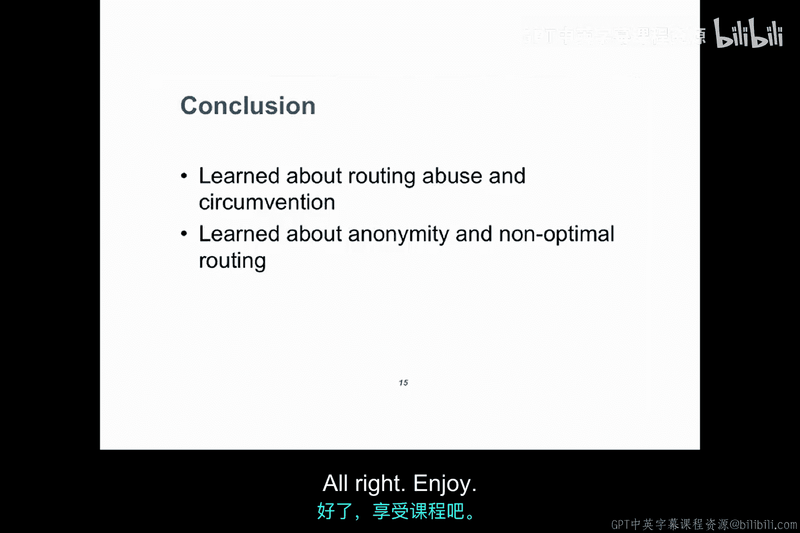

# 019：路由协议滥用行为 🛣️

在本节课中，我们将学习路由协议滥用行为。我们将探讨一个由路由配置错误引发的真实全球性故障案例，并了解如何将路由协议的原理用于非效率目的，特别是实现匿名通信。

## 路由协议的社会性与潜在风险

上一节我们介绍了网络维护者之间通常存在一种协作关系。本节中我们来看看当这种关系失效时，会发生什么。这正是互联网发生大规模破坏性事件的开始。

边界网关协议（BGP）在很大程度上依赖于社会信任，其内置的安全机制并不多。BGP协议本身并不运行，而是由路由器来运行。为了与另一个组织建立有意义的BGP连接，通常需要签署某种商业协议。

这意味着存在一个纸面上的记录。然而，它仍然可能被滥用，原因在于互联网是一个全球性媒介，一旦超出特定区域，这种“纸面记录”就可能变得不可靠。

## 案例分析：巴基斯坦YouTube封锁事件 🚫

接下来，我们来看一个具体的例子。在2008年，巴基斯坦决定在国内屏蔽YouTube的内容。他们的想法是在路由层面进行封锁，因为如果只是简单地屏蔽网站，用户很容易通过代理服务或加密通道等方式绕过。

以下是他们采取的方法：
*   YouTube宣布了一个IP地址块：`208.65.152.0/22`。
*   巴基斯坦电信（Pakistan Telecom）宣布了一个更具体的`/24`子网，并将其重定向到一个“黑洞”。
*   根据BGP的“最长前缀匹配”原则，更具体的路由（`/24`）会优先于较宽泛的路由（`/22`）。
*   结果，全球其他自治系统开始将所有发往YouTube的流量路由到巴基斯坦。

为什么这会演变成全球性问题？这是因为巴基斯坦电信的上游路由器没有过滤这个错误的路由宣告。他们的上游提供商也没有阻止它，导致这个错误信息在全球传播。

在美国和欧洲，发生此类问题时通常有现成的处理机制，因为上游提供商之间会相互沟通。但在当时，亚洲地区的网络互联相对较新，相关方未能与更广泛的社区进行有效沟通，导致一个本地行动引发了全球性后果。

目前，对于这类问题并没有完美的解决方案。尽管存在一些安全增强方案，但它们尚未被广泛采纳为可行的协议。

## 非最优路由：匿名通信的应用 🕵️

现在，让我们来谈谈匿名性。这是一个人们将路由协议用于其最初设计目的之外的典型例子。

首先，我们需要了解一个核心概念：**匿名集**。匿名集是指一群无法被区分开的个体。例如，如果你是霍普金斯大学的学生，你的匿名集规模可能是数千人；而如果你只是某门特定课程的学生，匿名集可能就只有20人左右。匿名集越大，匿名性就越强。

过去20年，人们在创建匿名消息系统方面做了大量工作，传统上是为了防范国家层面的监控。所有这些系统的基石都是**混合网络**。混合网络也是一种路由网络，但其转发目的不是为了效率，而是为了迷惑观察者。

经典的混合网络由David Chaum在论文《不可追踪的电子邮件、返回地址和数字假名》中定义。其核心思想是，网络中的节点对消息进行逐层加密和签名，消息在到达最终目的地前被逐层解密和验证。

为什么将电子邮件和路由相提并论？因为电子邮件和路由都是路由协议，在这方面它们非常相似。广义上说，混合网络与电子邮件的区别在于延迟。混合网络大致分为高延迟和低延迟两种。电子邮件属于高延迟系统。

最著名的低延迟匿名系统例子是**Tor**（洋葱路由器的简称）。它是最流行的匿名网络。Tor在TCP层之上增加了一层额外的路由。其工作原理是进行多层加密。

以下是Tor的基本工作流程：
1.  发送方将消息用最终目的地的公钥加密。
2.  然后，为路径上的每一个中间节点（中继）再包裹一层该节点的公钥加密。
3.  消息像洋葱一样被层层包裹，然后发送出去。
4.  路径上的每个中继依次解密属于自己的一层，以获知下一跳地址，然后将剩余部分转发出去。
5.  直到最后一层被解密，消息才到达最终目的地。

Tor有效吗？是的，但它也存在一些弱点，例如出口节点可能被监控，且运行出口节点需要勇气。Tor的主要问题在于，它承诺的是匿名性，而非隐私性。如果用户行为不当，仍然会暴露身份。

使用Tor时需要注意以下事项：
*   不要访问你通常使用的网站。
*   不要使用Cookie。
*   注意DNS解析可能泄露信息。
*   不要在Tor上登录个人账户（如Facebook），这等于直接暴露身份。
*   用户的其他行为也可能破坏匿名性。

Tor并非唯一的混合网络。还有其他替代方案，例如：
*   **Freenet**：一个作为托管系统开发的高延迟网络。
*   **Crowds**：由我论文导师开发的系统。
*   **Mixmaster**：另一个高延迟匿名邮件系统。

## 总结 📝

本节课中，我们一起学习了路由协议滥用行为。我们首先分析了一个因BGP路由配置错误和缺乏协调而导致的全球性网络中断案例。接着，我们探讨了如何将路由原理应用于匿名通信，重点介绍了混合网络的概念以及Tor系统的工作原理。

关于匿名性的关键点在于，它并非最优路由。路由的目的是尽可能高效地从A点到达B点，而匿名性的目的是迷惑观察者，让他们无法弄清你的去向。理解这种根本区别，对于分析网络协议的不同应用场景至关重要。