# 021：匿名性的形式化模型 🕵️

在本节课中，我们将学习匿名性的核心概念与形式化定义。我们将探讨匿名性的目标、实现方式以及相关的关键术语，如匿名集、K-匿名性和混合网络。通过本模块，你将掌握讨论和分析匿名性问题的基本词汇和框架。

---

## 匿名性的定义与重要性

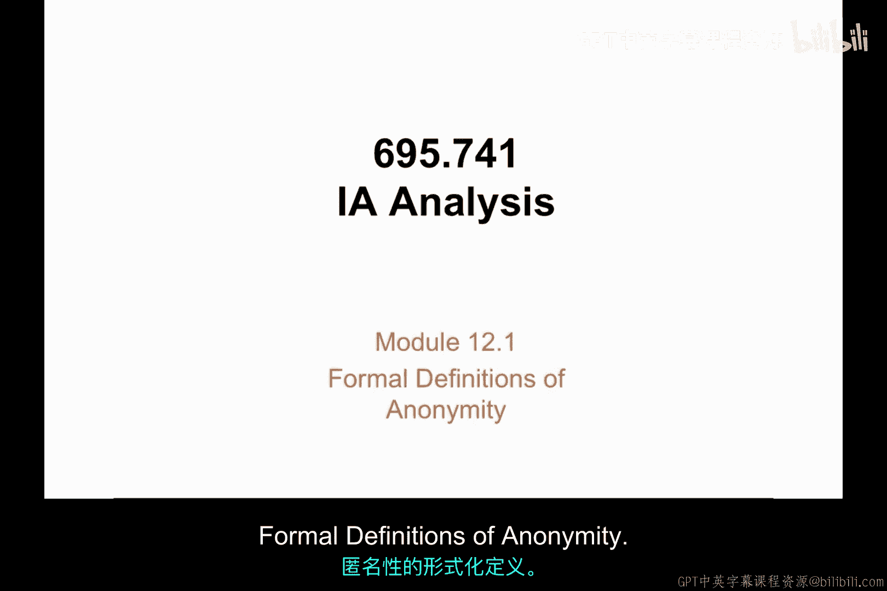

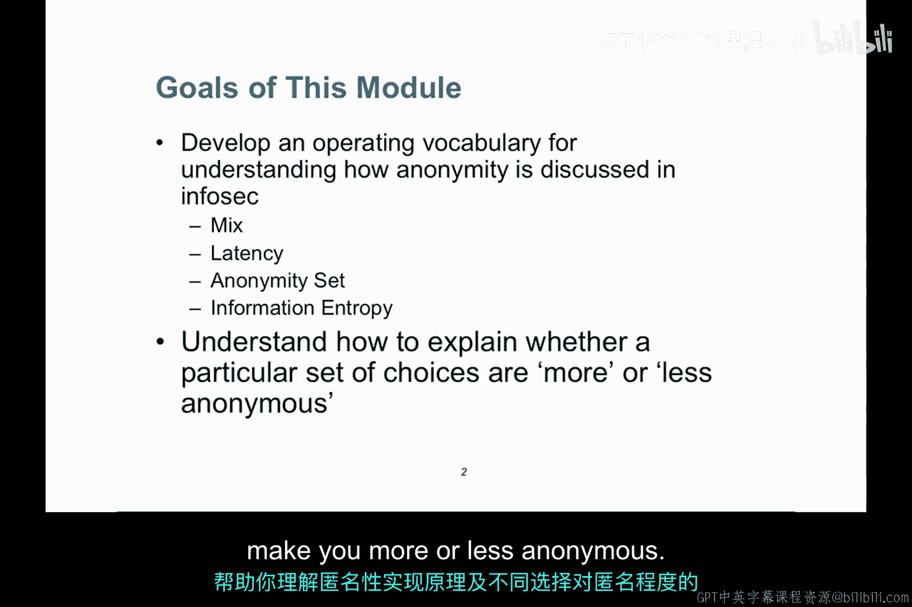

匿名性是计算机安全研究中最受关注的主题之一。例如，在主要的学术会议“IEEE安全与隐私研讨会”（又称奥克兰会议）中，作为隐私一部分的匿名性扮演着重要角色。

有多种术语用于描述匿名性，包括“混合网络”。混合网络有其特性和意图达成的目标，并且存在多种方式来实现我们想要的匿名性。我们将逐一讲解这些内容，以便你理解匿名性是如何实现的，以及特定的选择如何影响匿名性的强弱。

为了理解匿名性，最好从回顾“检察官谬误”开始。如果你不记得了，这是在课程早期讲过的内容。检察官谬误是一种常见的统计错误，其假设是：因为两个事件各自都很罕见，所以它们同时发生的概率就异常之低。

一个经典例子是萨莉·克拉克案。她被指控谋杀了自己的孩子，而指控她谋杀了第二个孩子的论据是：她的第一个孩子死于婴儿猝死综合征，第二个孩子也死于婴儿猝死综合征。因此，检察官将单个孩子死于SIDS的概率自乘，并声称这个概率小得离谱。然而，如果比较那些有过孩子死于SIDS的家庭，他们第二个孩子死于SIDS的概率会更高。这些事件是相关的，而非独立事件。

**这个概念中的“群体”或“实体集合”正是我们在讨论匿名性时需要关注的核心。**

---

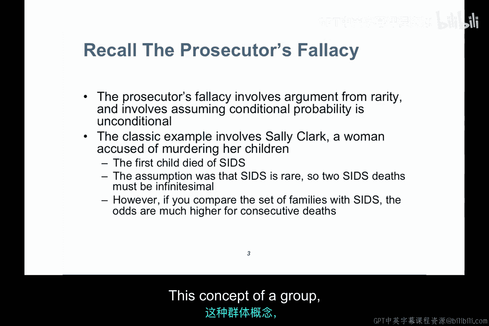

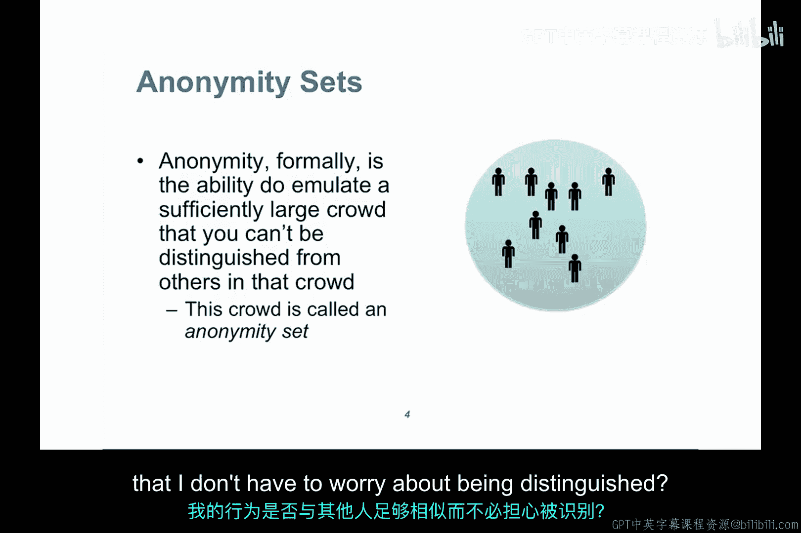

## 匿名集与去匿名化

我们形式化讨论的匿名性，是指能够模拟一个足够大的群体的行为，从而无法从该群体中的其他成员中被区分出来的能力。这个群体就是我们所说的**匿名集**。

我们如何定义这个“群体”呢？实际上，我们谈论的是收集到的数据。例如，如果我观察一组使用网络流量的人群，我的行为是否与其他人足够难以区分，从而不必担心被识别出来？

**去匿名化的过程**涉及将匿名集分解为更小的子集。

例如，如果我们不仅仅看网络流量，还查看照片，或者建立一个系统来识别所有戴水果帽的人（就像我在这个演示中使用的那样）。去匿名化的策略就是找到这个集合，并将其分解成更小的集合，找到我们可以用来识别和描绘个体的特征，最好能精确到个人。

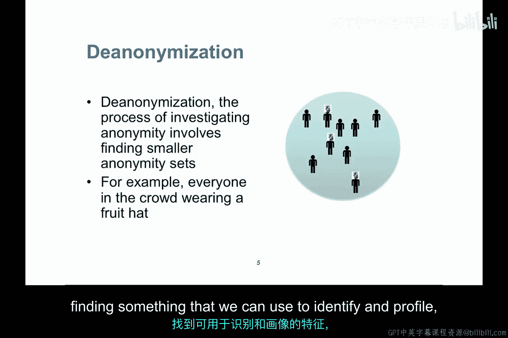

数据库设计中有一个类似的概念，叫做**K-匿名性**。我之前描述的匿名性与K-匿名性的区别在于：前面的匿名性是一种**行为**，而K-匿名性是一个**目标**，是数据库内部的一个设计标准。

其目标是：如果数据库中某些字段的组合可以用来识别某人，那么对于该字段组合的每一种取值，数据库中至少应有**k**个对应的记录，以确保个人无法通过该字段组合被唯一识别。

例如，如果我们记录头发颜色和食物偏好这类信息，对于这些特征的每一种组合，我们至少应有k个实例，以确保我们无法通过该组合指向特定的个人。

---

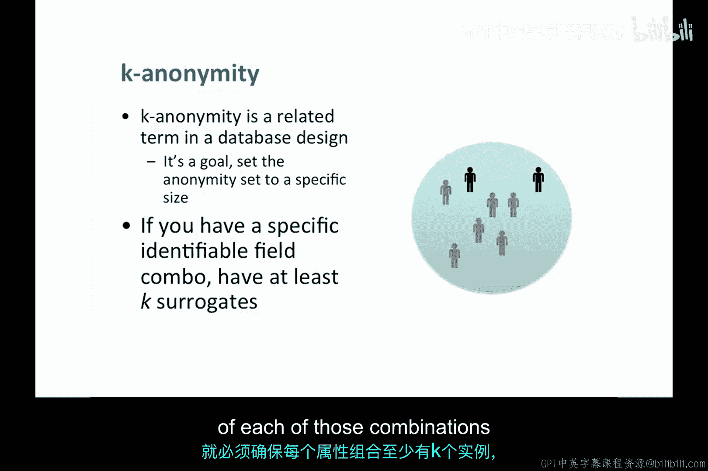

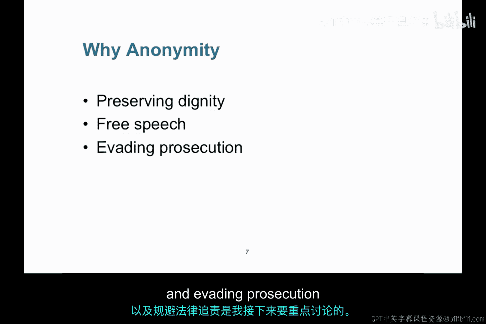

## 为何需要匿名性？

这自然引出一个问题：我们为什么需要匿名性？原因多种多样，目前我将重点讨论以下三个：维护尊严、保障言论自由和规避起诉。

*   **维护尊严**：在这个语境下，我希望你思考的是，可能存在关于你的尴尬信息，或者可能让你丢掉工作、丧失社会地位的信息。这并不一定意味着你是坏人、罪犯或类似的人。只是意味着，如果有人有足够的动机去调查数据库，他们可以通过各种方法找出人来识别个体。有一篇由S. Schmaticco和Naya撰写的论文（我已放入阅读材料），他们能够通过人们的Netflix偏好来识别个体。一个更明显的例子是医疗记录：你可能不希望别人知道你患有什么疾病，如果这不关他们的事。

*   **保障言论自由**：关于这一点，我持保留态度。这通常是匿名化系统的常见论点，但我并不完全相信这些系统能达到宣称的效果。我并非不同意这种观点，而是质疑其结果。像Tor和Freenet这样的工具（我们稍后会讨论）被设计用于抵抗审查，这意味着使用者可以在没有恐惧的情况下进行交流。然而，也有失败的案例，比如大约两年前发生的一个涉及名为Hastack的系统的著名灾难，我们也会提及。

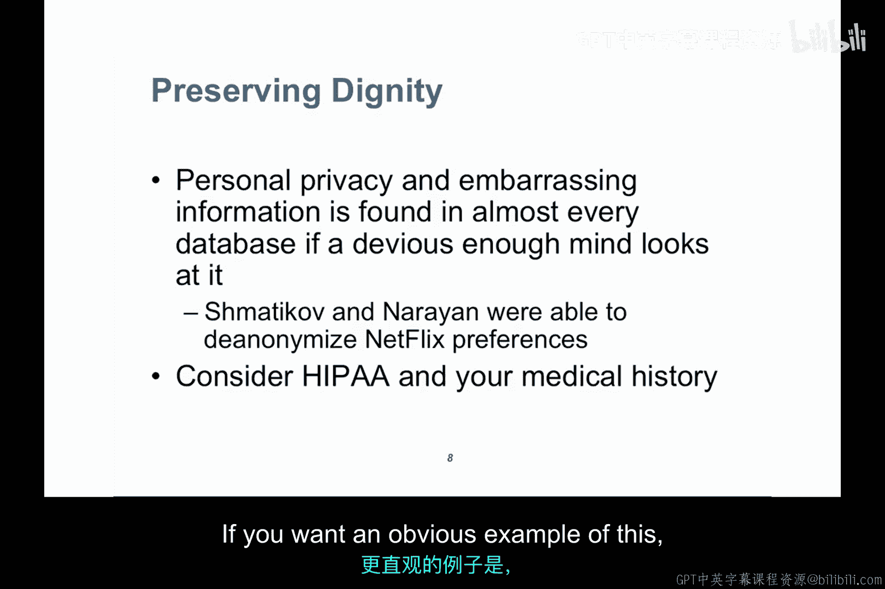

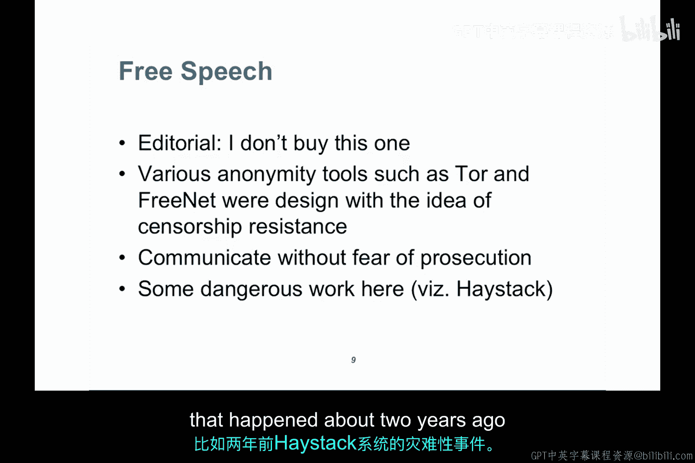

*   **规避起诉**：这不是一个价值判断，但匿名工具是技术工具，是软件，它们不做价值判断。因此，它们既能被用来规避伊朗的法律，也能被用来规避美国的法律。因此，使用这些工具的人目的各异。右边这张图片是一个名为“丝绸之路”的Tor隐藏网站。这是一个除非使用Tor否则无法访问的系统。Tor是一种旨在使你的网络流量无法追踪的路由系统。“丝绸之路”更进一步，它结合了Tor和一个名为比特币的匿名电子货币系统，以保护用户的匿名性。

---

## 如何实现匿名性？

如前所述，匿名性是通过生成一个**匿名集**来实现的。K-匿名性是数据库设计中实现这一目标的标准，但在网络流量中，这通常通过我们称之为**混合网络**的东西来实现。

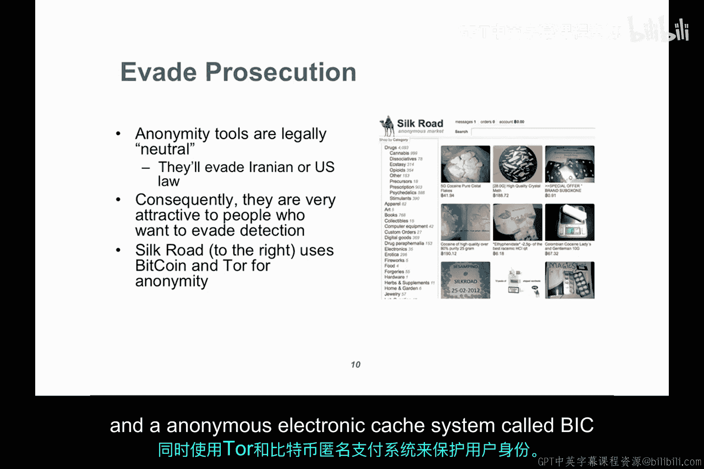

混合网络是一组在网络中转发流量的路由器集合。在这里，“路由器”不一定指BGP路由器。最早的混合网络系统源于David Chaum在80年代初的工作，完全是基于电子邮件的。事实上，电子邮件路由是第一种匿名通信形式。

**混合路由与经典路由的关键区别**在于：混合路由专注于通过不可预测的路径发送流量以混淆追踪者；而经典路由追求最短路径。混合路由则故意将流量发送经过多个系统，使其难以追踪。

传统上，混合网络根据性能分为两类：高延迟和低延迟。这实际上是一种简化的说法，用来描述用户使用时是否会感到抓狂。

*   **高延迟混合网络**：类似于电子邮件，流量以自己的节奏发送，你无法准确预测它何时到达。如果你在等待邮件，你可能需要等上一段时间。
*   **低延迟混合网络**：旨在支持像网页浏览这样的活动。因此，低延迟混合网络会足够快地发送流量，以使系统可用。网页浏览往往是这类系统的典型用例。

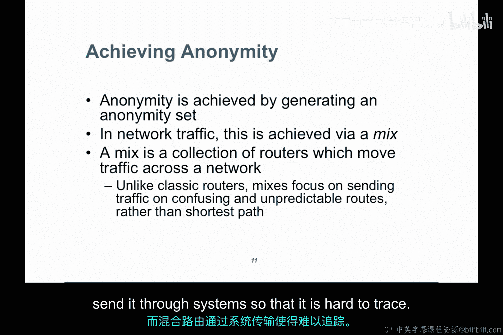

除了这个普遍的延迟要求，你还应该记住，匿名性工具通常不优先考虑**性能**。事实上，这里存在直接的权衡。匿名性系统的目标是打乱数据包，使用户无法被追踪。这意味着它们会采用更长的、不可预测的路径。为了设计一个有效且可用的系统，你需要在匿名性需求和可用性之间取得平衡。

匿名性面临的最大问题是**熵**。熵是信息论中结构性的度量，它描述了数据中包含多少信息。经典地，当我们谈论熵时，我们指的是香农熵。香农熵是**可压缩性**的度量。如果信息是结构化的，有很多重复的模式，那么该信息的熵就低，易于压缩，并且你会发现其中有很多可以识别和提取的特征。

你在密码学中遇到过这个概念。密码学的目标是让数据看起来像随机噪声，看起来是随机的。如果它是随机的，它就是高熵的，这就是为什么加密数据难以压缩。而互联网数据通常是结构化的，这意味着它的熵较低，各种特征出现的概率较高。

---

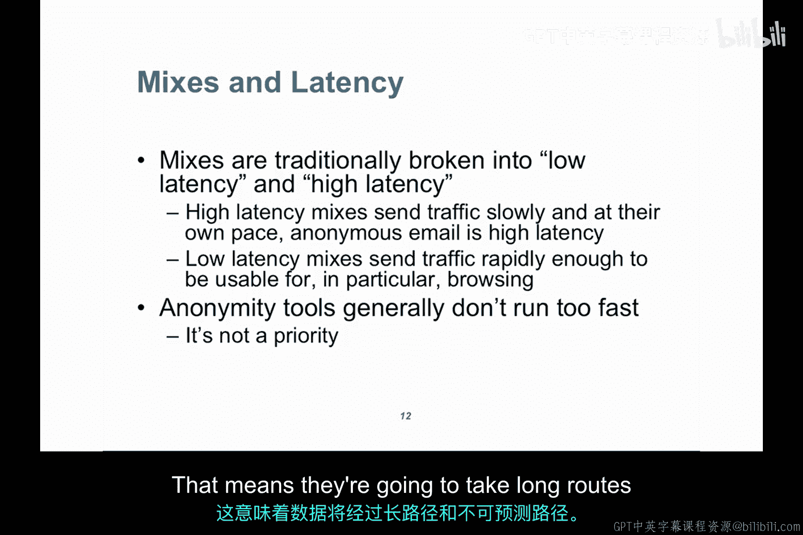

## 总结

本节课中，我们一起学习了匿名性的核心概念：匿名集、延迟和混合网络。

*   **匿名集**是我们描述某事物是否匿名的工具。集合越大，匿名性越强。
*   **延迟**是匿名性工具的一个质量属性。它意味着你通过牺牲速度来换取匿名性。延迟反映了信息通过系统的速度以及系统对用户的可用性。
*   **混合网络**是我们用来实现匿名性的主要工具。

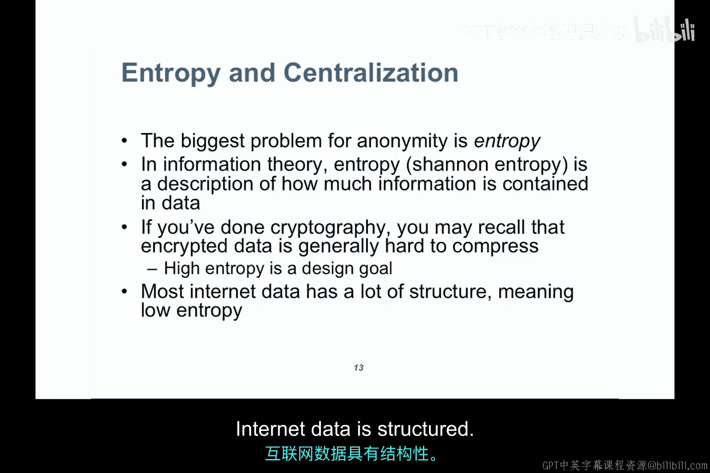

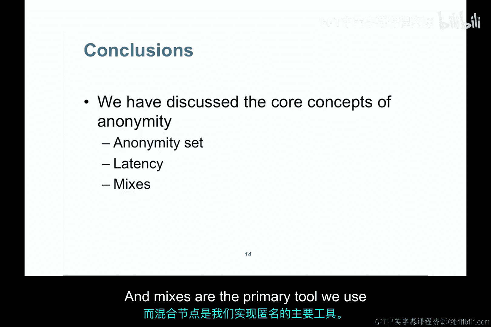

理解这些概念是分析和设计匿名性系统的基础。