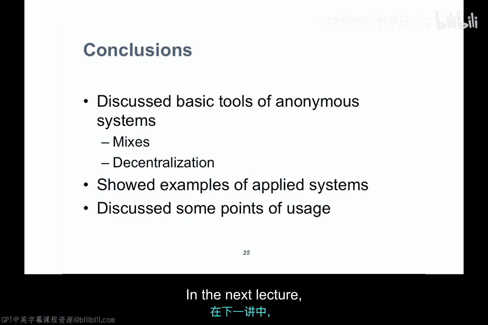

# 022：混合节点与分布式哈希表 🔐

在本节课中，我们将学习匿名化系统中的核心工具：混合节点网络和分布式哈希表。我们将探讨它们的工作原理、历史背景以及在实际系统（如Tor和BitTorrent）中的应用。

## 概述

互联网在设计之初并未将匿名性作为核心原则，这导致了一些固有的匿名性缺陷。为了应对这些挑战，研究人员开发了混合节点网络和分布式哈希表等工具。本节将详细介绍这些工具，并分析它们在保护用户隐私方面的作用与局限。

## 互联网的匿名性基础

上一节我们介绍了课程背景，本节中我们来看看互联网匿名性的基础。互联网协议本身对匿名性漠不关心。这意味着，虽然存在一些固有的匿名性，但这更多是设计疏忽而非有意为之。例如，在IP地址查找练习中，我们能够确定IP地址的归属和名称。此外，多年前的“追溯”技术试图定位攻击源，但效果有限。因此，互联网内置的匿名性非常薄弱。

同时，中心化结构也严重限制了匿名性。例如，在浏览网页时，几乎每个页面都会与Google或广告网络通信，这使得保持匿名变得异常困难。

## 匿名性研究的兴起

在20世纪90年代中期，匿名性成为一个焦点问题。当时，密码学和匿名性研究，尤其是美国国防部资助的研究，取得了巨大进展。此外，一个名为“密码朋克”的邮件列表汇集了持有自由意志主义观点的人士，他们相信通过高级密码学可以保障个人自由。

这一时期还发生了许多事件。例如，匿名转发服务器与山达基教会之间的冲突，成为了一个典型案例。该服务器因泄露教会认为受版权保护的信息而被关闭。这个例子揭示了一个关于匿名性的普遍观察：**单一解决方案存在脆弱性**。

## 混合节点网络

为了解决单一节点的脆弱性，传统上我们使用混合节点网络。混合节点网络是一个由路由转发系统组成的网络，它们转发流量而不记录来源。混合节点的原始概念由David Chaum在1981年的一篇论文中提出。其核心思想是：通过混合节点对数据进行洗牌，使得数据来源变得不可追踪。

混合节点的功能不仅限于路由。它们通常会对信息进行加密。因此，当你从点A开始时，你将消息加密发送到点B。如果你不在点B且没有密钥，你就无法解密消息。

经典的混合网络由Chaum定义，而密码朋克则根据一系列属性对混合节点进行分类：
*   **类型1混合节点**：剥离传输数据。这意味着它会从电子邮件消息中删除SMTP头部等信息，使消息看起来像是直接从该转发器或投放点发出的。
*   **类型2混合节点**：这是经典的Chaum混合节点，特别是名为Mixmaster的系统。
*   **类型3混合节点**：这是Chaum系统的改进版本，称为Mixminion，它增加了各种技术来防御原始设计后发现的各种攻击。

需要注意的是，混合节点大致分为高延迟和低延迟两种。高延迟混合节点不关心你何时收到信息，而低延迟混合节点则有性能约束。

## Tor：洋葱路由

在讨论了混合节点的分类后，我们来看看最成功的混合网络：Tor。Tor是历史上最流行、最成功的混合节点网络。它最初由Paul Syverson等人进行数学开发，实际实现则由Roger Dingledine和一个名为Tor Project的团队完成。

Tor是一个低延迟网络，你可以用它浏览网页，许多人确实这样做。它在某种程度上用我们所说的洋葱路由取代了传统路由。更准确地说，它在传统路由之上提供了洋葱路由。

让我们谈谈Tor实际如何工作。你从一开始就生成整个路由：获取入口节点，从Tor可用的节点中选择路径。你可能不知道完整的节点集合，但你知道一个足以让你连接到出口节点并进而接入互联网的子集。你在构建连接时就决定了路由。这与经典的路由器逐跳决定路径不同，你提前知道所有这些信息。你提前知道这些信息的原因是你将逐步加密信息，这就是洋葱路由。

洋葱路由的工作原理是结合转发和加密。当你创建消息时，你使用目标站点的公钥对目的地信息进行层层加密。然后，目标节点解密该信息并重复该过程。例如，如果我要经过A、E到H，那么我首先用H的公钥加密我的消息，并说明要发送给H。然后，我将这个结果用E的公钥加密，并包含发送给E的指令。重复这个过程，最后用A的公钥加密并发送给A。A依次剥离外层加密，它只知道有一个必须发送给E的数据包。E收到消息后，解密其外层，发现它是一个只能发送给H的加密数据包。只有H能理解里面的内容。因此，例如，如果我攻破了E，我无法查看消息，因为它是为H加密的。唯一能解密该消息的实体是H。我实际上能读取消息的唯一方式是攻破H本身。

Tor有效吗？Tor存在几个问题。最臭名昭著的是出口节点流量。多个出口节点的运营者曾被逮捕。运营出口节点的大学经常需要与警方沟通。不过，可能最重要的一点是，你必须规范自己的行为才能保持匿名。你不能访问你通常访问的站点，你需要担心DNS解析，不能使用可能泄露身份的Cookie或运行间谍软件。你最好在一台干净的机器上做这些。对于大多数用户来说，这是一个不小的主要挑战。他们设置了Tor访问，但第一件事就是去有Facebook的网站，结果发现他们的Facebook Cookie还在，这就泄露了身份。

此外，还开发了多种攻击Tor的技术，包括基于时间的攻击和涉及有限节点妥协的技术。我们将在后续课程和部分作业中更详细地讨论这些。

## 分布式系统与点对点网络

关于匿名性需要记住的是，Tor并非唯一方案。从90年代中期至今，为了应对各种挑战（如前文提到的山达基教会事件和Napster），人们构建了多种系统。这些系统的共同原则包括：**服务去中心化、服务复制和加密**。

匿名性变得重要的一个原因是Napster被关闭。Napster是第一个点对点文件共享（主要是音乐）应用程序，出现在90年代中期。在Napster之后，开发了包括Gnutella、Tor以及名为Winny的日本系统等一系列文件共享工具。这些系统通常因为依赖中心点而被打击。例如，Napster依赖一家公司，Gnutella和Winny有核心服务器。BitTorrent使用追踪器和对等节点，正如我们将讨论的，如果这些追踪器被关闭，可能会破坏部分网络。许多系统都是通过拔除中心控制节点而被阻止的。

## 分布式哈希表

在讨论匿名性或保护系统时，我们必须做此免责声明：我们暂且搁置自由问题。盗版是非法的，文件共享很可能涉及隐私。正因为如此，用户对不被追踪越来越感兴趣。这对我们来说是个问题，因为用户现在越来越积极地希望保持其所有流量的匿名性。我们想要防御这个问题，但从用户的角度来看，我们是“内部警察”，所以他们不会向我们透露他们在做什么。知识产权问题可能非常严重。

一个有趣的例子是日本维基百科和英文维基百科的对比。如果你访问日本维基百科，你会发现几乎没有图片，几乎全是文字。这是日本知识产权法严格规定的结果。在美国，你必须积极维护版权；在日本，你只需主张权利，不维护也不会损害权利。但结果是，在日本，维基百科页面上不放任何图片，而美国维基百科则倾向于包含图片。

另一个需要记住的是，当我们再次谈论匿名性和盗版网站时，我们遇到了单点故障系统。正如法律斗争所预期的那样，这导致了爆炸性的增长。例如，当流行的种子网站Demonoid的追踪器被关闭时，意味着这些系统对保护措施感兴趣，主要是加密和去中心化。

加密相当直接，我们来谈谈去中心化，特别是称为**分布式哈希表**的路由机制。去中心化从系统中移除了中心服务器。通过这样做，当单点故障会造成损害时，它们能保持系统运行。它们通常模拟各种路由技术，最常见的形式是目前称为DHT或分布式哈希表的技术。

DHT对我来说很有趣，因为它们作为一个学术概念出现大约四年后，实际应用就出现了。在学术界，我几乎从未见过任何东西只花四年就进入外部世界。这尤其迅速地被大众采纳，原因在于这样他们就不必处理中心化带来的问题。

有多种主要的DHT，常见的有Chord、CAN、Tapestry和Pastry。这些系统通过创建一种机制来为节点分配全局ID，然后在节点上设置本地路由表以提供邻接功能，并在节点之间传递流量。其思想是，当你使用BitTorrent并连接到追踪器时，追踪器告诉你到哪里寻找文件的特定实例或文件的一部分。而使用DHT，你向网络请求搜索特定ID，网络将你传递到该ID所在的节点，而无需连接到中心追踪器。DHT用于组织信息。

一个DHT示例（Pastry）可以让你了解这些系统通常如何工作：Pastry为节点随机分配128位ID，并假设均匀分布。因此，如果你有一个节点网络，节点间的平均距离应该是2^128 / n。Pastry的工作方式是，如果一个节点ID是目标，你去找与你拥有最长共同前缀位数的节点。因此，你需要在你的节点上维护一个路由表，它为你指向那些与你有n位共同前缀的节点。这是一种路由技术，通过保持路由表较小，并假设ID均匀分布，你应该只需有限次数的搜索就能到达目标。

令人惊讶的是，这些东西已经被BitTorrent社区非常积极地采纳了。如果你下载一个当前的BitTorrent客户端（如μTorrent），你会发现首先原生加密已被支持。有趣的是，BitTorrent的发明者Bram Cohen最初反对加密，因为他认为这破坏了BitTorrent作为传输信息的合法协议的理念。BitTorrent最初是为传输红帽ISO而设计的。BitTorrent也有无追踪器功能，如果你查看，会发现它提供基于DHT的查找。像海盗湾这样的网站非常提倡使用无追踪器模式。你会发现某些BitTorrent站点只接受以无追踪器方式或使用非常规端口号进行的通信，以隐藏用户身份。

## 总结

本节课中，我们一起学习了匿名化系统的基本工具：混合节点和去中心化技术。我们讨论了这些分布式系统的工作原理，展示了一些应用这些技术的系统实例（如Tor和BitTorrent），并探讨了它们的使用要点。在下一讲中，我们将讨论为什么实现匿名性如此困难。