# 023：实现匿名性的困难 🎭

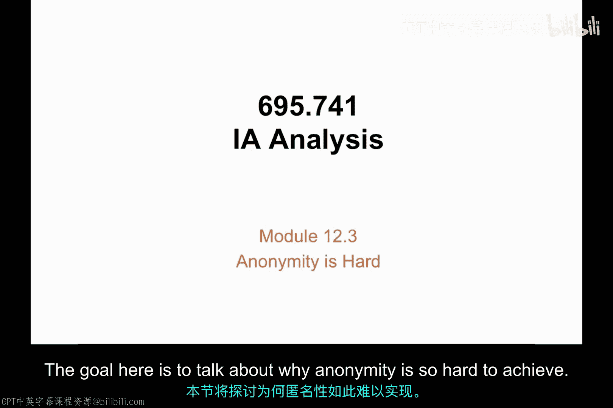

在本节课中，我们将探讨为什么实现真正的网络匿名性如此困难。匿名性长期以来都是信息安全领域部分研究者追求的目标，但事实证明，要达成这一目标极具挑战性。

## 为什么匿名性难以实现？

匿名性难以实现，一个核心原因在于，**要达成匿名，你必须以匿名的方式行事**。本模块的目标是帮助你理解这背后的原因，包括人类行为的低熵特性以及互联网服务的中心化趋势。

上一节我们介绍了匿名性的概念，本节中我们来看看具体有哪些因素使其难以实现。

## 使用Tor网络时的限制

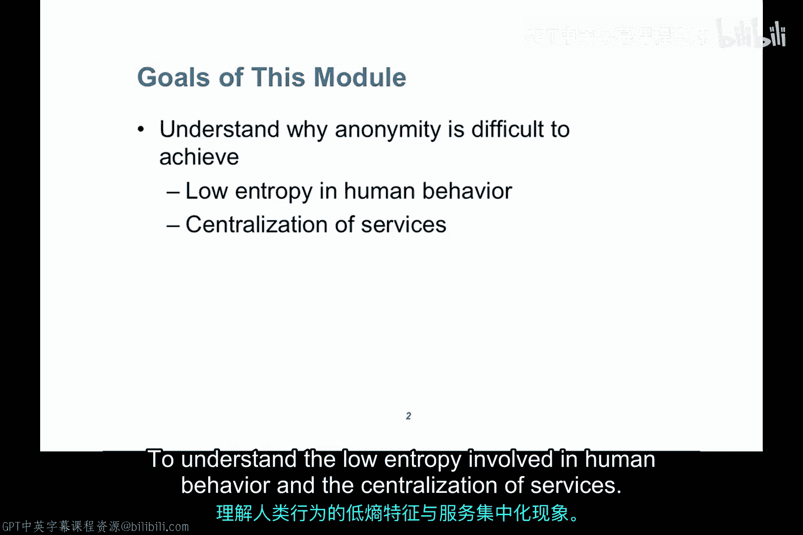

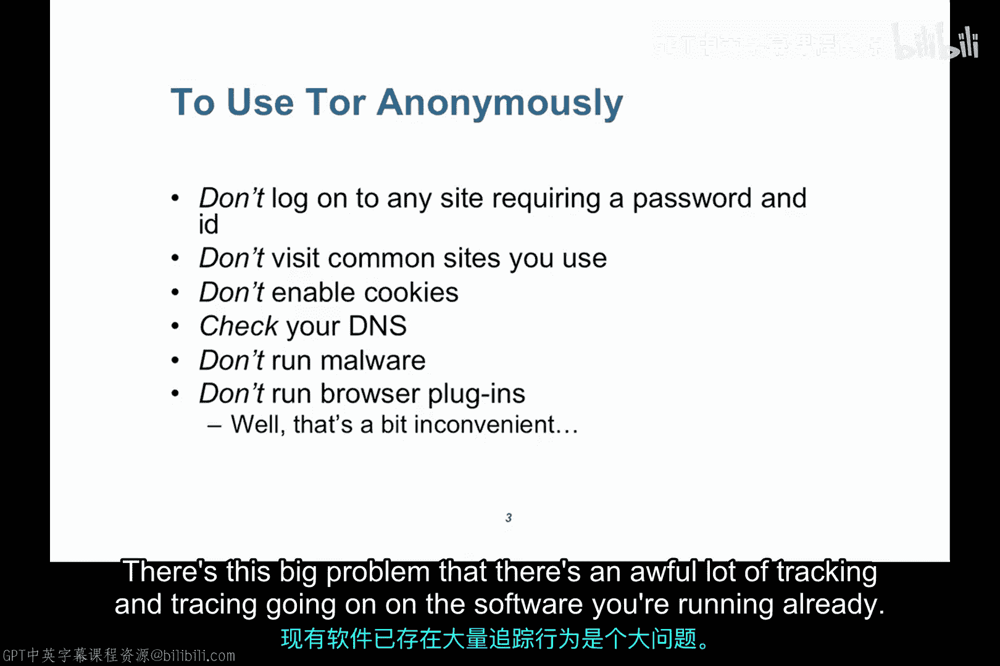

如果你想使用Tor网络实现匿名，必须遵循一系列严格的操作规范。以下是使用Tor时的一些基本要求：

*   **禁止登录**：不能登录任何需要密码和身份验证的网站。
*   **避免常用网站**：不能访问你平时经常使用的网站。
*   **禁用Cookie**：不能启用浏览器Cookie。
*   **检查DNS**：需要检查并确保DNS查询不会泄露信息。
*   **防范恶意软件**：确保系统没有运行恶意软件。
*   **禁用浏览器插件**：不应运行任何浏览器插件。

存在一个很大的问题是，你正在运行的软件本身已经进行了大量的跟踪和追踪，这使得以匿名方式使用Tor变得相当不便。

## 行为习惯会暴露身份

另一件你必须做到的事是：**你不能像平常一样行事**。计算机科学中有一个经典案例，即通过统计分析来确定《联邦党人文集》的作者身份。这些文章均以笔名“Publius”发表，实际由麦迪逊、汉密尔顿和杰伊撰写。研究发现，有多种技术可用于识别某篇文章是否由特定作者所写。

以下是几种常用的作者身份识别方法：

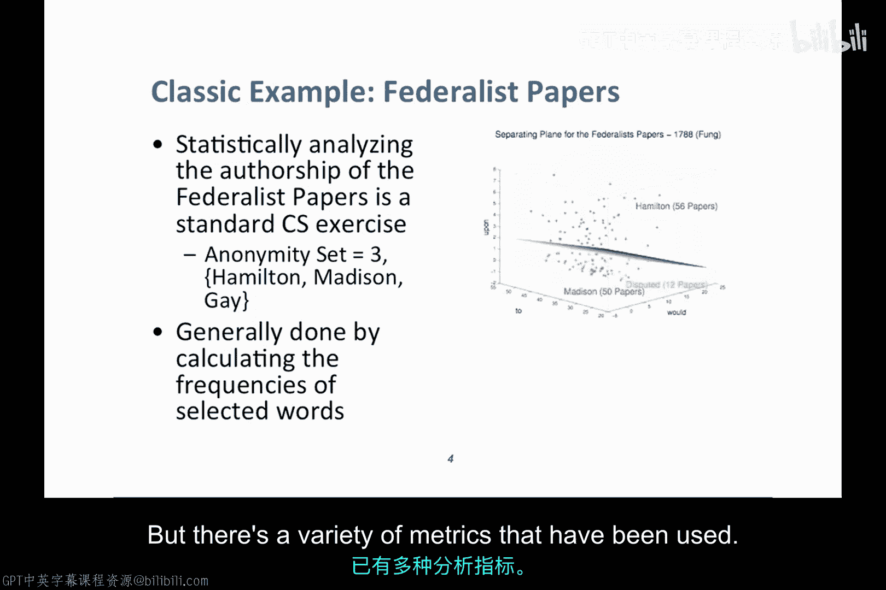

*   **词汇选择分析**：分析作者对特定词汇的偏好。
*   **语法错误分析**：统计语法错误的出现模式。
*   **词频分析**：统计特定术语出现的频率。
*   **特殊术语使用**：识别作者使用的独特术语。
*   **Hapax Legomenon（罕用语）**：指在整个语料库中仅出现一次的词语，这是翻译学中的一个术语。
*   **句子长度分析**：分析作者习惯的句子长度。

所有这些特征都是你养成的习惯，本质上构成了你的个人风格。这些习惯会标识你的身份，即使你使用了世界上最先进的路由和加密系统，也可能被用来推断出你是谁。

## 匿名性困难的根本原因

这正是匿名性困难的核心所在。匿名性之所以困难，原因主要有两点：

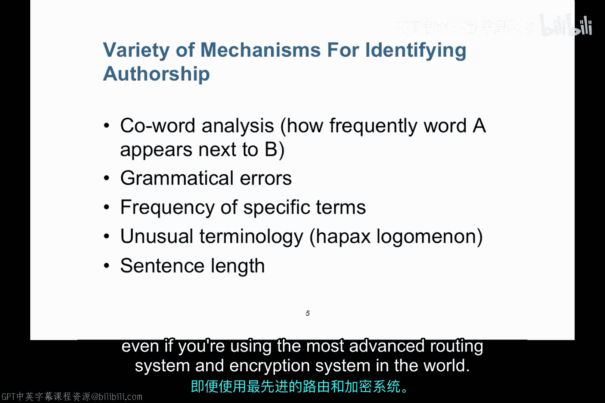

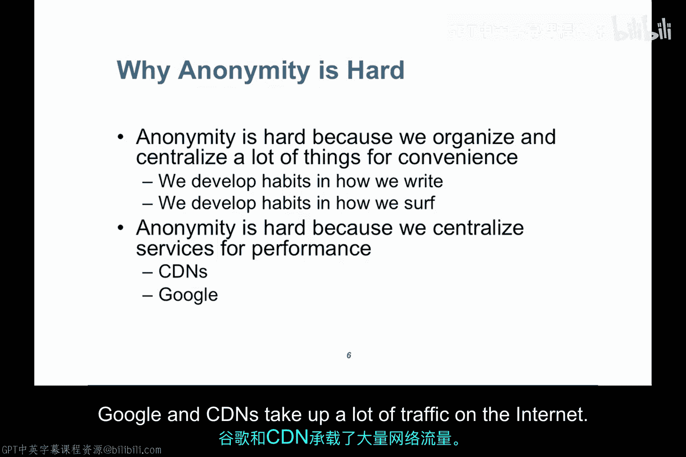

1.  **便利性与中心化**：为了让生活更便利，我们将许多服务组织并中心化。
2.  **行为习惯**：我们在写作和浏览网络时都养成了特定的习惯。例如，我每天都会访问《纽约时报》、Ars Technica和一些信息安全网站，这形成了固定的模式。

同时，为了让互联网正常工作，我们不得不将许多服务集中化。谷歌和内容分发网络承载了互联网的大部分流量，无论你做什么，很可能都在与它们通信。

## 浏览器指纹识别：Panopticlick项目

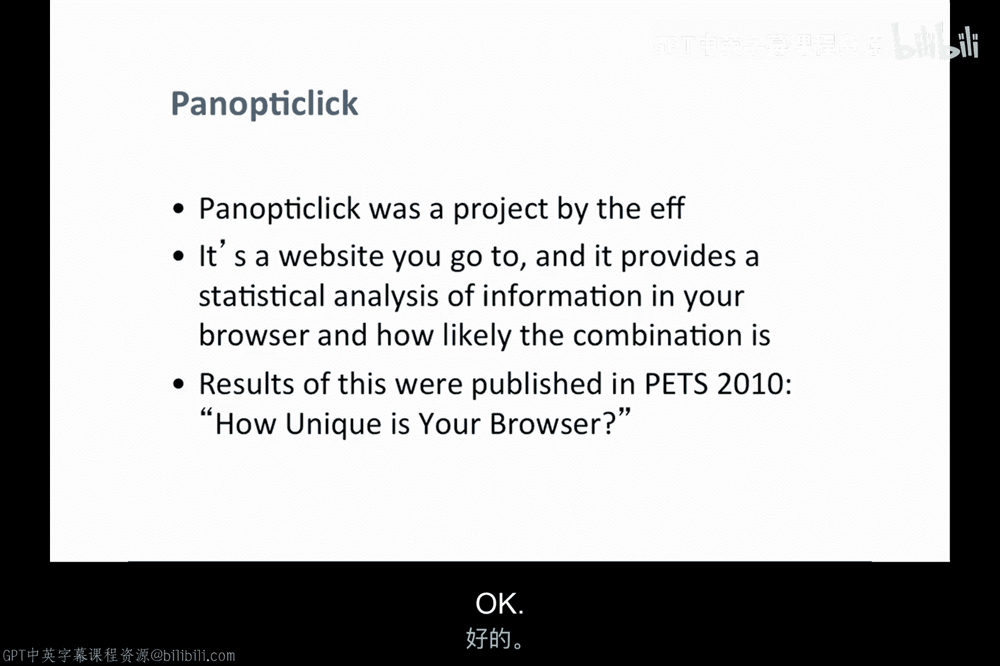

为了具体说明这一点，我们可以看看一个名为**Panopticlick**的系统。这是电子前沿基金会的一个项目，其成果发表在2010年隐私增强技术研讨会（PETS）上。

Panopticlick是一个网站，当你访问它时，它会统计分析你的浏览器配置信息。这些信息很容易被获取，Panopticlick使用了多项指标（部分需要JavaScript或用户同意才能获取）。该网站会告诉你某项配置值在你身上出现的概率、有多少浏览器可能拥有相同的值，以及该值包含多少信息熵（独特性）。

Panopticlick会检查多项浏览器配置信息，以下是其中一部分：

*   **用户代理字符串**
*   **HTTP Accept头部**
*   **浏览器插件列表**
*   **时区**
*   **屏幕尺寸**
*   **系统字体**
*   **Cookie设置**
*   **各种基于Cookie的测试**

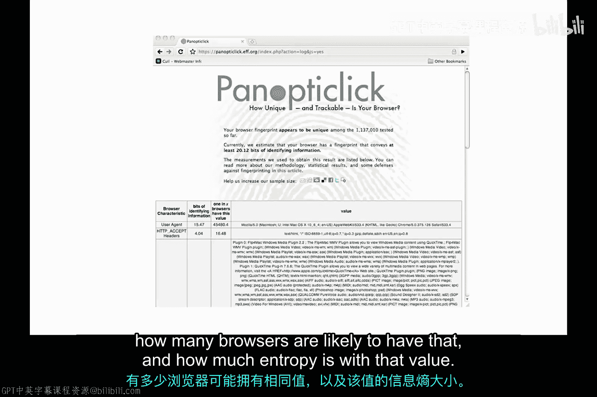

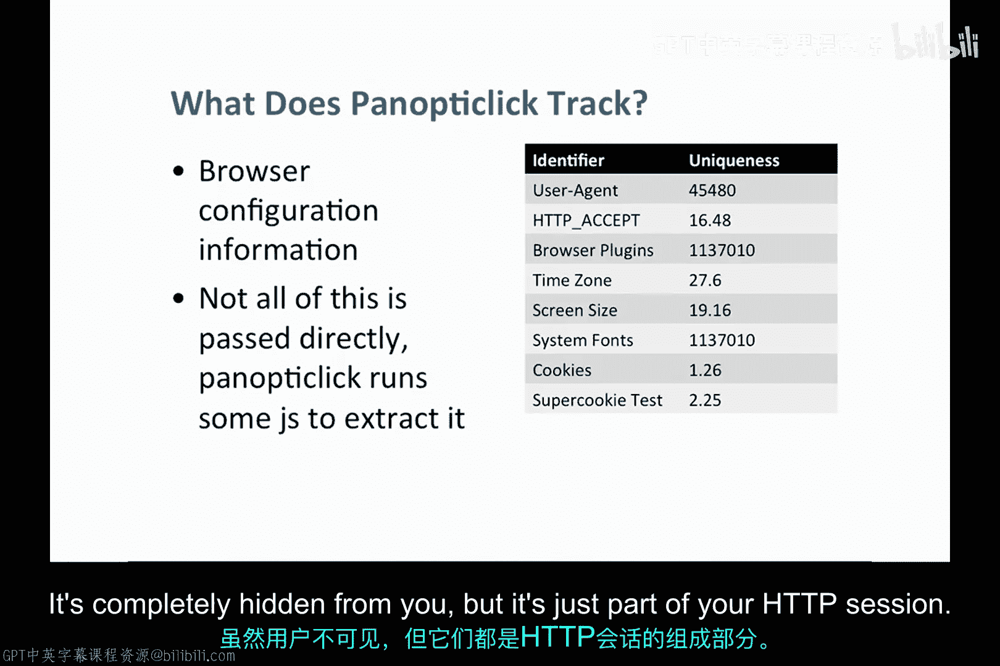

这些都是机械的配置信息，是你的浏览器为了提升用户体验而传递的。这些信息对你完全隐藏，但却是HTTP会话的一部分。

以我为例，我就因为安装了一款特定字体而变得独特。我安装了“Tengwar”字体（如果你不熟悉，它来自托尔金的作品）。某次阅读时，我想看看这种字体的效果，就安装了它。Panopticlick使用的许多识别技术正是基于浏览器插件和字体——这些你基于个人喜好安装并设置在浏览器上的东西。因此，如果你安装了一些独特或有趣的字体，它很可能被用来识别你。

## 核心矛盾：匿名性与便利性

这就是问题的关键所在。**有可能做到行为匿名，但如果你选择匿名，就意味着要让自己行事不便**。匿名性并不便利，它很困难。

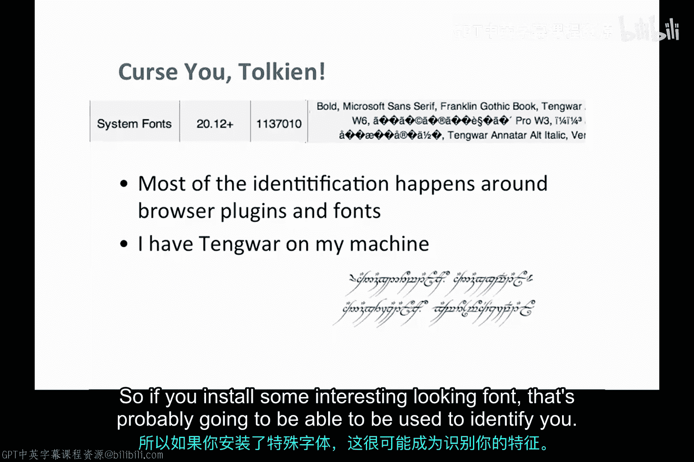

我们在信息安全领域，特别是在研究匿名性的政治敏感社区中遇到的一个问题是：我们必须非常小心，不要向人们兜售“虚假的希望”。为了使用匿名系统，你必须表现得像在隐藏自己。如果不这样做，你将会暴露身份的各个方面。

我不会随意使用Tor浏览网页。坦率地说，如果我使用Tor，那是因为我正在从事一项特定的、有限的活动，并且希望它是不可追踪的。我不会用它进行大量的用户交互。例如，如果要用它发送邮件，我会尽可能简洁，并尽量避免使用我平常的说话方式。

## 可用于追踪的基本行为特征

存在多种基本的行为特征可用于追踪你，这包括：

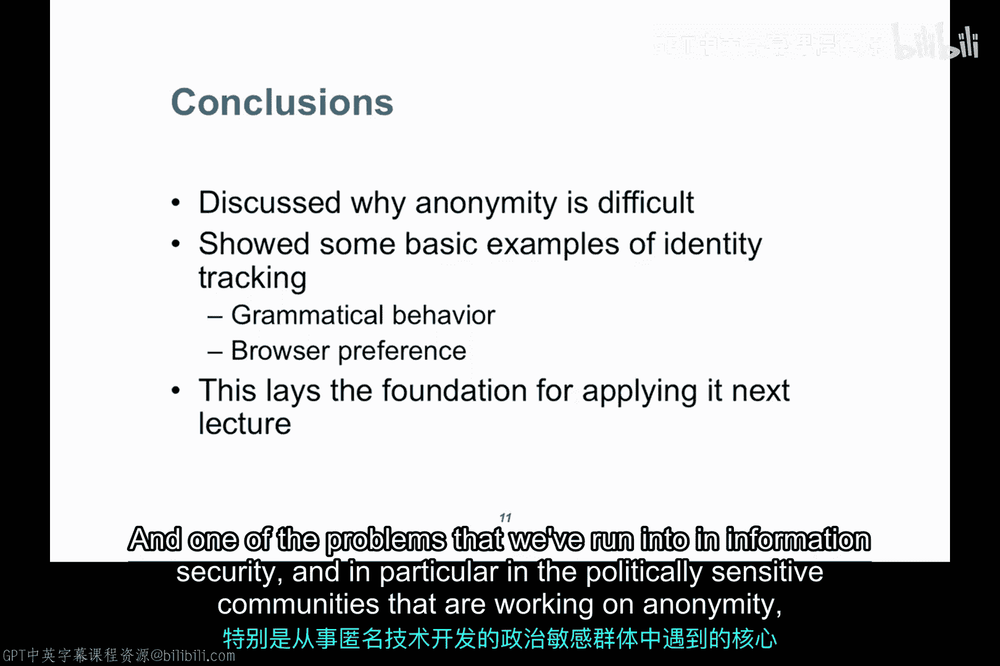

*   **语法行为特征**
*   **浏览器偏好设置**
*   **生物特征识别**

在下一讲中，我们将利用这些技术来探讨如何实际打破匿名性。

## 总结

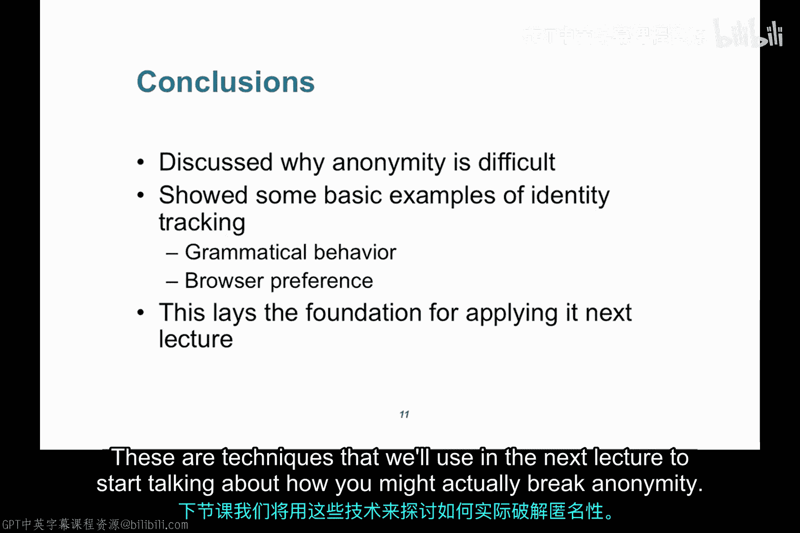

本节课中我们一起学习了实现网络匿名性为何如此困难。我们了解到，即使使用了像Tor这样的匿名工具，用户的行为习惯、浏览器指纹以及互联网服务的中心化结构都会导致身份暴露。真正的匿名要求用户改变其常规的在线行为模式，而这通常以牺牲便利性为代价。记住，**匿名是一种需要刻意实践的行为模式，而不仅仅是一种技术工具**。