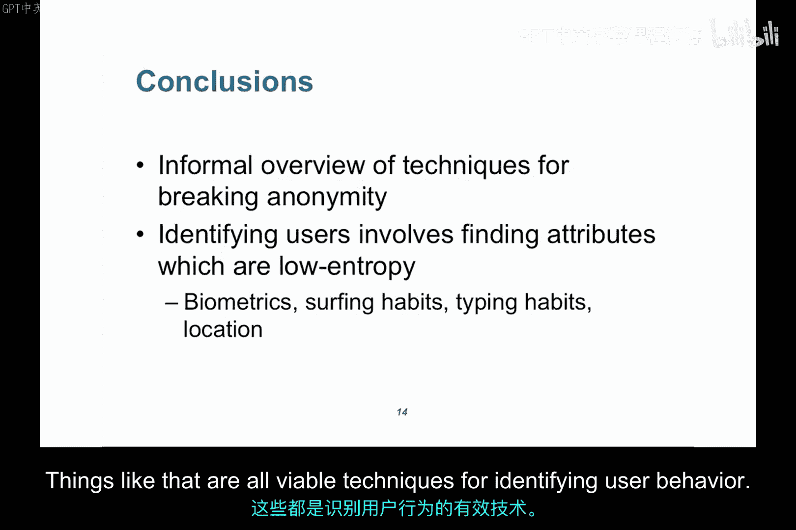

# 024：流量去匿名化技术 🕵️

在本节课中，我们将学习流量去匿名化的核心概念与技术。去匿名化旨在识别匿名网络流量背后的用户身份。我们将探讨多种技术，从行为分析到高级数据挖掘方法，并理解为何完全匿名在实践中难以实现。

## 概述


去匿名化没有一套固定的规则。本模块将讨论多种用于追踪或揭示用户身份的技术。这些技术本质上可归结为寻找用户的“痕迹”。有些是行为分析技术，有些则是更高级的方法，相关论文中有所涵盖。目前没有能保证在法庭上提交结果的“匿名攻击系统”，但存在一些通用的操作原则。

## 核心原则

以下是进行去匿名化时可遵循的三条核心原则。

*   **不按系统规则行事**：匿名系统在特定设计假设下提供匿名性。研究者们倾向于在明确的边界内讨论系统。因此，攻击时应寻找系统设计者忽略或回避的方面，而非攻击他们已讨论过的防御点。
*   **寻找共同习惯**：大量文献研究通过寻找用户的共同习惯来去匿名。这包括分析浏览习惯、点击模式等。
*   **审视次级服务与依赖**：查看用户与附属网站（如谷歌、脸书、推特）的通信。用户可能在不自知的情况下访问这些站点，例如通过广告或Cookie。此外，还应关注恶意软件、间谍软件、侵入性浏览器插件等。


## 行为与习惯分析

上一节我们介绍了核心原则，本节中我们来看看如何具体分析用户行为。

一个关键视角是关注“长尾”分布。许多用户会定期访问一组独特或小众的网站。这符合经典的**帕累托分布（80/20法则）**：80%的访问流向20%的热门网站（如谷歌、YouTube）。然而，分布还存在一个“长尾”——对于每一个谷歌，都有成千上万个仅被少数人访问的站点。


以下是“长尾”包含的典型站点类型：

*   小众博客，特别是政治或爱好类博客。
*   特定主题的网站。
*   用户定期且独特地访问，但并非人人皆访的爱好站点。

## 低熵信息与高级技术


最通用的去匿名化方法是寻找**低熵信息**序列，即内部存在大量结构的信息。一个更高级的技术例子是阅读材料中提到的一篇论文：《揭示加密网络电话对话中的口语短语》。

该论文的核心思想是，即使语音数据已被加密，你仍可通过数据包**长度**来解码VoIP消息。因为不同的声音（音素）以不同的比特率编码。例如，某些编码器对元音的编码速率高于辅音（如“f”或“s”这种气流通过两个表面产生的声音）。这种差异导致了不同的数据包大小。

## 语言结构与马尔可夫模型

为了理解上述技术，我们需要了解语言结构。英语中大约有40到60个**音素**，它们是语言中独特的原子性声音。当我们说一个英文单词时，实际上是组合了一系列音素。


然而，音素序列的分布并不均匀。某些组合非常常见，而有些则几乎不会出现（例如，舌头很难连续发出“th”和“z”的音）。如果你能计算出这些序列的概率，就能很好地猜测特定的数据包序列可能对应什么内容。

我们使用**马尔可夫模型**（Markov Model）来实现这一点。马尔可夫过程是一种“无记忆”的统计过程，其下一个状态仅取决于当前状态。

一个马尔可夫模型通常表现为一个图，包含一系列带有概率标签的状态转移。例如：
```
状态A --(概率0.8)--> 状态B
状态A --(概率0.2)--> 状态C
```
在机器学习中，我们使用**隐马尔可夫模型**。这是一种人工智能技术，通过观察输出来推断出马尔可夫模型。例如，输入大量英文句子，HMM算法可以学习并输出描述各种音素转移概率的模型。


## 去匿名化的核心挑战

前述论文利用隐马尔可夫模型，根据数据包长度来推断可能的声音。关键在于，单个数据包长度可能对应多个音素，但一旦将它们组合成序列，就更容易识别其可能的内容。

这触及了实现匿名性的核心难题：**低熵数据**。任何具有大量结构的信息（如用户习惯、互联网工程特性导致的偏好分布）都会使匿名化变得困难。


为了使匿名系统有效，必须确保攻击者能观察到的几乎所有信息都是**均匀分布**的。例如，上一讲中提到的高延迟混合网络，会控制数据包定时和大小以确保匿名性。但问题在于，使一切均匀分布意味着**效率的损失**。

**匿名性、效率和便利性三者相互制约**。为了隐私，你不得不以匿名方式行事，而这种方式往往既不高效也不方便。

## 总结

本节课中，我们一起学习了用于打破匿名性的多种技术概览。关键要点在于，去匿名化涉及攻击那些**低熵的属性**。存在许多此类属性可供分析：


*   生物特征
*   浏览习惯
*   购物习惯
*   位置信息



这些都是识别用户行为的可行技术。理解这些原理有助于我们更好地设计防御措施和评估匿名系统的实际强度。