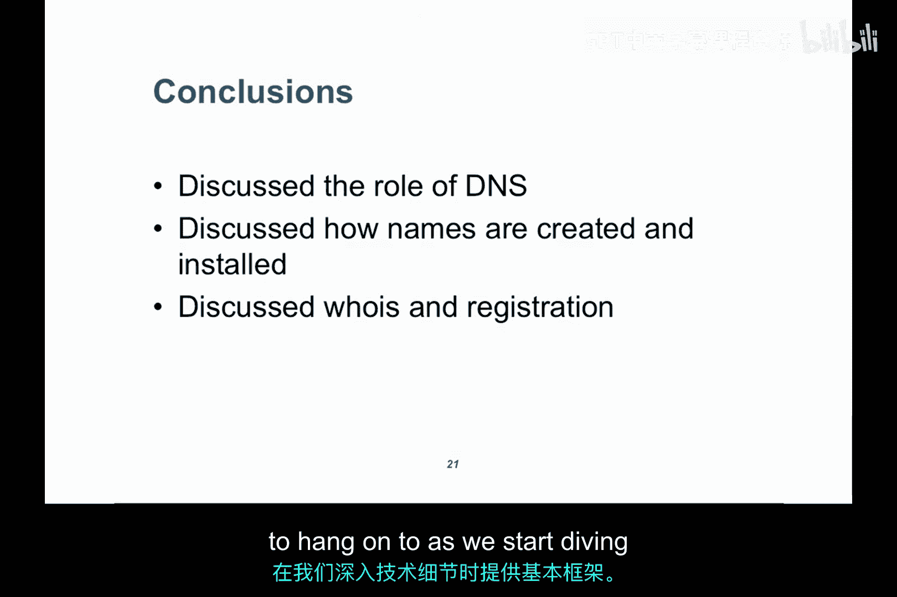

# 025：DNS协议概述 🧭


在本节课中，我们将要学习DNS（域名系统）的基础知识。DNS是互联网的核心基础设施之一，它将人类友好的域名（如 `www.jhu.edu`）转换为机器可读的IP地址（如 `192.168.1.1`）。本节课将提供一个高层次的概述，帮助你理解DNS的角色、基本工作原理及其在互联网中的中心地位。

---

## DNS的角色与重要性


上一节我们介绍了课程模块，本节中我们来看看DNS的核心作用。

DNS的根本目的是让互联网对用户更友好。互联网地址本质上是介于1到2^32之间的数字，但人们更习惯使用名称，例如 `www.jhu.edu`。DNS提供了将名称映射到IP地址的机制，极大地方便了用户。


此外，DNS深度嵌入在互联网基础设施中。例如，邮件系统（SMTP）依赖DNS来确定邮件的路由目的地。DNS也是信任和证书体系的基础，域名会出现在X.509证书中，从而产生与之相关的信任问题。

---


## DNS的起源：Hosts文件

在深入讨论DNS协议之前，我们先了解一下其前身。

最早的名称解析等价物是Unix系统上的 **`/etc/hosts`** 文件。这是一个简单的文本文件，包含了IP地址与主机名之间的对应关系。在Windows系统中，它通常位于 `C:\Windows\System32\drivers\etc\hosts`。


以下是该文件的一个示例格式：
```
127.0.0.1       localhost
192.168.1.10    myserver.local
```

关于这个文件，有两点需要注意：
1.  名称可以是任意的，不一定是完全限定域名。
2.  Hosts文件至今仍在使用。操作系统在进行名称解析时，通常会首先查询此文件。

正因如此，恶意软件常会攻击Hosts文件。许多病毒或木马入侵系统后，会修改此文件，将知名安全厂商的域名指向本地回环地址 `127.0.0.1`，从而阻止用户获取安全更新。


---

## 完全限定域名


在讨论DNS协议细节前，我们需要理解一个核心概念：**完全限定域名**。

你可能已经注意到域名具有层次结构，例如 `www.ep.jhu.edu`。这种结构化的名称就是FQDN。它类似于文件的绝对路径，从最具体的部分（左）到最通用的部分（右）排列。

一个显式指定的FQDN在末尾会有一个点 `.`，例如 `www.ep.jhu.edu.`。这个点代表DNS的**根域**。大多数情况下，DNS解析会使用隐式域名。例如，在 `jhu.edu` 域内查询 `ep`，解析器会自动将其补全为 `ep.jhu.edu`。

你可以将DNS想象成一棵倒置的树，根 `.` 在顶端，其下是 `com`、`edu`、`org` 等顶级域，再往下是 `jhu`、`google` 等二级域，以此类推。


---


## DNS系统的工作原理

显然，仅靠Hosts文件无法支撑全球数十亿台主机的名称解析。解决方案就是**域名系统**。

DNS是一个**分层级的分布式数据库**，用于将名称映射到IP地址。它的工作方式基于委托授权：
*   根服务器将 `.edu` 域的权威委托给管理 `.edu` 的服务器。
*   `.edu` 服务器再将 `jhu.edu` 的权威委托给约翰霍普金斯大学的DNS服务器。
*   约翰霍普金斯的DNS服务器则负责管理其域内（如 `www.jhu.edu`）的记录。

FQDN的解析过程正是沿着这条路径进行的。例如，解析 `up.quark.phys.cmu.edu.`：
1.  查询从根 `.` 开始，找到负责 `.edu` 的服务器。
2.  询问 `.edu` 服务器关于 `cmu.edu` 的信息，得到CMU的DNS服务器地址。
3.  询问CMU的DNS服务器关于 `phys.cmu.edu` 的信息。
4.  依此类推，直至找到负责 `up.quark.phys.cmu.edu` 的最终权威服务器并获取IP地址。


这个过程就像沿着树形结构逐级向下查询。

---


## 域名注册与管理机构

你可能会问，谁来决定 `cmu.edu` 归卡内基梅隆大学所有？答案是**注册管理机构**。

以下是域名注册的层级结构：
*   **ICANN**：互联网名称与数字地址分配机构，管理根域和顶级域。
*   **顶级域注册管理机构**：负责运营特定顶级域的公司或组织。例如：
    *   **通用顶级域**：如 Verisign 运营 `.com`， Educause 运营 `.edu`。
    *   **国家代码顶级域**：如 Nominet 运营 `.uk`（英国）。
*   **注册商**：经注册管理机构授权，向公众销售域名的公司，例如 GoDaddy、Namecheap。


如果你想注册一个 `.com` 域名，你需要向 GoDaddy 这样的注册商付费。注册商再向 Verisign (.com的管理机构) 付费，Verisign 最终向 ICANN 付费。这是一个链条式的正式商业协议。

不同顶级域有不同的注册政策。`.edu` 仅限 accredited 教育机构注册，`.org` 通常面向非营利组织，而 `.com` 则对所有人开放。


---

## IP地址的分配

拥有了域名之后，如何获得与之关联的IP地址呢？答案是**互联网服务提供商**。

IP地址的分配也是一个分层级的过程：
1.  **IANA**：将大块的IP地址空间分配给**区域互联网注册管理机构**。
2.  **RIR**：全球共有5个RIR（如 ARIN 负责北美，APNIC 负责亚太），它们将地址分配给大型ISP或组织。
3.  **ISP**：互联网服务提供商从RIR获得地址块，再将其中的一部分“租借”给终端用户或企业。


需要明确的是：**购买域名和获取IP地址是两个独立的过程**。你可以购买一个域名而不将其指向任何服务器（即“占位”）。但若想建立一个网站，你就需要从ISP获得一个IP地址，并在DNS记录中将你的域名指向这个地址。

由于IPv4地址资源有限（约43亿个），其分配和管理显得尤为重要。目前所有IPv4地址块均已分配完毕，市场主要通过交易和租赁来流通现有地址。


---

## 信息查询工具：Whois


如何追踪域名和IP地址的注册信息？核心工具是 **`whois`**。

你可以在命令行中使用它：
```bash
whois example.com
```
或
```bash
whois -h whois.arin.net 192.168.1.1
```


需要注意的是，`whois` 数据库的信息质量参差不齐。它没有统一的格式，信息更新可能不及时，甚至可能缺失。因此，查询时可能需要尝试多个 `whois` 服务器（例如，针对不同RIR的服务器）。

以下是进行有效 `whois` 查询的一些技巧：
*   **逐级深入**：`whois` 查询是层次化的。一个查询结果可能会指引你到另一个更具体的 `whois` 服务器。
*   **查看周边**：个人或公司通常不会只拥有一个IP地址，而是一个地址块（如 `/27` 网段）。除了查询特定IP，也可以查看其相邻地址的注册信息，以发现更多关联。


---

## 总结


本节课中我们一起学习了DNS的基础概述。

我们讨论了DNS在互联网中扮演的**核心角色**，即实现域名到IP地址的映射，并支撑着邮件、证书等诸多关键服务。

我们了解了域名和IP地址的**获取途径**：域名通过注册商-注册管理机构的层级体系购买；IP地址则通过ISP-RIR的层级体系租用。

最后，我们介绍了用于查询这些注册信息的 **`whois`** 工具及其使用技巧。


重要的是要认识到，整个DNS体系建立在**社会共识和商业协议**之上。我们使用的“官方”DNS根服务器由ICANN协调。虽然也存在替代根服务器，但由于缺乏规模、带宽和全球支持，其影响力有限。



本节课为你建立了一个关于DNS如何运作的总体框架。在接下来的课程中，我们将深入探讨DNS协议的技术细节、报文结构以及其中涉及的安全问题。