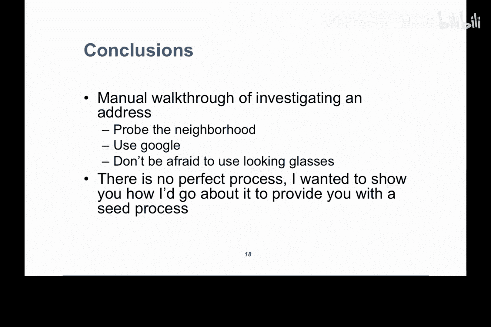

# 027：地址调查分析 🔍


在本节课中，我们将学习如何对一个给定的IP地址进行调查分析。这是一个实践性的演练，我们将把课程中零散介绍过的工具和方法串联起来，形成一个完整的调查流程。通过本教程，你将掌握从IP地址出发，逐步收集和分析相关信息的基本方法。

---


上一节我们介绍了课程概述，本节中我们来看看调查流程的第一步：初始域名查询。

## 初始域名查询

首先，我们对示例IP地址 `192.44.3.18` 执行 `dig -x` 命令进行反向DNS查询。
```bash
dig -x 192.44.3.18
```
查询结果显示，该地址没有直接对应的主机名，但权威部分指出它属于一个名为“Phonehoffer”的德国组织。这里需要注意两点：权威名称服务器通常以“NS”为前缀；域名中的国家代码（如 `.de`）能直接表明其地理位置。

为了对比，我们再查询另一个地址 `99.43.211.18`。
```bash
dig -x 99.43.211.18
```
这次我们在答案部分获得了丰富的信息：`adsl-99-43-211-18.dsl.rcsntx.sbcglobal.net`。这个编码化的名称透露了很多信息：`adsl` 表明这是一个DSL线路，`rcsntx` 可能代表地理位置（如德克萨斯州），`sbcglobal.net` 是西南贝尔公司的域名。这种命名方式在ISP为家庭用户分配动态IP时很常见。


以下是域名查询中可能遇到的命名模式：
*   **功能性站点**：常包含 `mail`、`ftp`、`search` 等词。
*   **动态IP**：常包含 `dsl`、`pool`、`dynamic` 等词及地理编码。
*   **组织机构**：域名本身可能直接反映公司、大学或政府机构名称。

---


上一节我们介绍了如何从域名中获取信息，本节中我们来看看调查过程中一个至关重要但常被忽视的环节：利用公开信息源。

## 善用公开信息源

调查是一个探索过程，而非简单的清单核对。许多调查者会忘记使用最基本、最强大的公开信息源。


在进行技术查询的同时，务必进行以下操作：
*   **使用搜索引擎**：在Google中搜索该IP地址或相关域名。
*   **查阅维基百科**：查找与该组织或域名相关的背景信息。
*   **访问相关网站**：如果允许，直接访问该组织的官方网站，了解其性质（是ISP、公司、非政府组织还是大学）。不同性质的机构管理IP地址的方式差异很大。

---


上一节我们强调了公开信息源的重要性，本节中我们进入调查的核心步骤：查询IP地址的注册信息（Whois）。


## 查询Whois注册信息

首先，我们访问ARIN（美国互联网号码注册中心）的Whois服务进行查询。虽然我们已经知道目标地址属于德国（.de），应使用RIPE NCC（欧洲IP地址注册中心），但此举是为了演示如果忽略地域信息会发生什么。


在ARIN查询 `192.44.3.18` 后，我们得到一份报告，指出该地址段属于 `RIPE-EX-192.44.1.0`。这明确告诉我们，需要去RIPE NCC查询更详细的信息。

全球各大区域性互联网注册管理机构（RIR）都提供Whois服务。以下是主要的RIR及其负责区域：
*   **ARIN**：北美地区
*   **RIPE NCC**：欧洲、中东和中亚地区
*   **APNIC**：亚太地区
*   **LACNIC**：拉丁美洲和加勒比海地区
*   **AFRINIC**：非洲地区

我们转而访问RIPE NCC进行查询。这次获得的信息比ARIN提供的更精确，它给出了具体的地址块（`192.44.3.0/25`），所属的自治系统号（ASN），以及技术联系人和管理联系人的信息（需要进一步展开查看）。根据调查需要，你甚至可以考虑联系这些联系人。


**一个重要提示**：不同注册机构和地区的Whois信息质量参差不齐。通常，西欧和北美的信息较为准确可靠。信息质量是注册机构和所在地域的共同作用结果。


---


上一节我们通过Whois查询了IP的注册信息，本节中我们来看看当标准反向查询无效时，还有哪些替代方法。


## 替代查询方法

除了标准的 `dig -x` 反向查询，还有其他途径可以获取信息，尽管它们可能不那么可靠或需要付费。

一个替代方案是使用互联网调查数据。例如，ISC（互联网系统协会）会通过主动探测DNS来收集名称信息，并出售相关的调查报告。此外，也有一些公司提供类似的商业化IP-域名映射数据服务。但请注意，这些数据可能不完整，不应期望过高。


---


上一节我们探讨了名称查询的替代方法，本节中我们进入网络层面的调查：分析路由路径。

## 分析网络路由


我们可以通过追踪数据包的路由路径来获取信息。这可以通过命令行工具 `traceroute` 实现，也可以利用在线“Looking Glass”服务器（例如通过 `traceroute.org` 查找）从不同地理位置发起追踪。

例如，从本地对 `192.44.3.18` 执行 `traceroute`，追踪在到达 `border1.fra-1.bone.fhG.de` 和 `noc.fho` 后停止。从另一个（德国）路由节点再次尝试，结果类似，均在到达弗劳恩霍夫协会的网络运营中心（NOC）后终止。


这暗示目标可能不存在。接下来，我们执行最简单的连通性测试：`ping`。
```bash
ping 192.44.3.18
```
结果显示“请求超时”。这**可能**意味着该地址上没有活跃的主机。在互联网安全领域，没有绝对的规则。对方可能配置路由器丢弃了ICMP回显请求（ping包）。

为了验证，我们可以探测该地址的“邻居”。例如，ping `192.44.3.21`。
```bash
ping 192.44.3.21
```
这次我们收到了回复。对 `192.44.3.21` 进行 `traceroute`，路径显示它同样经过弗劳恩霍夫网络。结合Whois信息（两者同属一个地址块），这进一步支持了 `192.44.3.18` 没有主机的推论，尽管不能100%确定（因为可能存在特殊的防火墙规则）。

---


上一节我们通过路由和连通性测试分析了网络状态，本节中我们来总结整个调查流程的核心要点和最佳实践。

## 调查总结与核心要点

本次演练展示了一个手动调查IP地址的流程。需要记住，这不是一个完美的固定流程，而是一套基于经验的方法论。以下是一些核心规则和要点：

1.  **探测相邻地址**：如果无法直接从目标地址获取信息，可以调查其相邻IP。你可能会发现所属机构、本地名称服务器等对进一步调查有用的信息。
2.  **大胆使用搜索引擎**：再次强调，Google等搜索引擎是最基础且强大的研究工具，应在调查早期频繁使用。
3.  **善用Looking Glass服务器**：在分析路由信息时，Looking Glass服务器是无价之宝。它们允许你从不同地理位置发起探测，避免因本地网络路径造成的偏见。从德国探测德国IP与从美国探测，路径可能完全不同。
4.  **理解信息的局限性**：你只能描述观察到的现象（如数据包被丢弃），但无法绝对确定其原因（是主机不存在，还是路由器被配置为不响应）。调查结论通常是基于证据的“可能性”推断。
5.  **流程是灵活的**：本次演示提供了一个起点和基本思路。随着经验积累，你会形成自己的一套工具组合和调查路径。

---



本节课中我们一起学习了针对IP地址的调查分析方法。我们从初始的域名查询开始，逐步深入到Whois注册信息查询、公开信息源利用、网络路由追踪以及连通性测试。记住，调查是一个综合性的探索过程，需要灵活运用多种工具和方法，并对信息的质量和局限性保持清醒的认识。本教程为你构建自己的调查流程提供了一个坚实的起点。