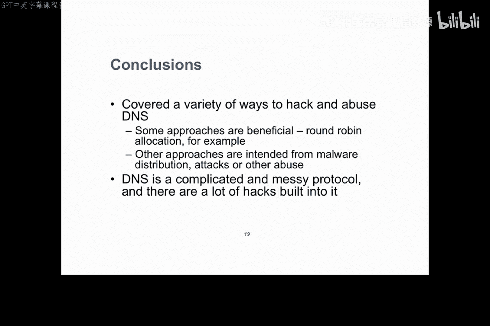

# 029：DNS攻击技术 🛡️


在本节课中，我们将要学习DNS（域名系统）的各种攻击与滥用技术。DNS是互联网的核心基础设施，负责将人类可读的域名（如 `example.com`）转换为机器可读的IP地址。我们将探讨合法的DNS使用方式（如负载均衡），以及攻击者（特别是恶意软件作者）如何操纵DNS进行攻击。


## 轮询DNS分配 🔄


上一节我们介绍了DNS的基础概念，本节中我们来看看一种基础的负载均衡技术：轮询DNS分配。这是互联网上最早、最简单的负载均衡形式。

其工作原理是：当一个客户端查询一个域名时，DNS服务器会从一个地址池中随机返回一个IP地址。理想情况下，这些地址分布在不同的网络和地理位置。


通过随机分配，流量得以均匀分布，确保没有单台机器过载。例如，查询 `CNN.com` 可能会返回多个不同的IP地址。


```
dig CNN.com
; <<>> DiG 9.10.6 <<>> CNN.com
;; ANSWER SECTION:
CNN.com.		300	IN	A	151.101.65.67
CNN.com.		300	IN	A	151.101.1.67
CNN.com.		300	IN	A	151.101.129.67
CNN.com.		300	IN	A	151.101.193.67
```


## 内容分发网络与DNS操纵 🌐

上一节我们介绍了基础的负载均衡，本节中我们来看看更复杂的系统：内容分发网络。互联网并非完全去中心化，它严重依赖高度集中的网络。早期的“端到端”连接模型在应对“闪存 crowd”（瞬间涌入的大量访问）时很容易耗尽资源。


CDN的解决方案是在全球各地复制网站内容。当用户请求一个域名时，CDN的权威DNS服务器会查看请求来源的IP地址，并返回地理位置上最近的缓存服务器地址。


以下是CDN利用DNS进行流量引导的过程：
1.  用户查询 `Foxnews.com`。
2.  Akamai（CDN提供商）的DNS服务器收到请求。
3.  服务器根据用户的IP地址判断其地理位置。
4.  服务器返回离用户最近的 `Foxnews.com` 缓存服务器的IP地址。


通过这种方式，CDN利用DNS操纵来优化互联网流量，没有CDN，当今的多媒体互联网将无法实现。

## DNS攻击技术概览 ⚔️


了解了合法用途后，我们现在来看看攻击者如何滥用DNS。攻击的核心目标是劫持域名解析，迫使用户访问攻击者控制的特定站点。


以下是几种常见的DNS攻击技术：


*   **修改Hosts文件**：这是恶意软件最常用的简单方法，直接修改本地的 `hosts` 文件，将域名指向恶意IP。
*   **域名仿冒**：攻击者注册一个与真实域名极其相似的域名（例如 `wwwnyytime.com`），诱骗用户访问。
*   **同形异义字攻击**：利用国际化域名中与其他语言字符外形相似的字符（如西里尔字母）注册域名，进行视觉欺骗。
*   **缓存投毒**：攻击上游DNS服务器或利用协议漏洞，污染DNS缓存，使缓存中存储错误的域名-IP映射关系。
*   **快速通量**：这是一种防御规避技术。攻击者将一个域名关联到大量IP地址，并设置极短的TTL。当防御者封禁一个IP时，域名已迅速切换到新的IP地址。
*   **域名生成算法**：恶意软件使用可预测的算法每日生成新的通信域名。防御者需要破解算法才能提前封堵这些域名。
*   **DNS劫持器**：此类恶意软件会修改系统的DNS解析器设置，将其指向攻击者控制的恶意DNS服务器，从而完全控制受害者的域名解析。

## 协议漏洞与Kaminsky攻击 🐛


上一节我们列举了多种攻击面，本节中我们深入探讨一个著名的协议级漏洞：Kaminsky攻击。DNS协议使用一个16位的**查询ID**来匹配请求与响应，理论上攻击者需要猜对这个ID才能进行缓存投毒。


然而，Dan Kaminsky在2008年发现并利用了一个关键点：DNS响应中可以包含“附加信息”部分，这部分信息可以包含任何其他域名的记录，即使原查询并未询问这些记录。

Kaminsky攻击的简化流程如下：
1.  攻击者诱使用户浏览器向权威DNS服务器发送大量对随机子域名（如 `1.example.com`, `2.example.com`...）的查询。
2.  同时，攻击者向权威服务器伪造大量响应，声称“`www.example.com` 的IP地址是 `恶意IP`”，并猜测查询ID。
3.  由于查询量巨大，攻击者猜中某个查询ID的概率大大增加。
4.  一旦猜中，权威服务器的缓存就会被污染，所有用户查询 `www.example.com` 都会被导向恶意IP。


此漏洞的严重性直接推动了 **DNSSEC** 的部署，这是一种为DNS提供数据来源验证和完整性的加密安全扩展。


## 总结 📚

本节课中我们一起学习了DNS技术的多个方面。我们首先了解了**轮询DNS分配**作为基础的负载均衡方法。接着，我们探讨了**内容分发网络**如何大规模地利用DNS进行流量工程，以支撑现代互联网。

然后，我们转向攻击视角，系统性地学习了多种DNS攻击技术，包括从简单的**修改Hosts文件**、**域名仿冒**，到更复杂的**缓存投毒**、**快速通量**、**域名生成算法**和**DNS劫持器**。最后，我们深入分析了著名的 **Kaminsky攻击** 原理，它揭示了DNS协议本身的脆弱性并促进了DNSSEC的发展。




核心要点在于：DNS因其核心地位而变得异常复杂。它不仅是互联网的“电话簿”，更成为了流量管理、安全对抗和性能优化的关键战场。理解这些技术，无论是用于建设还是防御，都至关重要。