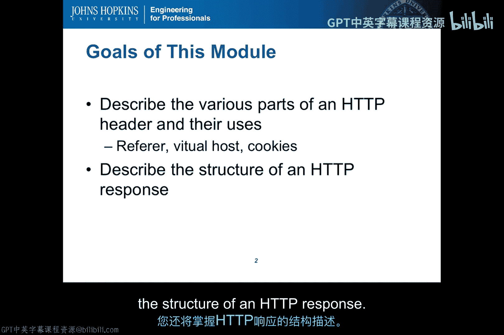
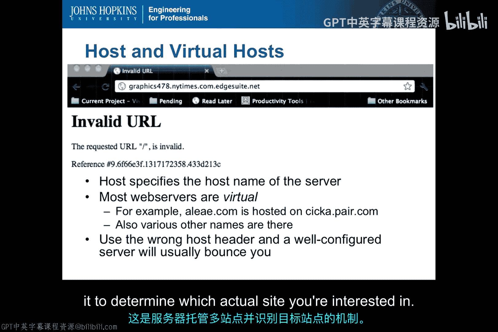
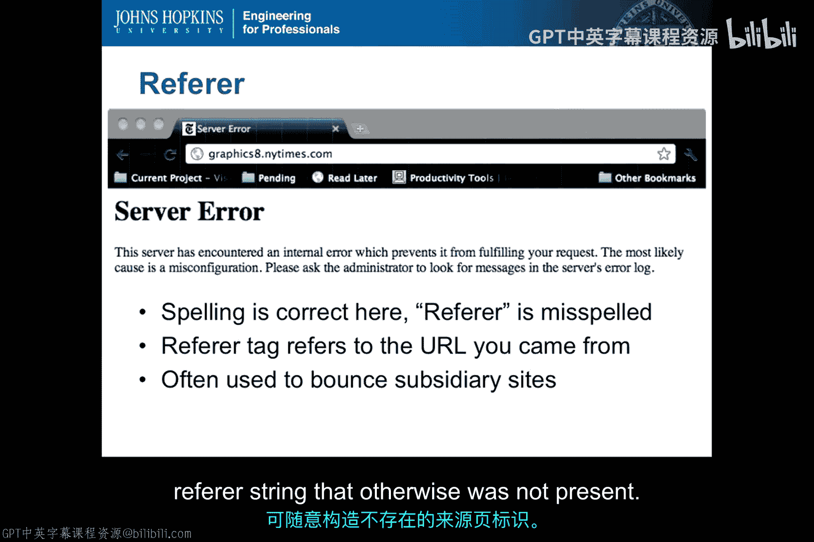
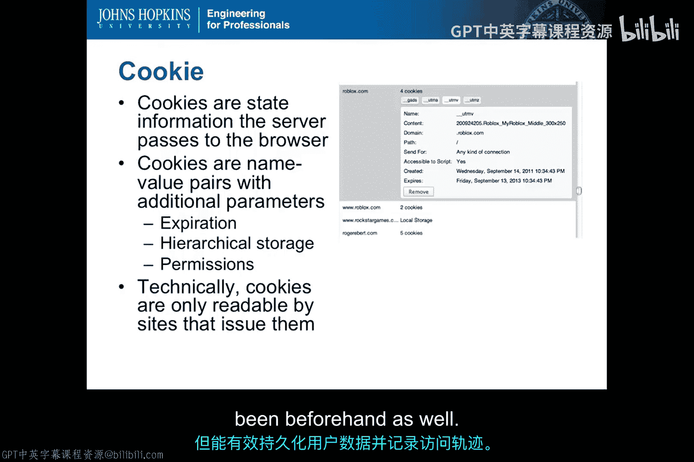
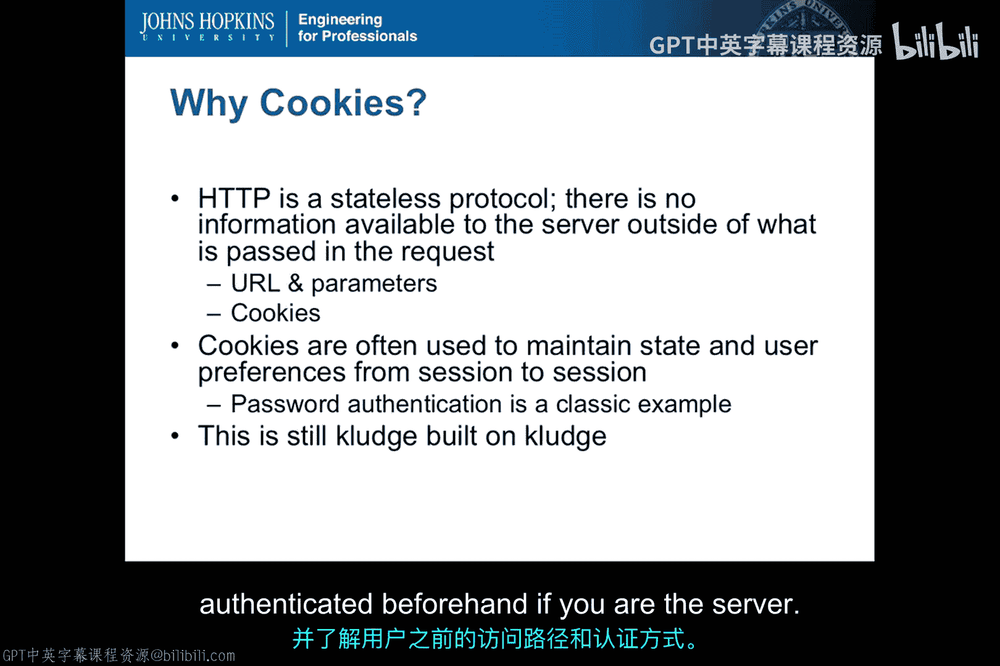
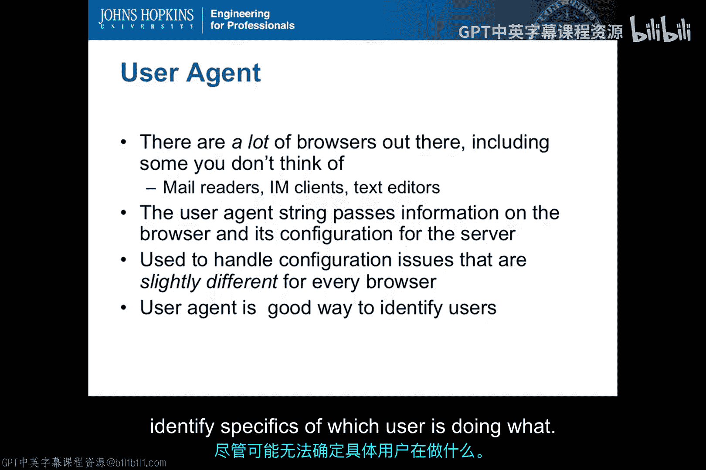
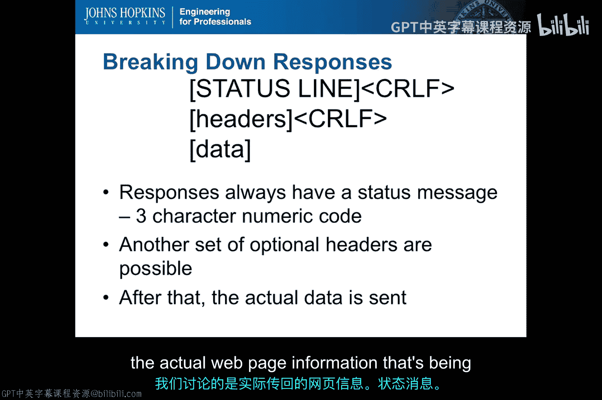
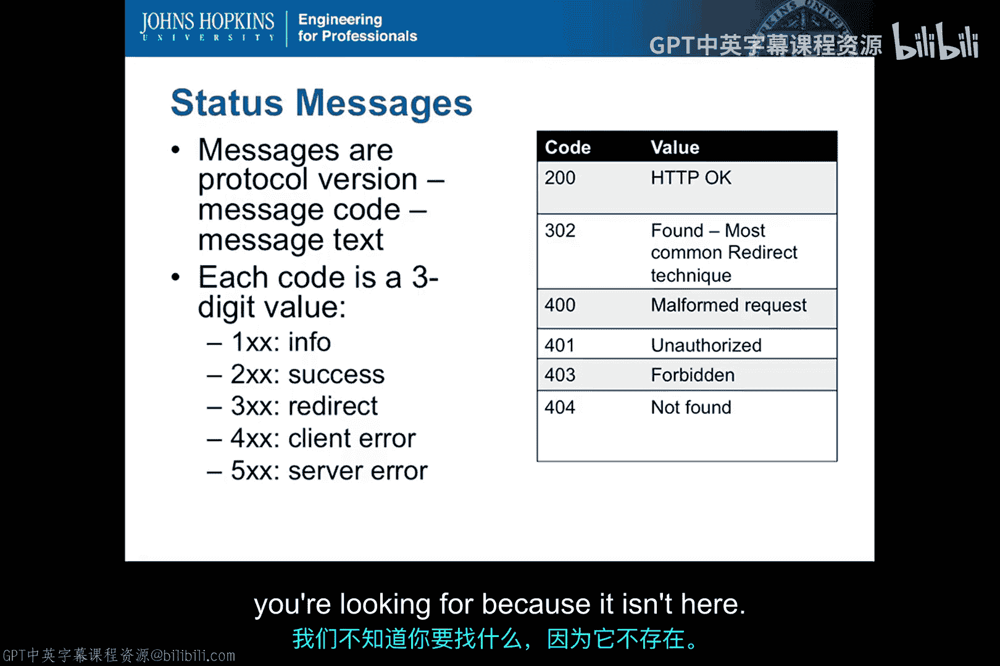
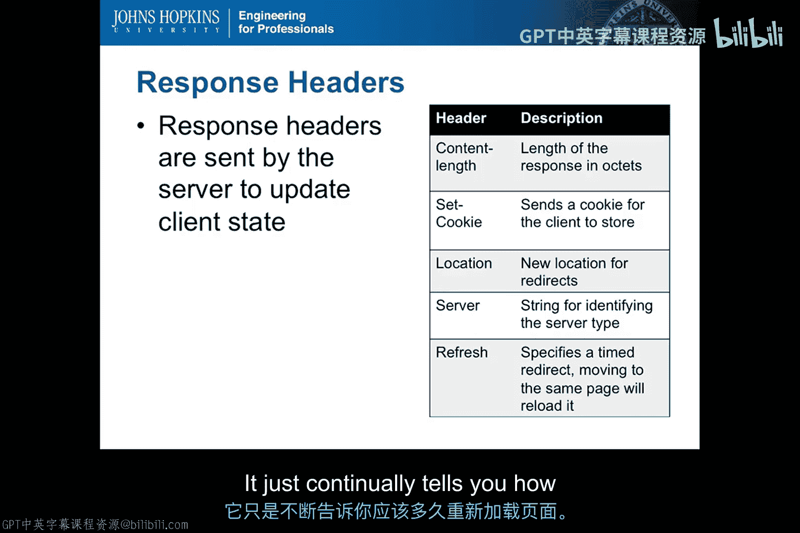
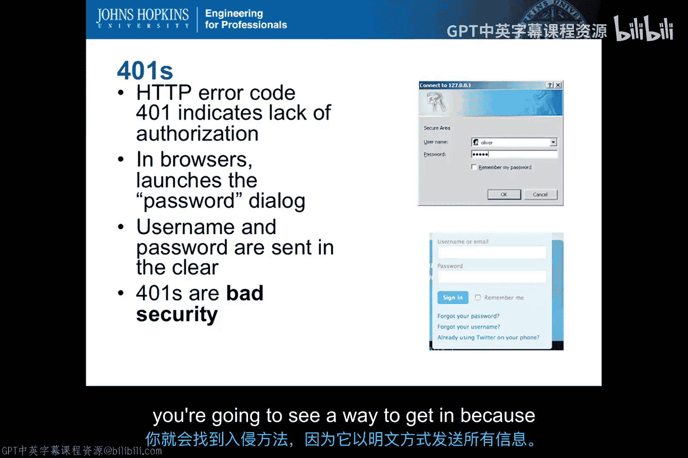

# 031：解析HTTP头部结构 🧩

在本节课中，我们将学习如何解析HTTP头部。我们将详细描述HTTP头部的各个组成部分及其用途，包括主机、虚拟主机、引用来源和Cookie。此外，我们还将探讨HTTP响应的基本结构。

## 主机与虚拟主机 🖥️

上一节我们介绍了HTTP头部的基本概念，本节中我们来看看**主机**字段。在HTTP头部中，**Host**字段用于指定服务器的**主机名**。然而，大多数Web服务器都是**虚拟主机**。

例如，`Aia.com`可能托管在`chica.pere.com`上。同一台物理主机上可能托管着多个不同的网站。因此，正确识别你正在访问的**实际虚拟主机**非常重要。

如果你使用了错误的Host头部，一个配置良好的服务器会拒绝你的请求，并返回一个错误，提示你使用了不正确的信息。

这本质上是一种允许**单个服务器同时托管多个站点**的方法，并使服务器能够轻松确定你感兴趣的是哪个具体站点。

## 引用来源 🔗

现在让我们继续讨论**引用来源**。**Referer**字段（注意拼写）用于说明你来自哪里，即“谁”将你引荐到了当前页面。

以下是关于Referer字段的关键信息：
*   **定义**：Referer字段包含你来源页面的URL。
*   **用途**：它常用于处理附属站点或验证访问路径。例如，过去《纽约时报》曾用它来验证用户是否来自其认可的特定站点，以处理身份验证。
*   **追踪来源**：该信息有助于确定流量来源，例如是来自Google搜索链接还是其他已知页面。
*   **安全性**：虽然可用于确保用户通过特定路径访问页面，但**Referer字段非常容易被伪造**。攻击者可以轻松构造包含虚假Referer信息的HTTP头部。

## Cookie 🍪

最后，我们来谈谈**Cookie**。Cookie是HTTP的**状态信息**，由服务器传递给浏览器。

Cookie是**名值对**，并可以附带额外参数，从客户端传回服务器。这些信息可以包含：
*   过期日期
*   分层存储信息
*   权限信息
*   服务器希望为终端用户跟踪的任何信息

从技术上讲，Cookie**只应由颁发它的站点读取**。它们非常有用，可以用于补充信息，并允许网站追踪用户之前的访问行为。

虽然我们使用Cookie，但HTTP本身是一种**无状态协议**。服务器无法获取请求之外的信息（通常只有URL及其参数）。通过添加Cookie，服务器可以追踪用户的行为、偏好等。

Cookie常用于**维护用户偏好状态**，并且这种状态可以跨多个会话持续，而不仅仅是单次连接或单次访问。它还可以用于密码验证，这样用户就不必在每个页面上都重新提供凭证。

## 用户代理 👤

接下来，我们探讨一个非常有趣的部分——**用户代理**。如果你在保护服务器，这部分内容会特别重要。

市面上有很多浏览器，甚至包括一些你意想不到的，如邮件阅读器、即时通讯客户端或文本编辑器，都可以用来浏览网页。

**User-Agent**字符串将关于**浏览器和系统**的信息传递给服务器。它提供这些信息是为了告诉服务器客户端**能做什么和不能做什么**，即具备哪些特定的能力。

一个典型的例子是，服务器可能需要根据你使用的是IE还是Mozilla（Firefox）浏览器，对页面进行略微不同的处理。通过提前告知服务器，它可以为你提供最适合IE或Mozilla的定制版本。

User-Agent也用于以这种方式处理配置问题，并且是识别特定用户群体的好方法。虽然可能无法确定具体是哪个用户，但至少可以将他们归类到不同的组中。

## HTTP响应结构 📨

现在，带有所有这些信息的HTTP请求头部已经发出。一切检查完毕后，我们会收到一个**响应**。

HTTP请求的响应结构非常简单，是最容易解析的内容之一。它包含三个部分：
1.  **状态行**
2.  **头部**
3.  **数据**

响应总是包含一个**状态消息**，这是一个三位数字代码（我们稍后会详细说明）。还可能有一组可选的**头部**，提供关于服务器的信息以及服务器后续能做什么的指示。最后是实际的**数据**。就本次讨论而言，我们不会深入探讨数据部分，因为它可以是任何内容（例如传输回来的实际网页信息）。

## 状态码解读 🔢

状态消息有些很常见，有些则不那么常见。基本上，这些消息告诉你服务器上发生了什么以及服务器的看法。

每个状态码都是一个三位数值。**第一位数字**表示主要的类别分组，**后两位数字**提供更具体的细节。
*   如果第一位是 **1**，表示这是一个**信息性**消息。
*   如果是 **2**，表示**成功**（但可能附带一些注意事项）。
*   如果是 **3**，表示**重定向**（服务器没有直接满足请求，而是将你导向了其他地方）。
*   如果是 **4**，表示**客户端错误**。
*   如果是 **5**，表示**服务器错误**。

你通常会看到的一些主要状态码值包括：
*   **200**：HTTP OK（请求成功）。
*   **302**：Found（最常见的重定向技术）。
*   **400**：Bad Request（错误的请求）。
*   **401**：Unauthorized（未授权，与“禁止”不同，意味着你未被授权访问）。
*   **403**：Forbidden（禁止访问，意味着你完全不能访问该资源）。
*   **404**：Not Found（未找到，服务器不知道你要找什么，因为它不存在）。

这些是状态码的基础知识。你几乎可以在任何地方（例如在Google搜索“HTTP status code”）查到完整的列表。

## 响应头部 📋

响应头部中有几个非常有趣的部分。这是服务器提供给客户端的信息。

以下是几个关键的响应头部：
*   **Content-Length**：响应的长度（以字节为单位），告诉客户端响应体有多大。
*   **Set-Cookie**：发送一个Cookie供客户端存储。
*   **Location**：用于重定向的新位置。它基本上是说：“你应该去这里。”
*   **Server**：标识服务器类型和版本的字符串。这本身非常有趣，因为它指明了服务器运行的系统及其能力。
*   **Refresh**：指定定时重定向。跳转到同一页面将导致重新加载，它持续告诉你应该多久重新加载页面本身。

## 深入探讨401状态码 ⚠️

现在，让我们花点时间专门讨论一下**401**状态码。

**401**表示**未授权**，即缺乏访问站点的授权。这很容易在浏览器中触发，只需访问任何需要密码的站点即可。

如果你通过**HTTP**（而非HTTPS）访问此类站点，情况会变得很棘手。因为当你发送用户名和密码时，你是在**明文传输**这些信息。任何要求通过HTTP传输密码的站点，都在让你以明文发送用户凭证。

因此，如果你在**HTTP**站点上看到**401**状态码，这是一个很好的迹象，表明如果你在那里嗅探足够长的时间，很可能会找到入侵的方法，因为所有信息都是明文发送的。

---

本节课中我们一起学习了HTTP头部的关键组成部分，包括**Host**、**Referer**、**Cookie**和**User-Agent**字段的作用与意义。我们还剖析了HTTP响应的结构，理解了**状态码**（如200、302、401、404）的分类与含义，以及常见的**响应头部**信息。最后，我们特别强调了在HTTP协议下遇到401状态码时可能存在的安全风险。掌握这些知识是进行Web信息分析和保障的基础。