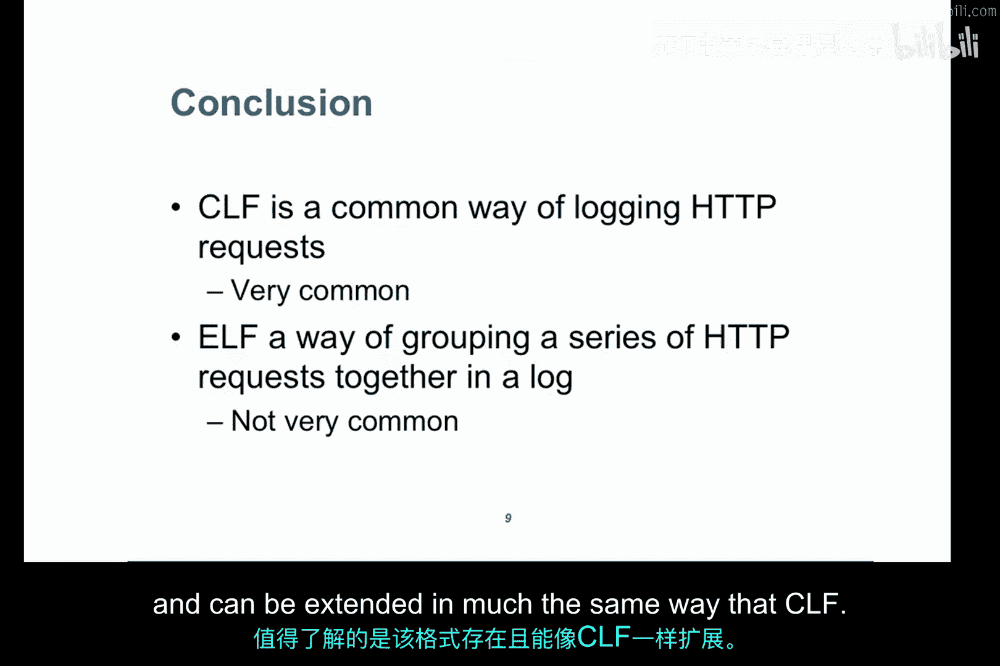

# 032：HTTP日志分析 📊

在本节课中，我们将学习HTTP日志分析，重点介绍两种主要的日志格式：通用日志格式和W3C扩展日志格式。通过本课，你将能够详细描述这两种格式的结构与用途。

## 概述

HTTP日志是记录Web服务器活动的重要文件。通过分析这些日志，我们可以了解谁访问了服务器、访问了什么内容以及访问是否成功。本节将深入解析两种最常见的HTTP日志格式。


## 通用日志格式

通用日志格式是一种非常流行且简单的日志格式。它易于理解，是许多Web服务器的默认日志格式。上一节我们介绍了日志分析的基本概念，本节中我们来看看CLF的具体构成。

CLF为每个HTTP请求生成一条日志记录，包含请求的IP地址、时间、请求内容、状态码和传输字节数等信息。其基本结构如下：

```
%h %l %u %t \"%r\" %>s %b
```

以下是CLF日志记录的一个示例及其各字段的详细说明：


```
127.0.0.1 - frank [10/Oct/2000:13:55:36 -0700] \"GET /apache_pb.gif HTTP/1.0\" 200 2326
```

*   **%h (远程主机地址)**：发出请求的客户端的IP地址或主机名。例如：`127.0.0.1`。
*   **%l (远程登录名)**：客户端的RFC 1413标识（已弃用）。通常为短横线 `-`。
*   **%u (远程用户)**：HTTP身份验证得到的用户名。如果未认证，则为短横线 `-`。例如：`frank`。
*   **%t (时间)**：服务器收到请求的时间。例如：`[10/Oct/2000:13:55:36 -0700]`。
*   **\"%r\" (请求行)**：客户端的完整请求行，包括方法、路径和协议。例如：`\"GET /apache_pb.gif HTTP/1.0\"`。
*   **%>s (状态码)**：服务器返回给客户端的最终HTTP状态码。例如：`200` 表示成功。
*   **%b (发送的字节数)**：返回给客户端的字节数（不包括响应头）。例如：`2326`。

CLF格式非常灵活，可以通过不同的变量进行扩展。例如，使用 `%A` 可以记录服务器的本地IP地址，这在多服务器环境中很有用。使用 `%{Referer}i` 可以记录引导用户访问当前页面的来源URL。

## W3C扩展日志格式

介绍完简单直接的CLF格式后，我们接下来看看另一种格式：W3C扩展日志格式。这种格式主要用于微软的IIS服务器，它允许管理员自定义日志中包含哪些字段。


W3C格式将一系列HTTP请求分组记录，字段可以从一个预定义的集合中选择。其规范可以在W3C的官方网站上找到。

以下是W3C扩展日志格式的关键特点：

*   **字段可定制**：管理员可以指定需要记录的字段组合。
*   **分组记录**：日志条目按组排列，而非严格的单行单请求（取决于配置）。
*   **IIS默认**：它是微软Internet信息服务（IIS）的默认日志格式。
*   **类似扩展性**：和CLF一样，它也可以通过添加特定字段进行扩展。

## 日志文件管理

了解日志格式后，管理这些日志文件本身也至关重要。无论是Apache还是IIS，日志文件通常都有特定的存储位置和轮转策略。


对于Apache，日志位置由 `CustomLog` 指令定义。对于IIS，日志默认存储在 `C:\inetpub\logs\` 目录下。日志文件通常按时间（例如每天）或大小进行轮转。

以下是关于日志文件管理的几个重要注意事项：

*   **文件大小限制**：Web服务器通常对单个日志文件有最大容量限制。超过此限制，当前文件会被关闭并归档。
*   **目录空间限制**：日志目录的总大小也可能有限制。超过限制后，系统可能会删除最旧的日志文件以释放空间。
*   **配置影响分析**：如果未能正确理解这些限制，可能会导致在不知情的情况下丢失具有分析价值的日志数据。因此，在部署前充分了解日志系统的配置至关重要。

## 总结

本节课中我们一起学习了HTTP日志分析的两种核心格式。


我们首先详细探讨了**通用日志格式**，它是一种简单、通用且高度可扩展的格式，通过单行记录每个请求的详细信息，易于解析和理解。

接着，我们介绍了**W3C扩展日志格式**，它作为IIS服务器的默认格式，允许自定义字段并可将请求分组记录，虽然不如CLF常用，但在特定环境中非常重要。

最后，我们讨论了**日志文件的管理实践**，包括存储位置、轮转策略以及大小限制，正确的配置是确保日志数据完整可用于分析的前提。



掌握这些日志格式及其管理知识，是进行Web服务器安全监控、故障排查和访问行为分析的基础。