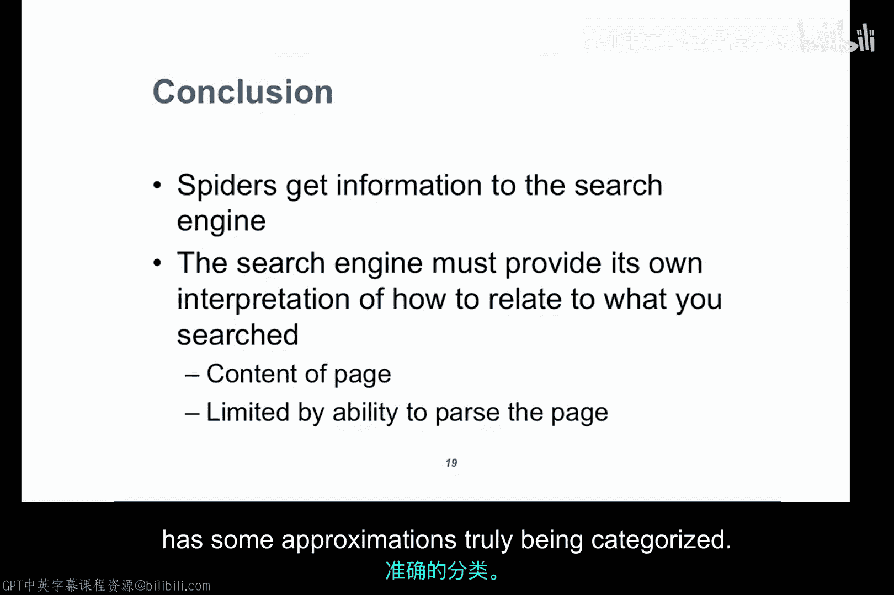

**信息保障分析：模块8：搜索引擎原理**

在本节课中，我们将学习搜索引擎的工作原理。我们将了解搜索引擎如何获取并理解网络信息，如何决定向用户展示哪些搜索结果，以及它们存在哪些局限性。课程最后，我们还将简要介绍如何构建一个 `robots.txt` 文件。

---


### **概述：搜索引擎如何“看”世界**

搜索引擎理解网络世界，主要依赖于一个被称为“网络爬虫”的程序。我们可以通过一张图来理解其基本工作流程。


上一节我们概述了搜索引擎的宏观目标，本节中我们来看看其核心组件——网络爬虫的具体工作方式。


网络爬虫（也被称为蜘蛛、机器人等）是一个自动浏览网页的应用程序。它从一个起始网页开始，提取该页面上的所有链接，并将这些新链接加入待访问列表。然后，它会依次访问列表中的新页面，重复这个过程，从而像蜘蛛网一样遍历互联网。


以下是其工作流程的关键步骤：
1.  **访问页面**：爬虫访问一个网页。
2.  **提取链接**：爬虫提取该页面上的所有超链接。
3.  **更新列表**：将这些新链接加入待访问队列。
4.  **重复遍历**：爬虫从队列中取出下一个链接，继续访问和提取过程。

在这个过程中，爬虫还会记录每个网页被其他网页引用的次数（即入链数量），这些信息对后续的页面排名至关重要。所有收集到的网页数据会被存入一个庞大的存储系统中。

---


### **从数据到索引：搜索引擎的“大脑”**

上一节我们介绍了爬虫如何收集原始数据，本节中我们来看看搜索引擎如何将这些杂乱的数据整理成可快速查询的索引。


存储系统收集了海量网页数据后，需要经过“索引器”的处理。索引器会分析网页内容，建立模型，以便用户搜索时能快速找到相关结果。


网页排名技术的发展经历了几个阶段：
*   **手工索引时代**：早期如雅虎的目录是完全人工编辑的，效率低下。
*   **文本分析时代**：第二代索引开始自动扫描网页文本，并根据以下因素建立排名：
    *   关键词在文档中的位置（如靠近顶部）。
    *   关键词的重复频率。
    *   关键词与其他词的关联情况。
*   **链接分析时代**：随后，以谷歌创始人拉里·佩奇命名的 **PageRank** 算法出现了。它革新了页面排名方式，其核心思想是：**一个网页的重要性取决于链接到它的其他网页的数量和质量**。

PageRank 算法本质上计算的是用户访问某个网页的概率。它通过构建网页间的链接关系矩阵（邻接矩阵），并计算其主特征向量来实现。公式可以简化为：


**PR(A) = (1-d) + d (PR(T1)/C(T1) + ... + PR(Tn)/C(Tn))**

其中：
*   `PR(A)`：网页 A 的 PageRank 值。
*   `PR(Ti)`：链接到 A 的网页 Ti 的 PageRank 值。
*   `C(Ti)`：网页 Ti 的出站链接总数。
*   `d`：阻尼系数，通常设为 0.85。

谷歌不断优化其算法，例如考虑链接锚文本、打击恶意刷排名（如创建大量垃圾链接指向某个网站）等。但 PageRank 的核心思想依然是：**基于链接的流行度投票**。这意味着搜索结果可能偏向大众文化或经过精心优化的内容。


为了改善这一点，可以为网页添加丰富的语义数据，例如：
*   标注重要信息的标签。
*   使用规范的元数据描述网站内容类型。
*   采用语义网技术。

---

### **与爬虫共舞：robots.txt 文件**

上一节我们探讨了搜索引擎如何排名，本节中我们来看看网站管理员如何与爬虫互动，这主要通过 `robots.txt` 文件实现。


网站管理员与网络爬虫的关系复杂。一方面，爬虫是网站被搜索引擎收录的关键；另一方面，爬虫“智商”有限，可能抓取不应公开的内容，或对服务器造成负担。因此，控制爬虫行为是网站管理的重要任务。

`robots.txt` 文件是网站管理员与爬虫沟通的主要渠道。爬虫访问网站时，会首先查看该文件，并（在遵守规则的前提下）按照其中的指令行动。

一个基本的 `robots.txt` 文件示例如下：


```
User-agent: *
Disallow: /
```

这段代码的含义是：
*   `User-agent: *`：指令适用于所有爬虫。
*   `Disallow: /`：禁止抓取网站的所有内容。

当然，更常见的用法是精细控制，例如允许抓取但禁止访问某些特定目录。


---

### **识别网络爬虫**

在进行网络分析时，识别出爬虫流量非常重要，因为大量爬虫请求可能会“污染”数据集，影响对真实用户行为的分析。如果你确信爬虫活动无害，可能希望过滤掉这些数据。


有以下几种方法可以识别爬虫：
1.  **IP地址列表**：许多公司会公开其爬虫使用的IP地址段。但需要注意，这些IP地址可能会频繁变动，因此需要定期更新列表。
2.  **DNS反向查询**：对访问IP进行反向DNS查询，爬虫的主机名通常包含“googlebot”、“bingbot”等明显标识。
3.  **行为分析**：这是最有趣且简单的方法。爬虫的行为与人类用户有显著差异。


如图所示，X轴代表对特定网站的请求测试次数，Y轴代表连续成功的请求数。爬虫的行为模式非常典型：它会持续发起大量请求，即使遇到失败（如404错误）也毫不气馁，从而产生一连串的失败记录。而正常用户在几次失败后通常会放弃。这种行为特征是识别自动化爬虫的良好指标。

---

### **总结**

本节课中，我们一起学习了搜索引擎的核心原理。

1.  **信息收集**：网络爬虫作为“侦察兵”，自动遍历互联网，收集网页数据和链接关系。
2.  **索引与排名**：搜索引擎对收集的数据进行索引，并运用如 **PageRank** 等算法，基于链接流行度和内容相关性对网页进行排名。
3.  **交互与控制**：网站管理员可通过 `robots.txt` 文件指导爬虫的访问行为。
4.  **识别与局限**：我们可以通过IP、DNS和行为特征识别爬虫流量。同时，搜索引擎存在局限，例如难以有效抓取和索引动态生成的网页内容（据估计，仅有约1/6的网络内容被充分索引）。



搜索引擎的最终目标，是在用户查询时，从其庞大的索引中快速返回最相关、最有用的结果。