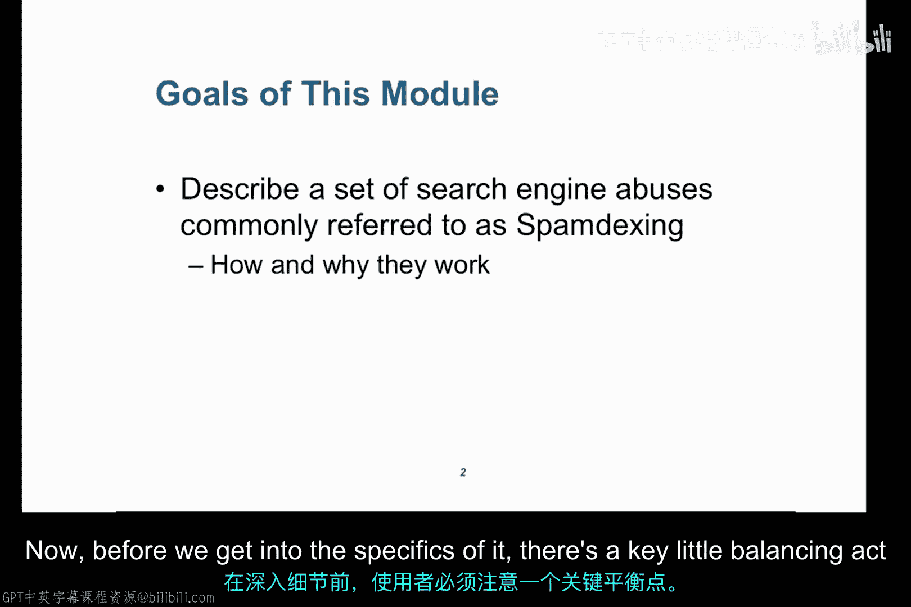
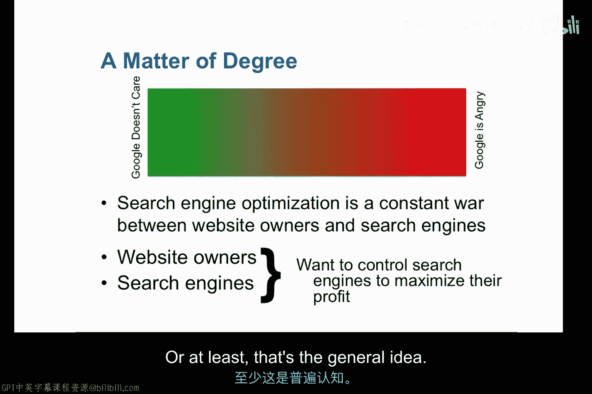
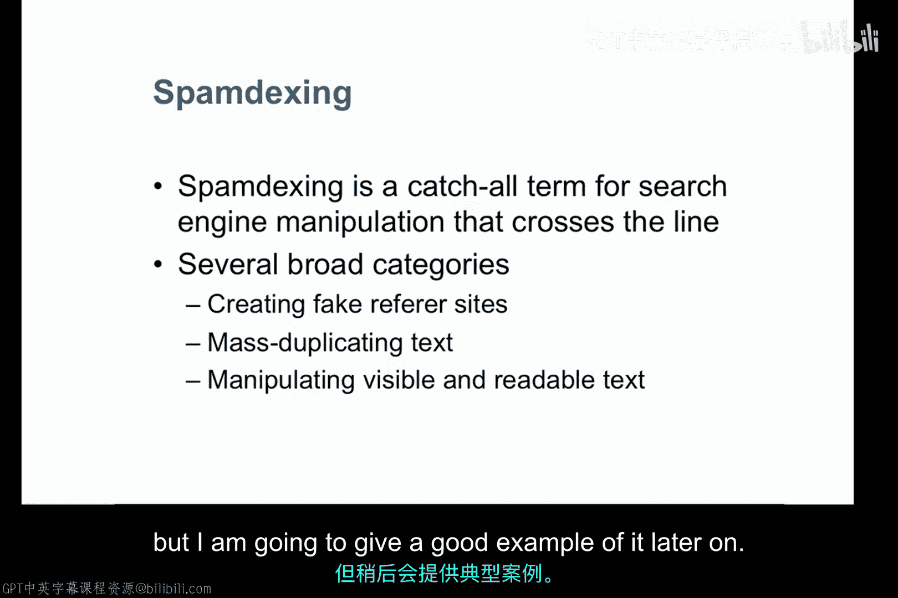
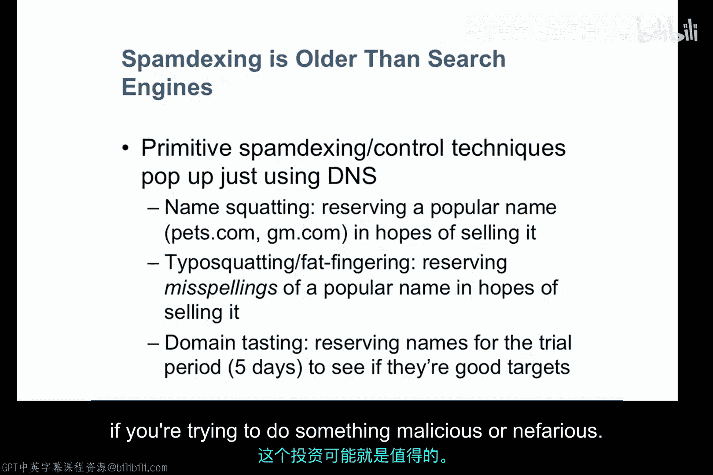
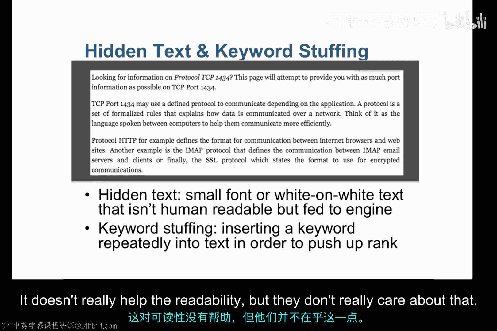
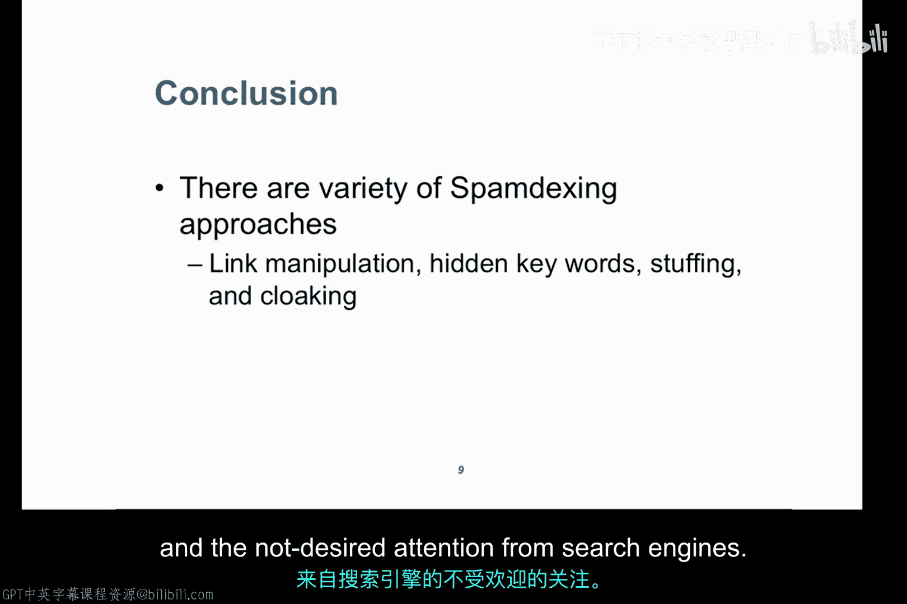

# 034：搜索引擎滥用行为 🔍

在本节课中，我们将学习搜索引擎滥用行为，通常被称为“垃圾索引”或“黑帽SEO”。我们将探讨其工作原理、常见类型以及实施者为何要承担风险。理解这些概念有助于我们识别并防范网络中的不良行为。

## 概述

搜索引擎优化（SEO）旨在提升网站在搜索结果中的排名。然而，一些人会采用欺骗性手段来操纵排名，这些行为被称为搜索引擎滥用。实施者需要在提升排名与避免被搜索引擎惩罚之间找到平衡。





## 搜索引擎滥用的主要类型

以下是几种常见的搜索引擎滥用技术。

### 域名抢注

域名抢注是指抢先注册热门或有价值的域名，以期日后出售获利。这种行为甚至早于搜索引擎出现。



*   **举例**：注册类似 `pets.com` 的流行域名。
*   **真实案例**：曾有一群人在星巴克大声讨论他们计划开发的网站域名，被旁边的人听到并抢先注册，然后向他们高价出售。

### 误植域名抢注

误植域名抢注是注册与知名网站域名拼写非常相似的域名，利用用户的拼写错误。

*   **目的**：
    1.  进行恶意活动，诱骗访问错误网站的用户。
    2.  迫使合法网站所有者高价回购该域名。
*   **举例**：注册 `bankamerica.com`（正确应为 `bankofamerica.com`）。

**技术实现**：这种行为常通过“域名尝鲜”来实施，即在5天试用期内注册域名，测试其流量价值，以降低操作成本。

### 隐藏文本与关键词堆砌

上一节我们介绍了域名层面的滥用，本节我们来看看在网页内容上的操纵手法。

**隐藏文本**是在网页中添加用户不可见但能被搜索引擎爬虫读取的文本，以提升特定关键词的排名。



*   **实现方式**：使用白色文字、极小字体或将文本置于页面边缘。
*   **代码示例**：
    ```html
    <p style="color: #ffffff; font-size: 1px;">这里是一长串用户看不见但搜索引擎能读到的关键词。</p>
    ```

**关键词堆砌**则是在页面可见内容中过度重复关键词。虽然效果不如隐藏文本，但仍被使用。

*   **举例**：在页面顶部段落中反复出现“TCP 1434”等术语，牺牲可读性以换取排名。

### 链接操纵



链接操纵通过大量外部链接来提升目标网站的排名。

*   **著名案例**：有人通过操纵，使谷歌搜索“miserable failure”（可悲的失败）时，乔治·W·布什的传记页面成为第一条结果。这并非恶意攻击，但有力证明了该技术的威力。

### 障眼法

障眼法是一种对 `robots.txt` 文件的巧妙操纵。它向搜索引擎爬虫和普通用户展示不同版本的网站内容。

*   **工作原理**：
    1.  搜索引擎爬虫访问时，服务器根据 `robots.txt` 指示，返回一个充满目标关键词的页面以提升排名。
    2.  普通用户访问时，服务器则返回正常的网站内容。
*   **核心逻辑**：利用 `robots.txt` 文件区分爬虫和人类用户，从而进行内容投喂。

## 总结



本节课我们一起学习了多种搜索引擎滥用行为，包括**域名抢注**、**误植域名抢注**、**隐藏文本**、**关键词堆砌**、**链接操纵**和**障眼法**。这些技术虽然能短期内提升排名，但都越过了道德与规则的界限，极易引起搜索引擎的注意并招致惩罚（如降低排名或从索引中移除）。理解这些手法有助于我们更好地维护网络信息的公正性与安全性。