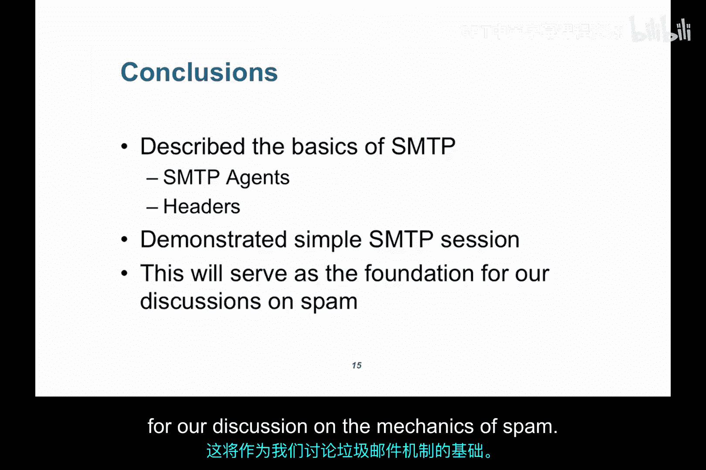

# 035：SMTP协议概述 📧

在本节课中，我们将学习电子邮件的基础协议——简单邮件传输协议（SMTP）。我们将了解SMTP的基本工作原理、相关代理角色、消息传递过程，以及它与电子邮件服务的关系。理解SMTP是后续探讨垃圾邮件（Spam）及其对抗机制的重要基础。

## SMTP简介

SMTP，即简单邮件传输协议，是整个电子邮件系统的基石协议。电子邮件本身是一个非常复杂的系统，实际上是多个协议交互的结果。然而，最基础的协议就是我们所说的SMTP。

上一节我们介绍了课程的整体目标，本节中我们来看看SMTP的核心概念。你需要从本模块掌握的是SMTP的基本操作、SMTP代理是什么、信息如何来回传递，以及SMTP协议与电子邮件服务之间的关系。因为电子邮件实际上是至少三个协议（可能更多）交互的产物。这部分原因在于电子邮件悠久的历史，它是互联网上最古老的协议之一，最初设计用于连接那些已有自己邮件系统的通信。

## SMTP协议的本质

我希望你从本节中获得的是对SMTP协议实际样貌的理解：消息如何来回发送、如何登录等。在某种程度上，这些知识已经过时，因为如今很难找到一个开放的SMTP服务器。但理解通信如何进行以及你的客户端实际在做什么，仍然很有益处。

那么，SMTP到底是什么？从根本上说，SMTP是一种路由协议。在这方面，它与BGP有一些共同行为，因为它是一种存储转发协议。我想给你发邮件，我与一个系统通信，该系统说“好的，我可以传到这里”，然后它把消息传递给一个中继，中继重复这个过程，就像传递数据包一样。

如果你查看你的SMTP消息内部，在你的邮件客户端中有一个“查看完整邮件头”的选项。如果你这样做，你会看到类似我在这里展示的一系列“Received”头信息。这一系列头信息实际上显示了邮件消息到达你所经历的逐步传递过程。

例如，你在这里看到的版本是我发送给我自己 `M.Collins@i` 的邮件。你会看到在此之前，它在 `listbox.com` 这个主机上。`listbox.com` 又从服务于 `cs.cmu.edu` 的 `SMTP03` 服务器获得，而 `SMTP03` 又是从康卡斯特（Comcast）获得的，以此类推。所以你会看到这一系列主机，并且可能会惊讶于有多少主机参与了你的消息传递。你可能认为这是ABC式的简单过程，但你可能会看到8到10个，甚至20个主机参与传递这些消息。

## SMTP的运作方式

SMTP实际上是一种点对点协议，因为它由一个对等网络组成。它们在TCP端口25上进行通信。对于经过身份验证的SMTP，通常在端口587。然后还有这些有着奇怪名称的服务器：MSA、MTA、MX。这些实际上都是同一个应用程序——SMTP服务器——所扮演的不同角色。在某些情况下，它们甚至是同一台服务器。这基本上只是描述了从一个用户到另一个用户的路径：用户提交给MSA，MSA传给MTA，MTA可能传给多个MTA，最后MTA传给MDA，然后MDA传递给接收者。每一个环节都只是路由和处理过程中的一个步骤。

以下是SMTP系统中的关键代理角色：
*   **MUA（邮件用户代理）**：即我们通常认为的电子邮件客户端，如Outlook或Mail应用。如果你使用Gmail，它隐藏在幕后，通过SMTP与服务器通信以提交你的消息。
*   **MSA（邮件提交代理）**：实际上是与SMTP开始通信的服务器。
*   **MTA（邮件传输代理）**：在网络中来回传输消息，直到它们到达MDA。
*   **MDA（邮件投递代理）**：这是将邮件送达目标邮箱的东西。

## 电子邮件与SMTP的区别

这里我们进入了电子邮件和SMTP的区别。你**不**使用SMTP来阅读你的电子邮件。你使用SMTP来**发送**你的电子邮件。你的电子邮件是通过一个通常称为邮局协议的协议来访问的。经典的有两种：最古老的POP（邮局协议）和另一个标准协议IMAP（互联网消息访问协议）。这些协议实际上是将你的消息存储在邮件服务器上，让你可以访问它们、放入文件夹等。基本上是一个消息数据库。我得到一个IMAP ID，可以查询邮件服务器，它可以返回相关的消息。

除此之外，DNS深深嵌入在SMTP中。你可能记得我在DNS部分提到过，DNS中有一个MX记录，它与邮件相关。事实上，它是这样工作的：让我们谈谈如何查询邮件交换记录。我想给 `someone@yahoo.com` 发邮件。我知道电子邮件地址类似于 `ob@yahoo.com`，但这并没有告诉我雅虎的哪台机器会开放SMTP会话。我查找一个MX记录，例如使用 `dig` 命令加上 `MX` 选项。你会看到在这种情况下，有 `smtp.mail.yahoo.com` 等。

这里我想让你注意的另一件事是旁边这组数字。MX记录包含所谓的“优先级值”。优先级值是一种距离度量，其工作方式与BGP中的距离度量类似：数值越低，意味着你会获得更好的路由。你会注意到在雅虎的例子中，他们给所有记录分配了相等的值。组织这样做有几个主要原因，其中一个主要原因是垃圾邮件发送者。过去，你会将最低的度量值分配给你最希望人们联系的服务。历史上，你会看到一种指数级的后备方案：一定比例的用户去排名最高的服务器，X/4去第二高的，X/9去第三高的，以此类推。垃圾邮件发送者发现，优先级值高意味着那台服务器维护较少、监控较弱，因此他们会优先选择高优先级的服务器。这可能是雅虎决定平等权衡邮件服务器的原因。当然，我不一定说情况就是如此，但你经常会发现这一点。

## SMTP消息与邮件头

SMTP是信息安全战争的前线。垃圾邮件和反垃圾邮件是历史上最古老的战斗。正因为如此，你会看到SMTP发生了很多变化：实际使用中的SMTP与理想中的SMTP。因为多年来人们发现，垃圾邮件发送者会尽一切人力所能及的办法来利用它。所以，当你查看实际的SMTP时，你会看到很多“战斗伤痕”。

SMTP消息包含电子邮件头。电子邮件头是SMTP的元数据，相当于TCP选项、BGP选项之类的东西。我之前展示的那些“Received”头就是电子邮件头的一个例子。

大多数电子邮件头都相当不言自明。例如，你需要一个“From”头、“To”头和“Subject”头，分别表示发件人、收件人和主题。此外，还有一系列其他值得关注的头信息。

以下是可选头信息类别：
*   **Received头**：基本上充当“洗衣票”，显示邮件经过的每一步。
*   **Message-ID头**：该邮件的全局唯一标识符。
*   **Reply-To头**：指定回复邮件时发送给谁。

让我们谈谈“Received”头。我早些时候向你展示过一些。沿着传输链的每一封邮件，你都会看到它。你通常会看到在连续的“Received”头之间发生顺序过滤。例如，如果“由服务器X接收”，并且某个反垃圾邮件系统在其中丢弃了几个头或添加了一些头来指示反垃圾邮件操作的类型，这些头通常会出现在两个“Received”头之间，表明“这里发生了这个”。“Received”头相当直截了当：有一个DNS名称，一个IP地址，以及发生事件的日期。

下一个值得注意的是“Message-ID”。Message-ID是该邮件消息的全局唯一标识符。如果你查看Message-ID，你会注意到它们附加了一个类似电子邮件地址的域名。这是为了确保消息的全局唯一性，因为这意味着它只在该域内生成唯一的ID，附加域名是为了确保唯一性。

除了Message-ID，还有“Reply-To”头。“Reply-To”头指定当你回复时应将消息发送给谁。垃圾邮件发送者经常调整它，他们会放入一个空白地址或类似的东西。你经常会发现，某些类别的恶意软件邮件，如果你点击回复，会发现没有合理的回复地址，这就是使用“Reply-To”头实现的。

除此之外，还有可选头，通常以“X-”开头。它们不受SMTP支持，但会沿路径传递。你会在“X-”头中放入很多东西，你会看到很多加密类型的信息。你还会看到来自反垃圾邮件系统的消息。许多反垃圾邮件系统实际上并不阻止或停止邮件，它们只是对其进行注释，表明它们是否认为是垃圾邮件。反垃圾邮件系统会添加一大堆关于它是否认为某物是垃圾邮件的细节，并且实际上会包含一种“收据”，展示它做出该决定所使用的推理过程。

## 一个简单的SMTP会话

这基本上是你对SMTP的快速概览。现在让我们实际谈谈一个SMTP会话是什么样子的。回到20世纪90年代，在那些纯真的日子里，我们曾经通过直接向SMTP服务器发送邮件来惹恼我们的朋友。你通过直接 `telnet` 到SMTP服务器并发送SMTP会话来做到这一点，很像HTTP可以在命令行完成。SMTP和HTTP的区别在于，因为垃圾邮件发送者会找到开放的SMTP服务器并立即开始使用它，所以我们不再在公网上开放SMTP服务器。

这是一个简单的SMTP会话。首先，你 `telnet` 到你的SMTP站点的25端口。你会收到一条关于它位置的消息。然后你联系它。你做的第一件事是发送一个“HELO”消息，说明你来自哪里。如今大多数时候，如果你这样做，SMTP服务器要做的第一件事就是进行反向查找来双重检查你。无论如何，你把你的名字放在那里，你发送（指定）收件人，然后你发送消息。传统上，这是用“DATA”语句完成的，要终止消息，你在一行中输入一个英文句点“.”，然后回车。无论如何，你必须放入邮件头。所以你会看到消息开头，发件人放入了这些头：From、To、Date和Subject，然后只是一条简短的消息。这就是我们过去自娱自乐的方式。在那之后，它停止接受数据，然后返回到SMTP命令模式，然后你只需“QUIT”就完成了。

正如我所说，这是我们在90年代常做的那种事情，因为它很有趣，令人困惑，而且很酷。你现在再也看不到这种事了。这是那些基本上已经成为历史的事情之一，因为垃圾邮件发送者寻找SMTP服务器，因为这对他们来说异常方便。

## 现代SMTP的演变

让我补充一点，当我说垃圾邮件发送者寻找SMTP服务器时，我使用的是有点过时的信息。如今，大多数垃圾邮件软件、大多数恶意软件都包含用于发送消息的SMTP服务器。过去，垃圾邮件发送者会寻找我们所谓的“开放中继”。大多数SMTP服务器连接到一个域的边界。所以如果它是 `A.com` 的边界，那么所有消息必须要么源自 `A.com`，要么发往 `A.com`。开放中继会接受来自任何地方、发往任何地方的消息。过去，我们经常在互联网上进行检查，发送邮件给人们让他们关闭他们的开放中继，因为垃圾邮件发送者喜欢开放中继。SMTP的基本设计是开放和友好的，因此基本上像塞伦盖蒂草原上受伤的羚羊一样生存机会渺茫。这导致了这种（开放）做法的消亡。现在基本上每个人都锁定了他们的SMTP服务器，进行身份验证保护，只接受来自有限服务器集合的连接，等等。

## 总结

本节课中我们一起学习了SMTP的基础知识。我们讨论了SMTP代理，讨论了邮件头。我向你展示了一个简单的SMTP会话是什么样子的。我特别向你展示了邮件头的作用，尤其是“Received”头的作用，以及这些可选的“X-”头如何为讨论垃圾邮件的机制奠定了基础。