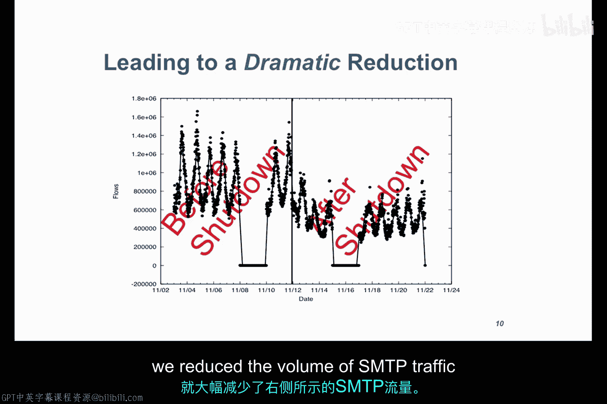

# 036：垃圾邮件问题 🚫📧

在本节课中，我们将学习垃圾邮件的基础知识。我们将回顾SMTP协议，探讨垃圾邮件的定义、影响、检测指标、缓解策略，以及它在不同媒介中的传播方式。课程内容将涵盖垃圾邮件对网络基础设施的影响，以及服务提供商如何应对这一挑战。

## SMTP协议与垃圾邮件

上一节我们介绍了SMTP的基础知识，本节中我们来看看垃圾邮件如何利用SMTP协议进行传播。

电子邮件系统由多个协议协同工作：
*   **地址查询**：由DNS处理。
*   **邮件路由**：由SMTP处理。
*   **收件人收取邮件**：由IMAP或POP3处理。

我们主要关注SMTP协议。垃圾邮件发送者会滥用SMTP协议。历史上，路由中讨论的“距离度量”也是服务器维护程度的指标。受青睐的服务器通常受到许可反垃圾邮件组织（如IronPort或Wellmail）的密切监控，并被列入黑名单。垃圾邮件发送者倾向于使用“高距离”服务器，即那些更偏远、监管较松的服务器。

一些防御者会安装虚假的高距离服务器作为陷阱，这种做法称为“黑洞列表”，其效果各不相同。在当今环境下，这种方法的影响已不如前，但仍在使用，并且可能非常有效。

## 开放中继与黑名单

邮件服务器有“中继”的概念，它们知道向哪个网络发送邮件。然而，历史上存在一些“开放中继”邮件服务器，它们被垃圾邮件发送者广泛滥用，并最终被列入黑名单。

理论上，任何人都可以在自己的网络上设置一个开放的邮件中继。这个中继会将接收到的任何邮件路由到任何目的地。它本意是作为一种促进连接和内容传递的方法。但和大多数内容传递机制一样，人们最初并未充分考虑其负面影响。

垃圾邮件发送者开始将这些开放中继作为他们的中转站。问题在于，那个拥有开放中继IP地址的主机会被列入黑名单。该主机的所有者将背负“垃圾邮件发送者”的指控，而他们可能对此毫不知情。我们可以假设大多数情况下他们并不知情。

在后续的一些课程中，你会看到被列入黑名单是非常麻烦的。不仅你的IP地址会被列入黑名单，还存在用于确定特定域名是否可信的域名解析选项。仅仅是你域名下的一个主机被列入黑名单，就可能对你整个域名的信誉和邮件送达能力产生非常负面的影响。

## 垃圾邮件的定义与规模

在继续深入之前，我们需要了解垃圾邮件的规模。

我认为在座的各位都理解什么是垃圾邮件。对于那些不熟悉的人，最直接的描述是：一堆你并不想要、未经请求、旨在让你购买产品、使用服务或窃取你个人信息的垃圾信息被发送到你的收件箱。

当我们谈论垃圾邮件的数量时，需要认识到，如果你明天就消除所有垃圾邮件，你所处理的邮件流量将大幅减少。保守估计，高达90%的邮件流量是垃圾邮件。这导致在2010年，每天约有20亿封垃圾邮件，平均每人每小时收到2封。

在我看来，这个比例可能还被低估了，因为垃圾邮件通常体积很小，不是那种大体积的高容量邮件。如果我们只处理SMTP流量的绝对数量，这个数字可能掩盖了实际的邮件数量。同样，因为它们体积小，实际数量可能更多。由于垃圾邮件过滤器的存在，你最终只看到这些信息中的一小部分。

## 垃圾邮件的影响与ISP的动机

服务提供商（ISP）真的不希望这些垃圾邮件链接出现在他们的网络上，原因多种多样。但更重要的是，他们拥有被这些垃圾信息堵塞的基础设施。他们本可以通过传输有效数据来赚钱，但如果传输的是垃圾数据，他们就无法为此收费。这对他们无益，对他们的客户也无益。

因此，他们尽力在网络层面清除垃圾邮件，但这并不能完全解决问题。我必须对这张幻灯片的标题一笑，因为Mike是制作它的人。

垃圾邮件往往是集中、免费、高对比度的内容。在一些第三世界国家，他们接收的垃圾邮件流量甚至超过了其可用带宽。因此，对ISP来说，能够过滤垃圾邮件至关重要。

在后续的一些实验课程中，你会看到许多垃圾邮件操作已转移到不一定是发达国家的地区。原因是法律开始将它们驱逐出第一世界国家。然而，在一些既非第三世界也非第一世界的国家中存在一个“甜蜜点”，它们有足够的带宽支持垃圾邮件操作，但又缺乏严格的法律来限制此类活动。我们将在后续的一节课程中更详细地讨论这一点。

## 案例研究：ISP的应对与“防弹主机”

让我们通过一个案例来了解ISP如何应对以及他们必须担心的问题。

存在一种称为“防弹主机”的服务。防弹主机提供商无论用户发送什么内容都会保持你的服务在线。这些提供商不在乎。例如，Colo曾是一个主要的垃圾邮件发送者McColo的宿主。它只是一个被列入黑名单的垃圾邮件发送者，最终被一个ISP团体联手断网。

我想让大家在继续之前意识到一件事：我们正在谈论的是一群ISP联合起来切断了一个实体的连接。

这张图显示在一个非常大的网络上观察到的SMTP流数量。在最高层级，我们看到从11月2日到11月12日期间，一侧的SMTP流数量对另一侧产生了影响。如图所示，有几个高流量时期。你可以看到季节性和昼夜模式，这指示了一周中的实际天数，然后在周末流量急剧下降，工作日又开始回升。

有趣的是，我们无法为它们找到一个单一的、明确的改变原因。但仅仅通过采取行动（指断网McColo），我们就将SMTP流量减少了多达图中所示的程度。

## 总结

本节课中，我们一起学习了垃圾邮件的核心问题。我们回顾了SMTP协议如何被滥用，了解了垃圾邮件的巨大规模及其对网络基础设施的严重影响。我们还探讨了服务提供商过滤垃圾邮件的动机，并通过案例看到了协同行动能显著降低垃圾邮件流量。理解这些基础是后续深入学习垃圾邮件检测与缓解策略的关键。