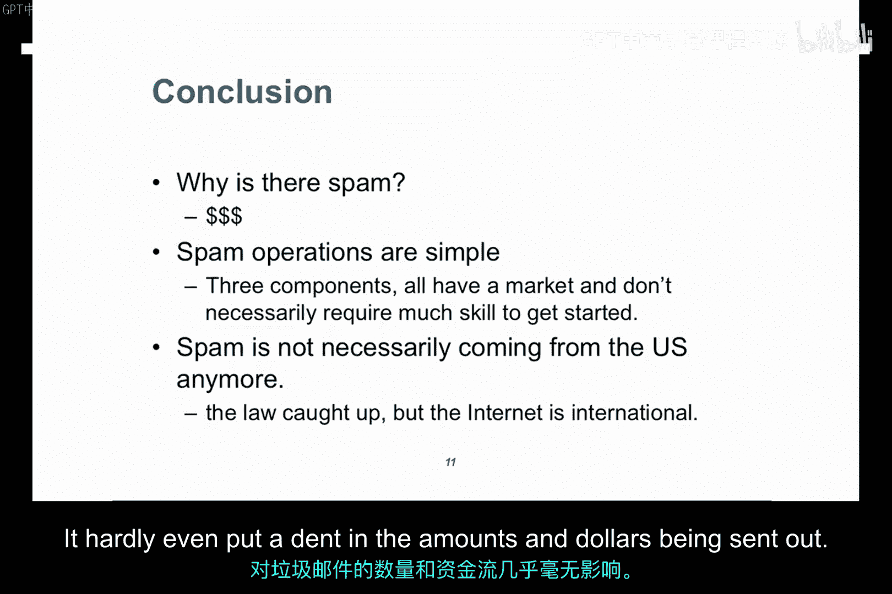

# 037：垃圾邮件发送者视角 🕵️♂️

在本节课中，我们将从垃圾邮件发送者的视角，探讨垃圾邮件产业的运作方式。我们将了解其背后的动机、盈利模式、有效原因以及其组织架构。通过本课，你将能够解释垃圾邮件活动为何存在，以及它是如何在全球范围内运作的。

---

## 垃圾邮件为何如此普遍？📧

上一节我们介绍了课程概述，本节中我们来看看垃圾邮件为何如此普遍。根本原因在于其**有效性**。垃圾邮件是驱动全球许多更复杂网络犯罪活动的引擎，历史上被视为利润引擎。它为犯罪者积累资本，以便进行更高级别的犯罪活动。

垃圾邮件之所以有用，是因为它能以极低的成本实现盈利。垃圾邮件发送者建立了对抗各种反垃圾邮件机制的系统，并投入大量资金开发高效软件。他们甚至利用运营所在国家的法律体系，试图限制对其活动的遏制，例如起诉反垃圾邮件者。

---

## 盈利引擎：如何赚钱？💰

既然垃圾邮件是一个盈利引擎，那么他们具体如何赚钱呢？本模块有一篇阅读材料会详细探讨这一点。需要明确的是，我们讨论的是一个年收入达数百万美元的产业。

以下是其主要盈利方式：

*   **营销高利润产品**：主要通过销售利润率高但效果甚微的廉价药品。由于全球化，他们可以非常低廉的成本（例如来自印度、加拿大或中国的标签药品）制造这些产品，然后将其推销给有购买力的美国用户。任何轻信广告并购买的人都会成为受害者。
*   **不对称经济**：这是一个完全不对称的经济模式。操作者可能来自经济规模较小的地区，从美国等第一世界经济体中提取资金。由于当地生活成本低，他们无需赚取数十亿美元就能过上优越的生活，少量收入就足够他们生活多年。

---

## 搭建垃圾邮件运营：需要什么？🔧

在了解了盈利模式后，现在我们来探讨搭建一个垃圾邮件运营体系需要哪些要素。这有助于你理解这些半合法操作背后的心态、组织方式及其目标。

搭建垃圾邮件运营需要三个主要组成部分：

1.  **地址列表**：用于发送邮件的目标邮箱地址集合。
2.  **垃圾邮件工具**：用于发送邮件、规避过滤的软件或系统。
3.  **基础设施**：包括带宽、服务器托管支持，以及从受害者那里提取资金的渠道（如支付处理）。

---

### 地址收集与交易

垃圾邮件发送者从多种渠道收集邮箱地址。

以下是常见的地址来源：

*   **公开帖子**：从论坛、博客评论等公开网络信息中抓取。
*   **模式生成与验证**：利用常见的邮箱命名模式（如 `name@domain.com`）生成大量地址，然后通过发送探测邮件验证哪些地址有效。这个过程自动化程度高，速度极快。
*   **网络爬取**：抓取各类网站上的“联系我们”页面、通讯录等任何包含邮箱地址的页面。

收集到的地址列表本身也具有价值，并形成了一个交易市场。地址根据其新鲜度、有效性和真实性进行评级。你可以购买这些列表，然后用于自己的垃圾邮件活动。需要指出的是，过于复杂的地址隐藏方案价值有限，因为一旦地址被捕获一次，就可能进入这个交易系统。作为网络防御者，更应着力于保护账户，而非仅仅隐藏地址。

---

### 工具与基础设施

我们将在本模块阅读的另一篇论文讨论了网络层面的行为。不仅地址被评级，用于发送垃圾邮件的主机也会根据其是否已被列入黑名单而被评级。信誉良好的主机（即尚未被标记为恶意的）对垃圾邮件发送者来说价值更高。

在90年代中期，大多数垃圾邮件发送者在美国。2003年，美国通过了《CAN-SPAM法案》，这基本上扼杀了美国的垃圾邮件产业，所有操作都转移到了海外。这造成了一种 dichotomy（二分法）：运营基础设施设在海外，主要目标是攻击美国等第一世界国家以获取资金。

这种转变催生了“飞蛾扑火”式的IP地址提供商，它们允许客户托管恶意软件、交易站点等。这些提供商通常信誉较差，但为垃圾邮件发送者提供了必要的网络存在。下图（源自RSA反欺诈行动中心，2009年3月）展示了这种全球化的、去中心化的基础设施网络，其中红色中心节点代表托管恶意软件和交易站点的服务器，连接着世界各地众多自治系统（AS）。

---

## 总结 📝

本节课中，我们一起学习了垃圾邮件产业的运作视角。

主要要点总结如下：

*   **动机纯粹是金钱**：垃圾邮件是获取启动资金、为更复杂犯罪活动融资的便捷方式。
*   **基本构成三要素**：地址列表、垃圾邮件工具和基础设施（带宽/托管）。
*   **存在成熟市场**：所需组件（如软件、地址列表）均可购买，降低了入门门槛。
*   **运营已全球化**：主要运营不再位于美国，法律打击效果受限，全球化使得打击更加困难。
*   **经济不对称性**：从富裕国家提取少量资金，就能在生活成本低的国家产生巨大影响。

理解这些原理，有助于我们更好地设计防御策略，从根源上认识垃圾邮件威胁的持久性和复杂性。