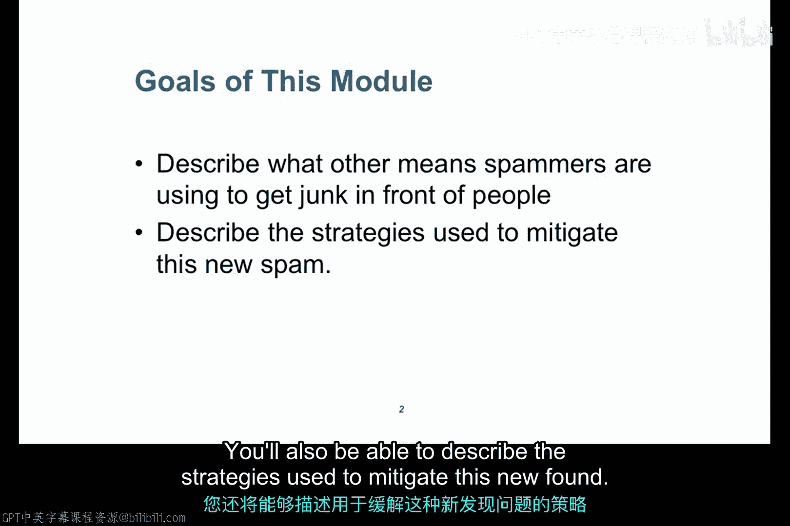
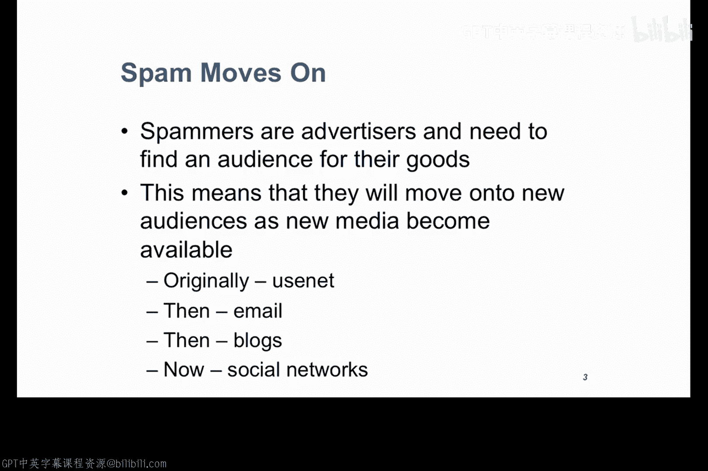
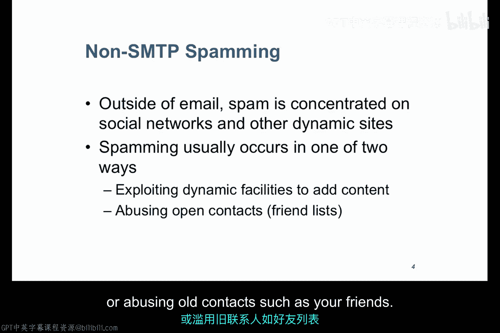
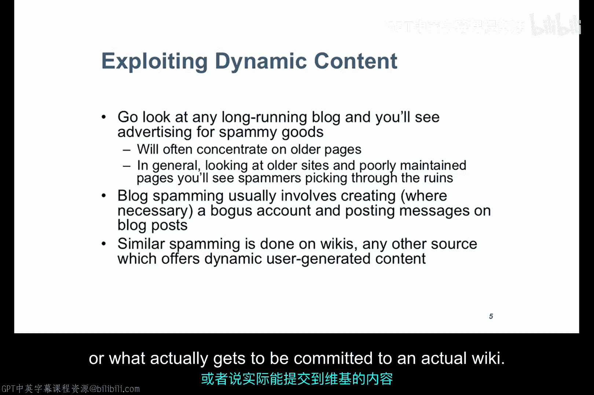
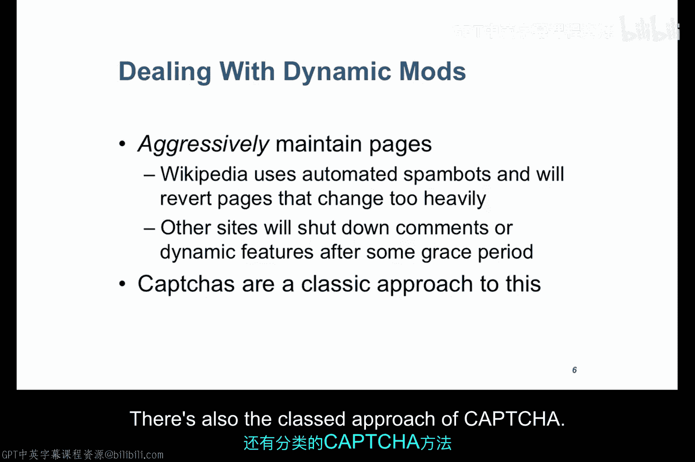
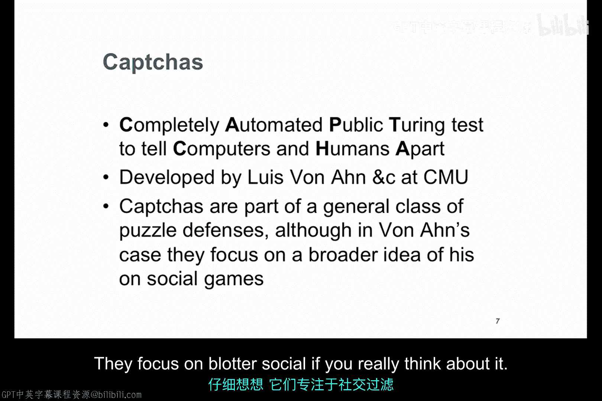
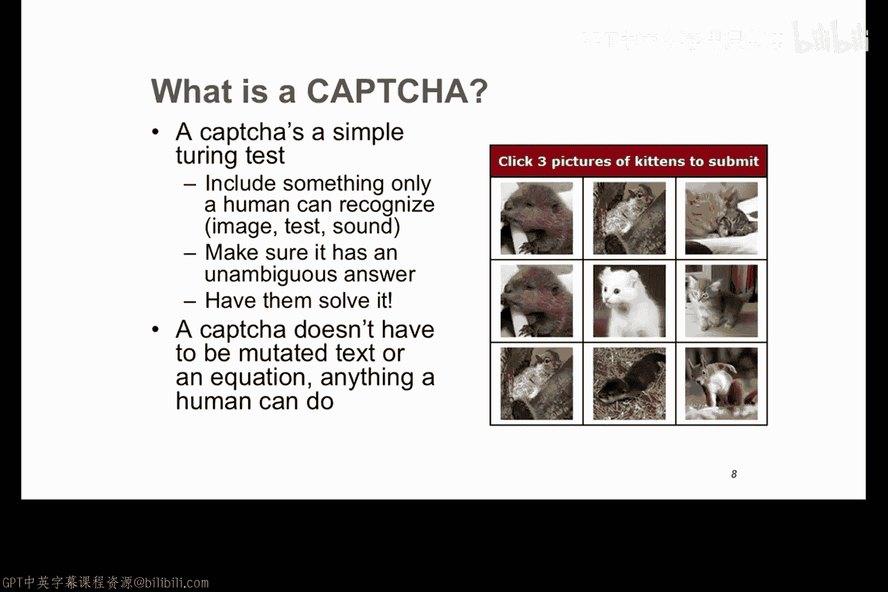
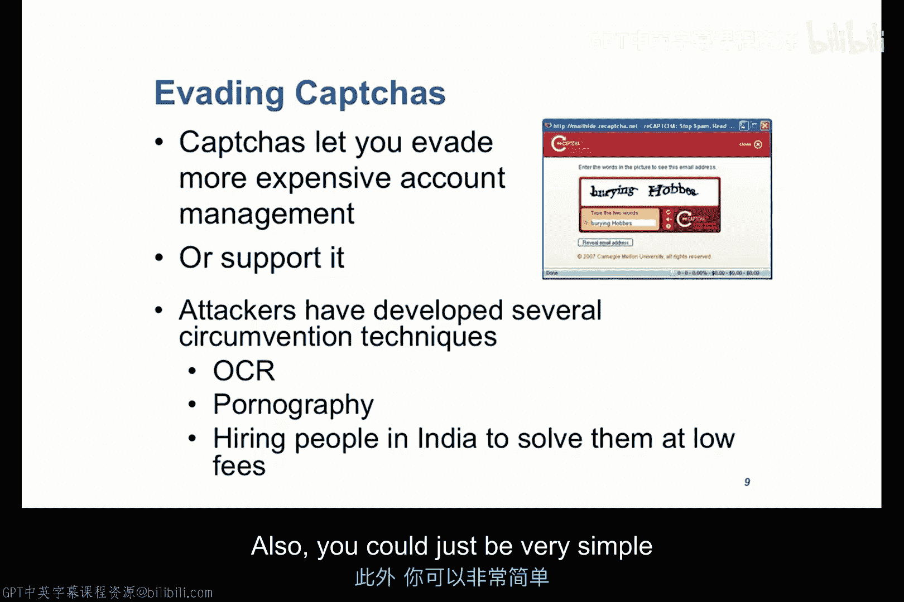
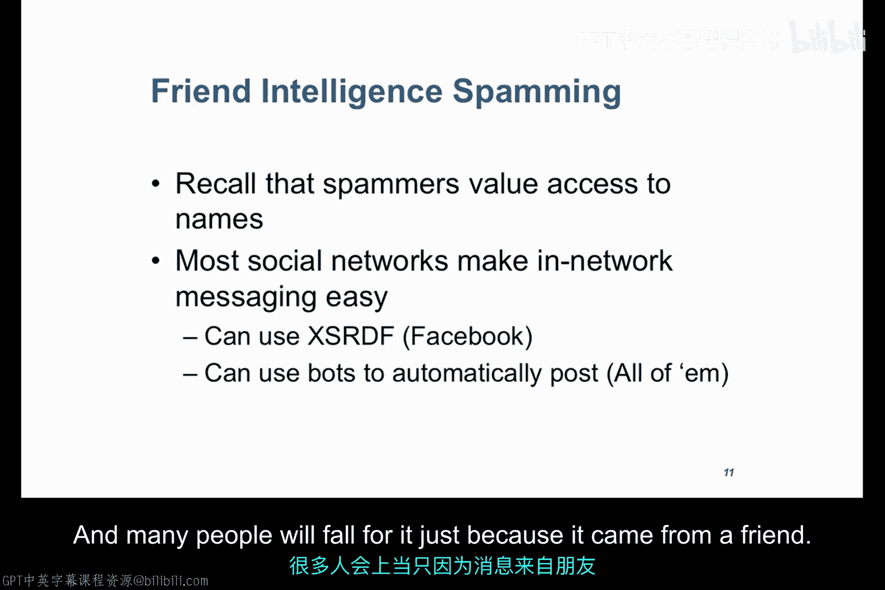
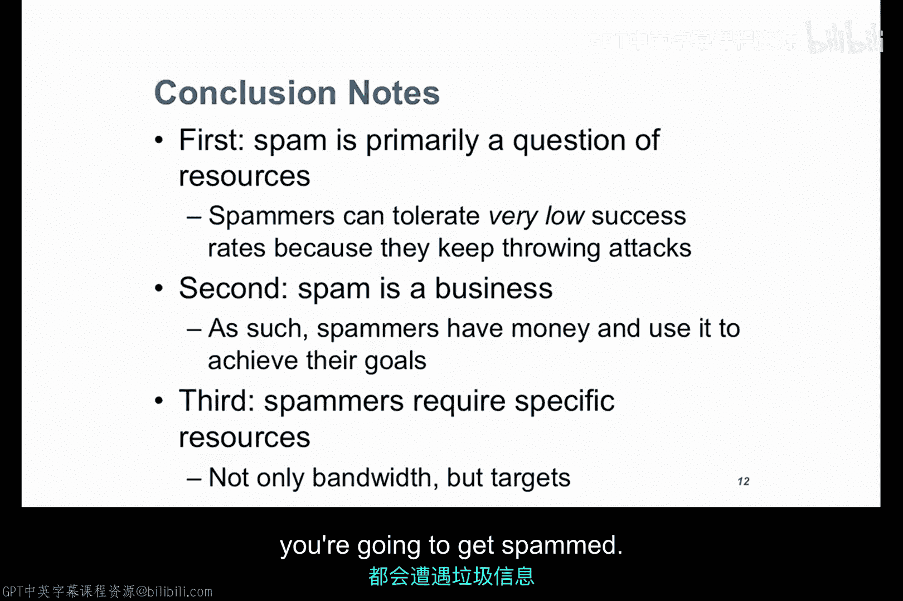

# 039：SMTP之外的垃圾信息传播 🚫

在本节课中，我们将探讨垃圾信息发送者（Spammer）如何利用SMTP电子邮件协议之外的其他渠道传播信息。你将了解垃圾信息传播的新手段，以及用于缓解这些新威胁的策略。





## 概述

垃圾信息传播是一个以盈利为目的的产业。随着电子邮件过滤技术的成熟，垃圾信息发送者开始转向新的媒介和受众。本节将介绍他们如何利用博客、社交媒体等动态网站进行传播，并讨论相应的防御策略。

## 垃圾信息传播的演变

上一节我们介绍了基于SMTP的垃圾邮件。本节中我们来看看，随着新媒体的兴起，垃圾信息发送者如何将阵地转移到电子邮件之外。



垃圾信息发送者是广告商，他们需要寻找新的受众。因此，当电子邮件等传统渠道效果下降时，他们会转向新的媒介。目前，除电子邮件外的垃圾信息主要集中在社交网络和其他动态网站上。



## 垃圾信息传播的两种主要方式

垃圾信息传播通常通过以下两种方式之一进行：

以下是两种主要方式：
1.  **利用动态功能添加内容**：例如，在博客评论区或维基页面上发布垃圾信息。
2.  **滥用联系人列表**：例如，入侵社交媒体账户后，向其好友列表发送垃圾信息。





### 1. 利用动态功能

这种方式通常针对那些允许用户生成内容的动态网站。



以下是具体表现：
*   查看任何长期运行的博客，你可能会看到垃圾评论。
*   垃圾信息常集中在缺乏维护的旧页面或网站上。
*   发送者试图将信息与人们可能搜索的关键词关联起来。

### 2. 滥用联系人列表（社交媒体垃圾信息）

让我们从简单的账户创建转向讨论那些已经建立、并被滥用的账户。垃圾信息发送者会入侵这些账户，并利用其社交关系网络进行传播。



以Twitter为例，存在所谓的“Twitter垃圾信息发送者”。他们的目标是让尽可能多的人关注他们。

以下是常见的策略：
*   **大量关注他人**：快速关注尽可能多的人（早期上限是每天1000人），希望对方回关。
*   **入侵账户**：一旦获得某人的账户访问权限，就能更容易地向其好友列表发送垃圾信息。接收者更可能点击来自“朋友”的链接。
*   **使用机器人（Bots）**：利用自动化程序，通过被入侵的账户向所有联系人发送看似无害的垃圾信息。

## 防御策略

面对这些新型垃圾信息，网站管理者采取了一系列防御措施。维基百科（Wikipedia）是一个很好的案例，展示了如何有效应对。

以下是几种关键的防御策略：
1.  **使用自动垃圾信息检测机器人**：自动扫描并回退被篡改为垃圾内容的页面。
2.  **关闭或限制动态功能**：在一定时间后关闭页面的评论或编辑功能，锁定最终版本的信息。
3.  **采用验证码（CAPTCHA）**：验证码的全称是“**完全自动化的公共图灵测试，用于区分计算机和人类**”（Completely Automated Public Turing test to tell Computers and Humans Apart）。它属于谜题防御的一种，旨在提出一个对人类简单但对计算机困难的问题，用户必须解决后才能继续操作。

**代码示例：一个简单的验证码理念**
```python
# 概念性代码：展示验证码的基本逻辑
def check_captcha(user_input, correct_answer):
    if user_input == correct_answer:
        return True  # 认为是人类
    else:
        return False # 可能是机器
```



然而，验证码并非完美无缺。

以下是验证码的局限性：
*   **可被光学字符识别（OCR）破解**：如果验证码是扭曲的文本，OCR技术可能识别出来。
*   **人工破解**：垃圾信息发送者可以雇佣廉价人力来批量解决验证码。

## 关键要点与总结

本节课中我们一起学习了SMTP协议之外的垃圾信息传播手段。

关于垃圾信息，有几个核心要点需要记住：
*   **低响应率即可盈利**：垃圾信息发送是数量游戏。即使向10000人发送只有1人回应，也可能获利。他们不在乎成功率低，只需持续发送。
*   **这是一门生意**：根本动机是经济利益，而非针对个人。
*   **适应性与演变**：垃圾信息发送者会不断适应新技术和新平台。任何高效的新通信渠道都可能出现垃圾信息。
*   **防御的挑战**：对于Twitter、Facebook、维基百科等我们网络之外的平台，我们很难直接检测其上的垃圾信息。防御重点在于平台方采取的措施（如验证码、自动检测）和用户自身的警惕性。



总之，垃圾信息传播是一个持续演变的问题。发送者会不断寻找并利用新的媒介和技术漏洞。理解他们的动机和手段，是制定有效防御策略的第一步。