# 040：分层模型 📚

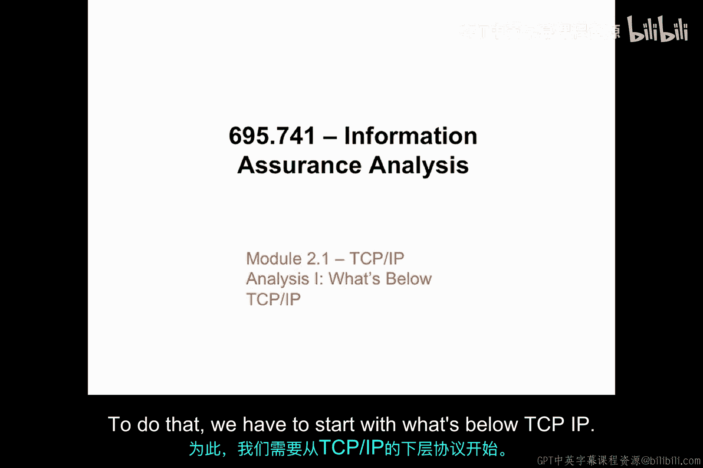

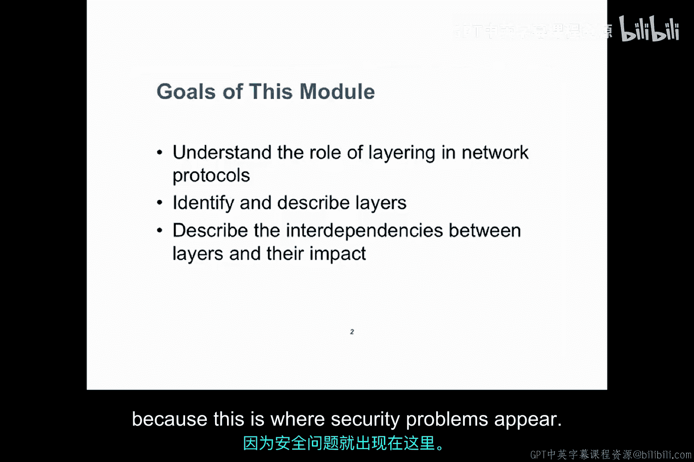

在本节课中，我们将开始学习TCP/IP协议分析。为了理解TCP/IP，我们必须从它之下的基础概念——分层模型开始。

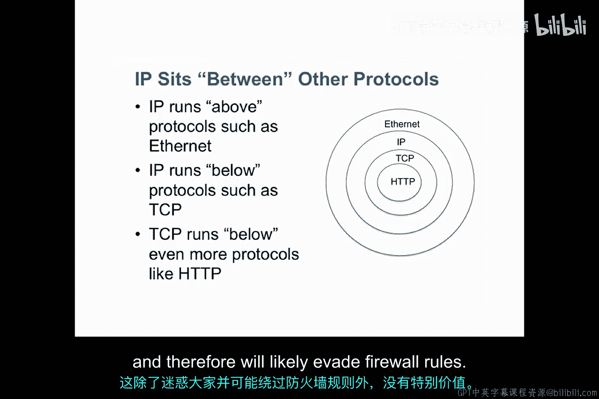

## 概述 📋

本模块的目标是让你理解分层和网络协议的作用。分层用于隐藏网络的复杂性，使其更易于配置和实现。存在多种分层模型。在本模块结束时，你将能够识别和描述这些模型，并理解各层之间的相互依赖性及其影响，因为安全问题往往就出现在这里。

## 分层模型的核心概念 🧱

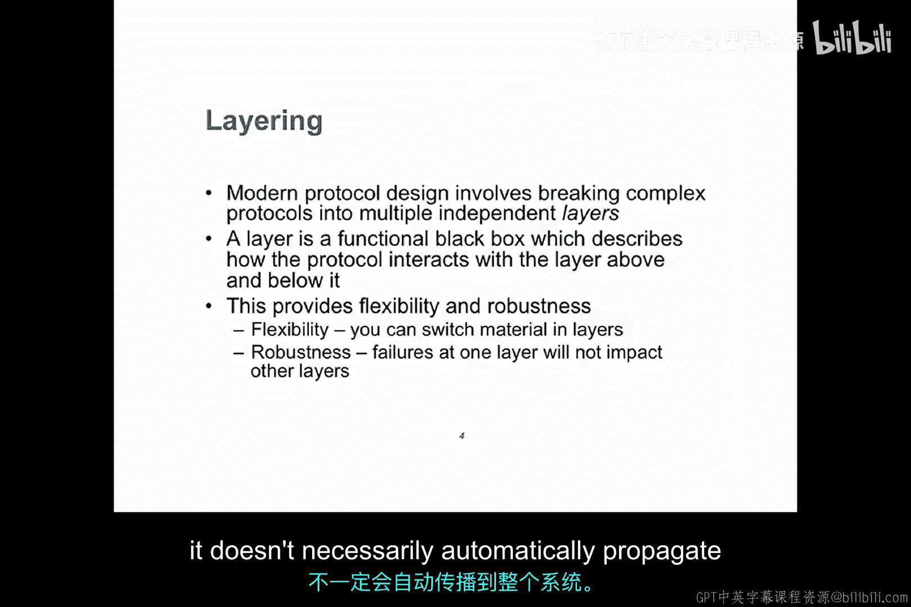

上一节我们介绍了本课程的目标，本节中我们来看看分层模型的核心思想。

在工程学中，一个核心思想是**有限理性**。这意味着工程师审视一个项目时，会为其设定边界以使问题可解。他必须抽象掉某些方面。例如，设计汽车时，你不必担心其环境影响或总体污染，你关心的是如何将能量传递到车轮。在协议设计中，我们通过将协议放入一系列称为“层”的黑盒中来抽象和限定我们的理性。

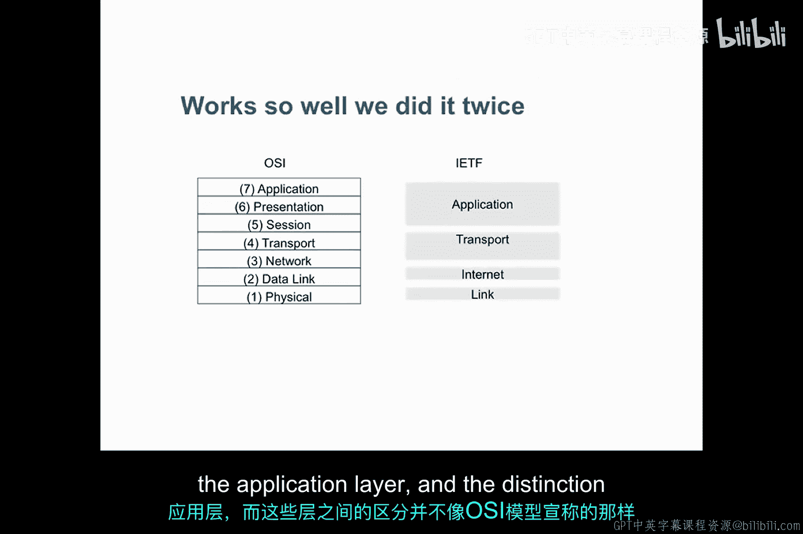

一个层是一个功能性的黑盒，它与上层和下层交互，但不知道这些层内部发生了什么。这为我们提供了灵活性和鲁棒性。灵活性的一个关键特征是，我可以在各种底层链路协议（如以太网、ATM、令牌环）上运行IP协议，而无需过多担心这些底层协议的细节。此外，分层还提供了一定程度的鲁棒性：如果某一层出现问题，它不一定会自动传播到整个系统。

## OSI与IETF分层模型对比 🔄

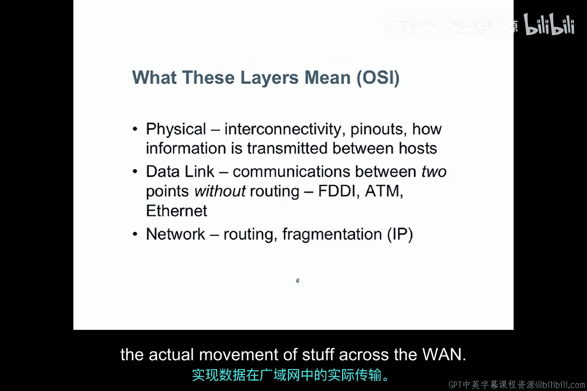

现在，关于分层最重要的一点是它们并不总是完美工作。这部分是因为IETF（互联网工程任务组）信奉“粗略共识和运行代码”，不喜欢复杂的分层方案。而OSI（开放系统互连）模型则钟爱复杂的分层方案。

以下是两种模型的对比：

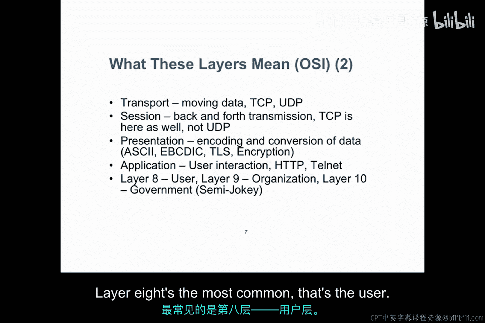

*   **OSI 七层模型**：物理层、数据链路层、网络层、传输层、会话层、表示层、应用层。这个模型出现得比TCP/IP晚，其层与层之间的界限比实际情况更清晰。
*   **IETF 四层模型**：链路层、互联网层、传输层、应用层。IETF有一篇著名论文叫《分层被认为有害》，因此他们的模型分层不那么严格，各层之间的区别也不像OSI模型所宣称的那样清晰。

## 详解OSI模型各层 🗂️

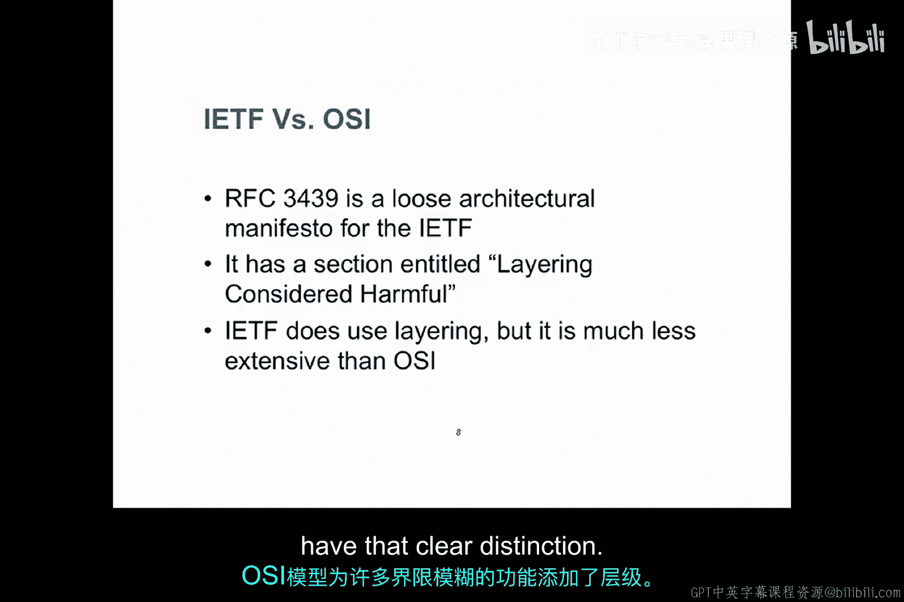

上一节我们对比了两种模型，本节我们来详细看看更复杂的OSI模型各层的职责。

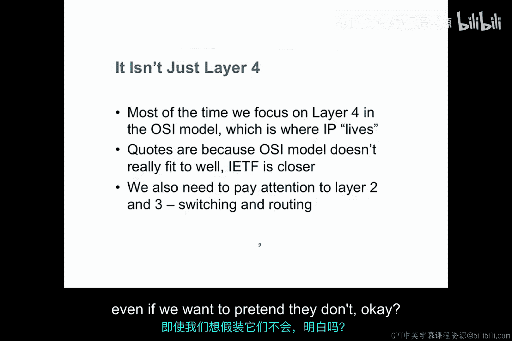

*   **物理层**：关注物理互连。它涉及如何将两台计算机连接起来，包括引脚排列、信息是作为载波脉冲、光束还是电信号传输等问题。
*   **数据链路层**：关注两点之间的通信，不依赖路由和中介。这是像以太网、帧中继和ATM这样的协议，它们假定拥有或列出了与所有通信对象的直接连接。当人们谈论星型或环型拓扑时，他们谈论的就是数据链路层的问题。
*   **网络层**：关注路由和分片，即数据在实际网络中的移动。
*   **传输层**：也关注数据传输，主要是像TCP和UDP这样的协议，专注于发送用户信息。大约从这里开始，用户的真实需求开始显现。
*   **会话层**：涉及双向传输。你可能注意到TCP在这里出现了很多次，这是因为OSI模型是在TCP开发很久之后才出现的，IETF模型（主要由TCP/IP驱动）与OSI模型的多层重叠。
*   **表示层**：关注数据的编码和转换。它涉及如何将传输的比特转换成用户可以阅读的内容，涵盖从ASCII或EBCDIC编码到加密等问题。
*   **应用层**：到达你可能认为是客户端程序（如Netscape、Telnet）的层面。此外，你还会听到一些半开玩笑的“超级层”，最常见的是第8层（用户）、第9层（组织）和第10层（政府）。

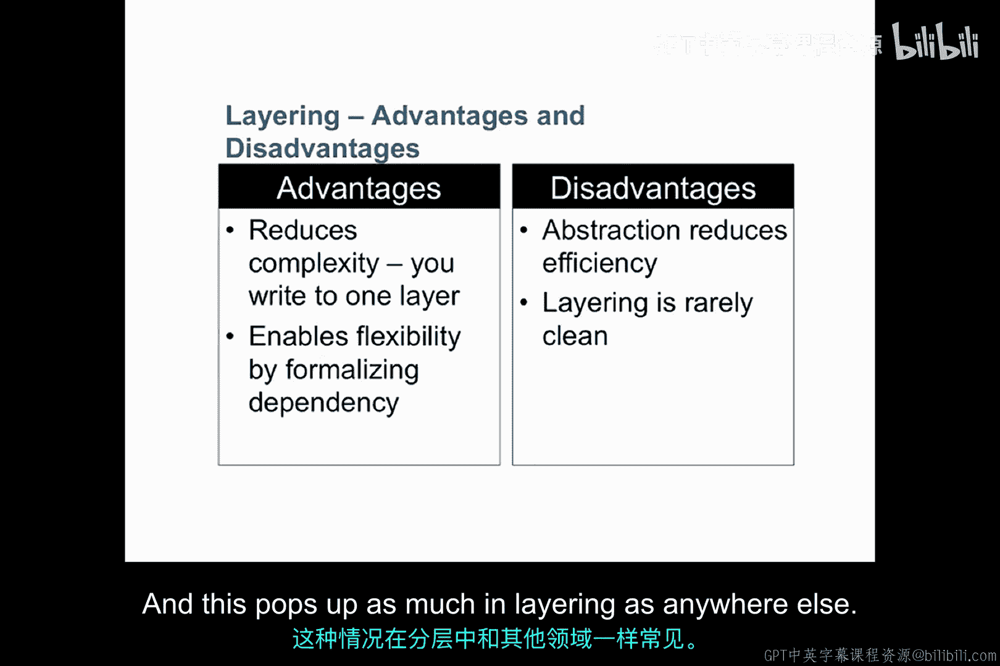

## 分层模型的挑战：MTU与分片 ⚠️

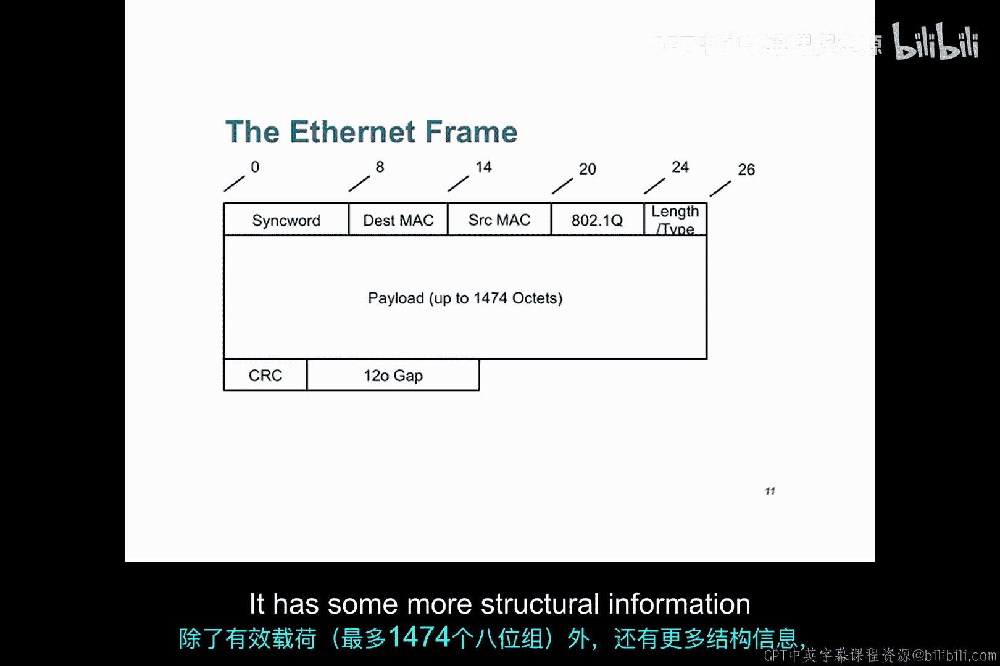

记住关于分层的一切：分层降低了复杂性，但抽象降低了效率，并通过形式化依赖关系实现了灵活性。问题是分层很少是清晰的。为了理解这一点，让我们看看一个我们将遇到的基础性问题：**MTU（最大传输单元）**。

要理解MTU，让我们从第2层的**帧**开始（第2层通常是帧，第3层是数据报，第4层是包）。以以太网帧为例，它有一个同步字、硬件地址、服务质量信息、结构信息，以及最多1500字节的有效载荷。

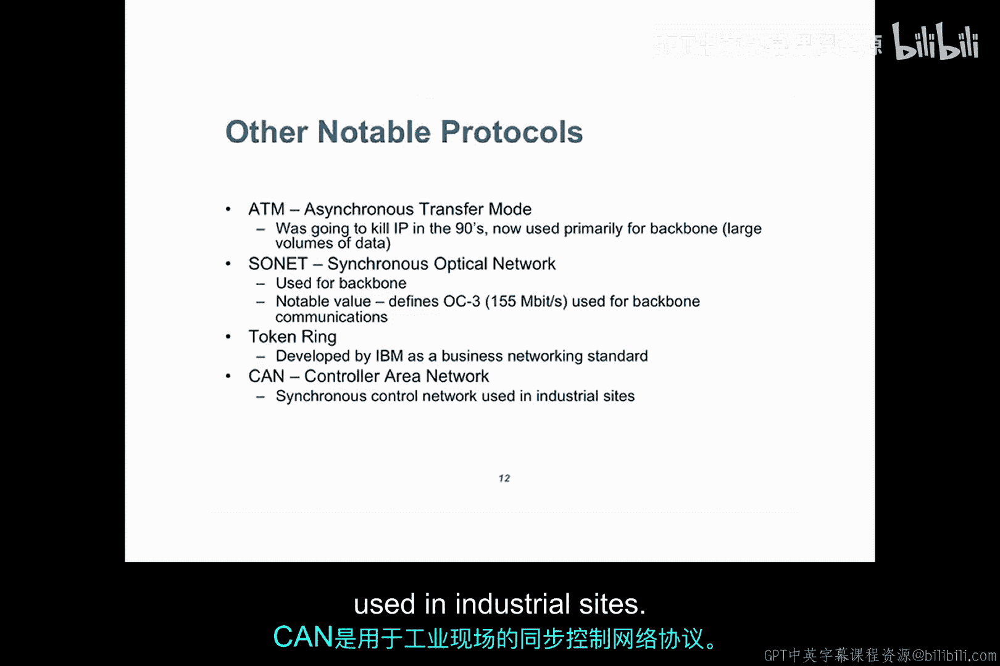

以太网只是多种第2层协议之一。其他例子包括ATM、SONET（同步光纤网络）、令牌环和CAN（控制器局域网）。如今，以太网因其在处理异步活动（如办公室人员共享激光打印机）方面表现出色且成本低廉，几乎成为了一切的标准。

然而，这些协议都有自己的依赖关系，这些依赖关系导致了复杂性的增加。IP中最臭名昭著的例子就是**分片**。

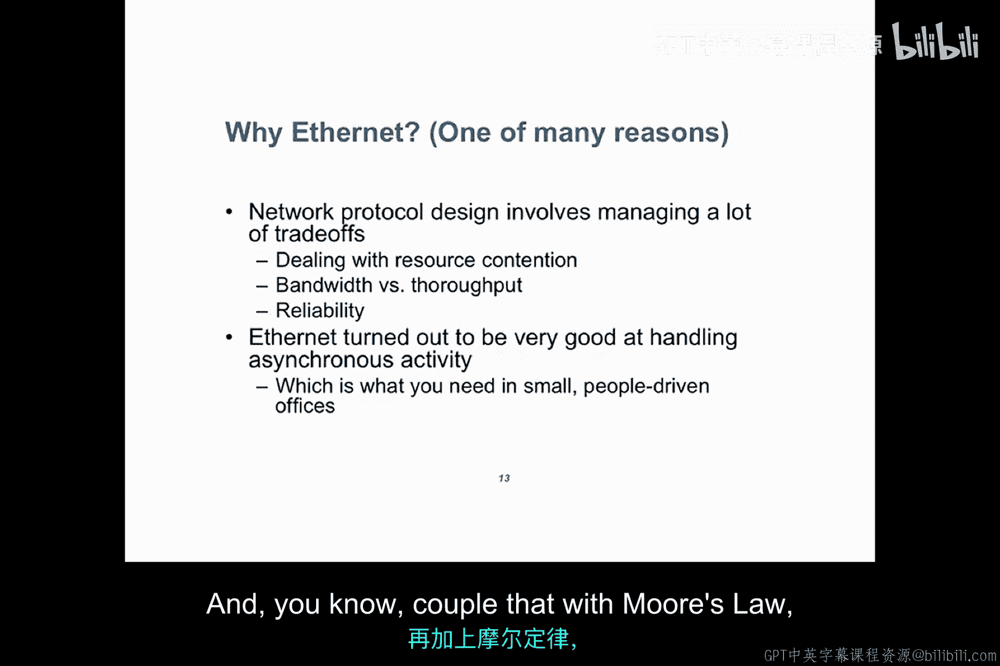

## 分片机制与安全问题 🔓

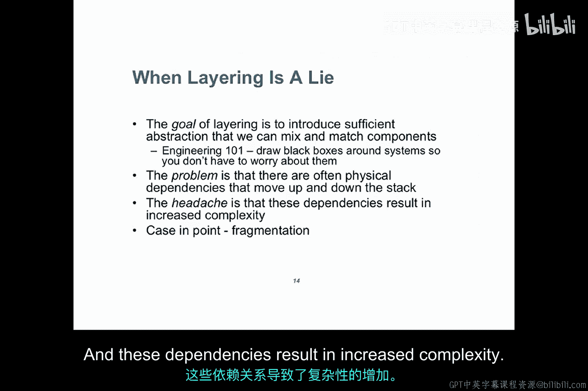

要理解分片，你必须理解MTU的概念。协议涉及实体争夺资源（带宽）的控制权。例如，以太网帧每帧可以发送1500字节。这是一个权衡：如果将帧大小设为1兆字节，那么丢包或重传的代价就很高。因此，帧大小被设定在丢包不会造成灾难的水平。不同的协议为最大帧大小设定了不同的标准。

但是，如果你在具有不同MTU的网络之间传输数据呢？例如，从一个使用ATM AAL5（MTU为9180字节）的网络连接到一个以太网（MTU为1500字节）网络。在IPv4中，他们开发了一种称为**分片**的机制。位于两个网络之间的路由器会将大的ATM数据包分割成多个带有重组指令的子数据包，对用户完全透明。

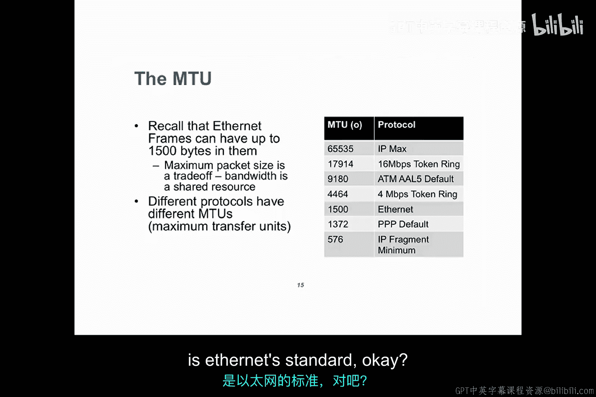

IP通过三个字段实现分片：**IP标识符**（所有分片共享同一个标识符）、**分片偏移量**（指示该分片应放置的位置）和**标志位**（指示是否为最后一个分片）。接收方根据这些信息重组数据包。

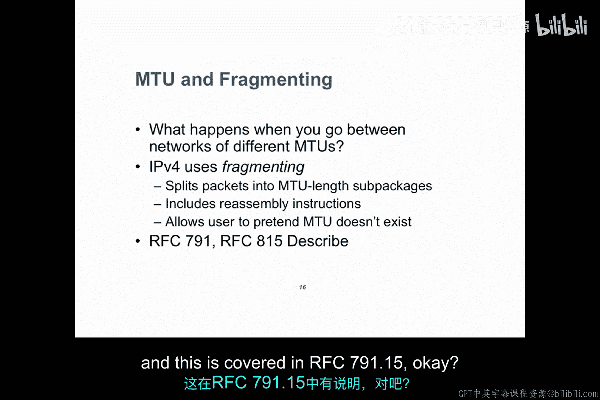

## 分片带来的安全噩梦 😱

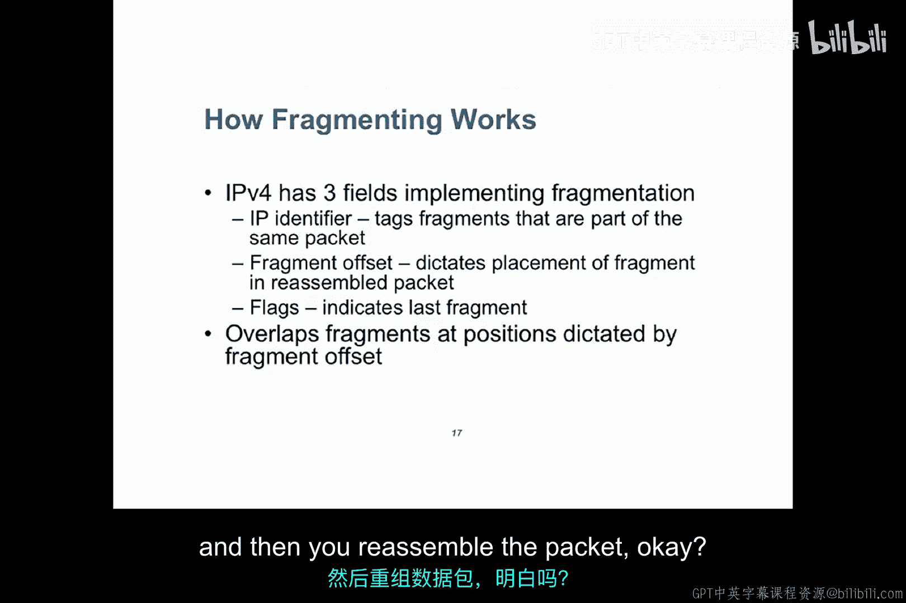

分片从一开始就是一场巨大的灾难。主要问题在于规范编写时存在一系列复杂且未定义的行为。例如，如果两个分片被指定为重叠，会发生什么？作为安全人员，我们必须考虑当有人设置这个参数时会发生什么。答案是，不同的协议栈以不同的方式实现了它，因为规范没有明确说明该怎么做。这意味着攻击者可以根据协议栈对分片的反应来探测其类型，或者操纵分片以逃避检测。

IPv6基本不使用分片，它使用**路径MTU发现**机制来探测整条路径上的最小MTU。此外，由于现在几乎所有连接都始于并终于以太网，只要中间网络不使用更大的MTU，分片问题就不那么突出。

那么，为什么这很重要？原因是：**MTU打破了分层模型**。它是一个影响所有其他层的工程约束。因为我不能有一个超过1500字节的以太网帧，所以我实际上也不能有一个超过1500字节的TCP包或UDP包。这甚至影响了像DNS这样的协议。分片是为了保持分层模型工作而进行的尝试，它通过增加复杂性来隐藏细节，而这种复杂性却引入了巨大的安全漏洞。

## 总结与要点 🎯

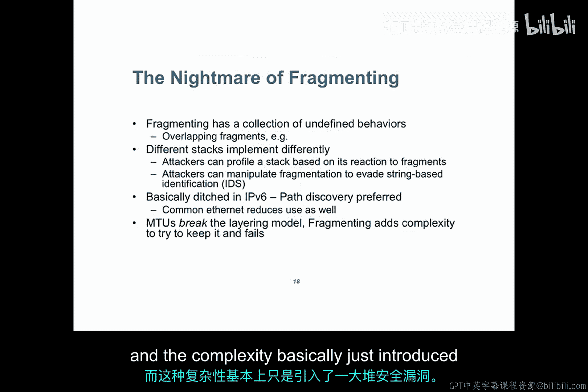

本节课中我们一起学习了现代协议设计依赖分层，需要记住第2层（交换）、第3层（路由）和第4层（传输协议）。所有这些用于隐藏细节的工具都是不完美的，低层的信息会影响高层。MTU是第2层的产物，它影响了IP包大小、TCP包大小以及其上的一切。

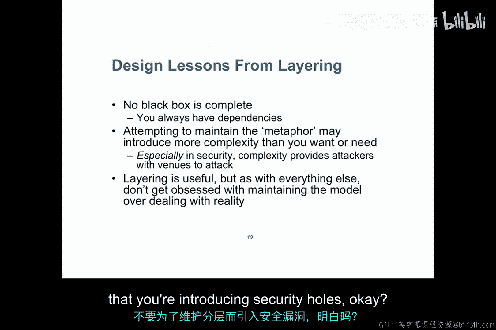

此外，请记住，**维护抽象会增加复杂性，而复杂性为攻击打开了路径**。分片就是这方面的一个经典例子。不要为了维护一个模型而牺牲现实，这是问题的核心。不要为了捍卫分层而引入安全漏洞。

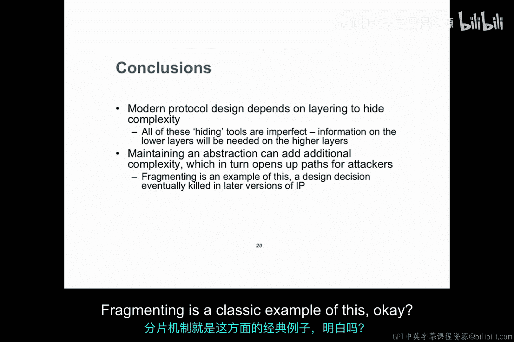

**核心要点回顾：**
*   分层是管理网络复杂性的关键工具。
*   OSI七层模型和IETF四层模型是主要的参考模型。
*   **MTU**是数据链路层的限制，它向上影响网络层和传输层。
*   IPv4的**分片**机制是为了解决MTU差异，但引入了复杂性和安全漏洞。
*   在安全设计中，应平衡抽象带来的好处与复杂性增加的风险。