# 041：IP协议族 📡

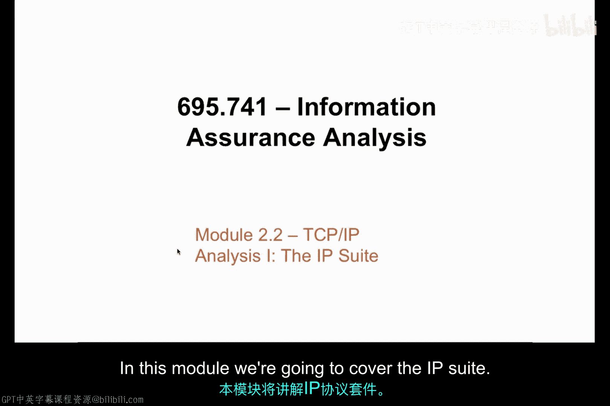

在本节课中，我们将要学习TCP/IP协议族，特别是IP协议。我们将了解其作为“尽力而为”的包交换协议的关键特性，并详细解析IP数据报的各个字段，如TTL、地址和协议字段。

---

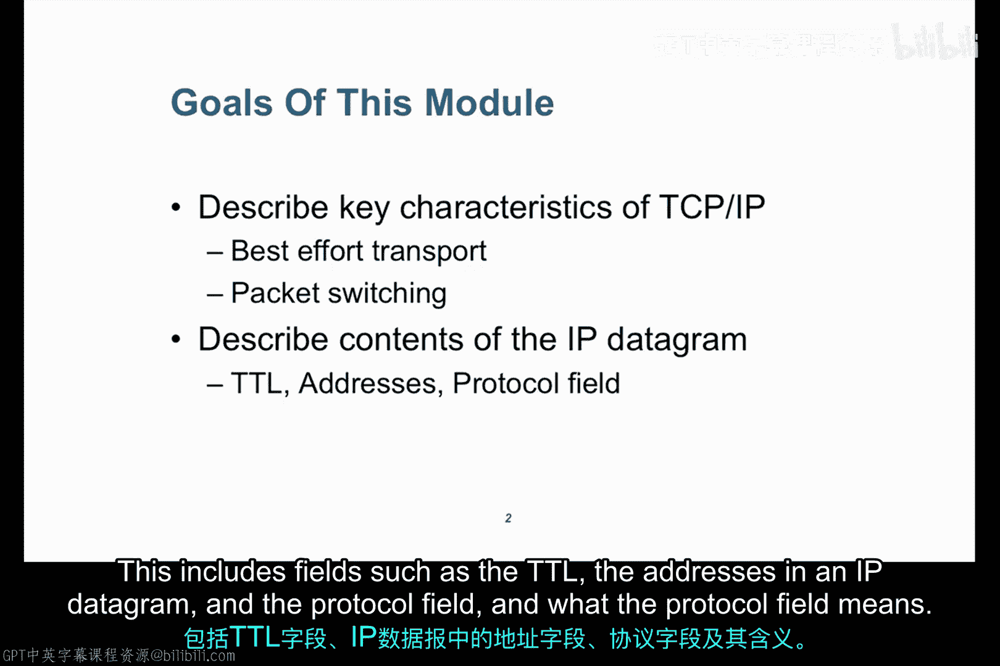

## 什么是TCP/IP？ 🌐

上一节我们介绍了课程概述，本节中我们来看看TCP/IP的基本概念。

TCP/IP是互联网上传输信息的基本协议。它是一种**包交换协议**。这意味着数据被分割成离散的数据包在互联网上传输，并最终到达目的地。

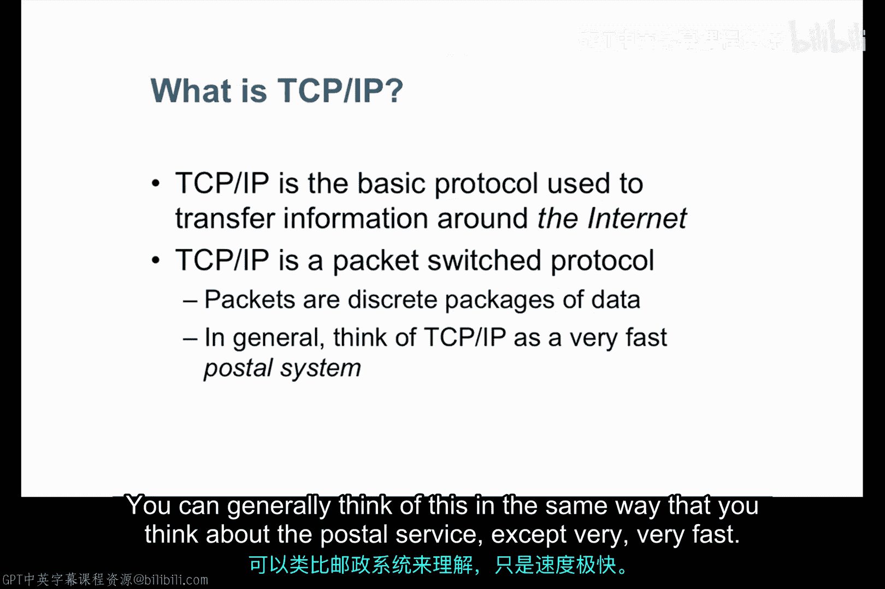

你可以将其想象成一个非常、非常快速的邮政服务。

---

## 包交换 vs. 电路交换 🔄

在介绍包交换的具体含义前，我们先了解两种信息传输模式。

以下是两种主要的传输模式：

*   **电路交换**：类似于传统的电话系统。在两个地点之间建立一条专用的物理连接。这条专用连接允许你在两点之间传输信息，并为此分配了专用资源。
*   **包交换**：我们将信息分割成数据包，然后将每个数据包单独发送到目的地。它们可能走相同的路径，也可能不走。包交换并不关心路径，只要所有信息都能到达即可。

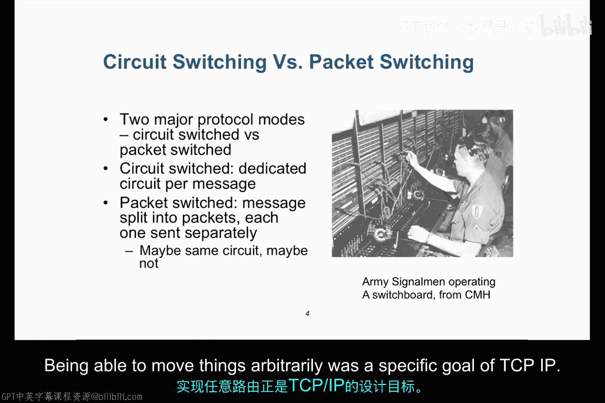

TCP使用包交换。数据包是你会话的子部分，它们可以被任意路由。能够任意路由数据是TCP/IP的一个特定设计目标。

---

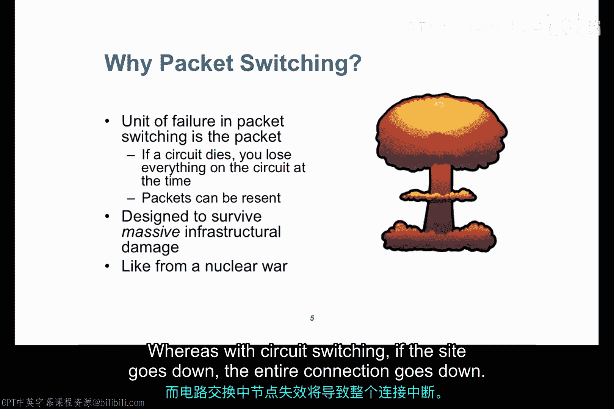

## 为什么选择包交换？ 💡

上一节我们对比了两种交换模式，本节中我们来看看选择包交换的原因。

IP协议族的设计初衷是为了在战争中存活下来。它被设计成即使路由流量的站点被摧毁，也能重新路由流量。

*   电路交换为你提供一组专用资源。
*   包交换则不同。如果一个站点宕机，你可以绕过它进行路由。而在电路交换中，如果站点宕机，整个连接就会中断。

---

## 邮政服务类比 📮

理解TCP/IP包交换的最佳方式，是将其类比为一个超高速的邮政服务。

我们只关心某物要去哪里，而不关心它来自哪里。在这个类比中，路由器就是不同的邮局。它们不需要确切知道目的地在哪，只需要知道哪个邮局能把信件送到更接近最终目的地的地方。

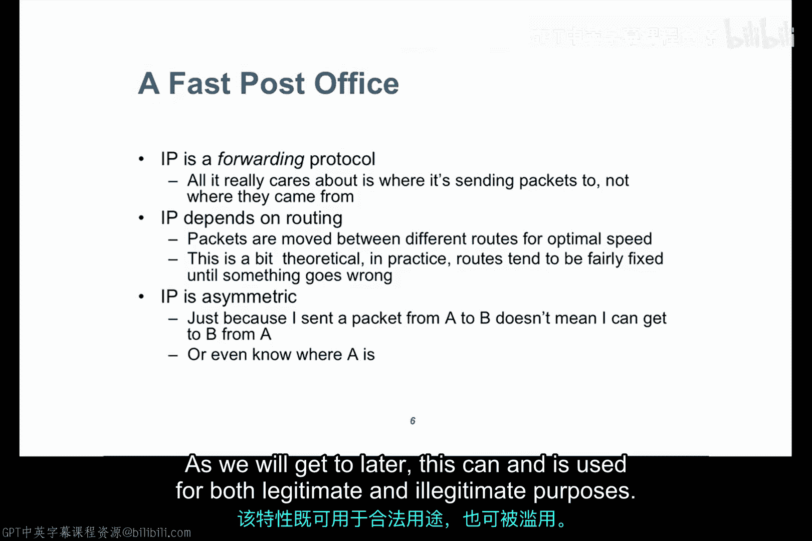

同样，路由器只关心它所知道的、能将数据包送到更接近（且更快）其目的地的下一个路由器。这意味着你可以在不了解世界上每台计算机所有信息的情况下路由信息。这也意味着路由路径不具有对称性。从A到B的路径，并不意味着从B返回A会走相同的反向路径，甚至不一定能从B到达A。

由于如此注重将信息送达目的地，这种路由形式容易受到**欺骗**。即某人可以声称他们代表A发送数据，但实际上与A完全无关。正如我们稍后会讲到的，这既可用于合法目的，也可用于非法目的。

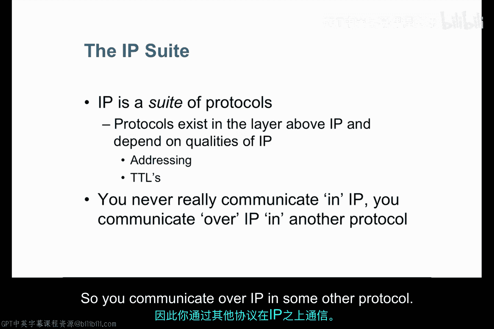

---

## IP协议族简介 🧩

现在我们来介绍IP协议族本身。它是一个**协议套件**。

协议存在于IP之上的层，并依赖于IP提供的特性，特别是**寻址**和**TTL**。你实际上并不直接通过IP进行通信，IP并非为此设计。IP的设计目的是帮助引导数据包。因此，你是在其他协议之上通过IP进行通信，而不是IP本身。

---

## IP数据报结构 📦

以下是IP数据报的格式图。如图所示，它被分成几个不同的字段。

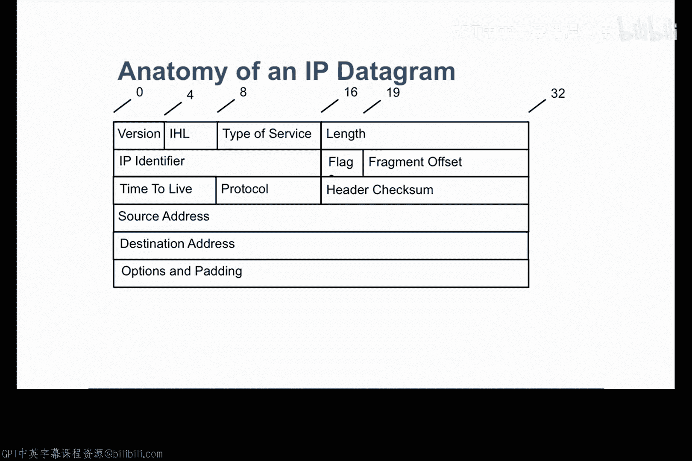

第一个字段是4位的**版本**，目前可以是4或6，大多数情况下你会看到IPv4。接下来是**IHL**，即整个IP数据报头的长度。然后是服务类型、总长度、标识符、标志、分片等。随着课程的深入，我们会探讨其中几个最有趣的字段。

当然，大多数人最关心的字段是**源地址**和**目的地址**。这是两个32位的地址，在谈论网络流量时最常见。地址格式类似 `192.168.1.1`。

最后，我们还有**选项和填充**。选项和填充是一些不一定需要成为实际数据报部分的字段集合。你会注意到IP数据报的长度实际上是可变的，这是因为你不一定必须在这里添加选项，但你可以添加。

---

## 关键字段详解 🔍

上一节我们概述了IP数据报结构，本节中我们深入看看几个关键字段。

### 1. IHL（首部长度）

IHL基本上是**包括选项在内的首部长度**。关于这一点，一个容易让人困惑的地方是：当人们想到“长度”时，通常想到的是8位（字节）或其倍数。但IHL是一个**4位字段**，它指定的是首部中包含多少个**32位字**。

### 2. ToS（服务类型）

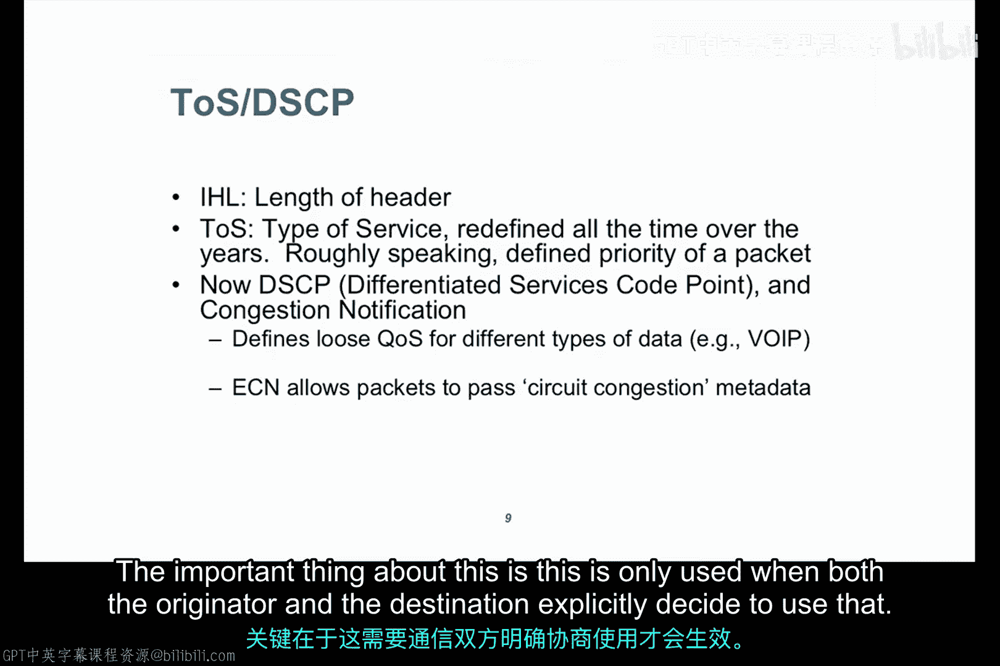

这个字段实际上相当过时，多年来被不断重新定义。粗略地说，它定义了数据包的优先级。目前它通常包含两个部分：

*   **DSCP（差分服务代码点）**：为数据包提供分类，例如VoIP服务应获得的优先级。
*   **ECN（显式拥塞通知）**：用于通知目的地网络中出现的拥塞问题。

关于此字段的重要一点是：**只有当发起方和目的地都明确决定使用时，它才会被使用**。

---

## TTL（生存时间） ⏳

TTL可能是IP数据报中最简单但也最容易被利用的部分。

TTL的基本工作原理是：IP数据包以尽力而为的方式路由，它们实际上并不知道数据包是否会到达目标。理论上，数据包可能永远循环下去。因此，设计者为每个数据包关联了一个计数器。TTL就是用来通过这个计数器防止无限循环的，**每次数据包经过一个路由器，TTL值就会减1**。

例如，你可以将TTL设置为3。第一个路由器看到它，接收，TTL减为2，然后转发。下一个路由器减为1，再下一个减为0。如果下一个看到它的路由器不是最终目的地，它就会丢弃这个数据包。

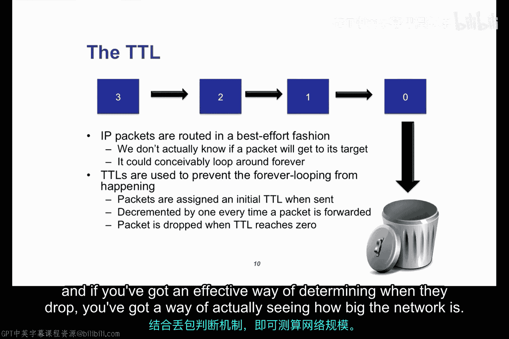

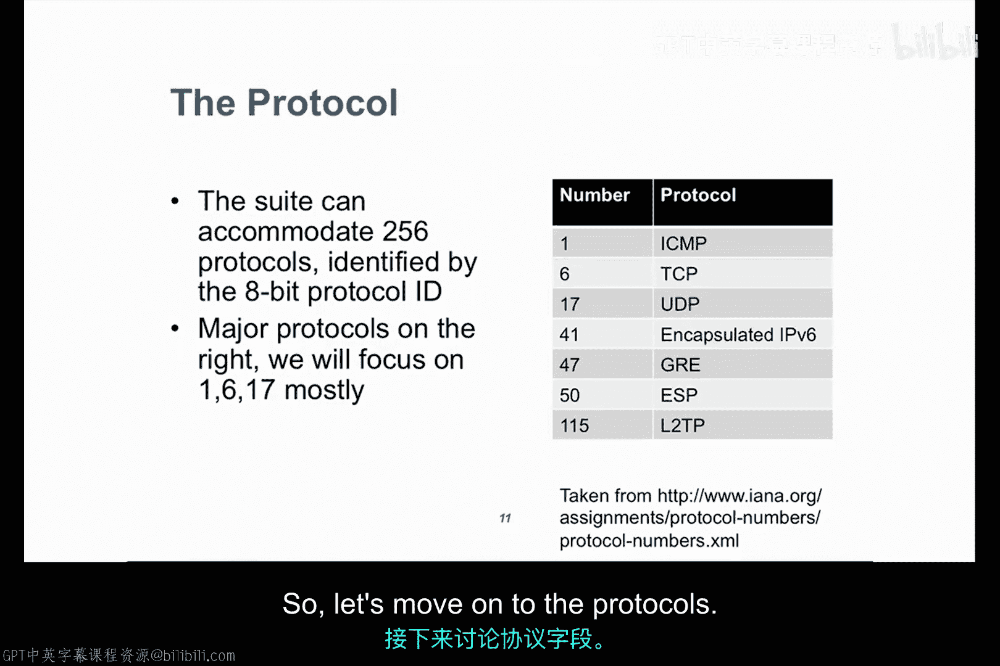

通过调整TTL值并发送数据包，如果你有一种有效的方法来确定数据包何时被丢弃，你就可以实际探测出网络有多大。

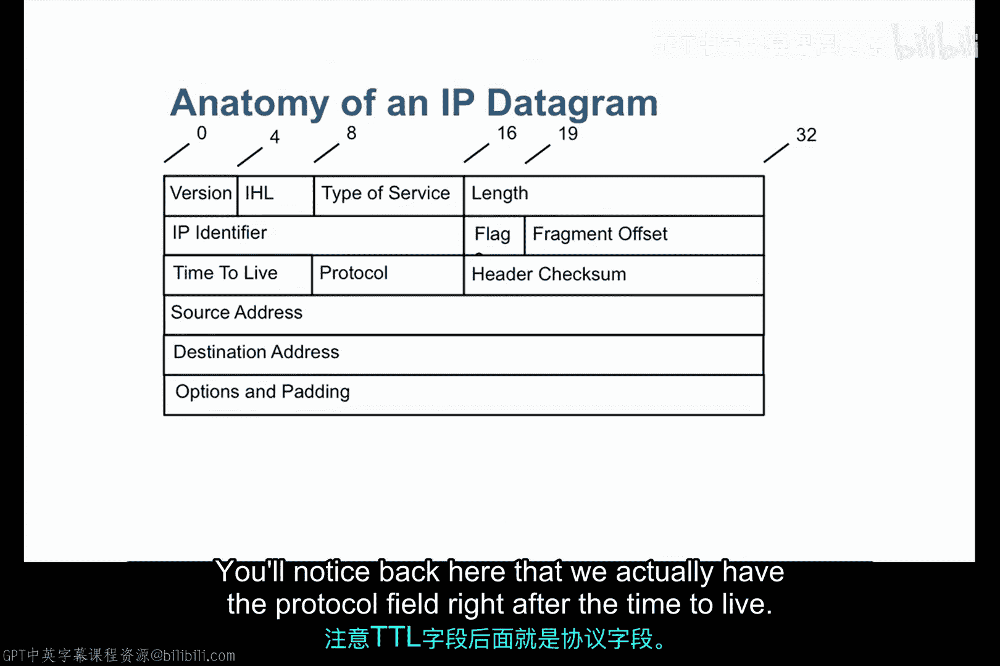

---

## 协议字段 📋

现在让我们来看看协议字段。你会注意到在TTL字段之后就是协议字段。

这个字段可以容纳256种不同的协议，由IANA协议ID标识。大多数人可能只能列出其中的两三种，因为这两三种非常常见。

以下是几个常见的协议ID：

*   **1 - ICMP**：互联网控制消息协议。包含所有关于网络状态的信息，例如“主机不可达”、“目的不可达”等。
*   **6 - TCP**：传输控制协议。这是面向连接的状态化协议。
*   **17 - UDP**：用户数据报协议。这是无连接的协议。

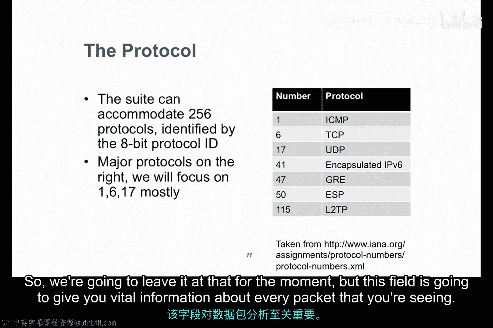

这三个是你最常见到的。你可能还会看到一些其他的，比如用于封装IPv6的协议，或者用于VPN的GRE和ESP等。

这个字段将为你看到的每个数据包提供至关重要的信息。

---

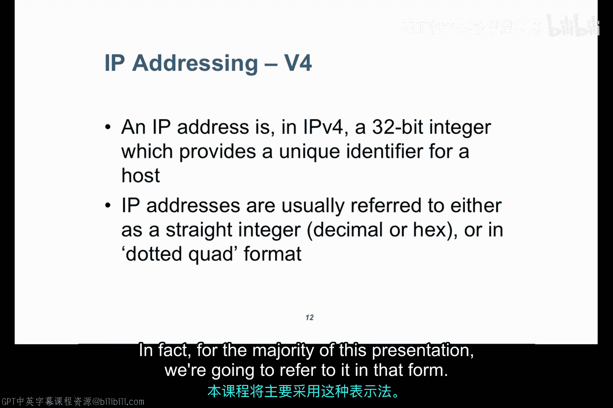

## IPv4地址 🏷️

本节我们将专门讨论IPv4地址（IPv6将在后续课程中讨论）。

IPv4地址是一个**32位整数**，为网络上的大多数设备提供唯一标识符。IPv4地址通常以十进制整数或十六进制表示，但在口语中更常见的是**点分四组格式**，例如 `192.168.1.1`。在本课程的大部分内容中，我们将以这种形式引用它。

---

## IP地址分类与CIDR 📊

历史上，我们通过**类别**来划分IP地址，例如A类、B类、C类、D类。

*   **A类网络**：地址块为 `0.0.0.0` 到 `0.255.255.255`，包含约1600万个地址。
*   **B类网络**：包含65536个地址。
*   **C类网络**：包含256个地址。

这种划分方式的问题是：如果你只以这种方式划分网络，你能分配出去的块数量非常有限，而且这些块都很大（最小的C类也有256个地址）。

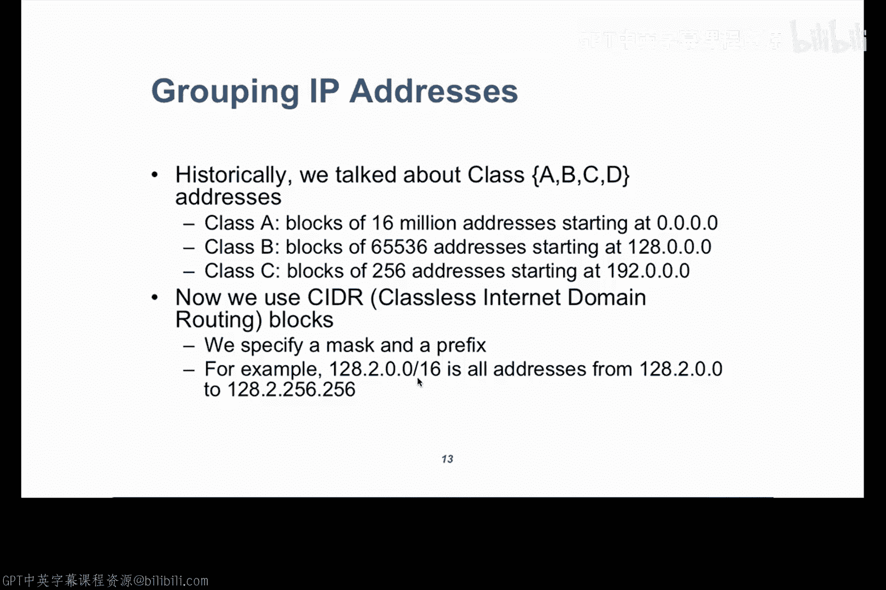

因此，现在我们实际上使用**CIDR（无类别域间路由）表示法**。它通常带有斜杠，例如 `/16`、`/24`。斜杠前的部分是地址，斜杠后的数字是**网络前缀的位数**（即掩码的位数）。

例如，`/16` 表示前16位是网络部分，后16位是主机部分。如果我们想要一个C类网络（`/24`），那么前三个八位组（24位）是固定的，最后一个八位组可以是0到255之间的任何数字。

---

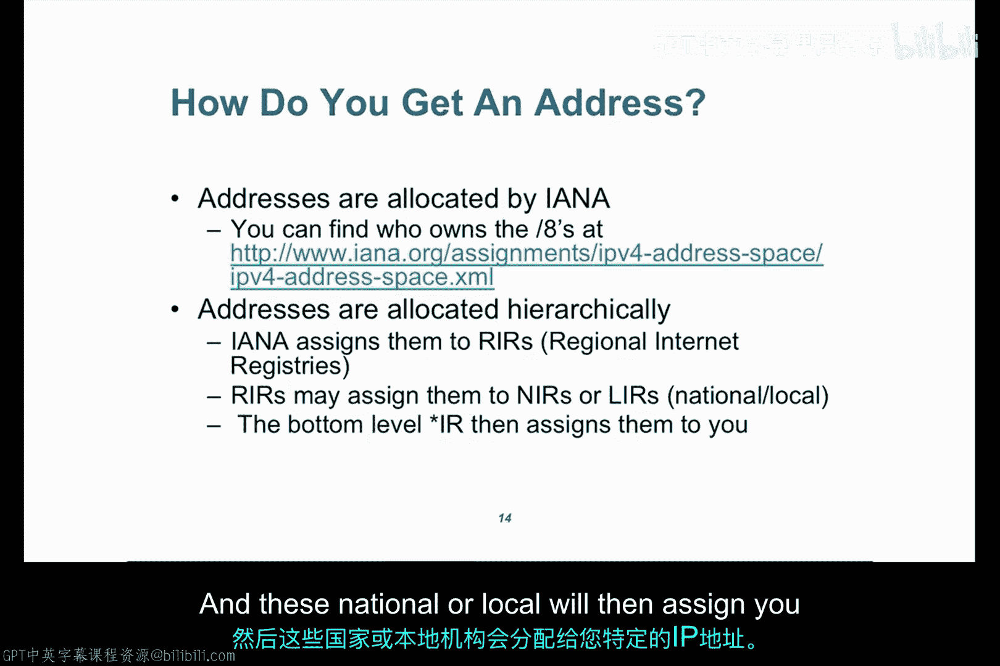

## 地址分配与特殊地址 🗺️

IP地址由 **IANA** 分配。你可以通过特定查询找到谁拥有一个 `/8` 的地址块。地址实际上是分层分配的：IANA将它们分配给 **RIR（区域互联网注册管理机构）**，然后RIR可能将它们分配给国家或本地互联网注册管理机构，这些机构再分配具体的IP地址。

我们有 2^32（约43亿）个地址可用，但并非所有这些地址都能使用。其中一部分有特殊用途或根本不被使用。

对我们来说特别感兴趣的是：

*   **广播地址**：通常是网络地址的补码，以 `.255` 结尾（例如 `192.168.1.255`）。用于向整个网络发送消息。每个路由器都知道如何处理 `.255` 地址。
*   **网关地址**：通常是你访问互联网的接入点，是你本地网络到更广阔广域网的过渡区域。这个地址通常是你的网络地址加上 `.0` 或 `.1`（例如 `192.168.1.0` 或 `192.168.1.1`）。

这意味着一个典型的 `/24` 网络中，你实际上有254个可用主机地址（例如 `192.168.1.1` 到 `192.168.1.254`），而不是256个。

除了从你的地址块中划出的这些地址外，还有一些CIDR块永远不会分配给公众。这些是专门用于私有网络的地址：

*   `10.0.0.0/8`
*   `172.16.0.0/12`
*   `192.168.0.0/16`

有趣的是，当你在公共互联网上看到这些地址的流量时，通常表明有人正在将其本地流量泄露到整个互联网。它们不应该被路由到公共网络，但我们确实见过这种情况。

---

## 源地址欺骗与单向性 🎭

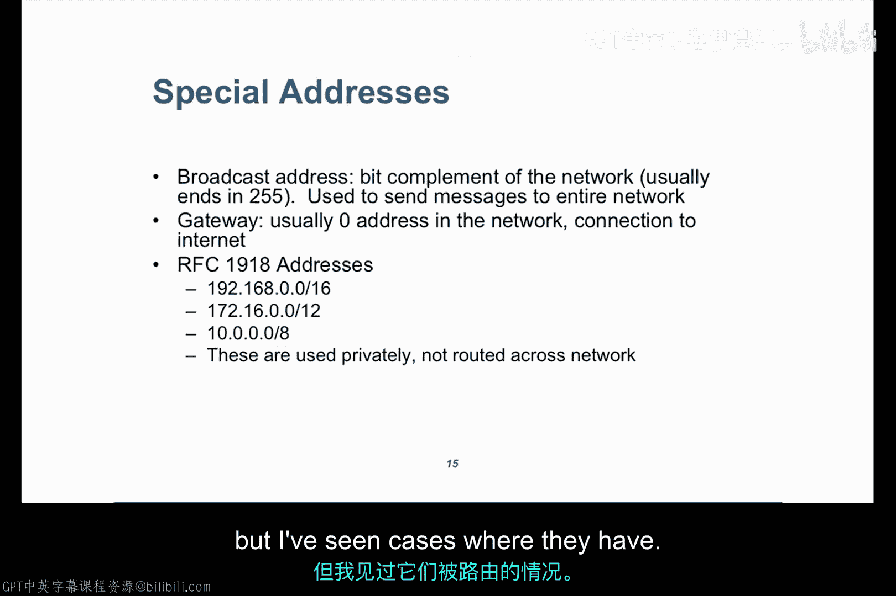

正如之前所说，IP并不进行双向通信。我们遇到的情况是，每个路由器都试图将数据包送到目的地。因此，**没有真正的“返回路径”概念**。

正因为如此，**源地址的意义是有限的**。它对你作为分析师来说意味着一些东西，因为它给了你数据包来源的指示，但这**不一定**是真正的源头。那只是你看到的源头。

TCP/IP提供了许多进行“花招”的能力，其中最好的（也是最常被利用的）之一就是通过**代理**。代理会代表其他主机执行功能，使用那些主机的IP地址，而不是请求的实际发起者的地址。这同样有合法和非法用途。

---

## 总结 📝

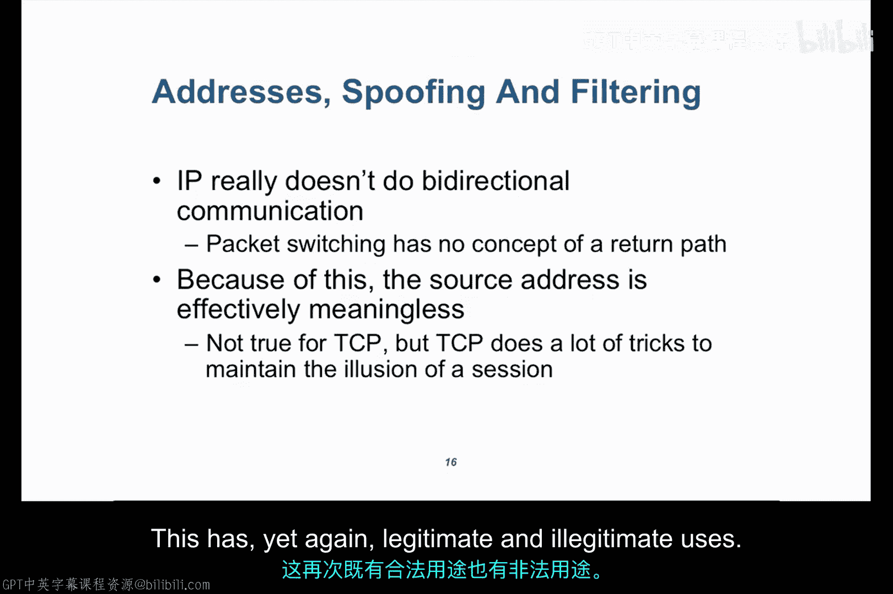

本节课中我们一起学习了IP协议的核心知识。

*   **IP是一个包交换的转发协议**。它是一个协议套件，位于TCP或UDP等协议之下。
*   **IP数据包包含多种字段**，描述了流量的关键信息，包括地址、协议类型等。
*   **欺骗和操纵这些字段相对容易**。正如我们所说，这真的只是“说你有什么”的问题，没有真正的验证机制。所以你可以声称任何数据包来自 `192.168.1.1`。

IP协议的设计重点在于将数据送达目的地，而非验证来源或保证双向连接，这既是其强大适应性的基础，也带来了安全挑战。理解这些特性是进行有效网络分析和安全评估的关键。

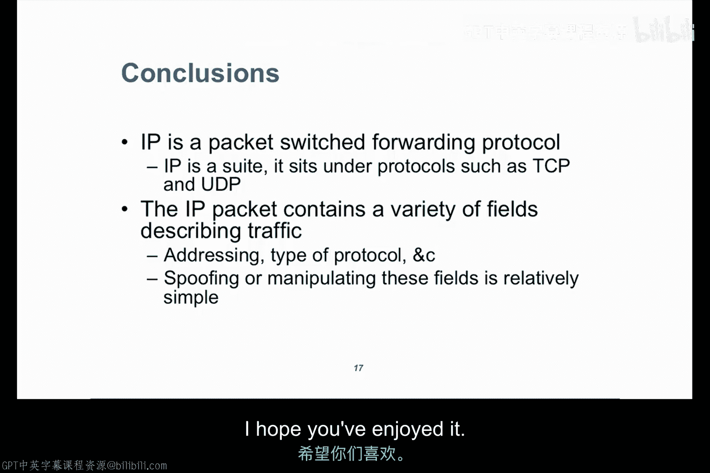

本节课到此结束，希望对你有所帮助。