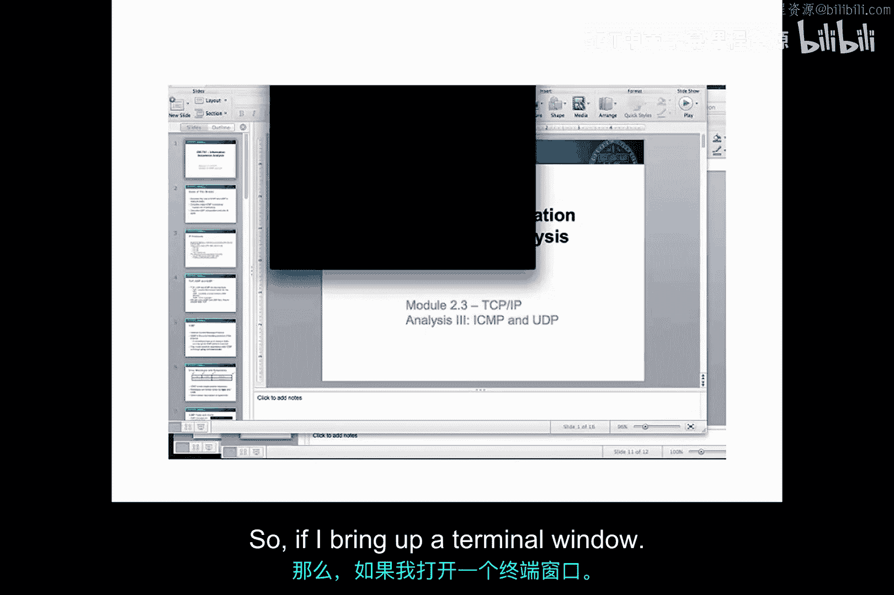
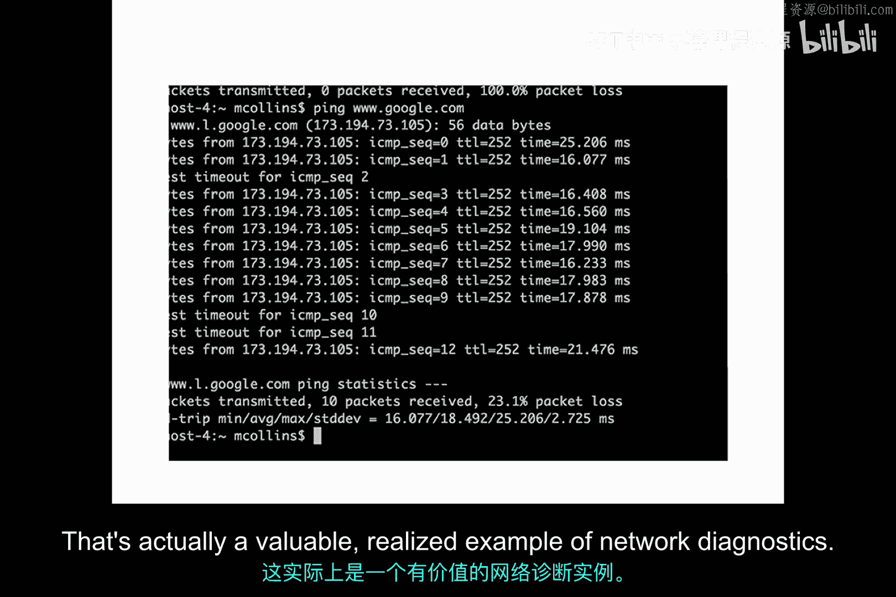
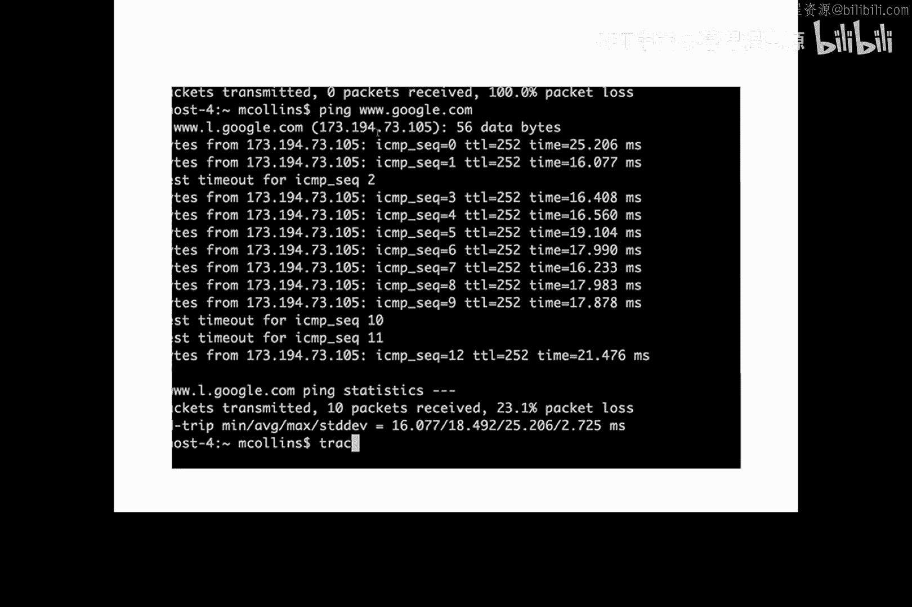
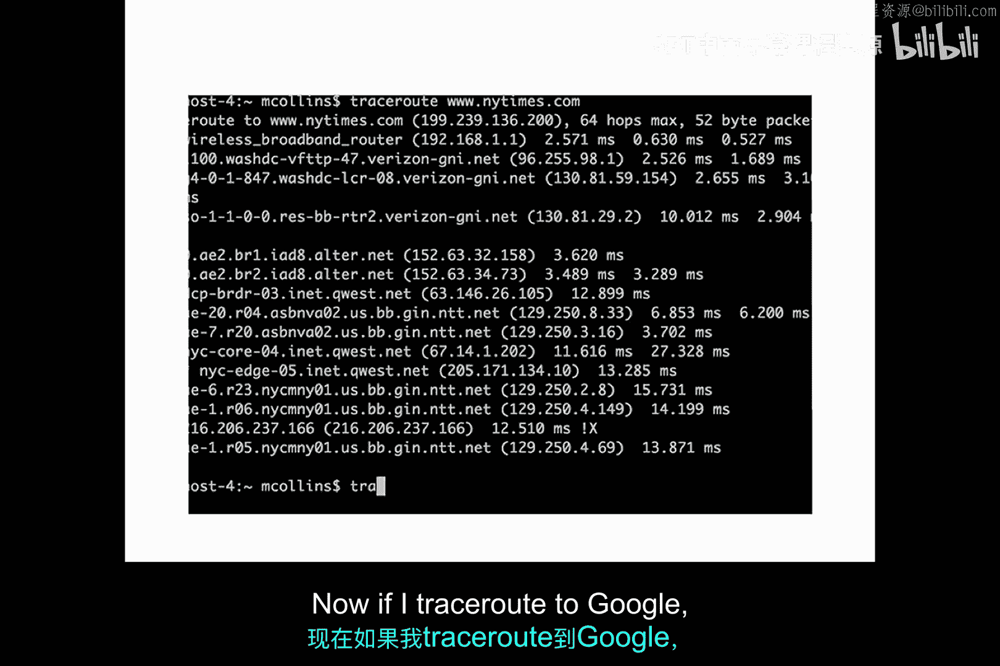
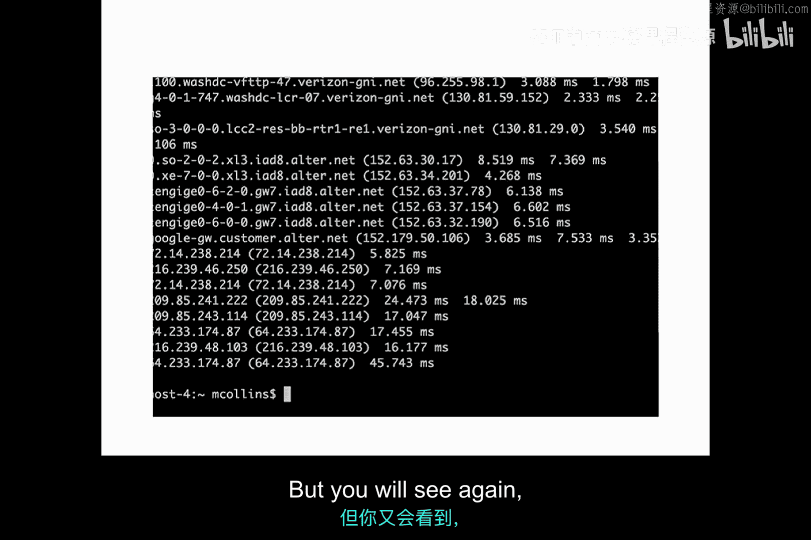
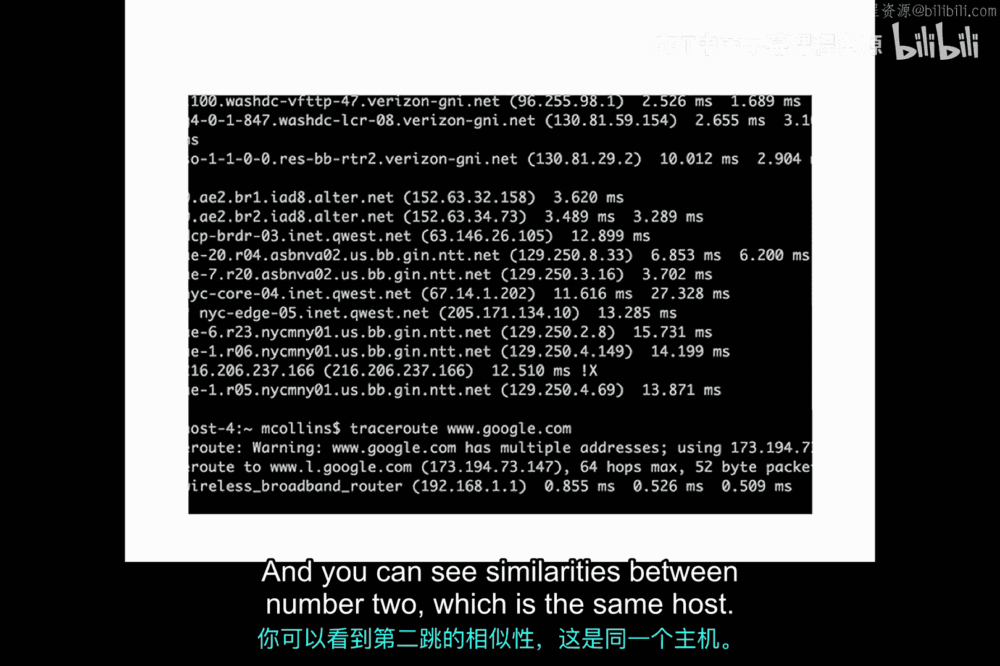
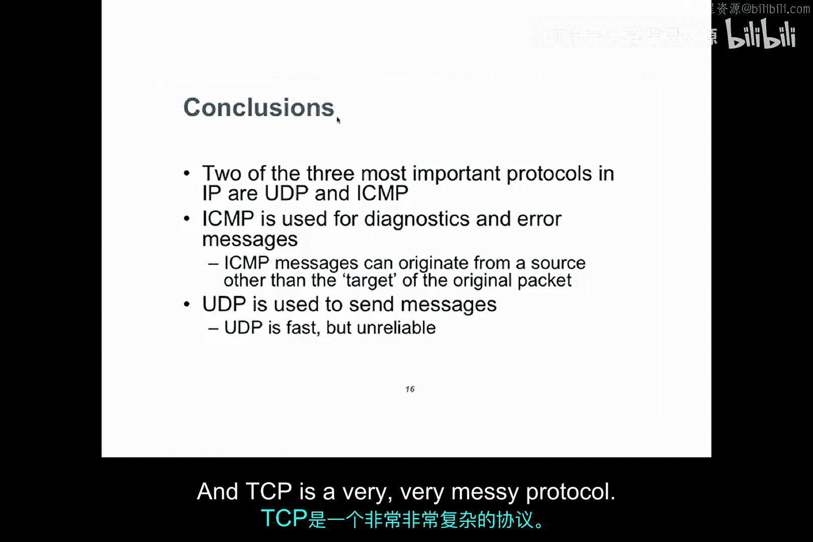

# 042：ICMP与UDP协议分析 🧩

在本节课中，我们将学习TCP/IP协议族中的另外两个核心协议：ICMP和UDP。我们将首先探讨ICMP协议，它负责网络中的错误报告和诊断；然后分析UDP协议，这是一种简单、快速但不可靠的数据传输协议。理解这两个协议是掌握更复杂的TCP协议的重要基础。

## ICMP协议：网络的“错误报告员” 📨

上一节我们介绍了IP数据报的基本结构，本节中我们来看看ICMP协议。ICMP是互联网控制消息协议，它是互联网的错误处理协议。当路由或数据传输出现问题时，你可能会收到一个ICMP数据包作为响应。

ICMP发送单数据包消息，并期望得到单数据包响应。消息通过类型和代码值来区分。一个ICMP数据包包含8个字节，其中1个字节是类型，1个字节是代码，2个字节是校验和，以及ID和序列号。消息的实际内容取决于其类型和代码。

以下是主要的ICMP消息类型和代码示例：
*   **类型0**：回显应答，代码固定为0。
*   **类型3**：目的地不可达，包含多个代码，例如：
    *   代码1：主机不可达
    *   代码2：协议不可用
    *   代码3：端口不可达

这些类型和代码的组合可能会在数据包负载中包含额外的诊断信息。例如，如果你尝试访问一个主机并收到“主机不可达”的ICMP消息，该主机的IP地址会被编码在ICMP消息中。

## 使用ICMP的常见工具 🛠️

有多种工具直接使用ICMP，其中最常见的是Ping和Traceroute。

**Ping**是最常用的工具。它向目标发送ICMP类型8、代码0的消息，即回显请求。该消息包含一个数字，并等待带有相同数字的回复消息返回。Ping通常会发送多个数据包并等待它们返回，以生成关于往返时间的统计模型。数据包通过序列号来区分。

**Traceroute**的功能与ICMP类似，用于追踪从源主机到目标主机路径上的路由器。它的工作原理类似于Ping，也发送回显请求消息。但与Ping不同的是，Traceroute从一个较小的TTL值开始，并逐步增加该值。TTL旨在防止网络被数据包淹没。数据包每经过一个路由器，TTL值就减1。因此，当我对《纽约时报》网站执行Traceroute时，我发送的第一个数据包TTL为1，它在我的机器之外的第一台路由器处被丢弃，我会收到错误消息。接着发送TTL为2的数据包，它经过第一台路由器到达第二台路由器后丢弃，如此重复。这允许你看到数据包在何处被丢弃。

## UDP协议：快速但不可靠的“明信片” 💨

现在，我们来讨论UDP协议。UDP是用户数据报协议，或称不可靠数据报协议。UDP是一种轻量级的数据传输协议，它在两个主机之间发送无状态的单数据报。UDP不假设会有响应，它就像发送明信片。服务可以实现发送响应的功能，但UDP本身没有处理响应的机制。

UDP的核心特点是廉价且无状态信息。与我们将要介绍的复杂协议TCP相比，UDP没有TCP那样的开销。这意味着使用UDP发送数据非常容易，但它是不可靠的。如果一个数据包丢失，你无法知道。UDP数据报的结构非常简单：包含源端口、目的端口、长度、校验和一些数据，仅此而已。

UDP数据报引入的关键概念是**端口**。端口本质上是IP地址的一个子地址，是一个介于0到65535之间的值。如果我们将IP地址比作一栋建筑，那么端口就是这栋建筑里的一个邮箱。

以下是一些众所周知的端口示例：
*   **端口53**：DNS服务
*   **端口6881**：BitTorrent服务

这些端口是我们定义如何与网络上的服务器进行公开通信的方式。如果你想与DNS服务器通信，你可能会打开到端口53的连接。这是公开的常识，攻击者也会扫描端口53。

## 总结 📝

本节课中我们一起学习了TCP/IP协议族中三个最重要的协议中的两个：UDP和ICMP。

*   **ICMP**用于诊断和错误消息。这些消息可能来自你最初期望发生错误的源地址之外的地方。
*   **UDP**用于发送消息。它快速、不可靠且简单。

请记住这些概念，因为接下来我们将探索TCP协议的奇妙世界，这是一个非常复杂的协议。