# 045：IPv6协议 🌐

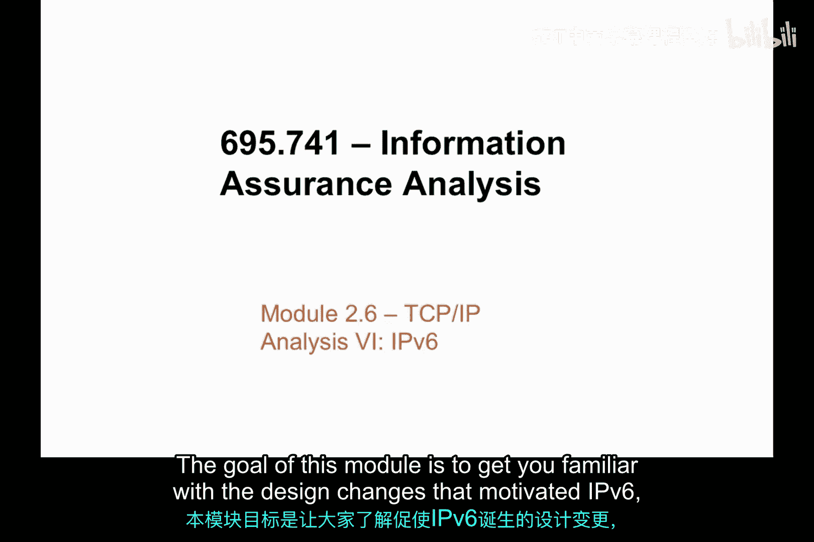

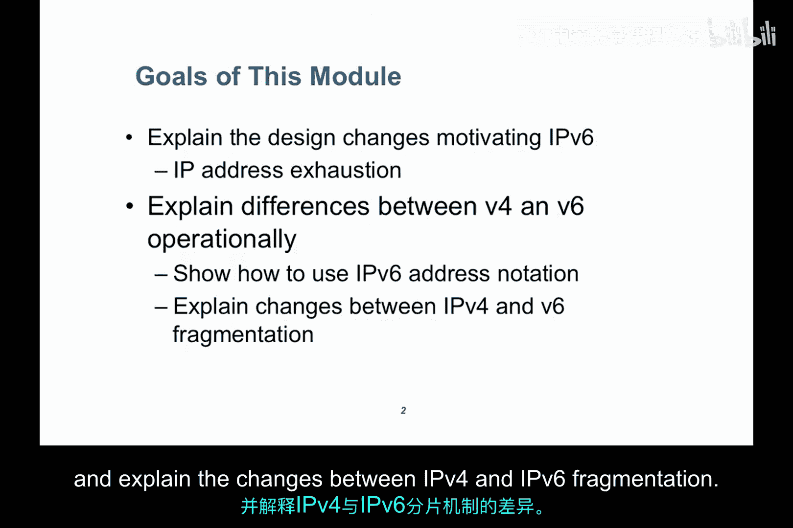

在本节课中，我们将要学习IPv6协议。我们将探讨其设计动机、与IPv4的主要区别、地址表示方法以及其在安全性和部署方面的考量。

## 地址耗尽问题 💡

上一节我们介绍了TCP/IP协议的基础，本节中我们来看看推动IPv6设计的核心问题：IPv4地址耗尽。

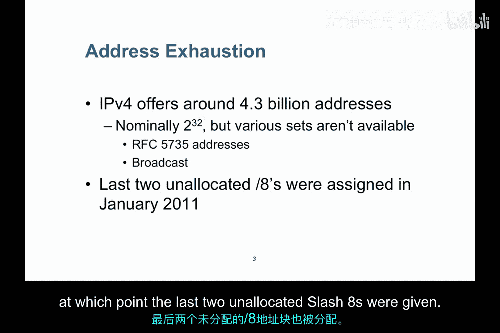

IPv4提供了大约43亿个地址。理论上这是2的32次方，但由于路由、组播和本地地址预留等原因，实际可用的公网地址更少。一个重要类别是RFC 1918定义的私有地址，例如`192.168.x.x`和`10.x.x.x`。负责分配地址的机构IANA在2011年1月耗尽了最后两个未分配的地址块（/8）。

## 地址分配不均与滥用 🗺️

了解了地址耗尽的背景后，我们来看看地址分配本身的问题。

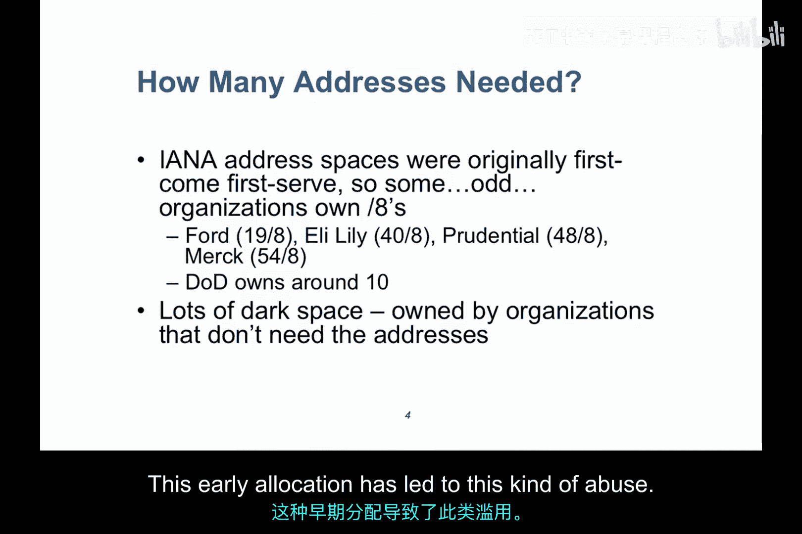

IP地址的分配最初基于“先到先得”原则，导致分配极不均衡。许多早期组织获得了远超其需求的地址空间。例如，美国国防部拥有约10个/8地址块，总计约1.6亿个IP地址。而像礼来公司这样的组织，可能只使用了其拥有的巨大地址空间中的一小部分，其余部分处于闲置状态。这种早期的分配方式导致了地址资源的浪费。

## 现有解决方案：NAT与DHCP 🔄

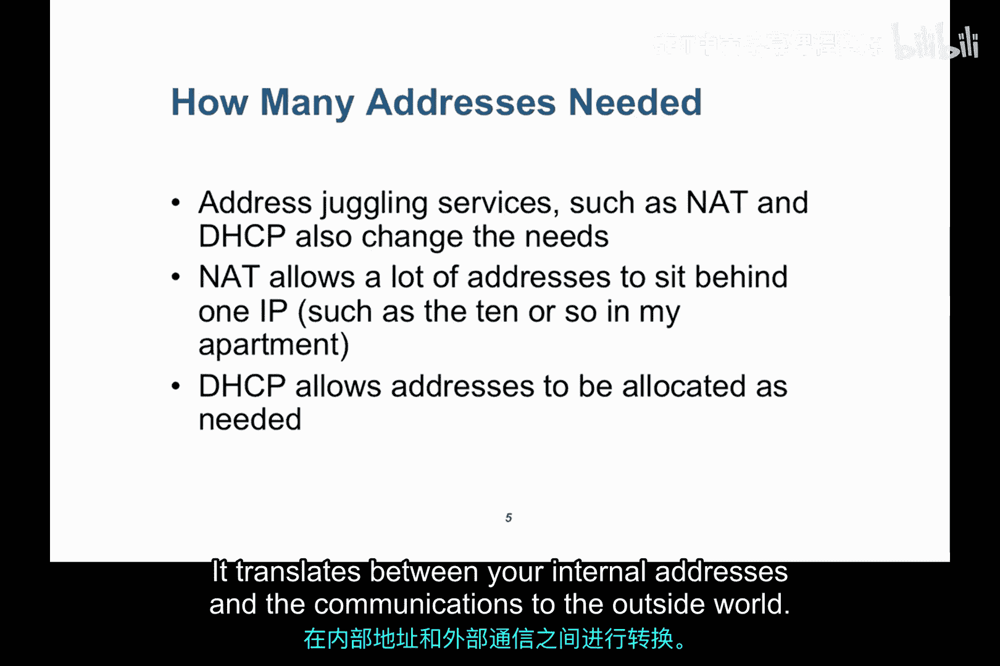

面对地址限制，我们已采用了一些关键技术来适应。

以下是两种核心的地址管理服务：
1.  **网络地址转换**：NAT允许多个设备共享一个公网IP地址。例如，家庭无线路路由器为内部设备分配`192.168.x.x`这样的私有地址，然后通过端口转换，将这些内部地址的通信映射到ISP分配的一个公网地址上。
2.  **动态主机配置协议**：DHCP自动为网络中的设备分配IP地址，简化了网络管理。

## IPv6的设计目标与变化 🚀

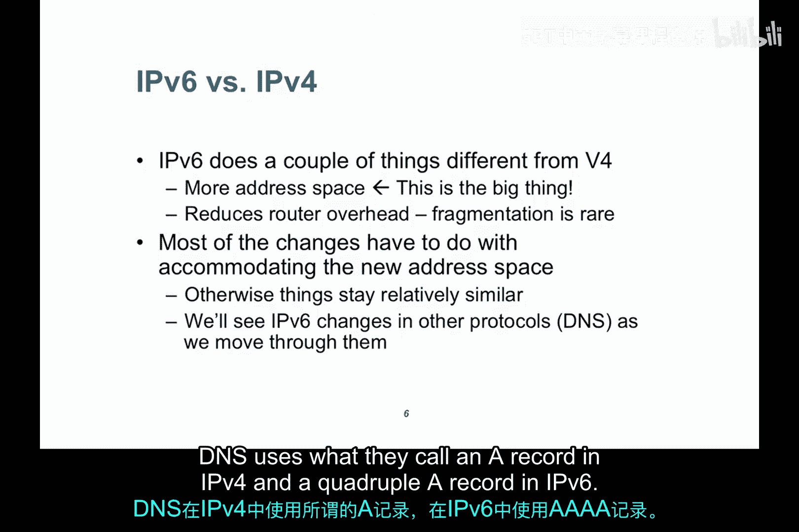

我们已看到IPv4的局限和应对方案，现在让我们深入探讨IPv6本身。

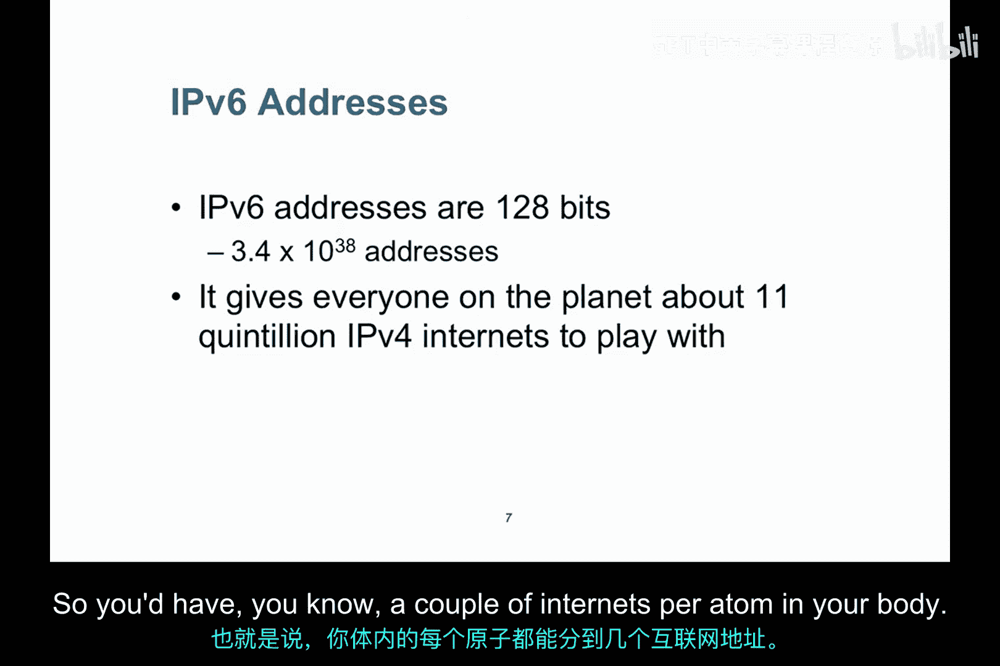

IPv6旨在克服IPv4中发现的缺陷。其设计思想始于1992年。最明显的改进是提供了巨大的地址空间，以解决地址耗尽问题。另一个重大变化是减少了路由器的开销。回顾之前讨论的分片机制，IPv6通常不在路由器上进行分片，从而降低了处理负担。大部分变化都是为了适应新的、更大的地址空间。其他方面则相对类似：IPv6中同样存在TCP和UDP，其操作与IPv4版本基本一致。像DNS这样的协议则同时包含了对IPv4和IPv6的支持，IPv4使用**A记录**，而IPv6使用**AAAA记录**。

## IPv6地址空间与表示法 🔢

IPv6带来了巨大的地址空间，这自然导致了新的地址表示方法。

IPv6地址长度为128位，提供了约`3.4 × 10^38`个地址。如果均匀分配，地球上的每个人都能获得海量的地址。IPv6的表示法比IPv4复杂。最简单的形式是将完整地址写成8组4位的十六进制数，例如：`2001:0db8:85a3:0000:0000:8a2e:0370:7334`。

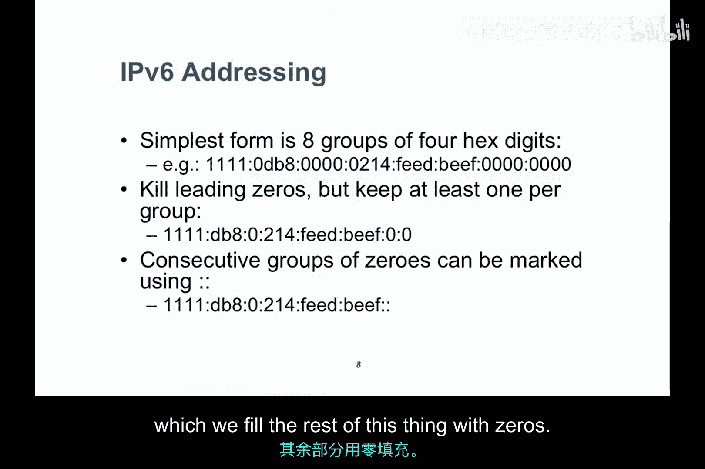

为了尽可能简洁，遵循以下压缩规则：
*   **省略前导零**：每组中的前导零可以省略。例如，`0db8`可以写成`db8`。
*   **零组压缩**：连续多组全零可以用双冒号`::`表示一次。例如，`2001:db8::1`表示`2001:db8:0000:0000:0000:0000:0000:0001`。

## IPv6的特殊地址与关键差异 ⚙️

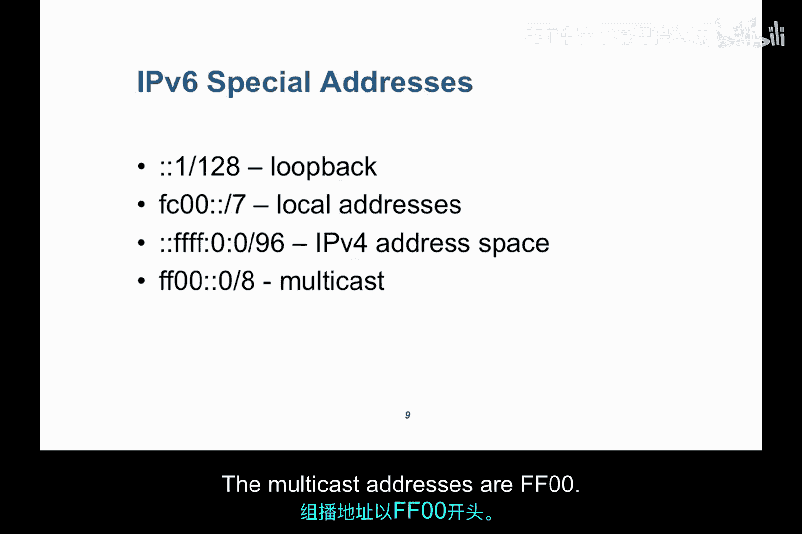

掌握了地址表示法后，我们来看看IPv6中的一些特殊地址和重要特性。

IPv6定义了一些特殊地址块：
*   **环回地址**：`::1/128`
*   **本地链路地址**：`fe80::/10`
*   **IPv4映射地址**：`::ffff:0:0/96`，用于在IPv6中嵌入IPv4地址。

IPv6与IPv4的两个关键差异在于：
1.  **标准子网规模**：IPv6充分利用其地址空间，标准子网大小是`/64`（2的64次方个地址）。这比IPv4中常见的`/24`或更小的子网大得多，简化了路由和管理。
2.  **分片处理**：IPv6的分片通常不在路由器进行。通信开始时，通过**路径MTU发现**机制确定整条路径上支持的最小MTU，随后整个会话都使用该MTU发送数据包，避免了中途分片。

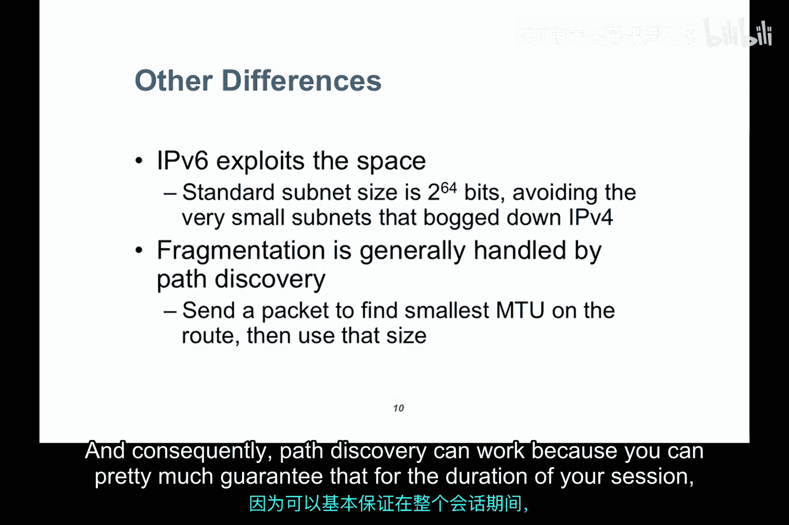

## IPv6与安全性 🛡️

那么，IPv6是否让我们更安全呢？这需要辩证地看。

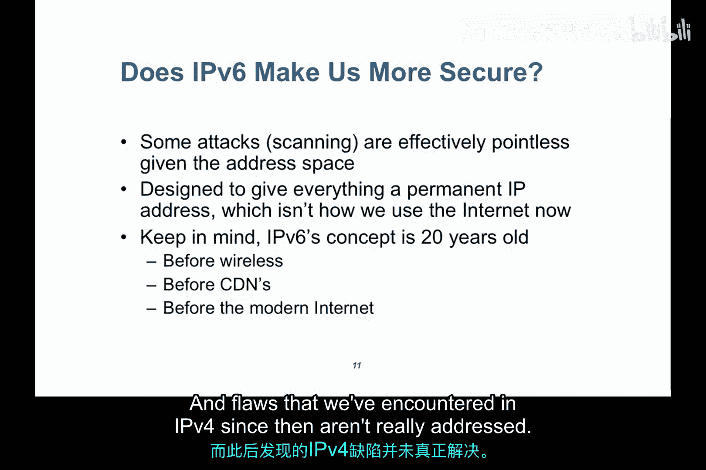

某些攻击在IPv6环境下效力大减。例如，基于扫描的探测攻击在浩瀚的IPv6地址空间中变得不切实际。然而，IPv6的设计基于为每个设备分配永久、公开的IP地址这一早期理念。这与当前普遍使用NAT和动态地址的互联网现状不同。IPv6的设计早于无线网络、云计算和现代互联网应用模式的普及，因此它主要解决了IPv4的地址空间和效率问题，但并未完全解决后来在IPv4中发现的所有安全缺陷。

## IPv6的部署与过渡 🌍

IPv6的部署是一个渐进且不均衡的过程。

IPv6的采用取决于互联网服务提供商。例如，康卡斯特和AT&T等大型ISP已在不同时间点部署了IPv6支持。所有现代操作系统都内置了IPv6支持，谷歌等许多互联网服务也原生支持IPv6。全新建设的网络（如研究网络或某些IPv4地址稀缺的国家）更倾向于直接部署IPv6。预计亚洲和东欧等IPv4地址紧张的地区会率先广泛采用，而美国由于拥有大量历史遗留的IPv4地址，过渡动力相对较弱。

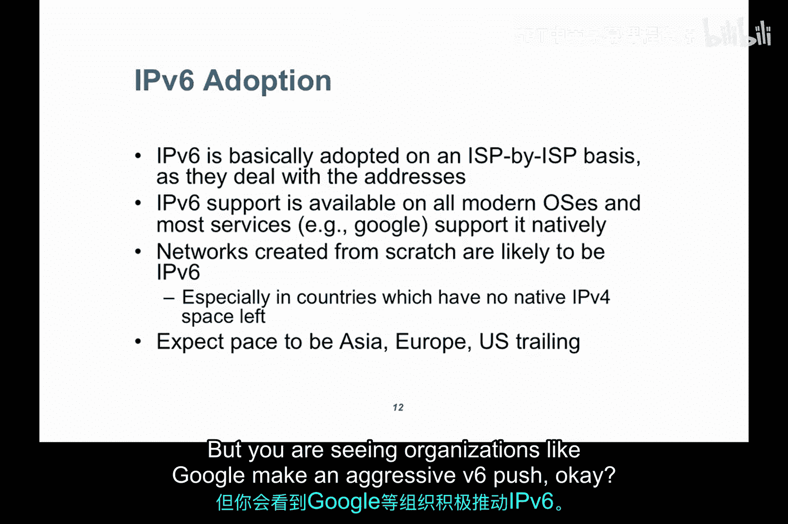

## IPv4与IPv6的共存与过渡技术 🌉

由于IPv6尚未完全普及，我们需要技术来实现IPv4和IPv6网络的互通。

当前存在多种过渡技术，其核心思想是**隧道协议**。在网络中设置IPv4/IPv6网关，当数据包需要从一种协议网络穿越到另一种时，网关负责进行协议转换和地址封装。例如，将IPv4数据包封装在IPv6数据包内进行传输。主要的过渡技术包括：**6to4**、**6in4**、**4in6**以及以“无聊”蠕虫命名的**Teredo**隧道协议。

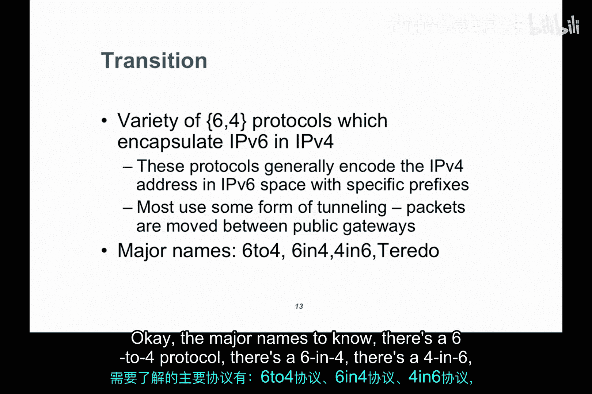

## 总结 📝

本节课中我们一起学习了IPv6协议。
*   IPv6的核心目标是解决IPv4地址耗尽问题，提供了极其庞大的地址空间（128位）。
*   这导致了新的十六进制压缩表示法（如`2001:db8::1`）和更大的标准子网（`/64`）。
*   与IPv4相比，IPv6减少了路由器分片开销，依赖路径MTU发现。
*    IPv6的部署是一个漫长且不均衡的过程，受各地区IPv4地址存量影响。
*   过渡期间，需要通过隧道等协议实现IPv4与IPv6网络的共存与通信。

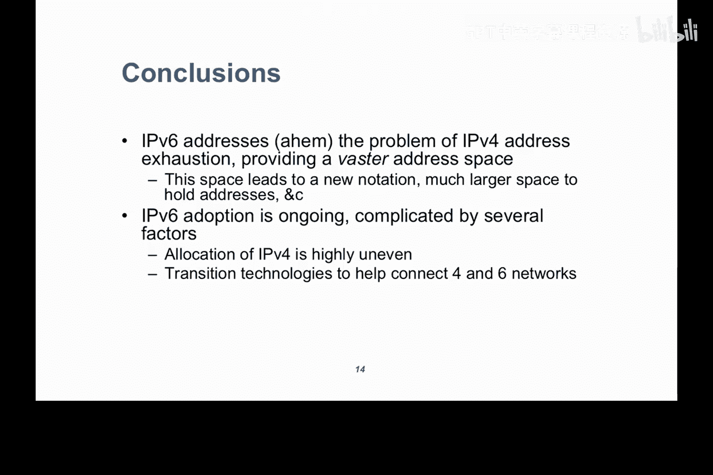

理解IPv6是理解现代及未来网络发展的基础。