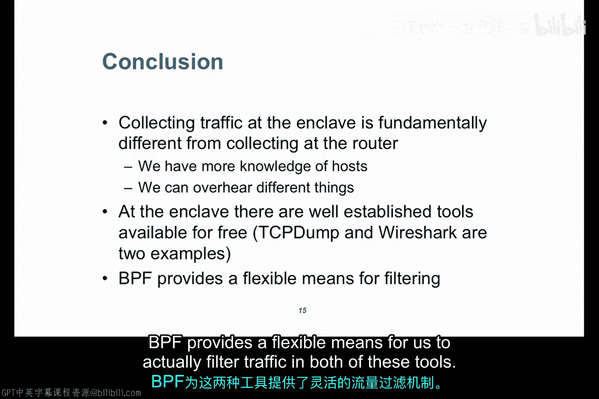

# 046：安全区域数据采集工具 🛡️

在本节课中，我们将要学习安全区域级别的数据采集。我们将探讨其目的、局限性，并介绍如何使用伯克利包过滤器进行数据采集和过滤。

## 概述

数据采集可以根据传感器部署的位置分为两大类：基于路由器的采集和基于安全区域的采集。本节课程将重点介绍基于安全区域的采集方法。完成本模块后，你将能够解释安全区域级数据采集的目的和局限性，并能够使用BPF来定位数据采集和过滤已收集的数据。

## 什么是安全区域？ 🏘️

在深入探讨如何采集数据之前，我们首先需要明确“安全区域”的概念。当我们谈论安全区域时，我们指的是一个内部与外部空间有明确区分的网络。例如，你的家庭网络、军事基地或公司总部都可以被视为一个安全区域。在安全区域内部署的系统和需要保护的资产，与整个互联网之间有一条清晰的界限。

然而，需要指出的是，人们通常并不像他们想象的那样了解自己的网络。一个典型的例子是，许多人没有意识到他们的每一台打印机同时也充当着内部网络服务器的角色。

## 安全区域采集与路由器采集的差异 🔄

上一节我们介绍了安全区域的概念，本节中我们来看看它与路由器采集的主要区别。安全区域采集与路由器采集最显著的区别在于，在安全区域内，你可以看到更多单个主机的行为细节，但总体流量较少。

在安全区域内，你可以看到主机的所有本地流量以及它发送到互联网的流量，但你无法看到其他所有安全区域通过上层路由器进行通信的全部流量。此外，在安全区域层面，我们较少受到网络地址转换的阻碍。网络地址转换有时是一个很大的障碍，因为它使你无法准确判断你实际处理的主机数量，因为所有主机都被隐藏在某个特定的IP地址之后。

但在安全区域层面，你可以精确地看到主机在做什么以及如何做。由于我们处理的主机总数较少，我们在保留哪些流量方面拥有更大的灵活性。在路由器层面，由于流量巨大，你不得不处理流量汇总，而在这里，我们至少可以尝试记录非汇总的数据，甚至可以尝试按数据包进行记录。

## 流量如何进出安全区域？ 📡

为了实现按数据包记录的目标，让我们讨论一下流量如何进出安全区域。为了简化，我们假设我们的安全区域位于单个集线器上。如果我们有一个大型网络，我们可以简单地假设在每个集线器上都设置了采集点，仍然可以获得大致相同的结果。

以太网和大多数第二层协议都是广播协议。如果一切实施正确，每当一台主机向集线器发送流量时，该集线器会将其发送给路由器，但它也有将流量广播给连接到该集线器的所有其他主机的倾向。

现在，假设其中一台主机被设置为传感器，用于记录流量。主机可以以两种模式运行：混杂模式和非混杂模式。

以下是两种模式的区别：
*   **混杂模式**：主机监听来自集线器的所有内容。其优点是能够监听到其他主机的流量。其缺点是必须在混杂模式下运行传感器，这需要对该机器拥有根级访问权限。
*   **非混杂模式**：如果你没有根级访问权限，或者只想检查发送到特定主机的流量，可以使用非混杂模式。这会进行主机通常进行的所有过滤，主机本身不会监听所有流量，而只监听专门发送给它的流量。

## 数据采集工具 🛠️

关于背景知识已经介绍得足够多了，让我们来看看一些实际的工具。在本课程中，我们将反复使用两个工具：`tcpdump` 和 `Wireshark`。它们的功能基本相同，都是采集和分析工具，允许你将网络流量保存为二进制文件格式，并允许你对流量进行过滤和其他操作。

两者的区别在于，Wireshark 拥有一个简洁的图形用户界面，并且可以在多种不同的平台上使用。

### tcpdump

我们先从 `tcpdump` 开始，快速了解一下。它是一个用于Unix环境的命令行工具，有几个非常重要的选项需要快速过一遍。

以下是 `tcpdump` 的几个关键选项：
*   `-A`：允许你将ASCII输出到屏幕。这意味着你可以开始报告流量并直接将其转储到屏幕上，查看发生了什么。
*   `-i`：允许你指定网络接口。每个拥有笔记本电脑的人可能都意识到你有大约三到四个可用的接口，因此能够指定我们真正感兴趣的那个至关重要。
*   `-w`：用于将原始数据写入文件。

### Wireshark

如前所述，Wireshark 是一个易于使用的GUI工具。需要提醒你的一点是，确保你以足够的权限运行它，以便选择你想要使用的接口，并以能够以混杂模式运行的方式配置这些接口。这一点对人们来说可能不那么明显，即程序需要在混杂模式下运行，或者必须配置其某些子进程以混杂模式运行才能完全正常工作。

关于这方面的很多内容实际上都列在网站提供的文档中。我不会花太多时间在这上面，因为网上有大量的YouTube视频以及网站上的几份文档，可以告诉你关于这个工具本身你需要知道的一切。

## 过滤语法：伯克利包过滤器 🔍

现在进入过滤语法的核心。分析师将执行的最重要的操作之一就是过滤流量。伯克利包过滤器基本上是数据链路层的一个接口，它允许你发送和接收数据包。它是一个非常有趣的工具，在大多数操作系统中都可用。

当大多数人谈论BPF时，他们不一定是在谈论该工具本身，更多的是在谈论其过滤能力。这种过滤能力在各种不同的工具中都可用。此外，Windows和Unix都有支持它的API，分别是Unix的`pcap`和Windows的`winpcap`。每当你使用 `tcpdump` 时，你都可以使用BPF，而且Wireshark的语法也非常相似。

### BPF 基础语法

让我们深入了解该语法的基本原理。在最基本的层面上，BPF允许你分析来自数组（如IP、以太网帧或TCP）的记录。基本上，它的作用是将数据块分割成你在本模块前几节课的数据报中看到的各个字段。

例如，`ip[9]` 表示它正在查找数组中第9个位置的值（从0开始计数）。在这种特定情况下，这将是协议字段。里面存放的不是协议的名称，而是与之关联的实际数字，即0到256之间的值。如果值为6，则表示TCP；如果值为17，则表示UDP。

BPF包含许多原语，它们是数组特定部分的快捷方式。你可以指定一个特定的值，如 `host` 或 `proto`，它会直接给你协议信息。

### 高级操作与逻辑

数组有范围表示法。例如，`tcp[2:2]` 将给出从偏移量2开始的两个字节。在TCP的情况下，这将是目标端口。而 `tcp[0:2]` 则是数据报中的前两个字节，即源端口。

BPF的一个有趣特性是它允许你进行比较操作，例如等于、大于、小于、不等于。你可以操作值，将不同的字段组合在一起，然后将这些结果与你想要的任何静态值进行比较，并使用该过滤器来决定是否保留你正在采集的数据包。

你还可以使用逻辑运算符将许多条件组合在一起。`&&` 表示逻辑与，`||` 表示逻辑或，`!` 表示逻辑非。通过这套简单的保留关键字，我们能够组合出一些非常复杂的过滤器，以确定是否保留特定流量，或者在已捕获的数据中显示它。

### 地址与子网过滤

关于BPF的另一点是，地址可以使用主机名或IP地址进行过滤。在查看内容时，你也可以使用子网。例如，你可以指定类似 `src host 192.168.1.1` 或 `dst net 10.0.0.0/24` 的条件。

### BPF 语句示例

以下是一些BPF语句的示例：
*   `host alibaba.com and port ftp or ftp-data`
    *   这个语句的含义是：如果解析源或目的IP地址得到 `alibaba.com`，则返回真。并且，如果查找端口号，端口号是FTP（端口21）或FTP数据（端口20）中的任何一个，则也返回真。如果这两部分（主机名和端口名）都返回真，则记录将被捕获。
*   如果我们想查找ICMP记录，这里列出了两种方法：
    *   `ip[9] == 1`：这意味着它确实是IP数据报，并且是ICMP流量。
    *   或者，我们可以直接说 `icmp`，它会自动转换为适当的形式。

## 总结 📝

本节课中我们一起学习了安全区域级别的数据采集。总结来说，在安全区域收集流量与在路由器收集流量有根本性的不同。我们对单个主机及其本地流量有更多的了解，并且可以监听到与路由器层面不同的内容，例如本地流量。

在安全区域层面，有许多成熟的免费工具可用，例如 `tcpdump` 和 `Wireshark`，当然还有其他一些工具，这只是本课程中我们偏好的两个。BPF为我们提供了一种灵活的方法，可以在这两种工具中过滤流量。