# 047：路由器流量采集工具 🛠️

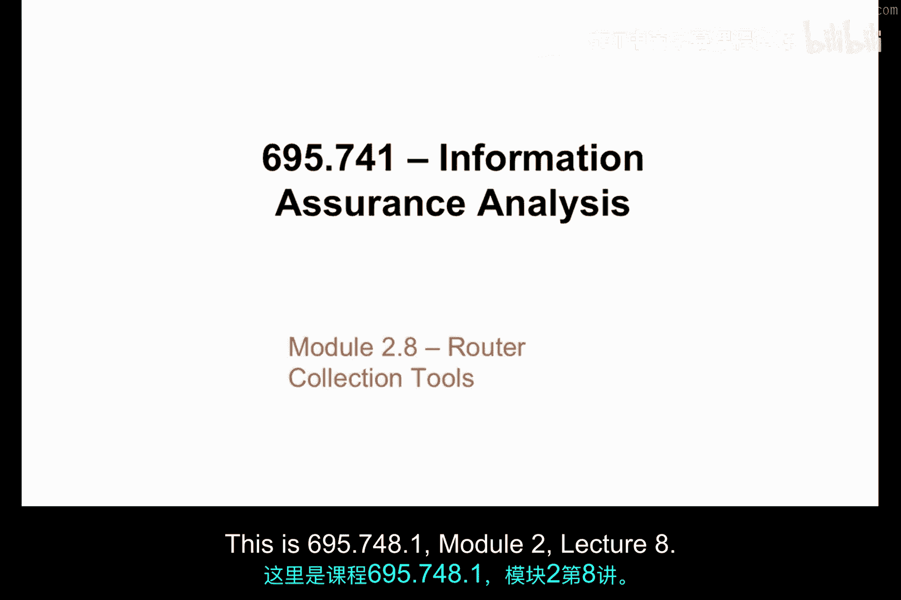

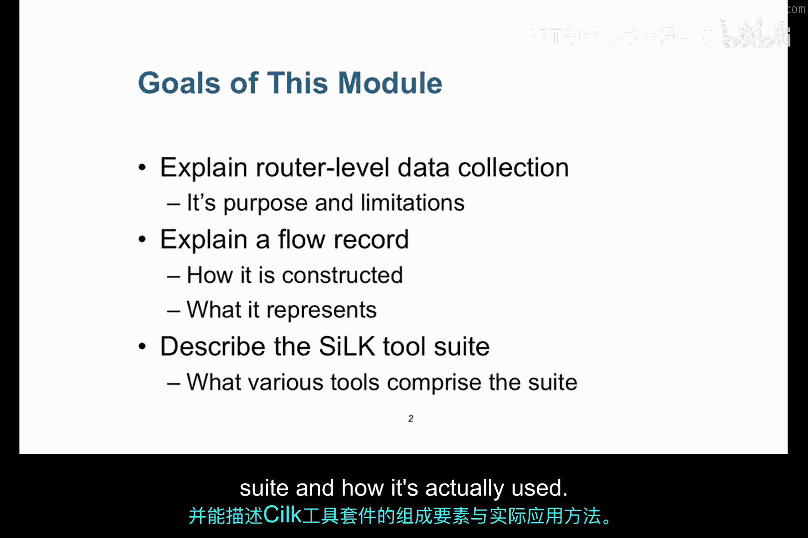

在本节课中，我们将学习路由器级别的数据采集工具。我们将解释路由器级数据采集的目的与局限，理解流记录（Flow Record）的构成与含义，并描述Silk工具套件及其使用方法。

## 概述

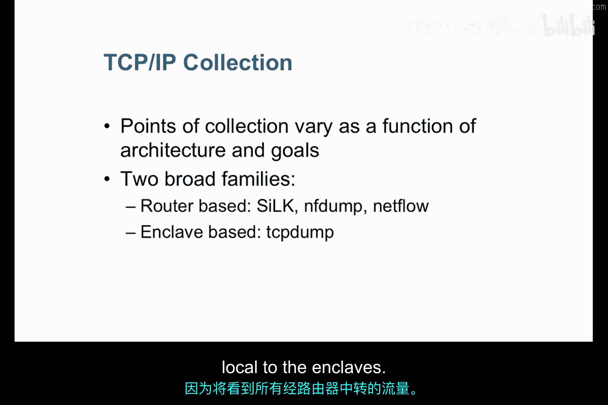

上一节我们讨论了数据采集的视点问题。本节中，我们来看看在路由器层面进行数据采集的策略与工具。

正如在2.7节中提到的，数据采集的视点决定了采集策略。如果你位于网络分区（Enclave）内部，你可以访问本地流量，监控的主机数量较少。如果你处于路由器层面，例如作为互联网服务提供商（ISP），你将无法访问分区内部的本地流量，但会看到经过该路由器的所有流量，因此流量总量会大得多。

考虑这个示意图。在一个拥有多个路由器的大型网络中，有三个主机。假设网络分区的所有者不允许我们在其分区内采集流量。这比想象中更常见。例如，你不会允许黑客在你的家庭网络中采集流量，大多数企业也不希望如此。

因此，与其试图从分区获取流量，我们可以对路由器进行配置。路由器非常适合这项任务，它们能看到所有经过的流量。唯一的问题是，路由器无法复制它们看到的每一个比特的流量，这任务过于繁重，也不是其主要功能。路由器的首要功能是路由流量，而非报告流量。流量实在太多，无法全部复制。

所以，路由器转而使用摘要信息。流（Flow）是一种常用的流量摘要。从一个分区到另一个分区的流量摘要结果看起来是这样的：一台主机通过一个路由器通信，再经过另外两个路由器，到达另一个分区中的主机。这对于检测分区间的通信非常有效。然而，对于分区内部的通信，我们则完全无法看到。

除了这个缺点，你的采集配置还可能提供冗余的流信息。例如，如果我们对数据包经过的所有三个路由器都进行配置，它们都会看到相同的东西。如果我们没有制定策略来限制输出或建立更好的感知策略，就可能报告冗余数据。理解你的实际基础设施是避免这种错误的关键。

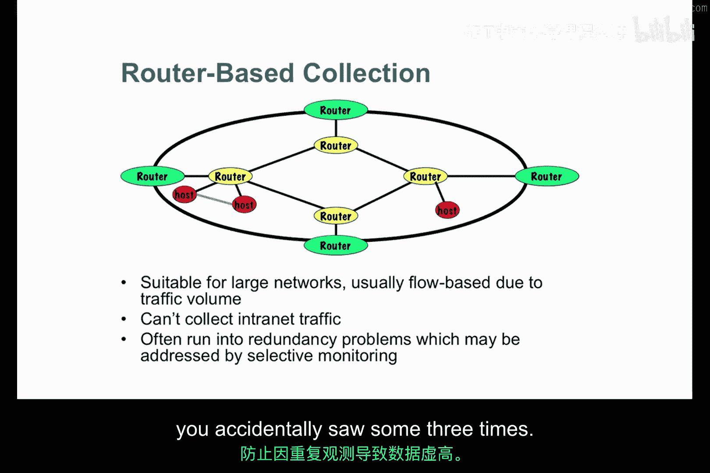

## 流记录详解

上一节我们提到了流作为摘要。本节中，我们将具体关注NetFlow。

NetFlow是共享一个共同**五元组**的数据包的单向摘要。这个五元组是：**源地址、目的地址、源端口、目的端口、协议**。所有共享这五个要素的数据包将被归为一组。

路由器开始构建一个记录，将具有相同五元组的数据包分组。它统计字节数、数据包数、记录首次看到该流的时间以及会话的持续时间。在NetFlow中，特别是使用Silk时，我们还会存储观察到的所有TCP标志位。

例如，如果你看到TCP三次握手，并且会话仍在进行，标志位字段将包含S（SYN）和A（ACK）。Silk会尝试遵循协议语义，如果我们看到RST（重置）或FIN（结束）标志，就会开始结束会话。

此外，我们还会对持续时间过长的会话进行超时处理。主要有两种超时：
1.  **TCP超时**：如果在设定时间内没有看到任何数据包，就假设连接已死，写出完整的记录。
2.  **长时间会话超时**：如果某个会话持续了极长时间，我们会关闭当前记录并写出，然后当下一个数据包到达时，再开启一个新的记录。

这样做的原因是，例如一个SSH会话可能持续数周，我们不想等到会话结束才获得任何信息。超时机制保证了我们能在不久的将来获得部分数据。

## 流记录示例与局限

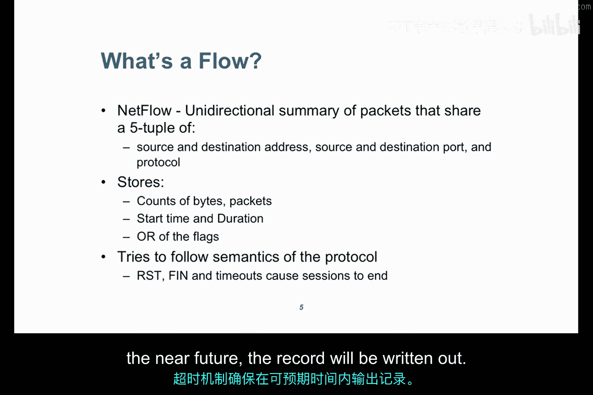

现在，我们来看一个NetFlow输出的例子。

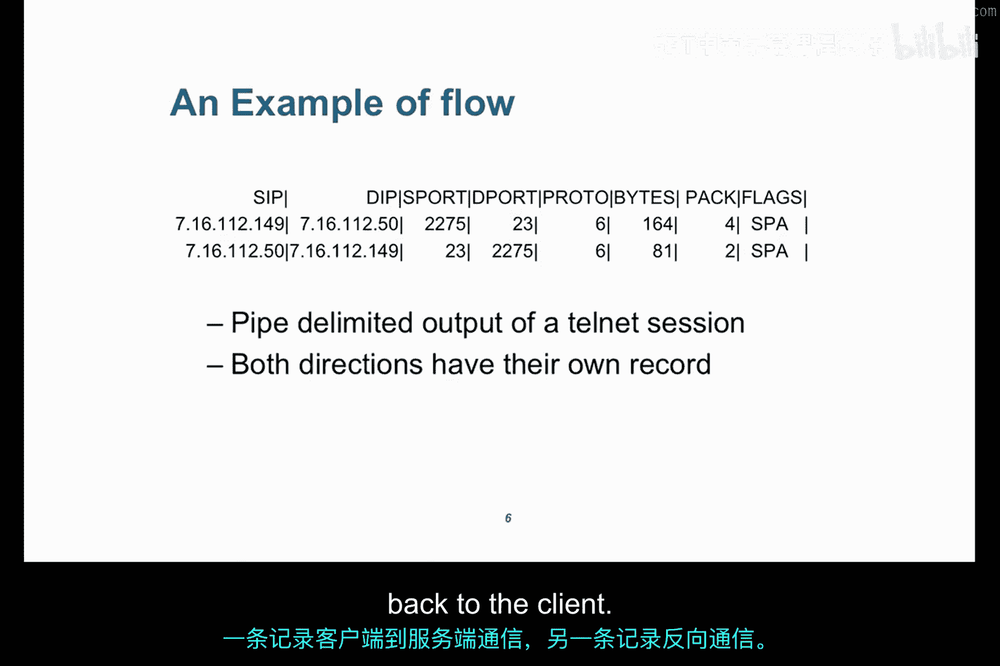

这里展示的是管道符分隔的TCP会话输出。需要指出的是，**每个方向都有自己独立的记录**。NetFlow是单向的。因此，要了解一个完整的会话，你至少需要处理两条记录：一条是客户端到服务器的通信，另一条是服务器到客户端的通信。

这是一种非常有效的方式，可以查明谁在什么时间、通过什么端口、与谁通信了多久，传输了多少数据。

然而，它也存在一些问题：
*   **没有有效载荷**：在路由器层面处理海量流量，无法像在分区内部那样保留数据包的有效载荷内容。
*   **对行为的近似**：流是对TCP/UDP/ICMP等协议行为的近似汇总，并非完全精确。
*   **ICMP处理**：对于ICMP流量，其类型和代码信息是通过**重载目的端口字段**来编码的。高比特位表示类型，低比特位表示代码（或相反，具体见文档）。
*   **时间粒度较粗**：只能获得会话开始和结束的时间，没有数据包间到达时间的精细信息。

## Silk工具套件介绍

如前所述，本课程将主要使用Silk进行流分析。

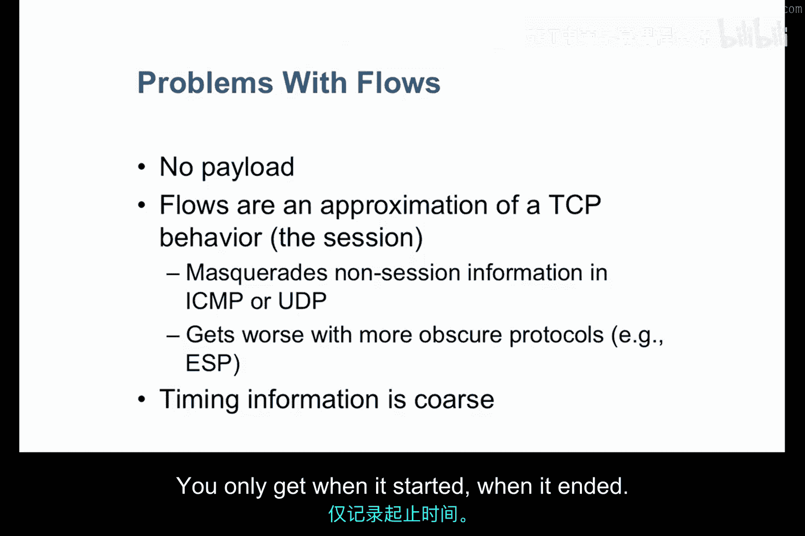

Silk是一个用于分析流数据的相对复杂的工具套件。其重要之处在于，它**既是采集工具也是分析工具套件**。它收集数据并将其组织到自己的存储库中，然后你可以通过一组Silk工具访问该存储库。

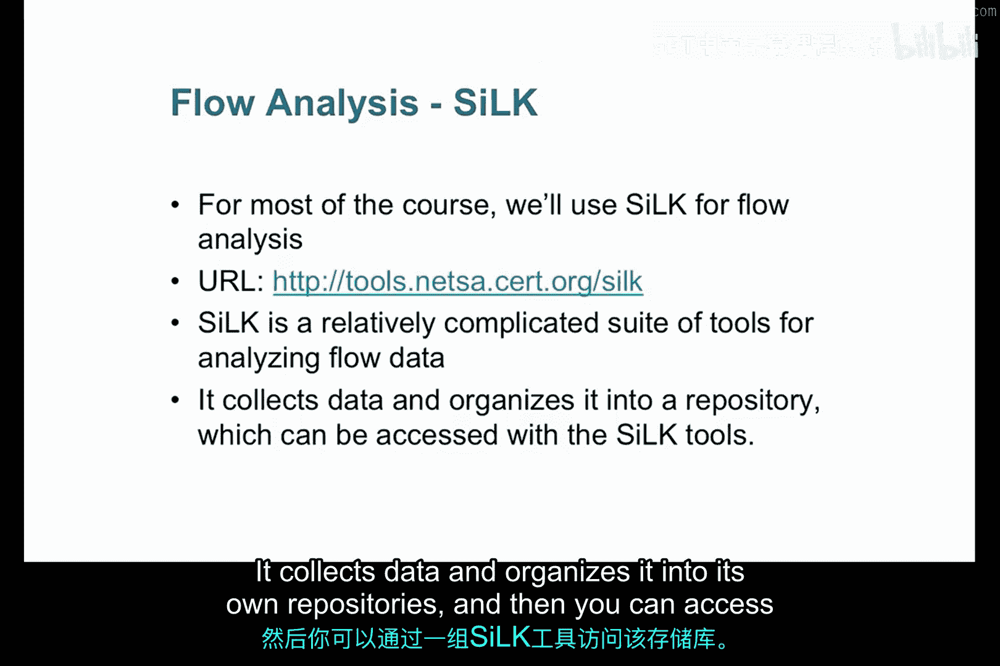

以下是该套件中的一些核心工具：

*   **`rwfilter`**：选择和过滤工具。它允许你从存储库中选择记录，并根据特定特征进行过滤。
*   **`rwcut`**：转换工具。它读取Silk格式的文件，并输出ASCII文本（就像前面NetFlow示例中展示的那样）。
*   **`rwcount`**：汇总工具。它主要用于生成时间序列数据，可以按任意时间范围对数据进行分箱，并统计该时间段内的字节数、数据包数和流数。结果可以轻松导入Excel。
*   **`rwuniq`**：聚合工具。它允许你将任意字段组合在一起进行聚合。例如，你可以按源IP和目的IP地址聚合，查看从特定IP到另一个IP传输了多少字节、数据包或流。

在所有这些工具中，**`rwfilter`是最重要的**。它不仅用于过滤数据，还是你访问已采集数据存储库的入口点。可以说，几乎所有使用Silk的分析，都将从运行`rwfilter`命令开始。

## IP集（IP Set）工具

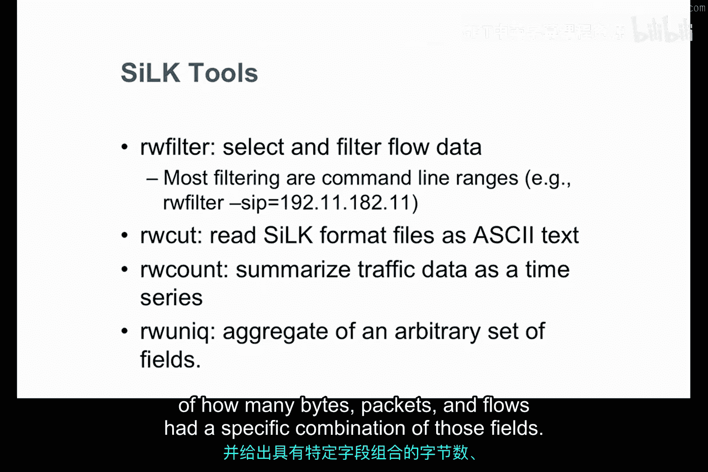

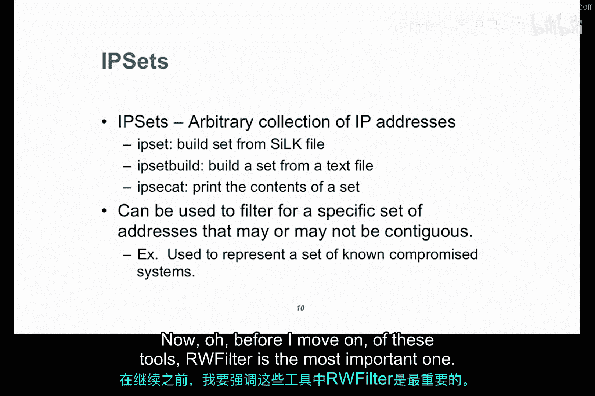

关于这些工具，还有一个非常重要的方面，即IP集（IP Set）工具，初学者常常会忽略。

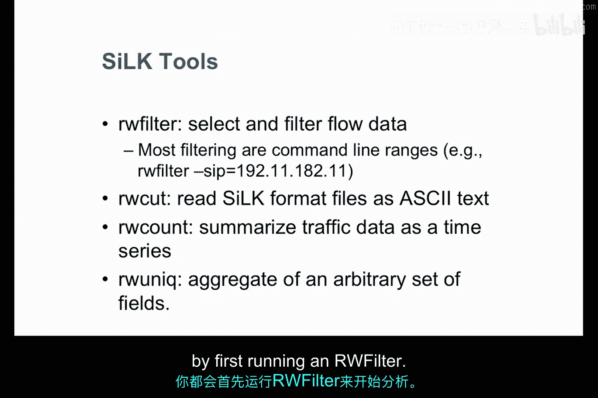

IP集是IP地址的任意集合。有三个工具用于操作它们：
*   `rwset`：从Silk文件构建集合文件。
*   `rwsetbuild`：从ASCII文件构建集合文件。
*   `rwsetcat`：查看集合文件的内容。

IP集的用处在于，你可以用它来过滤一组不一定连续（不仅仅是CIDR块）的特定地址。一个很好的用例是：假设我们过滤后发现了一组可能被感染的主机，我可以自动将这些IP放入一个集合文件中。之后，我就可以像过滤单个IP地址一样，轻松地过滤出所有这些主机的流量。IP集使用紧凑的二进制格式表示，处理效率很高。

## 总结

本节课中，我们一起学习了路由器级别的数据采集。

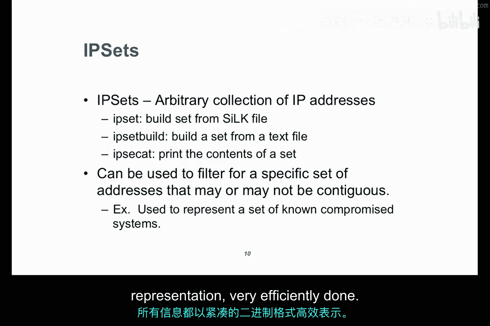

*   路由器级采集提供了网络分区之间传输流量的摘要信息。
*   我们深入了解了NetFlow流记录的构成，它基于**五元组**（源/目的地址、源/目的端口、协议）对流量进行单向摘要，并包含字节数、数据包数、起止时间等信息。
*   我们介绍了**Silk工具套件**，它是一个功能强大的流数据采集与分析系统。我们认识了几个核心工具：`rwfilter`（过滤）、`rwcut`（转换）、`rwcount`（时间序列汇总）、`rwuniq`（字段聚合），以及管理IP地址集合的`rwset`系列工具。

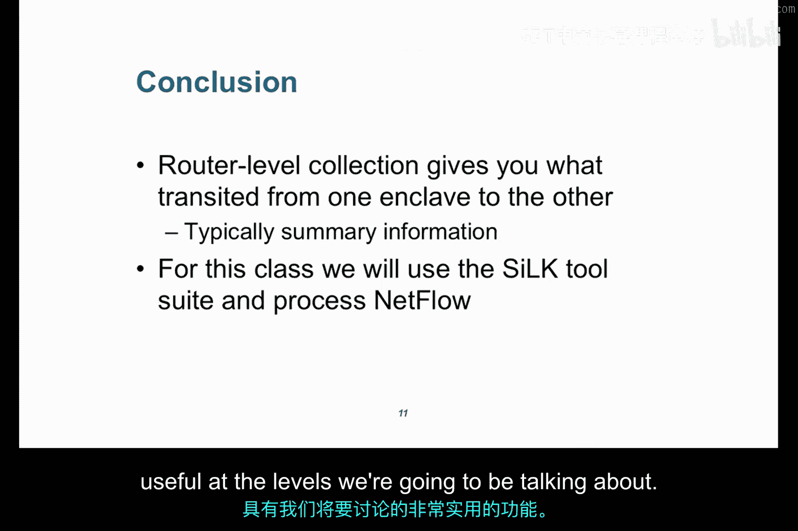

路由器级采集虽然无法看到分区内部细节，但在监控大规模网络流量、分析分区间通信模式方面是不可或缺的工具。