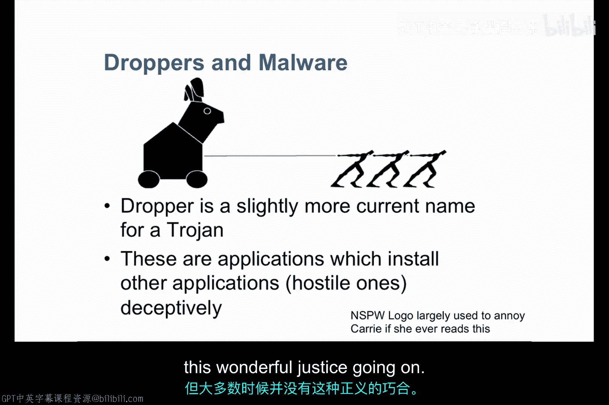
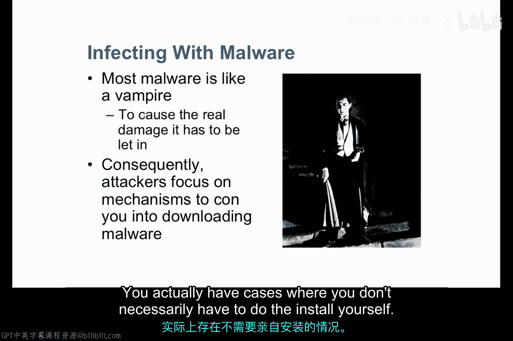
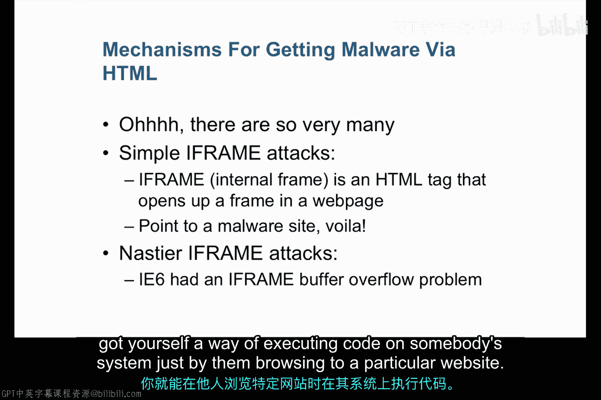
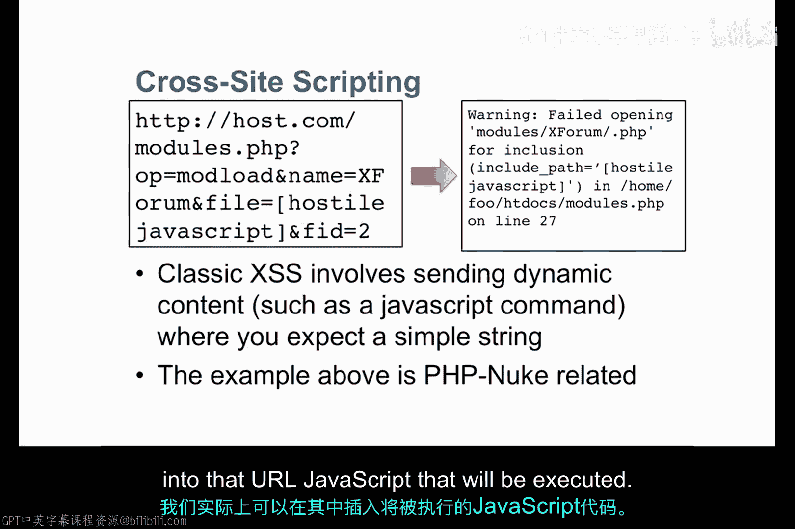
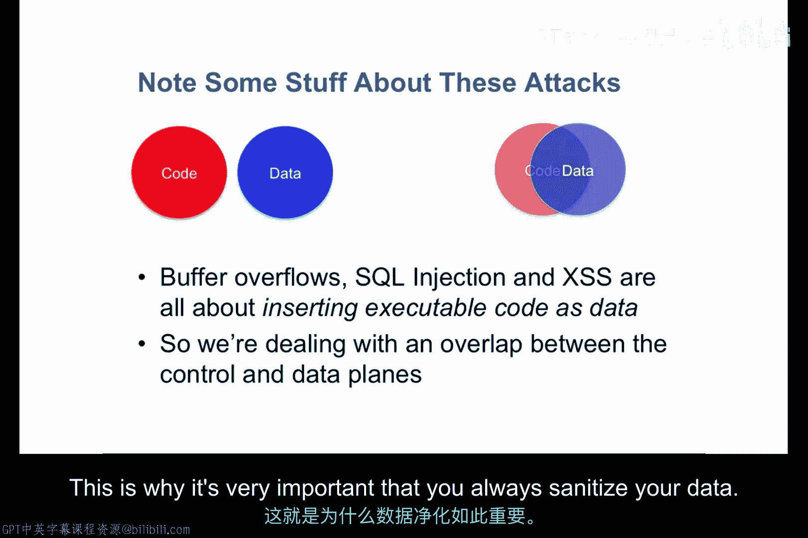
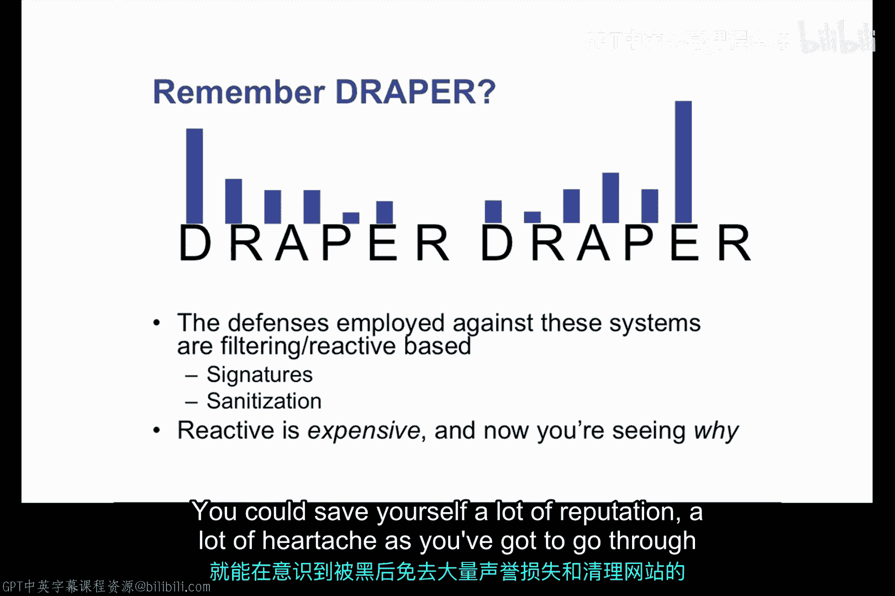
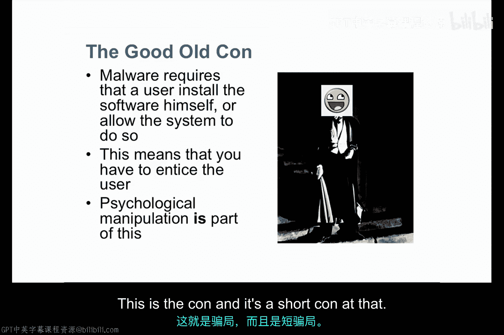
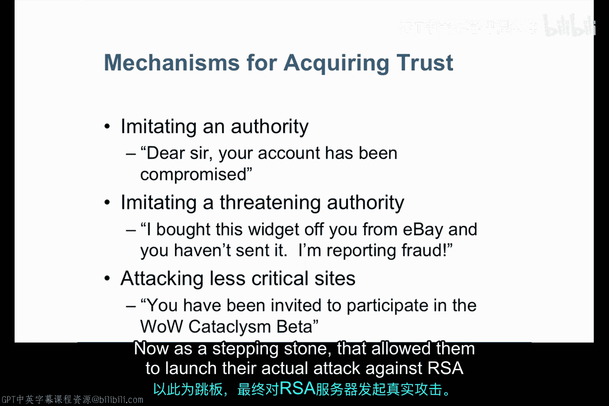
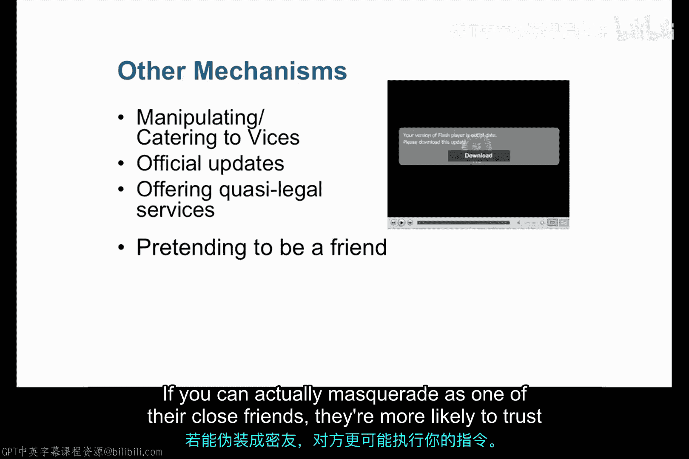
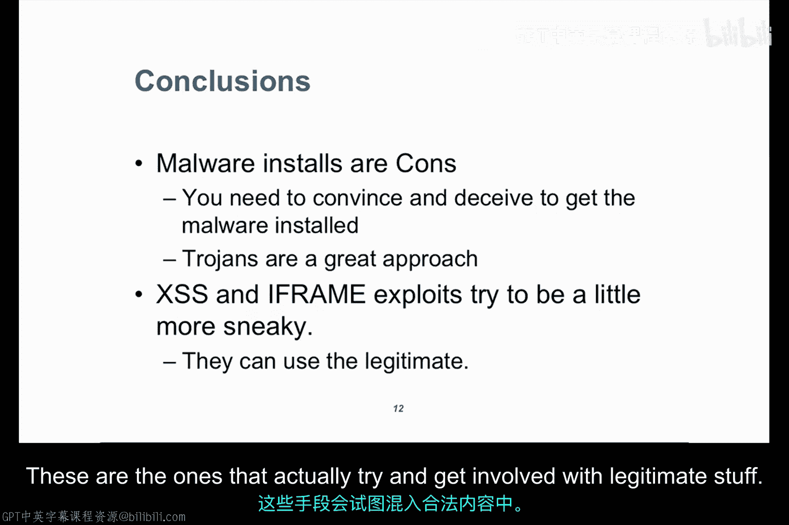

# 约翰霍普金斯大学《信息保障分析｜Information Assurance Analysis》中英字幕 p02 1_恶意软件分析.zh_en -BV1Qz8EzYENX_p2-

This is 695741， module 3， lecture7。In this lecture。

 we're going to be talking about several different types of malware and broad strokes。

We want you to be able to identify these different types of behavior and speak specifically to what they do and bo generallyly to how they operate。

The first of these that we're going to describe is the Dper Dper is really the old school's name for a Trojan。

Which are applications that masterade as serving one function but really are being hostile。

 a prime example of this was discussed in lecture 3。6。

 where the free fishing kit were complete with their very own backdo into the fisher system。Now。

 the important thing about this is of course they。The Trojans tend to do what they say they do。

 they just do stuff in addition to that。The phishing kits were。

 they have the ability to set up nice websites that look exactly like they should and are very good at duping individuals into installing applications that they shouldn't。

Now， also many of them have wonderful little spam bots already set up that hurt。

Pretty easy for them to use。 The only problem is that in addition to these things。

 they've got these back doors that allow the actual writer of the malicious code to get directly into their system。

Granted in this case， that's a wonderful thing because the J quote unquote here is actually somebody trying to victimize other people。

 but most of the time we don't have this wonderful justice going on。

Trojans are the most basic implementation of a simple concept。You've got to get a piece of malwear。

 one to somebody's system， and you've got to make it to where they get it and they actually execute that piece of malware。

So。Most malwares like a vanbar。Cause the real damage it has to be let at。 You have to install it。

 So consequently， attackers focus on。Actually putting together a wonderful con。

 they want to make it so enticing that you just have to download it。

 you have to actually install this new piece of software。In the case of the Trojan。

 they are actually getting the victims to do all the work of downloading installing themselves。

 However， that's not always the case。哦。You actually have cases where you don't necessarily have to do the install yourself。

And we're going to start getting into some of those right now。

Primary example would be HTML provides a wonderful mechanism for installing malware。

The simplest one that we can start off with is the iframe。

It basically what it allows you to do is start setting up。Micious sites within legitimate sites are。

Miicious sites within would look like legitimate sites。

 so what an Iframe is it's an HTML tag that opens up a frame into a web page。

So all you've got to do is have the malicious site be pointed to by the iframe itself。

Now you couple that together with a nice little buffer overflow with that。

 and you've got yourself a way of executing code on somebodyy just by them browsing to a particular website。

Another example of this wonderful。Way of actually installing code without people realizing it is crossside scripting。

It's a classic example， basically it involves sending dynamic content such as JavaScript commands。

Where actual data was being expected。What the attacker is really doing is getting their executable code。

To be put onto a quote unquote  legitimate site。Any site that allows others to post onto their site has to ensure that what they are incorporating into the site is not code。

That will be run on the site。This is something that Facebook had to deal with。

 this is something that any of the websites that you go to that allow people to post comments has to deal with。

That's the wonderful part about it is that you're actually listing comments that people have posted。

 you've got to sanitize your data before you allow those onto the page。Hey。

 there's even one more interesting one about it， you can actually encode this kind of attack into URLs in some cases。

 for example， this this up top， this little bit up top。

Well we've got a URL here and we can actually put into that URL JavaScript that will be executed so when you're talking about URLs。

 they do provide an excellent way for attackers to execute crossl scripting attacks。

Because。A lot of systems get to parse the URL， so a lot of systems get to try and interpret what's going on in the year。

 and the only reason that crosssidescripting works is because the browser is a fully functional turning machine。

 it wants to execute instructions， so all the attacker really has to do is figure out a way to get those instructions to your browser and to your system in order to be executed。

This is really just all of these offer over fellow SQL jack and crossside scripting are all just。

Are all about just inserting executable code where you are expecting actual data。

So what we're dealing with is an overlap between the control and data plane， the control plan。

 of course， determining what's going on with what instruction should be run and the data plan be the data thats contained and needs to be actually stored and manipulated。

The bad place to be when these two actually start crossing off't crossing pass。

This is why it's very important that you always sanitize your data。

It helps to protect that control point and speaking of which I mean。

The defenses to employ against us are quite simple。

If you're actually allowing people to post a website， at the very least。

 what you should do is try and identify and remove all tags with M postss。

Don't allow people to randomly startX to upload random code that you haven't checked。

They would be using your site if they actually get through， they're using your sight。

The Washington attack。Your side is legitimate。They have just turned it into a malicious entity。

And this and that is why this gets to be， it's more important to actually have a proactive approach to actually to securing a site than to have a reactive approach。

If you're just a little bit pro， you just do that step of removing。

 removing all tags from posts on your website。You could save yourself a lot of reputation。

 a lot of heartache and try as you've got to go through and sanitize your site after you realize that you've been hack。

So。Now I'm going to hop down off by soapbox and we're going to start talking about nowware itself。

Or basically how you can get them out or two people。It requires them to install。

It requires your victim to install， open themselves up， and allow their systems to be used by you。

 in some way shape or form。This means that she needs to entice things。

This is where knowing your psychology is。Ideal。All it is is manipulation， this is the con。

 and were in so short con at that。

So let's think about that if you put yourself in the attacker shoes， you want to imitate。

An authority figure， either a nice one or Read one， a go where people are not expecting the attack。

So email somebody's home email address。Are their Gmail account。Get them to go to a link。

Exp their box a certain website from a website that you've set out for phish。

Now you're on in their system。Once you're on their system。

Let them start connecting to their VPN and to their corporate network and guess what now you have a compromise machine within a network。

From there， you can move forward。In fact， that's kind of the model that was used for the RSA attack。

They didn't target the CEO of RSA， they didn't target any of the technical staff or RSA。

 what they targeted was the low level employees。They convinced those low level employees to install malware on their systems。

When those systems were within and those systems were within the actual network。

Now is a stepping stone that allowed them。To launch their actual tech against Rsa Sers。

Note that what we've talked about here。These are just a few of a simple version of the attack mechanisms that can be used。

You can always do why these whenever you actually want to entice somebody to do something。

 manipulating and catering to devices is a wonderful way of doing it。

I've already mentioned once before that you could actually try and get people to install their own updates。

just act like you're an official entity and say， hey。

 we need you to update Adobe or as everybody remember。

 whenever you get used to get those pop ups for a free virus scanner。And。Of course。

 there's also pretending to be a friend。 That's a tried and true method。

 If you can actually masquerade as one of their close friends。

 they're more likely to trust anything that you tell them to do。

more likely to do it， so in conclusion， malware installs our cons。

You need to convince and dece to get what get a malware installed。Tjans are a great approach。

 but they're not your only approach。Again， yes you can convince somebody that you're an update and not even be an update。

 just get them to download it。I you know if you wanted to do something clever and make it pretty。

 I'd be more than happy for you guys to start putting together your own fishing。

 free fishing kits and start exploiting。Other fishers as wow。

Gssside scripting and iPhone frame exploits。They try to be a little bit more sneaky about them。

These are the ones that actually。Try and get involved with legitimate stuff。

