# 约翰霍普金斯大学《信息保障分析｜Information Assurance Analysis》中英字幕 p03 2_动态HTTP、XML、SOAP与REST架构.zh_en -BV1Qz8EzYENX_p3-

Hello class， this is Professor Collins and this is 695741 Information assurance Ana module that we're about to cover is module 32。

 this is about dynamic HTTP， which includes CGI， XML， SoF and the RE。Now。

 the goal of this module is to make you conversant in dynamic HTTP recall from the previous module that I said that HTTP is both the simplest and the most complicated protocol we deal with。

 and the reason for this fundamentally is because of all the additional material we've slapped into HTTP the real jumping off point。

 the point that HTTP begins to become the glorious mess that it is is the development of dynamic HTTP couples with the use of XML is universal formatting language as you begin to get the TTP stack effectively replicated within HTTP。

Coupled with this the various technologies used to create dynamic invocable HTP sites like soap and rest in this module we're going to discuss how they were developed。

 the differences in philosophy， and how they make things complicated。

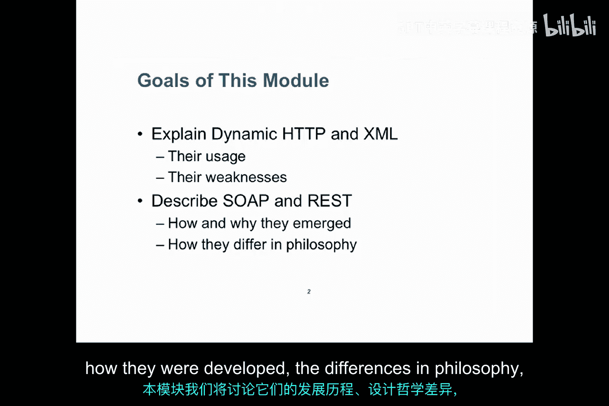

At the cornerstone of it， remember that in module 31。

 I listed9 methods that were associated with HtTP。 That was if you send an HP request。

 there's one of nine methods you could potentially send。 however， of these nine methods。

 only two of them get post or in common use。 As originally conceived H TTP would be a sort of library access protocol。

 You would specify a resource you wanted with a Uri。

 and then you had various methods for manipulating it， you could access it with get。

 you could modify it with post。 You could delete it with delete。

 you create a new one with put all of this。However。

 it rapidly became apparent that the server was for all intents and purposes。

 from the client's perspective， a black box。 Now， the intuition of H TTP。

 when you look at a URL is that it is a file system。 If I look at a URL H TTP colon s slash site。

 slash file， slash path， slash data dot text in the back of my head。

 I assume that there's a directory somewhere on the server site。

 which has a directory called file in that directory。

 there's a path and then that there's a path directory into the path directory。

 there's a data dot text file。There is no guarantee that this is how the server actually operates for all you know。

 the server could in fact ignore。The request， you pass it Rly generate a file and send it back to you。

 Theres no particular read。 There is no actual correspondence between that URL and whatever the server decides to do。

The moment the dynamic HT became possible was when people realized that the server was that black box。

 and that led to steady evolution in dynamic technology。

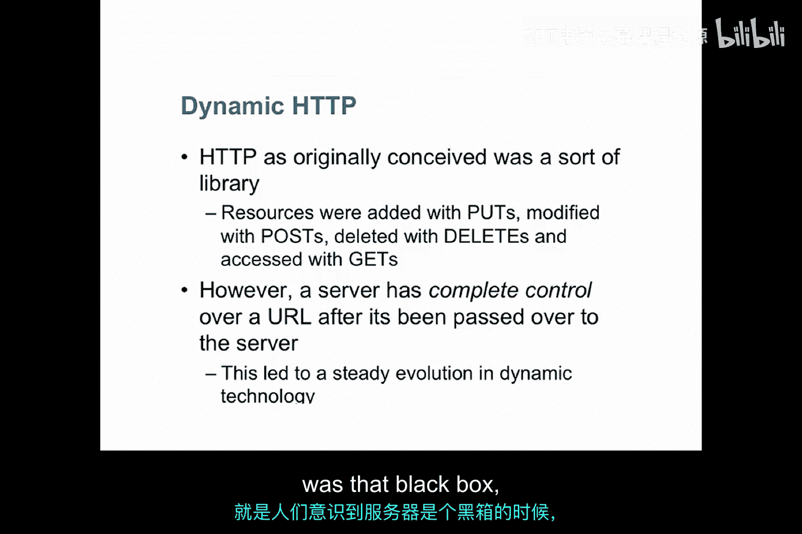

The cornerstone of dynamic HtTB are the get and post messages。 More specifically。

 it is the fact that get post messages have parameters in them Now。

 depending on the type of message you're using those parameters are either encoded within the URL or sent as part of the message itself This in particular emphasizes the statelessness of HtTP commonly when we talk about HttP。

 we say it's a stateless protocol that means that every time you send an HB request。

 all the information it means is sitting in that request in the case of get。

 that information is explicitly available if， for example。

 you've ever used a bookmarklet where you' go to and they tell you bookmark it is to be able to call the site and do something functional with it that's done with a get what you've done is you've created a bookmark with some specific parameters in it。

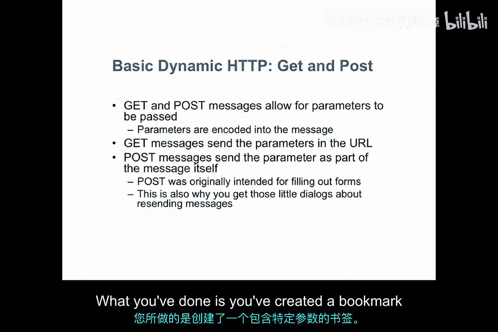

We can see this by taking a look at a dynamic web page。

The page I'm looking at here is one of a number of CGI bin testing sites。

 and it's no more special than in the other， however。

 what I wanted to do is show you how the actual dynamic element works so you'll notice up here this command echo up as there's a question mark that separates the URI from the parameters and then there is a bunch of assignments submit button text field。

 things like that you can see that these were exactly replicated in the query string here。

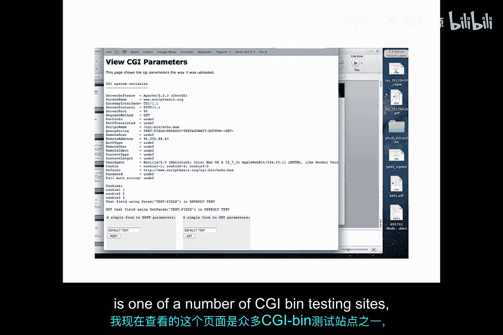

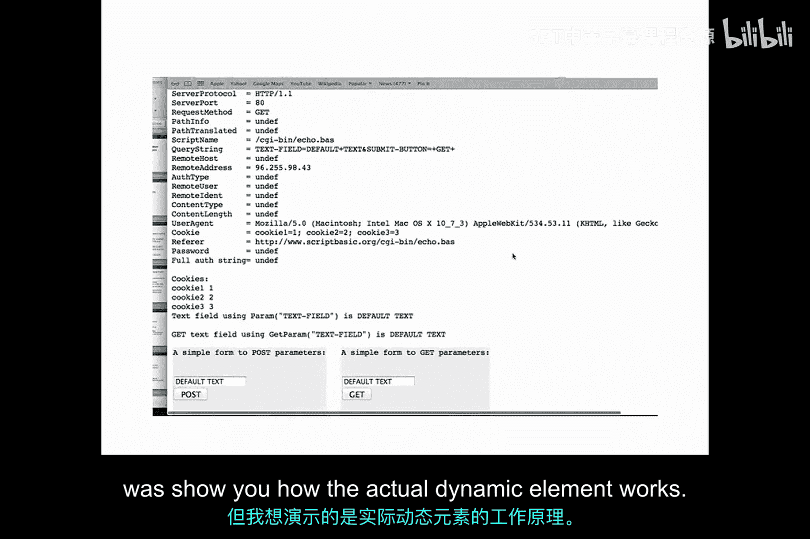

All right， in addition， you'll notice that a couple of other things that we' talked about。

 for example， the user agent string is over here。Okay， as it is the referer。

 however the key thing is you can see the dynamic element there。

 this value here is passed down and stored in this value here all this thing does is it shows values。

 but you could just as easily set it up to do something dynamic like modify the tax reverse it or start playing the Ga clone。

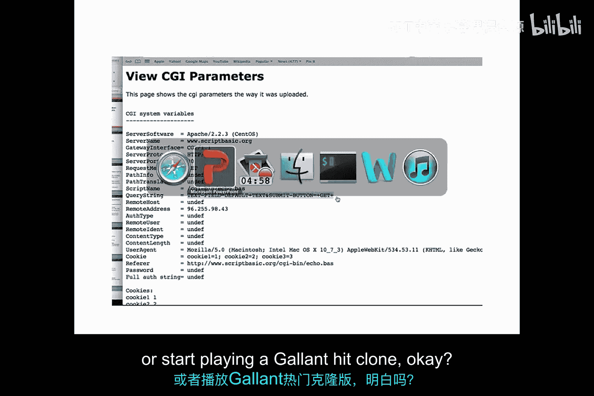

嗯。Now。

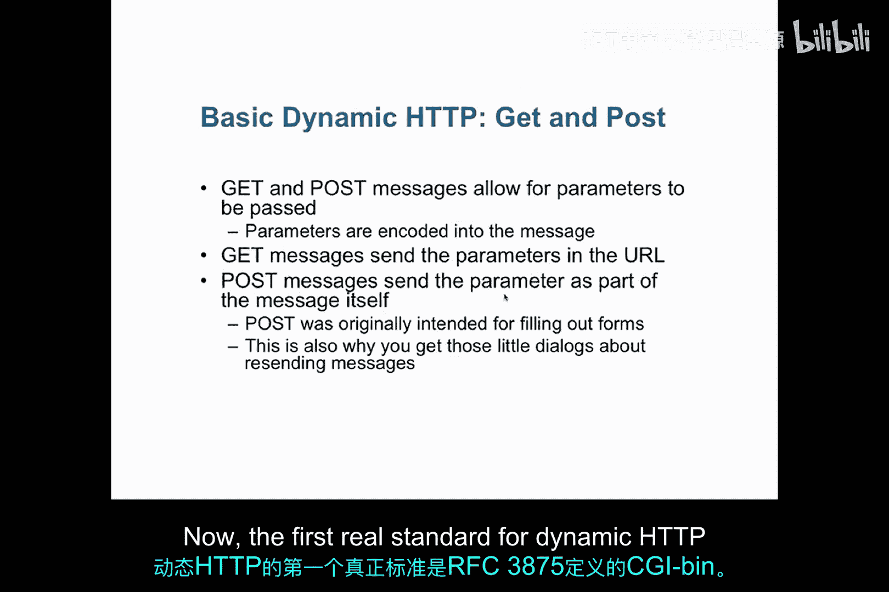

The first real standard for dynamic HTTP was CGI B defined in RFC 3875 CGI stands for common gateway interet face This is the model T of dynamic HTML The way that CGI B worked parameters of descent in the gi or post are passed as an environmental variable to a shell script now the important thing to understand therefore is that CGI B is not a language or a technology in itself。

It's a way of parsing the URL， extracting information。

 then passing it to another application as environmental variables。Alright。

This incidentally was the growth point for Pearl， in fact。

 a lot of early CGI bin was written in Pearl and Pearl and the Web really did grow hand at hand。

However。Pearl is a terrible， terrible language to do anything serious and if any of you've ever tried to maintain Pearl。

 well， A， you know that and B， you have my pity。this was exacerbated by the fact that in this sort of late 90s early 2000 period。

 everyone is building their own web browser as we have internet Explorer versus Netscape versus Firefox versus Mozilla versus opera versus Safari versus links versus W3。

 and each of these things is rendering HTML in a slightly different way， for example。

 Ie tended to be very robust with table construction whereas Netscape tended to be more demanding in the syntax。

This led towards the use of dynamic architecture， things called we called CMSs content management systems content management systems are things which allow people which allow you to sort of split the task so that the people who do development to do development to the people who write your pages focus on the pages without having to worry about the details of development many of these details were driven by the fact that as I said we have many different browsers and we would have to render slightly differently for different browsers it was bad enough if you wanted to do a table if you want to do anything of any ja you had to engage in incredibly complicated configuration maneuvvers so。

The CGI Cluge sort of dies off and it gets replaced with these architectures like PhP， Dngo。

 all of these at the same time， JavaScript itself， which starts out as a very sort of。

Simple store variables technology eventually becomes full fledged ECmascript and a relatively sophisticated programming language in its own right this leads to the AJX environment where you have JavaScript。

 XML， all of these things working together。Now。Content management systems are effectively。

 they're usually tied into a web server， but many of they will include their own web servers。

 there's a variety of tools out here， PhP， Django， Ras， Zpe， media Wiki， Doku Wiiki。

 all of these things the key thing about CMS is which separates them from plastic CGI B scripts。

 they manage incompatibility。And they separate content from presentation this is a key feature okay without this ability to separate content from presentation。

 you have to write all you have to write all of this stuff yourself。

 you have to develop all of it and you have to keep track of all the little changes that the browsers are going through all the time。

The other thing to keep in mind about these systems。

Is that they have plugin architectures to support functionality， so for example。

 if you're doing graphical visualization， you can get a plugin for Django to support scientific visualization if you wanted to create a message boards。

 they all have plugins that will create message boards for you。

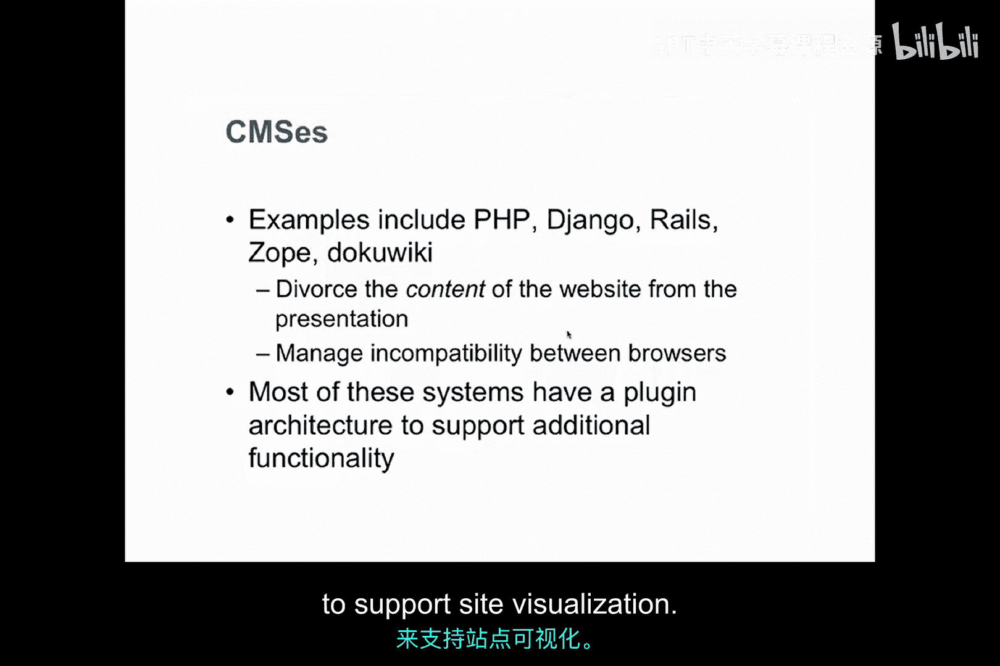

All right， the thing about this is that this really breaks down the classic client server model in your classic client server model。

 you have a client， which all you can really do is talk to a server and a server。

 which does all the work。We're now？Spreading computation all over the place。

 some of it's being done by the server， some of it's being done by the CMS。

 some of it's being done by the browser， some of it's being done by the database。

 some of it's being done by plugins。So we've created this incredibly complicated modular architecture。

 which quite frankly。Is dripping with vulnerabilities。

 Each of these different little ovals can have its own family of vulnerabilities。

 and some of them have vulnerabilities that only really happen when they interact with each other。

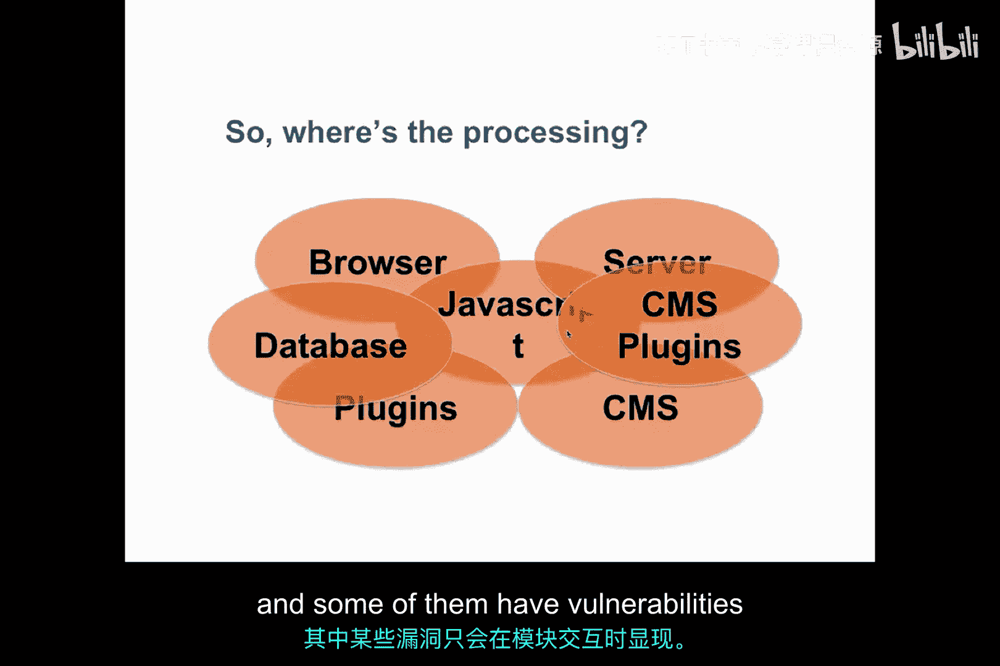

Now while I talk about the vulnerabilities among all these things there's also what we can call in the engineering world a parts list problem there are a lot of options theoretically available。

 I mean if you want to you can write your own bullet board software however in practice there are usually only a flu few implementations of something when I was in graduate school doing work in satellite design I had this sort of heartbreaking moment when I realized all my my mechanical engineering training have been pointless because there are only four engine types available for satellite and nobody's going to build another one so you have four options this is very much the case with many of these dynamic things because there's plugin architectures。

 certain plugins become the default choice and you will see them over and over again and attackers know this and they know that certain applications are common and they will look for attacks on those applications。

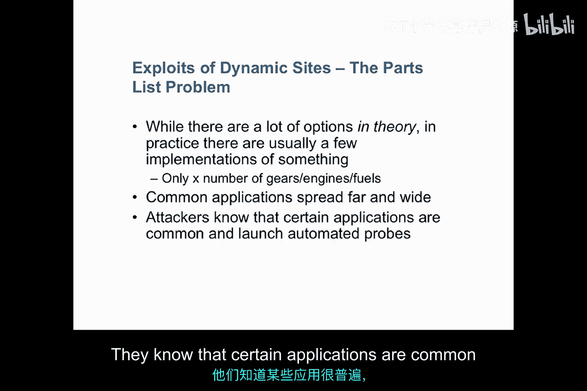

And it cant。So。What we've effectively done is we've rebuilt computing on top of computing。

And I mean over the past 30 years， moduluular software has been one of the holy grails of the development community okay。

 there have been dozens of techniques， sockets， RPC DCC， Corba， RMI MOM。

 what we're doing now is we're talking about WebAMba services we're rebuilding software and service yet again。

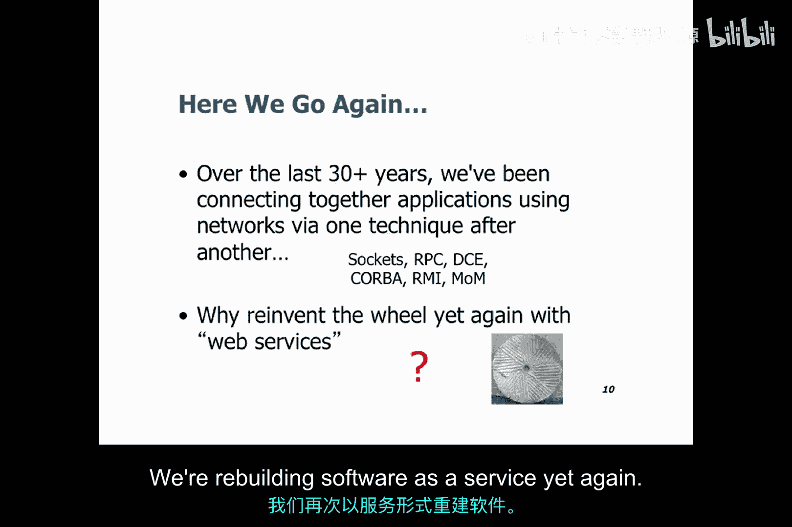

嗯。Oh it's different this time the big difference is Xm now first off。

 let me tell you Xml does not solve a problem for you， it merely reformats the problem。

XML is a limited reimpleation or limited constrained version of SL。

 the standard generalized markup language， the advantage of XML over Sl is that XML is comprehensible it is pure ASI text it basically looks like HTML you have this simple delimited tag format on the other hand and it will take up an enormous amount of space。

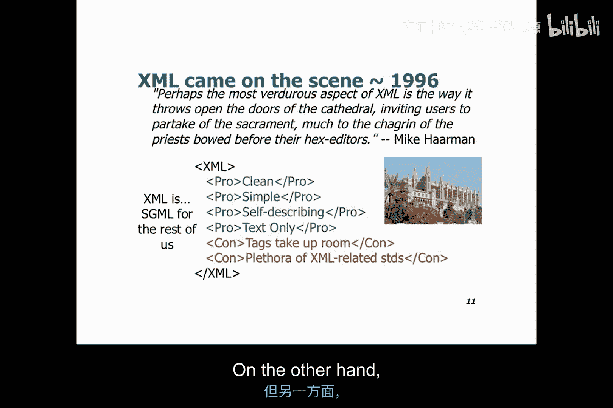

So why what's so exciting about XML well before there's XML。

 if you want to transport information back and forth among systems。

 you have to come up with your own definition of how the data will move back and forth in XML。

 you create a DTD， which is document template definition。

And then boom anything that has access to the DTT knows how to process the data that you're passing back and forth so once we've got that。

 we've got a method for sending messages between servers or between hosts on the network such that they will understand each other Now you're thinking yourself well can't I just do that with CG bin problem the thing about CG bin is again CG bin all you're doing is your sending information。

 you don't know what that information means XML helps you define what that information means that of course leads to the next question so how do we communicate this well if it was 1992 I would use sockets or I'd use DCE or whatever Microsoft was calling an active X that week？

But now that we've got H T TP， port 80 is wide open。 Why is port 80 open。 We don't have any choice。

 Everything goes over port 80。 So what we can do instead is we can start to talk about sending XM L messages back and forth using H T TP。

 Okay， and this leads to port 80 becoming the gigantic information superhighway is to day。 Now。

 when we take a look at。

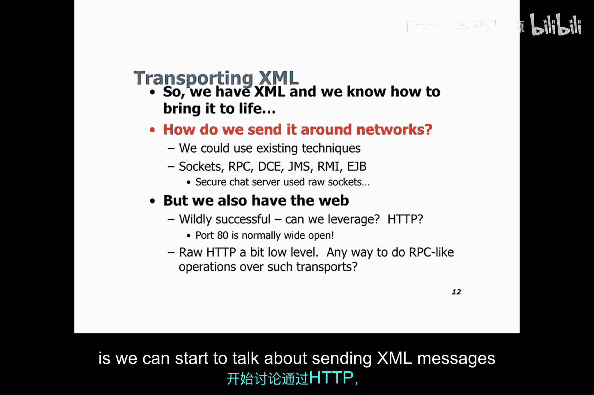

Well， we look at an information security。In fact。We create a gigantic fortress， there are firewalls。

 there are guards， there's protection， there's a moat， and then we build an eight lane superh。

 call it HTTP and we drive it right through the middle of the house。

we have reimplemented everything on HtTP， we have introduced all new domains of insecurity。

 and there are whole varieties of companies like Quadraasesis， Reactivity and checkpoint。

 which are trying to create defenses over HtTP because HtTP was easy and convenient。

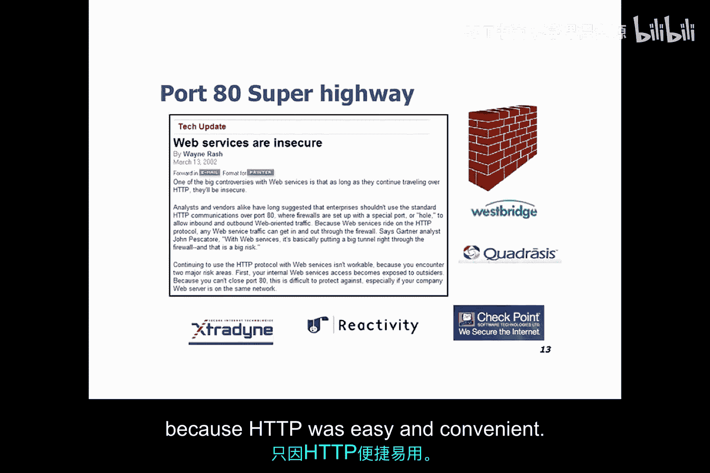

We've built HTTP， the super service， we've built an entirely new TCP stack on top of HTTP if you ever use something like Citrix Citrix lets you and client server sessions over HTP it has become at the same time HtTP is not only the moderator for a bunch of protocols。

 a bunch of protocols really are just HTTP bit torrent for example。

 the protocol used to talk to the trackers is HtTP it's on CG inscript。

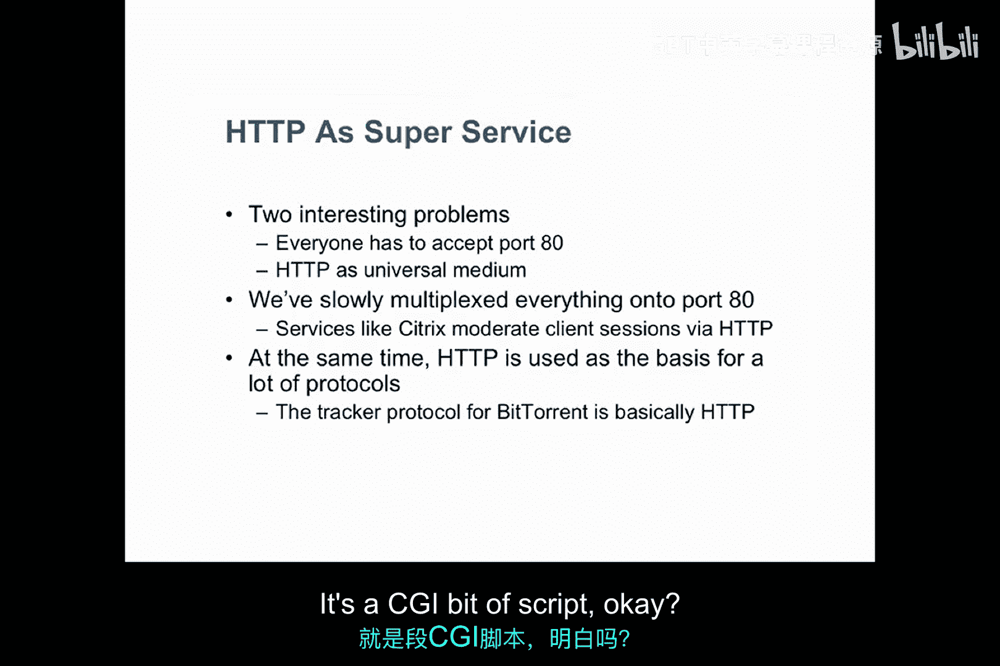

Okay。Soir。Somewhere around here， some clever person。

 that clever person probably being Dave Weiner realizes， well。

 what I can do is instead of sending this custom formatted data， everyone's opening port 80。

 allll write this thing which sends XMl that takes XML as a data in a post and I'll respond with XML and what I can do then is I can send commands I can implement remote procedure calling with XML said to XML and that is a simple object access protocol。

 web servers can now moderate remote procedure calls using XML。

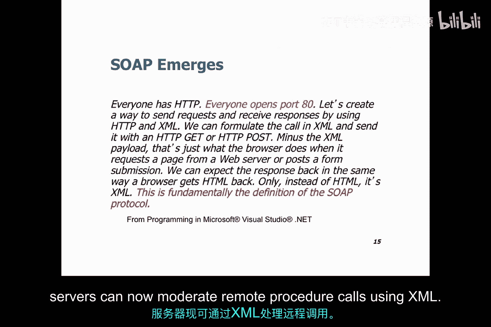

And right？Now。Soap the nextMpC， kill Corba。If you were wander around 2001 or 2002。

 you wouldd have written an awful lot about Corba， Corba was the common object。

I forget what the R stands for， a common object broker architecture，Corba。

Was this incredibly complicated and sophisticated protocol。

 which would allow you to remotely access objects on different machines and manipulate them by sending remote calls。

So I the Corpus standard was strikinganttic。In the meantime， a couple of guys come together。

Cudl together this XML based communication standard。 and all of a sudden。

 everybody is doing things like Google Maps， Mas shops。 Okay， walk score。

 those walk score or those things of liter。 See how many tacos stands or near where you where you are。

 All of those things X Ml moderates。 Okay， The reason that this worked。

 Basically XMl RRPC moved all of the tasks back the developer。

 The developer is basically told the websites and API Here's the call for the APIpis。

 how do you find this， Each website figures out how to tell you。 Okay there's no sales examination。

 no reflection， no integrity checking nothing like that。 You can write this If it goes wrong。

 Godt help you。But it's very quick to write something an Xl call an Xl response in corba dies in ignominious death。

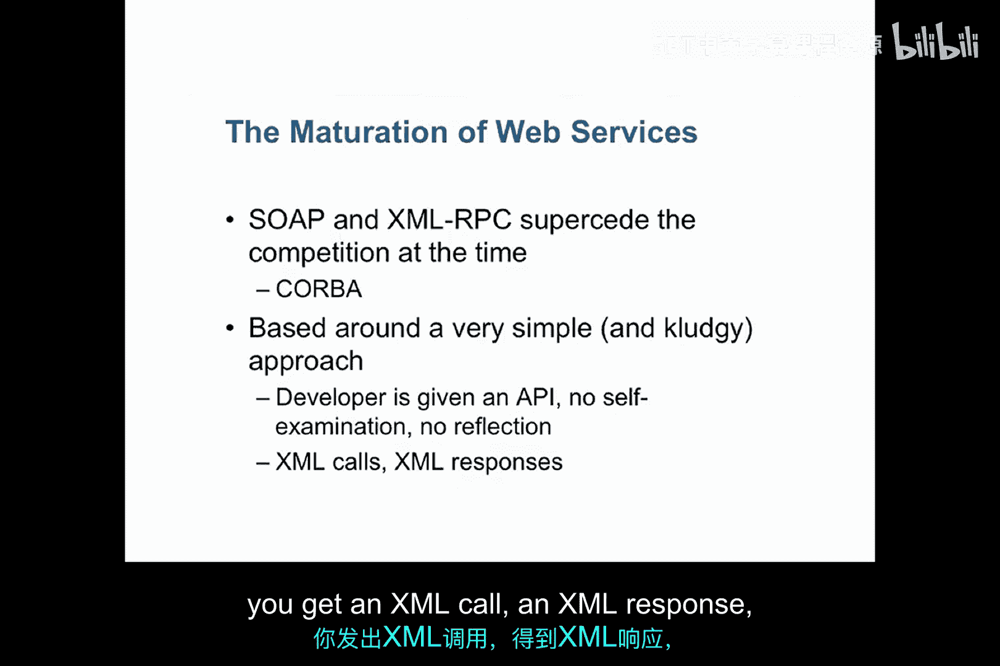

Okay， this led to a paradigm which we call rest， representational state transfer。

Rest is one of those weird beasts which isn't really an API。

 it's more of a framework for transferring information statelessly。

 so it's sort of a how do it's more of an API guidelines and Google in particular has been using RE extensively to create tools like for example。

 this dynamic chart I created over here using RE。Now。This is the beginning of Web 2。0 XML messages。

 sites as sites that are so dynamic they' are all for intents and purposes。

 they are for all intents and purposes， just APIs。

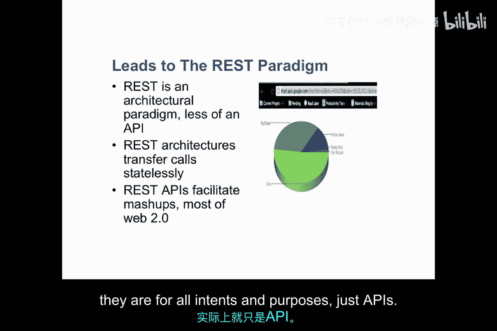

The culmination of this as of last year was Facebook's G API。

 where what you could do is you could send XMl messages back and forth to basically manipulate the entire Facebook system。

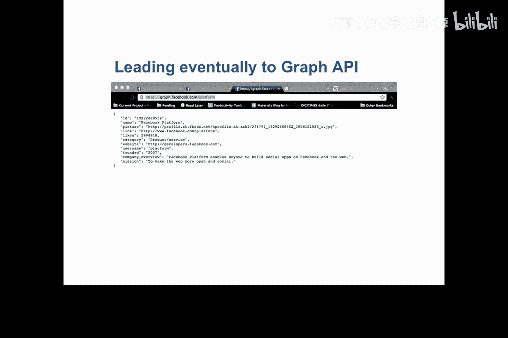

No。嗯。Now。What do these do， right？The big thing。These are service oriented architectures and it is a moving target and an alphabet soup R XmLRPC So graph API all of these things turn websites into XMl based database front ends you communicate with XML and basically instead of going and grabbing pages you're generating functions a key thing is that a lot of the trust issues are handled by the servers themselves one of the things you may have noticed for example。

 is you take a look at commentary sites recently is that they're starting to take advantage of economies or scales。

 so systems that used to have their own authentication systems for commentary are now just using Facebook So what's happening is。

We're starting to see a couple of these sites become common gateways now what does that mean that it's common gateway look at it this way。

If you go to p sitey。And it pulls up some Facebook info or some Google info in the corner for you。

 That means you visited Google。 That means they know， that means as Google knows。

 you just visited the site。 Okay， there's a reference back and forth。

There are sites like Google and Facebook where I would not be surprised if one out of every two web pages you look at involves communication with both of them。

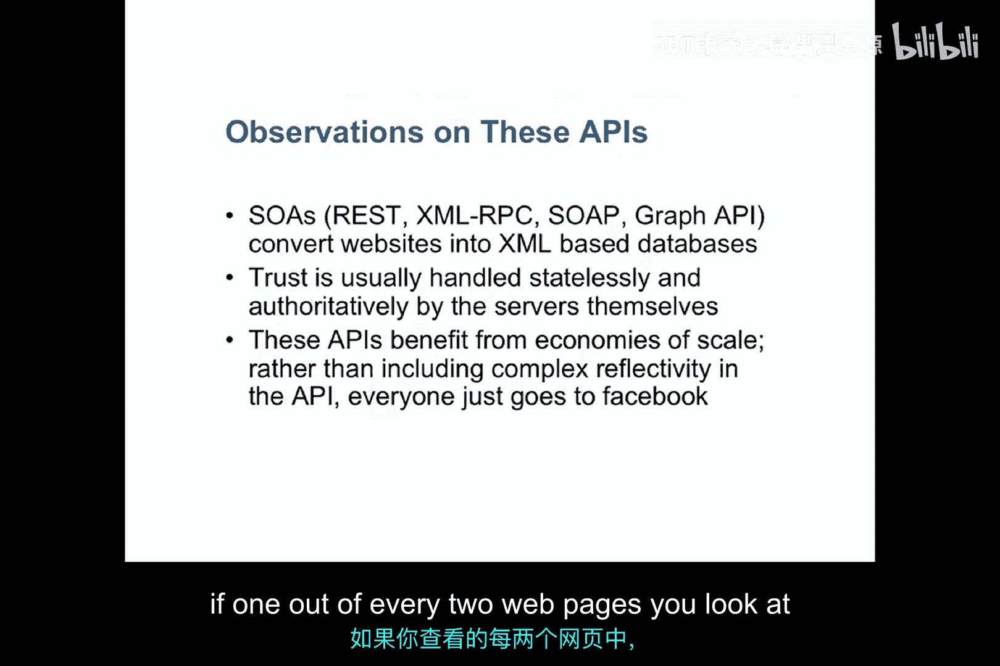