# 约翰霍普金斯大学《信息保障分析｜Information Assurance Analysis》中英字幕 p04 3_网络钓鱼攻击.zh_en -BV1Qz8EzYENX_p4-

This is 695，741， a module 3， lecture 6。 this module， we're going to be talking about fishing。

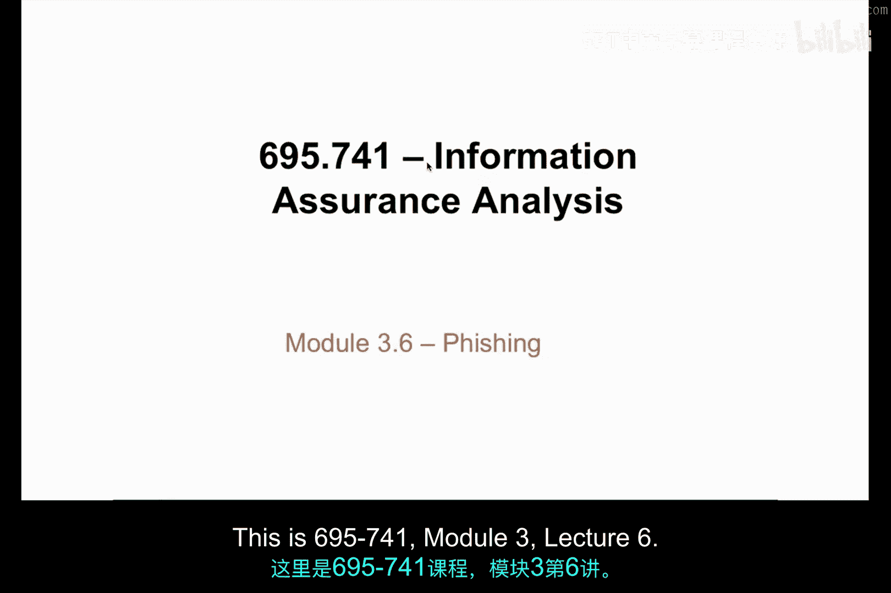

Let's say we want to set up shop。For doing some fish。

Fishing is a two phase attack first we need to send out spam messages that contain a link to the site we control。

The second part of the attack， the victim clicks on the link。

 which directs the victim to a sight that will copper。

So it's important for us to make the sites look legitimate if we actually want people to go to the sites and make the email messages。

 of course， look legitimate if we want people to click on the links。First。

 we need to find a place to host our fishing site and put set up this nice legitimate looking site。

Obviously we don't want to use our own machines。Why have all evidence traced back to you when you can have it trace back to some other faceless person？

Like we talked about inlasher 3。5， there are several lists of sites that are vulnerable right now。

Go break into one of them and use that one as the fishing site instead。Chances are。

 if you get there quick enough。You had the site。You have a site that is not even thought to be suspicious by anyone。

 so a blacklist commonly used to used by mail servers to fill the traffic won't have an entry on the site and thus won't lock that site。

That site's map。Also， if we set up a server there and if we set up our fishing site there。

 the server doesn't have a bad reputation。 So web based filtering probably will fail， too。So。

 Andrews old。Compromise the weak surfer and then compromised more people with a fishing attack。

 And there is evidence that people actually set up a fishing sight。

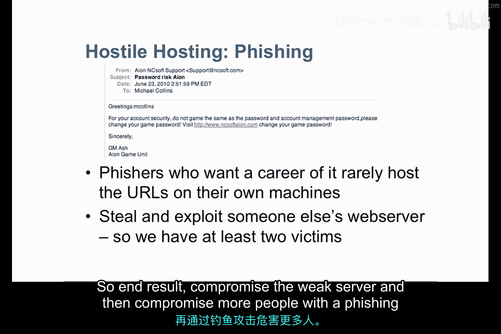

With stuff that has a very decent reputation。Here we got two images。

 This is basically a the intersect， the image on the on the left。You'ear left。

Represents the intersection of。Botnats to currently reported fishing sites。

The image on the right represents the intersection of fishing sites to commonly reported。

What you're going to see is that the prefixes are out well。

Let me explain exactly what these are first。 the x axis here is the prefixed length。

For the maximum match， the Y axis is the count of total net lock。So as you can see。

The intersection of the guys who have been reported as fishers previously。

 who were now bots is far higher， far better than random。

In the case where something is reported as a fissure， it has a lower intersection with bos。

And the reason for that is quite simple。 They want the sites that actually still have decentcent reputations to be set up asure fishing sites。

Once they fail and they're no longer useful in that capacity， yeah。

 sure use as a bot for anything else that you want。

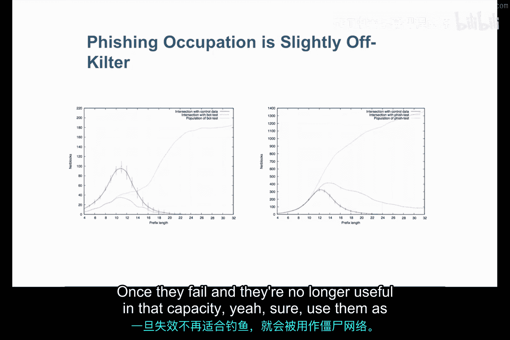

So now some notes on phish itself， it's important for you to understand that for the most part。

Fishing is a business， the even the e's operating， it really don't care much about a direction。

As with any other business， there's a variety of sophistication here。At the top。

 we've got to work in organization like Rock at the bottom。

There are basically the guys who have the free fishing kit。Which is a bunch of junks。

 it takes a lot of effort for them to actually set up anything that's meaningful。

 and these are the guys that primarily get lot and first pass。

Whenever whenever their messages come through any source spam filter。However。

 there's an awesome silver lining to this。In the article， there's no free fish。

ACova and company explained。How the free fishing kits often gone with bag doors into the fishers system。

So these fishs being haples。No wes who actually want to exploit other people。

Install these wonderful fishing software kits that actually make them victims themselves。

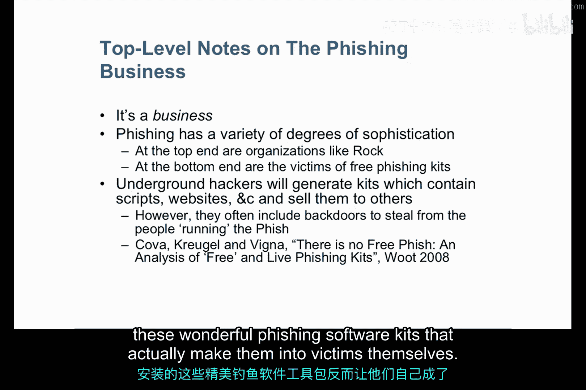

So that's just a little bit of a silver lining， in my opinion。

While the fishssure is getting exploited by people who， are doing this professionally。

Maybey be very interesting， is it digression， Let's get back to the real subject at hand。

What are fishers after simple。Counts。Often small potatoes， must beeg fishers。

 fishing victims are poor。So comproising their accounts is not necessarily the biggest thing。

 the best thing on the planet passwords。 Now there's where we get into some paper Since people tend to use the same password on multiple sites。

 this can be far more valuable than individual information。

So if they compromise one of your accounts。Fances are， if you are like most people。

 they've compromised maybe 80% of your accounts。

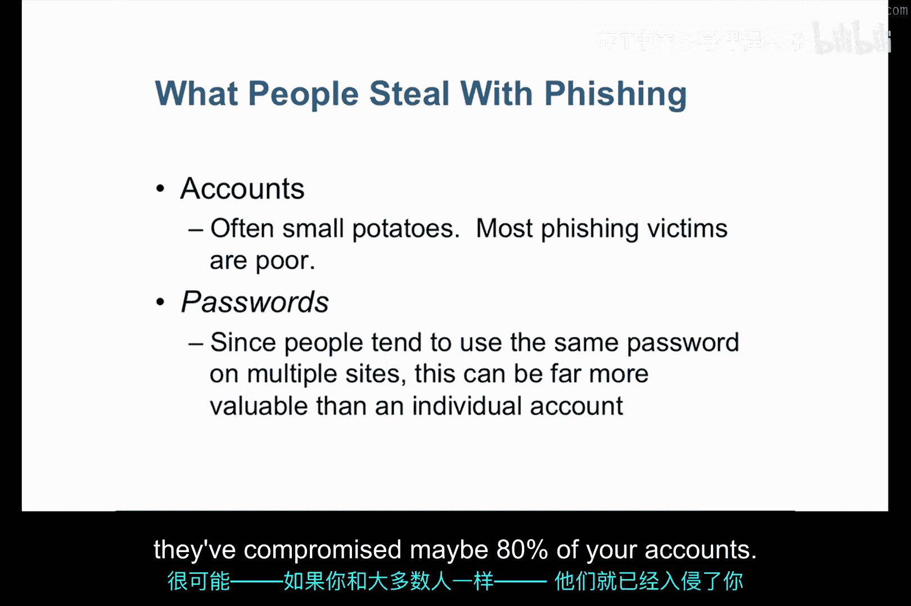

Maybe every single one of your fine。 And that's what they're after。 Now。

 there's an exist subcatery of fishing called spear fishing。

And airfishing is really just targeted fishing。 The attackers found out something about a target。

 and they used that to get more information and try and compromise a specific person they're targeting。

The US was subject to a major fishing attack in 2010。

 So attacks has been done in Tibet to Tibet activists in the previous year， and there are several。

More instances of this that you see throughout the news on a semi regular basis now。

 it's becoming a very common thing。

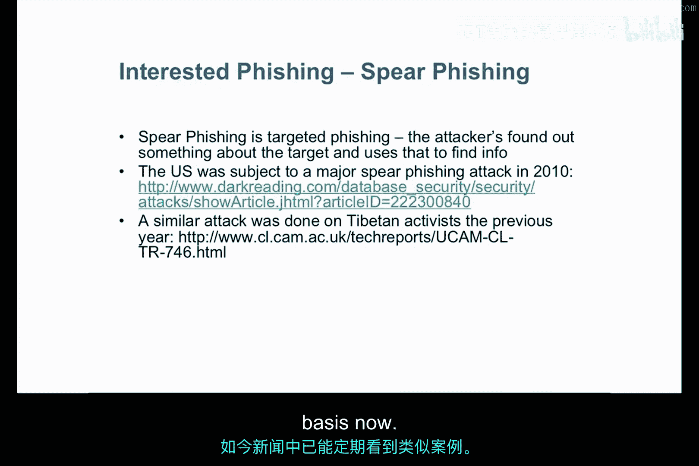

Now。The wonderful thing about fishing or the most devastating thing about fishing is that it often tries to actually do some interesting things with name manipulation one of the interesting things that you will find。

Is that people will tend to put together things like interesting cyrellic alphabet characters。

 they'll put those in to sub A。And that's because， you know。

 an A in Cyyrelllic looks a lot like an A in penny regular N。Standard hewi Al bat。

Fishers will consequently seek ways to actually put these in there to make their URLs look identical to what you're expecting。

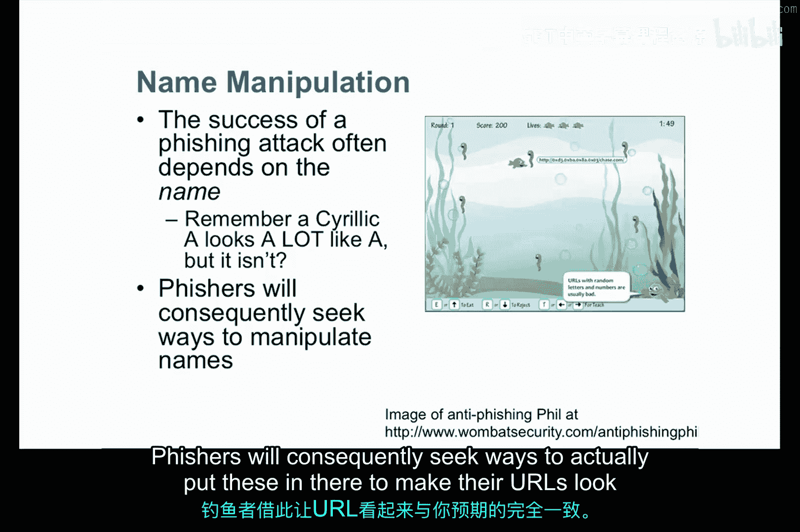

So we've got some simple ways to visit。For instance， you know。

One thing that they may do is in the email。 They might put a hyperlink in there and say that it's。

 you know， something like ebay， but actually the hyperlink itself is。

Some sort of evil sight that it directeds you。 And that's the easiest way to do this。M。

Another way is that they can actually just make。Their URL look almost legitimate。

 but up pin to it their， their actual domain。 So in that case。

 you got things like the second case here where we've got W W W dot ebay dot com followed by， well。

 it's all evilness。Now， of course， there's also the wonderful redirect where you say that you're going to one site and then boom。

 pop them over to another site。

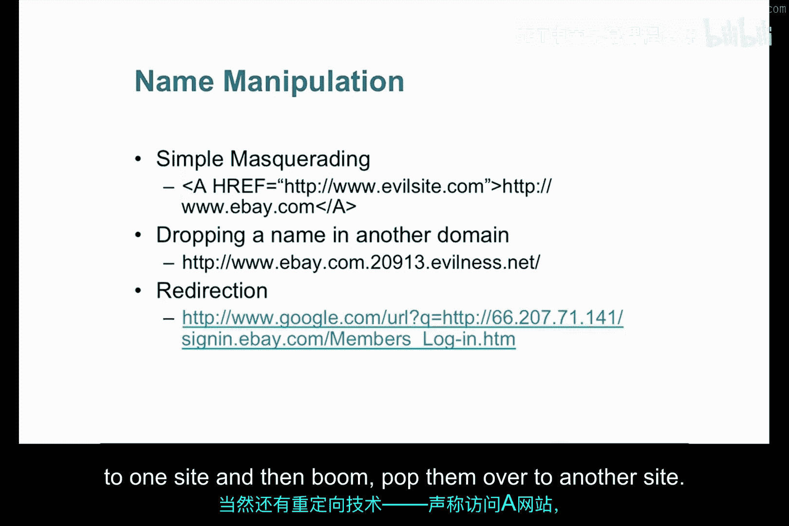

Now， in addition to simple name manipulation。There's other wonderful ways that fishes hide their activities are high in where they're actually senting you。

 They're stuff like vast flux。 Now， this is a really interesting one。

The domain name is assigned to multiple IP addresses， and each of those IP addresses。

 the assignment only lasts for a very， very， very short time。Which means that。You've got a user base。

 And instead of everybody who's infected going to one host。

 and they're going to a multitude of different host。

 And that multitude of different house is constantly changing。

 all of them hosting the same nowware or redirecting again to a different place that is hosting them out。

So it makes it very difficult to track。Ratfish has employed interesting techniques like this。

 that's a bag of sophisticated stuff。Theyig characteristics uses websites as proxies to hide the real mothership。

 there's all kinds of interesting sort of DNS manipulation that these guys do。

 but the bottom line is。These guys are hosting a malicious site and that site is just bouncing around。

Makes it very hard to trend this activity it makes it very hard to figure out what's going on and just simple trending techniques looking for the amount of activity going to one site are a specific subset of sites will probably not yield a good result for this in fact。

Most of the time， it doesn't yield a good result to us， trip in mind。

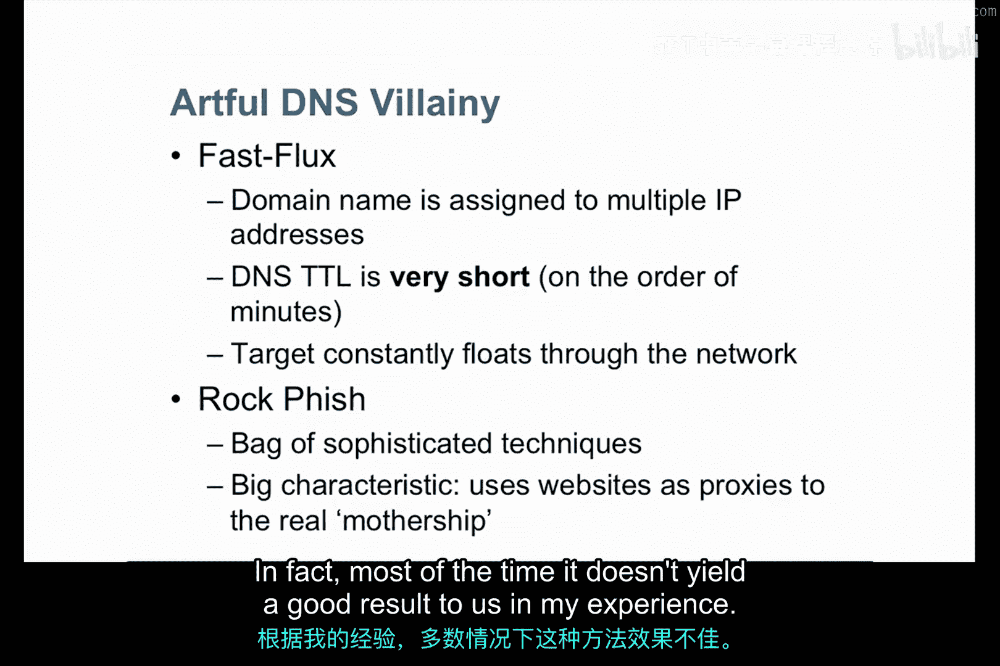

So。Big thing about this。Why don't why do they need to get more exotic with this naming business？

Wlacklisting is that there is a。Very dangerous。Attackers pay less for host。Kown to me he painted。

As we showed in slide three of this， if you've got a guy who's actually already been flagged as being part of a butt。

Answes are you don't want him have him as a fishing site because he's already been identified。嗯。

Our core problem here is that is that we're blacklisting as opposed to whitelist。

So basically what we're getting to is a point where we're having to add all of these guys who have been compromised and you got to figure out how you want to stage those guys back off。

How do you know when something that was bad actually becomes good at it？And more importantly。

 how do you know it's something that was bad that is now good We't go back to being bad again。

 We've got an open sort of system that we're dealing with here whenever we're talking about the protocols that make up the Internet。

It's a lot more challenging to construct valid white lists than it is just to decide to try and block things that have done something bad in the past。

  normally， the easiest way to figure out whether or not。

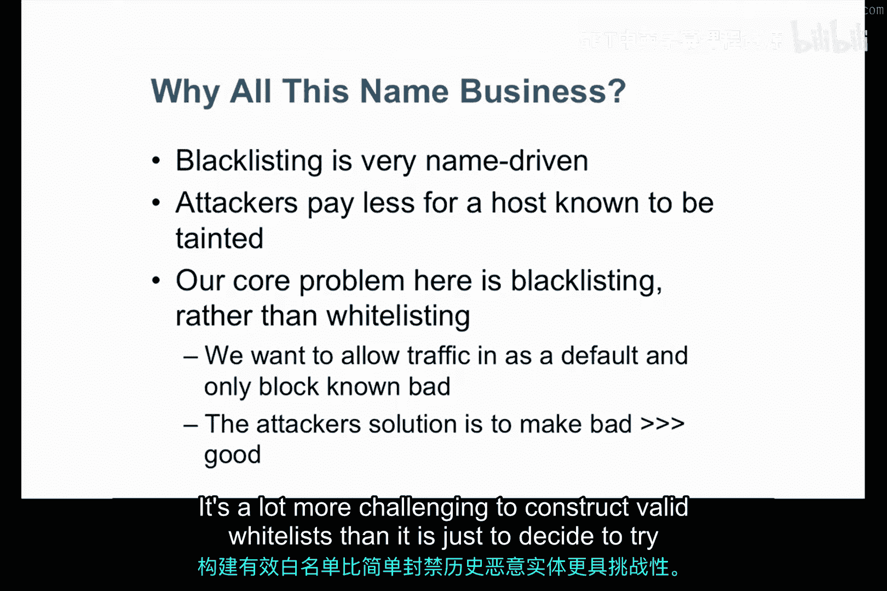

You're a fishing site is somebody will tell you。You've got a lot of sites out there that will start。

Screaming bloody murder you if you get compromised and you get used as a fishingish site。

There's a lot of public blacklists that are available that you can actually check all of your IP information against to see whether or not your site has been compromised and is currently being used for efficiency。

How do you know that you've been fished？Go at E store。 I didn't know that you'd been a date。

In this case， generally somebody will tell you your bank will call you all of a sudden somebody will call trying to tell you that your counts have been liquidated。

This sort of thing is the easiest way to find out， and know it's got the best egg on the planet。But。

The best course of action is to be very suspect of all emails that you get and try and avoid being fish in firstly。

So to recap what you got with fishing isn't these guys are really in it for to make money。

 they're not in it for the los what they're trying to do is they're trying to get your account information。

Your password information， and they're going to try and use that information in as many places as possible。

They're going to cast as big a net as possible。Because what you really need to do is only get a few is get a certain number of people who actually click。

actually does to and enter their accation。 You're not expecting everybody to to click on your one。

 So all it takes really buying up a duly compromised bot that hasn't shown up on any black list yet。

Set up shop， make a legitimate looking website， make a spammer that works very well。

Sam everybody and sit back and waiting for people to actually come by and start start providing you with their user information。

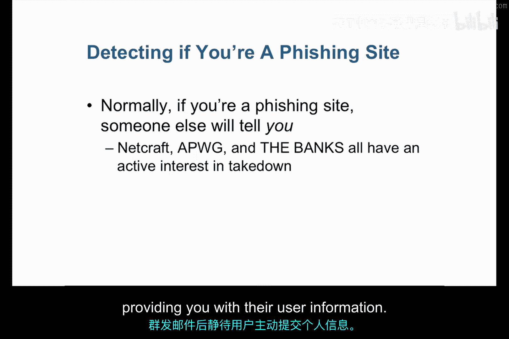