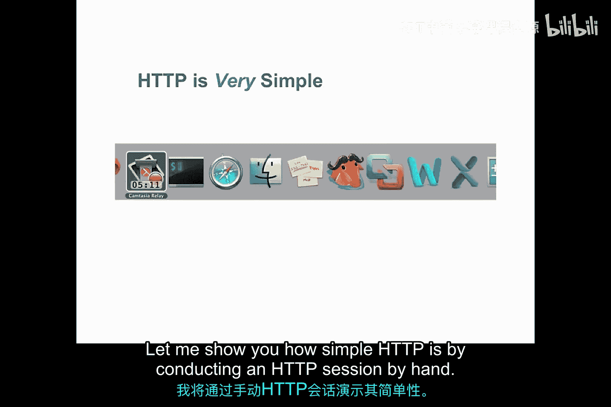
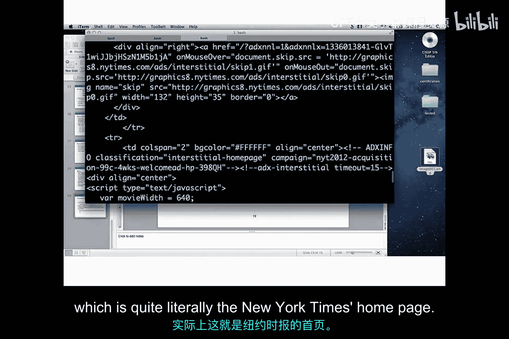
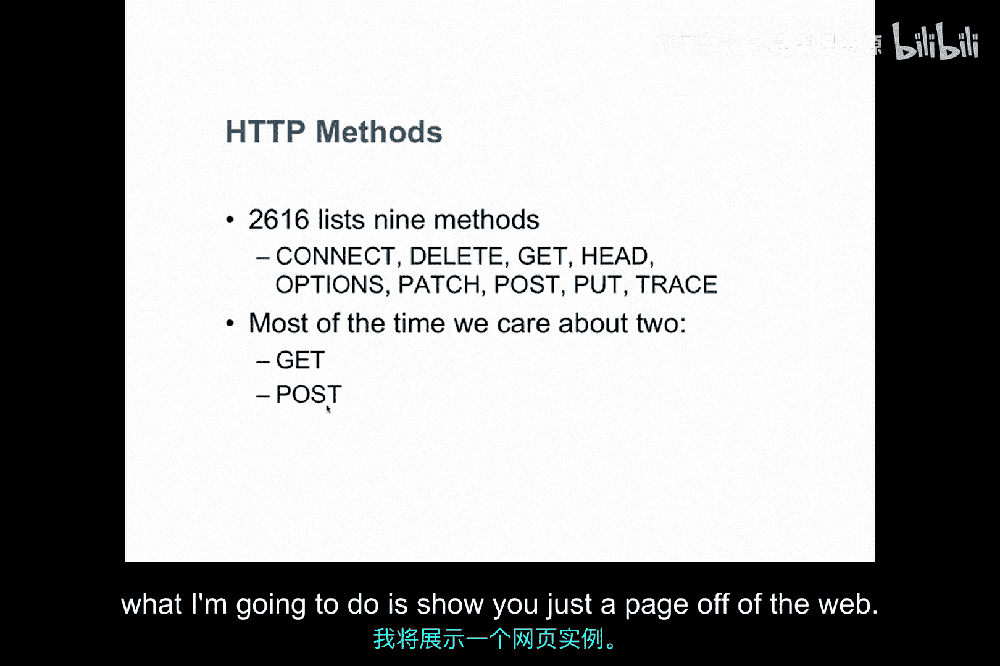
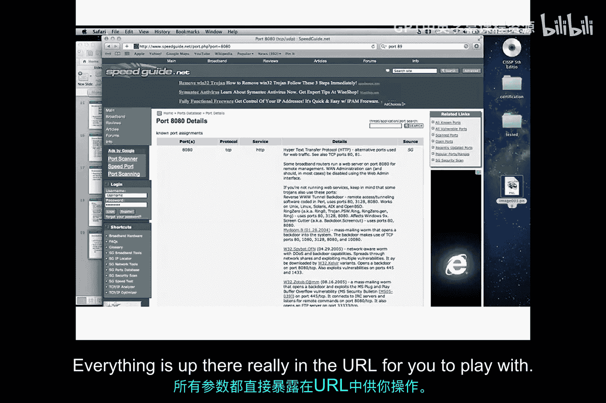
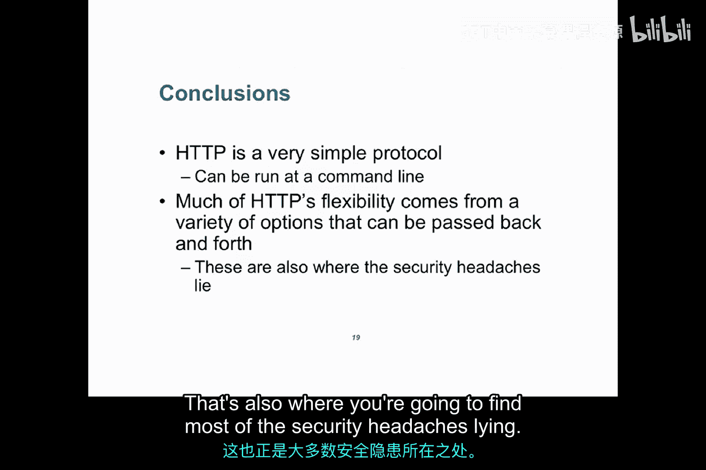

# 约翰霍普金斯大学《信息保障分析｜Information Assurance Analysis》中英字幕 p05 4_基础HTTP协议.zh_en -BV1Qz8EzYENX_p5-

Welcome to A 3。1 of 695741。Information assurance analysis。 This is Dr。 Collin speaking。

Typic of this module is how H TTP works。 The primary goal of this module is to get conversant with the basic functionality of H TTP。

HTTP is a very simple and even crude protocol。Which has seem almost cheerer accident become the most important protocol used on the Internet today。

 I you were to take a look。At the Internets of 1903。He would sign that the。

Both of activity was divided between SMTP， which is to say male N NTP， which was used at。

 and then Tnets and SSH。Where both console protocol。

 What you now find is that much of that activity has been rolled up into H TTP。

And various applications built on top of an HTTP framework。

This huge swing towards HCTP has made it fundamental in ways that nobody could have conceived of 20 years ago。

In this module we are going to focus on the very basic elements of HTTP， in fact。

 basically HTTP as of 1993， we're going to describe how it transfers data。

 you're going to understand how the status codes are used to communicate information about it。

 and we're going to explain the use of headers， which are optional values that can be passed back and forth by clients in service。

Now。HTTP is short for the Hytext transfer protocol。HTTP and HML。

 the Hypertext Markup language were developed in 1990 by Tim Bders Le， who was a researcher at Cern。

 Cern is a particle physics， Nuclear physicsyics Research Center located in Switzerland and CEN and many of the DOE research supercomputing centers。

 are the unsung heroes of the World Wide Web because much of the early work to develop the web was done there。

 the first web server and the first web clients were developed with Cern。

 many of the early web clients in particular Netscape， which became thatscape and W3 Netscape。

 which eventually led to almost Zililla and Firefox were developed at the University of Illinois。

 urban Banish Champa super the Computing Center。Now。

All these sites generate enormous amount of codes of public usage。

 and they generate it in many cases to solve their own internal problems。

 which as Sper as B was doing， he used an in for way to share research papers rapidly among computers。

 and so what he did was he created a very stripped down version of what is commonly called hypertext。

Now， youferred about hypertext and context of the web。

 but hypertext is a much bigger and very different animals in the web with the perspective of hypertext theorists。

 there are a very large number of these on Hm is very， very prim hypertext at the very minimum。

 the one of the big problem with HttP is that it's a very rashackle environment。

 I can create links and the links may actually not go anywhere。

 whereas in the hypertext environment can create a link to something that exists and links are bidirectional。

 you can go forward on a link， or you can go backward not there are a variety of other features of hypertext links that the web has not taken to these include fat links type links。

 and in particular explicit structure。 much of what Burey talks about the semantic web that in this category。

There is an outdated list of these features， which I picked up from one of the early web usability Gers。

 Danny Jacob Mc Neilson。we'll send run the site calleduseit。

com to be honest I'm not sure how much it's being paid now I use it was a big thing in 1995 so you know。

 we're talking about something that was a big thing 17 years ago。

But if you go look at the site and you'll find this list of these are features that should be in web browsers to make them real hypertext devices。

 but aren't if you want， take a look at how many of those features are actually implemented now in some fashion。

Now all of this is to say HTTP。Very quick。 we put together。 Very， very simple。

 Let me show you how simple H T T P is by conducting an H T TP session by hand。 Now。

 what I'm going to do is I'm going to show you a short and a long H T TP session。

 I'm going to go to C M N dot com。 And you'll notice that I am tellddding。

 And in the course of telledding。

I am tele that to port 80， okay， that means that when I open up this connection。

 it's actually communicated with port 80， which is the HC people。

Now I go there and you'll notice the situation to me nothing the reason for that is because what I have to do it nowun is I type yet S。

Okay， and what you'll see is I get a web page back in this particular case， S 301。

 the page has permanently。 Now I can go to other sites。And doing this same little exercise。

 for example， they go to the New York Times。And I do this。I get dys giganttic。Pile of H。

 which is quite literally the New York Timess homet。

Then。So I can do three HTTP sessions at just by typing in comments okay。Now。

 that doesn't mean them actually cannot not do what you might consider a real H TTV session。

 Part of H TTV is very crude and per setup is that it's very robust to people doing things like opening up connections and typing in sessions by hand。

 very easy to debug。Um， but there's an additional pile of status information that I can pass back and forth to make it more of what would like consider a real session now。

Yov is a very simple protocol。 H TTP is defined in a very small set of RFCs。

 The big RFC is RFC 201616， which。first when you look at it， you'll notice it's old。

And the second thing is it describes HtTP 1。1， which is where we've been pretty much for。 The HtTP 1。

0 came out。 HtTP 1。1 came out shortly after that。 and was pretty much stuck there。

 part of the reason for this is because in comparison to a lot of standards organizations。

 the HtTP will is very， very chaotic。 There's a lot of influenceations， there's a lot of ambiguity。

 there's a lot of options and this sort of IETF model of rough consensus and running code is even roughered war running in this case。

 That said the other key particle， The other QfC to again are 4229。

 If you're going to take look at any one for security。4229 is probably the most critical one。

 because that defines a whole pile of HtTP headers。 We'll get to what these headers are later。

 but they are basically how you add the special sauce for the HtTP session。

The other thing to note about HtTP is because it is such a simple and primitive protocol。

 People started adding stuff to it very quickly and started replacing other chunks of the internet infrastructure with HtTP。

 This also because we see a lot of very odd server and implementation specific eccentricities in the protocol。

 Sometimes servers， for example， would terminate HttP sessions。 Now H TTP rubs on top of TCP。

 They would terminate sessions with pres。 because it was a faster way to get going。There， no。

Once that relates to DP session， client opens up connection to server， again this is TCP。

 so protocol 6 the destination port is generally 8080 is the default port for HTCP。

 8080 is another commonly used port in particular if people don't have group access。

We said the message which consists of a method， which in my commandine example was yet。The U R I。

 the U R I I passed with slash。And then a perer ID， I didn't have that， Okay。

 you follow that withccs， you added any headers you need， there you go。Yeah， the shoes though。

Rerchard the status message。It returns any headers that are necessary and then it returns to the data。

 that's about it。H T TP is based around a very simple open request response closed model。

 Something incidentally that at ECP really isn't supposed to be doing that much of recall TCP is sort of open run interactive keyboard intensive session closed later on。

 This kind of open response thing is more where you expect the U P type implementation to be used。

 Thats no longer all relevant。 Now， there have been mods to H TTP。 in particular。

 the major model was HTP 1。1， as I mentioned， HtP 1。

1 added features that were intended to improve thoroughput sessionession persistence and pipe。

 Session persistence meant that you could open， said a request to get a response。

 said another request to get another response to repeat the process。

The other thing you added was pipe winding。 pipe whing。 you load up a bunch of requests。

 And you get a bunch of responses back at one time。

 The thing about these elements is that they're generally erratic。

 and a lot of modern tools really don't use them。 The reason for that is because H Tp has become a much more user interactive environment。

 So session persistence， testistic ground， But in my experience pipe winding doesn't。

 because oftentimes。You set out a request， you get a response。 And then based on that response。

 that shaped your next request。 Yeah， the key thing out of all of this。

 And part of the reason that Pi doom becomes such of an issue is because of Bor's law。

 the forman's capability increased。 and as a result。

 the sort of primitive protocol could be handled more aggressively simply through more effectively simply through war processor power。

Now， let's talk about bringing these requests down。In Que consists of three key parts， a method。

 a URI and a protocol ID Pro ID is was already discussed as either HtP 1。0 or HtP 1。1。

The URI is what you normally think of as the URL， it is the ator to the data you are trying to access。

We will get into the distinction between URLs， UNs， and Us in a mill。The last thing is the method。

 The method is the type of operation which Dec client has tried to do on the server。

 There are a bunch of potential methods， although in the modern world。

 we really over use about two of them。 and then there are special options which are handled via headers。

Now， RC 20616 lists9 methods， Okay， the important thing to understand about these nine methods。

 the original concept of HTTP was as a sort of virtual library。

 Each URL was a page or a bookinging library， and so these various methods were associated with sort of moving things around deletele could remove a page put could add a page。

 get can grab a page， things like that。The world， as we know it now。

 basically uses two methods yet and post yet is the method that pulls down a page。

 yet also allows you to do that if you've ever done any of that question mark style hacking where you take a look at URL。

 you take a look at the options in the question mark， that's where yet used， host is。

A mechanism the post is the thing that is used when you can still out of form when you post a message or when you post in HTTP。

 your generally attorney said an awful lot of inflammation upward of 64K。

 which is beyond the upper limit established by yet the key thing。Yet he is effectively stateless。

 Now， HtP in general。He is supposed to beless protocol。

 but gets the point where you're passing along information command light。

 This is what allows you to do to things such as bookmarklets。

 If you were created a bookmark list As with the idea。

 a bookmarklet is a bookmark which could provide some kind of functionality on jascript or something like that。

Corned under the bookmark let us decide that you can pass all of this information in get statement。

 That is where that question mark appears。 when you take a look at URLl， De and post。

Which is involves sending messages back and forth。But to give an example of a get。

 what I'm going to do is show you just a page off of the web。

 so if we take a look at this site speed guide， you'll notice it's currently showing me information on port 155s and when we take a look up here。

 you can see this question mark。

Followed by port equals 1，5，5。 So this is literally an entire URL for yet。 Now。

 I can change that value up here， and it is dynamically changed。

 as you can see it's now telling me what's going on in Port 8080。

 That's the key characteristic to do a get。 Everything is up there really in the URL R for you to play with。

 Now， we've mentioned URLs， or I've been talking about URLs。

 But as I said in specification or looking at the U R。 If U R I is a uniform reference。

 uniform reference indicator， This is opposed to a URL。

 which seems form reference locator at the URL R N， which is the uniform reference name。

The reason for the overlapping URL URL issue， the URL is a position in space。

Whereas a UN is intended as a name， a Un is something like an ISBN number or social Security number。

 which is an unique pointer to an individual entity。 So， for example， I can refer to ISPN 978。

0312890179 and that's always going to be the same book conversely I might create a couple of URLs that point pages about that are pages about that in book。

Or our pages to pull that book or something of that nature。

 but those are vocations whereas the ISPn is an idifier。 the UI is a superet of both of those ideas。

 Now UI formatting U is different Us involves a protocol colonpath convention with the path construction the any function of the protocol that is defined in the Uri。

 So for example， mail to colon present White House gov that at that's part of the email protocol。

 So that's part of SMTP。That channel by the mail okay。Conversely， when we do HTTP。

 we do all of these slashes because we're going through usually a file system and the key thing is that that path is always protocol specific。

Now in H TTP， we deal in URLs Okay， a URL consists of HtP colon slash slash。

 the host name and then the pack to whatever you're actually looking for All right。

Pay attention to the host name。Many H T TP servers are virtual。

 which leaves their a process for running on a machine which is hosting multiple websites。

 That host name may ask。 So you may go to the same IP address and find it as a dozen different host names。

 each one of which providess you with a different server。

 all of this is done through the magic of H TTP headers。 Now。

 you are else to have optional parameters。 This is where the get method start using the question mark the deliver as for what I showed you earlier headers。

Ex she to be but primitive simple protocol in it of itself。

H D becomes more complex to the use of headers。 Headers are optioning seals。

 They're passed as part of the request。 R C 67，85 specifies a huge list。

What I won to do right now is focus on four particular headers。

 Otraferra co user agent is these are the ones that really together， this is the glue of the wet。

 Okay， so what do these do。Hulched。Is the fully qualified domain name of the host you're communicated with this is the name。

That we you passed as part of the request。 So for example， if I go visit w Wwe do like I co。

I pass wW WWtimes co in O field。 you might ask yourself， why would you do that well。

If you are hosted at a site like Go if you're a hosted server。

 the odds are that whoever's running your server of that physical box is probably running multiple websites。

 All of them being run by Apache urs or some web server。You know。

 order to tell which server is involved in which action you use the host parameter。Now。

 the companion to the hostes is the referer， the referer header and spelling this correct there is the address of the page you used to get there in the first place。

 So， for example， when I go to W Ww。 NY Time start palm， it pulls down that page。

 Then it pulls down a bunch of images， right。Those images are being served by a content distribution network。

If I go， and I copy。One of those image URLs and just try to fetch it directly then I'll be told I can't do that one of the places where you take to see this a lot is when people do cross references to a site like photo bucket on。

You may notice that photo bucket will study something the effect the photo bucket will put up a little。

 you can't see this image from the gear and it does this by checking theflower。No can。

 So the serverer is used basically to trace the path by which somebody reached a site and to control that path。

 It's a way to make sure that if somebody is just trying to access a file directly， for example。

 they can't do so unless they've got the correct now。

All the person has to do is forward with a server properly， so I wouldn't call it security per se。

The next one is the inmous cookie for those of you who are not familiar with cookies。

 a cookie is a piece of persistent information that is maintained by the client so that you can maintain a consistent long- term relationship with an application The classic cookie is an authentic authentication token so that you don't have to worry about passing a password every time。

And then there's the then the last one， which is more as the Esperantostr is what's called Pis or agent。

The user agent is a string that identifies your browser so if you're communicating using Mozillow and an Explorer Firefox an opera or an embedded browser or something of that nature。

Used by the user agent is critical。 All the browsers are ever so slightly and a ever so slightly incompatible in order to render a page properly。

 you generally have to know at least one or two technical details about the browser you' are communicatingd with。

If you take a look at moderned content management systems like Dopal juis， rails， things like that。

They have a whole chunk of code which basically just sits there and figures out based on the user agent。

 all these little sdly detailss about graphical layout， so you don't have to。All right。

 That's a gene your request。 Your response consists of a status line， again， a collection of headers。

 and then some data。 And I really need to emphasize this。

 H T T P is a very simple and flexible particle。 The complexity comes up to the use of the headers themselves。

 I can't。 but the particle itself。Practically nothing， man。 Bar。

 A status message is a three character New York code。There's another set of optional headers。

 and then your actual data。The status messages， as I said， three characters。

 always a three digit value，5 major categories，1 x is information，2 X X is success。

 The most important one here is the famous 20， the H TtP O K。 If you get that。

 that admit your request for through5。The 3XX family are redirects， in particular 3013 301 and 302。

 which are the common redirect techniques if you go to old page and automatically links and sends you somewhere else。

 that's been because of the 3XX。4 x are errors on the part of the client。 Now。

 the two most important errors on the part of the client are 401， which is unauthorized and 404。

 which is not sound。 You've all seen 404 pages，401s are a little more complex and interactive and we'll show you a moment。

 And then5 effects。 that's server error。 Now， you've got those codes。 you also got headers。

 All right， the major headers， content length， which is the length of the response inoc text。

Al right， said cookie， This is the way that the server tells the client that here's some information that you should store location。

 is this is a header used to indicate where you should go there to redirect server。

 this is the stream they buy the server type because guess what Why maybe you can react as lead to different types of servers and then refresh refresh is an interesting one because when really is is the time to redirect the refresh header specifies when to reload the page。

 So 404 as I mentioned， but there's also the 401。The 401 is an interesting beast， because。

It was specified in 1992， which is really before people are thinking about security seriously。

 and you find it present in a lot of embedded systems。

401 means you have to enter use I and a password to continue。 In， in browsers， this launches a box。

 which we usually call the password dialogue， which is the upper over two boxes here。

 The lower box down there is the Twitter login， which you will note is actually written as a punk pile of dynamic H T about。

 And there's an important reason for that。401s are terrible security。

The username and the password are being sent in the Cl。 If you ever used it。

 you have to do this silly password jittery Pory on the local host to get it to work。

 You should never use this type of H TP authentic。You read it。我看了。It's terrible security。

 It probably signed it， for example， in the wireless router because a lot of the people are building embedded systems just is part of the purchase of whatever embedded web they're using。

 And hey， it's there it's not the condition package。

 The core thing I want you to take away from this lecture。 H T TP is very simple。But very flexible。

 And the flexibility comes from these variety of headers to be passed back and forth。

 That's also where you're going to sign those as maturity headaches lie， O pet。

