# 约翰霍普金斯大学《信息保障分析｜Information Assurance Analysis》中英字幕 p06 5_服务器攻击技术.zh_en -BV1Qz8EzYENX_p6-

33 a 695741 information assuranceance analysis。The topic of this module is serverver attacks。

The goal of this module is to describe mechanisms that can be used to subvert servers。

 and in this case sub burninging servers generally using HTTP as a vector。

Now this is really more about breaking HtTP servers than necessarily attacks via HtTP。

It all falls within the same domain now there's a variety of tools used to do this。

 there's good old password cracking， there's secondary access， there's SQL injection。

 we're going to touch on all of these in this particular module。

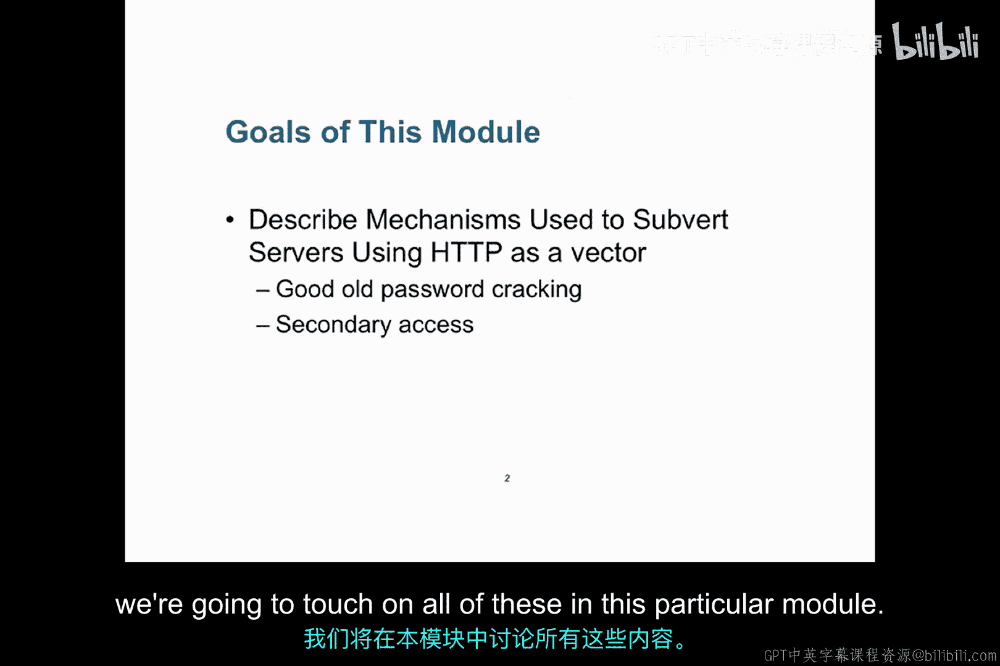

Now。The classic mechanism for taking over web servers was not to touch the web server at all Classly a website and I said this in module 32 where I talked about the idea that there was this intuition directory。

 the truth of the matter is that when you set up your original website。

 they were directories on the local file system this meant that when you wanted to modify the site which you would do is you would transfer files via FTP Now this is still used on a couple of this is used on very basic low end hosting。

 but CMses tend to have taken over a lot of this responsibility。Now， this meant though， that。

 you know， this IP address that a web server was on was actually a variety of servers。

 it might be a database client， so it would communicate on port 1521 and 1434 it would be an FTP server。

 it would be an SSH server， it would be an STP client。

 it might be a web client all of these things might be on that machine and all of these are vectors for tax in particular。

SSHFTP database， these are all things so vulnerable to password attacks Now this means that you know whenever you talk about a web server。

 what you're really talking about is a constellation of services around it。

And when you're talking about defending a server， you're talking about detecting things like secondary access。

 you need to monitor and audit this stuff to do that you need to have some form of traffic monitoring in module 4 we're going to cover netflow extensively。

 this is one of the classic ways to do this， you can take a look at logs on the server itself。

 but the problem with that is that you can never tell if somebody's just probed you with that because until you've engaged in an actual server session。

 you don't get a server log。There's a variety of techniques you can use to identify attackers。

 the big one is new IP addresses people who are contacting a server that they have access to are going to generally come from predictable sites。

 I do not update my website from any random location。

 I have a fairly fixed number of places I do it from Hu office home， local coffee shop。

 things like this the other thing is to look for evidence of clumsiness if people are wandering around a server。

 for example， if they're just looking at files or they're looking for file or they're trying to such files that don't exist that's usually an indication that somebody's probing rather than going for something they know is there。

Now， the classic way to take over any site is password Cracking。

Don't last Password cracking is still a phenomenally effective mechanism for taking over hosts because people tend to be fairly predictable with their passwords。

 if you tell people that it is six character password at the minimum， and it must have a digit in it。

 you're going to find a lot of people using one，2，3，4，5，6 as a password。2。Also， keep in mind。

 many applications do have default passwords。 So when you set up an application。

 you may be installing the security hole if people know what that default password is。 Now。

 there are alternative mechanisms to taking over。 I discussed Cs as a substitute for FTP。

 They is still our security holes as well。 Cs is usually provide you with a lot of capabilities that you historically would handle through multiple service。

 They'll provide you with uploading facilities。 They'll provide you with account management they'll provide you with scripting。

 Oftentimes they will have their own administrative permission structure within the CS itself。

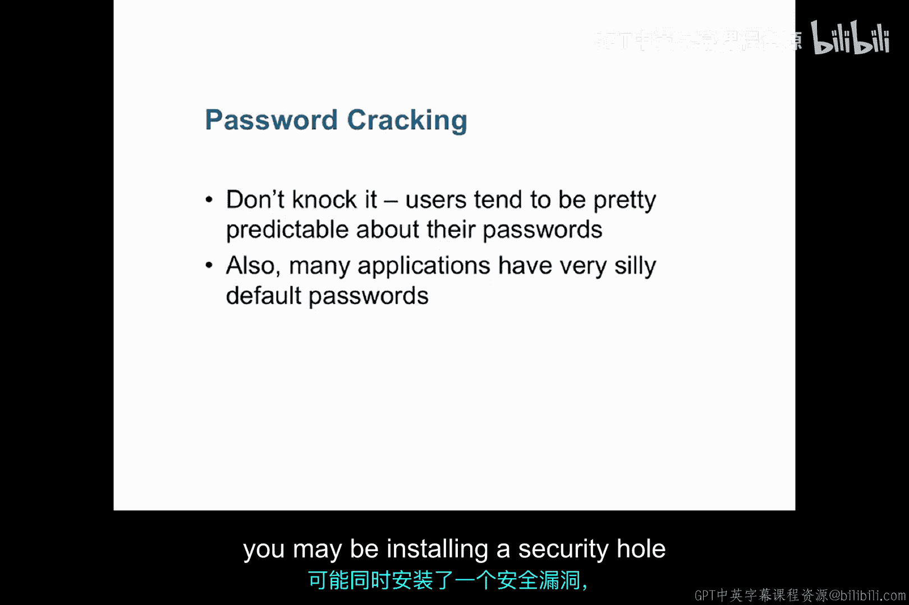

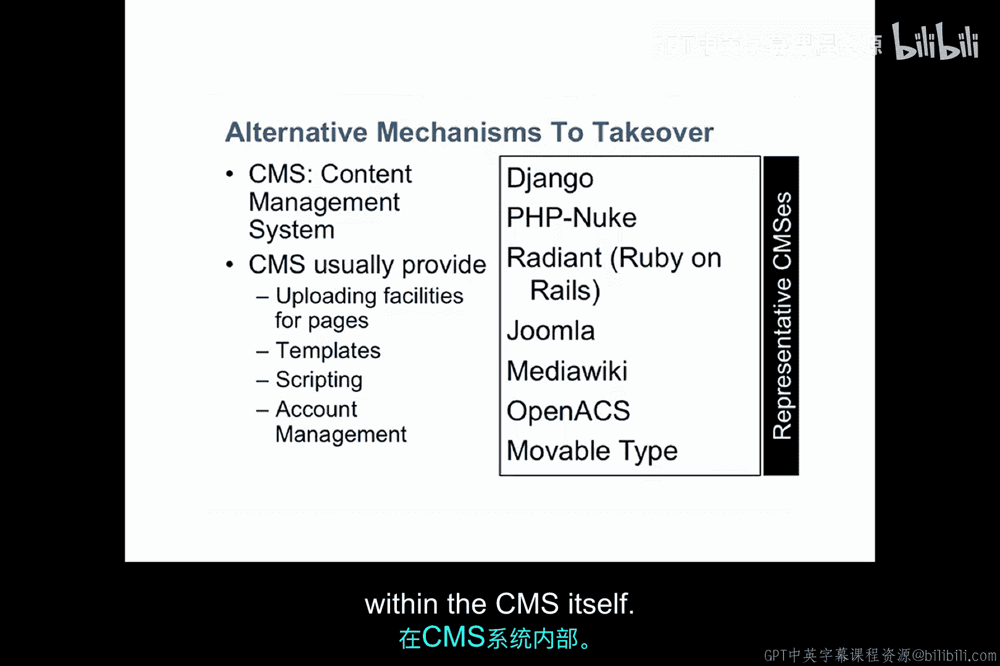

你听。And this can lead to problems now。There's a very common content management system called PP New It is a collection of PhP scripts that allow you to basically build a classic lamp system。

L was a term probablyably its head it was about five years ago。

 which was sort of the prerails django world Linux Apache MysqL PhP。

 This was your classic Expendable system，PHP of course is web is a scripting language for web pages。

 LAM basically was a content management system implemented in PhP along with a set along with a package manager and PhP to allow you to load in a variety of modules。

 it's very expandable， it also has a longstanding reputation for insecurity。

 so much so that at least oneP PhP Nuke Fork Zula is motivated purely by security concerns。

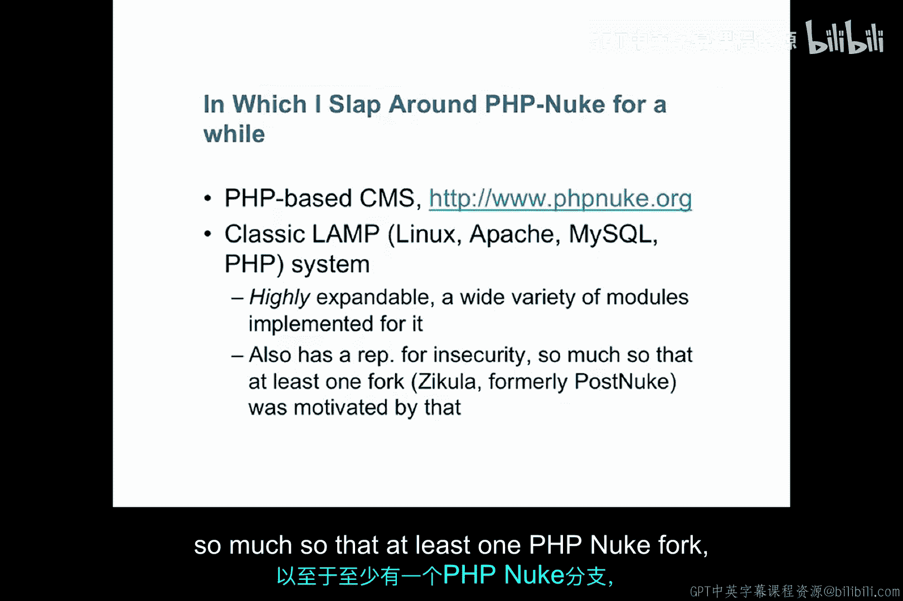

For example。If you take a look at the admin。phP script in PhPNke。

 you'll see that it actually passes along the admin name privileges and rightstes in every message。

 this was a known vulnerability， so all these things had to be passed in on route and easy to subvert。

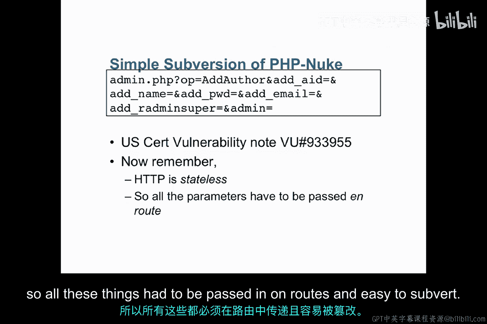

Okay， now。That is an attack within the scope of the app itself， that's an attack in PHP。嗯。

SQL injection， which is one of the more common forms of webbased attack these days。

 relies on multiple levels of systems parsing data without realizing what they're parsing SQL injection is a very common vector at the moment and it is also a very in my opinion。

 good example of the dangers of unrestricted string evaluation so here's how SQL injection works I have a website okay being a waffle obsessive。

 it's going to be waffle net and I have a script on it。

 it doesn't really matter what the fixed food script does it takes two parameters an ID D and an A so if I want to update if I want to fix waffles somehow I'm doing that。

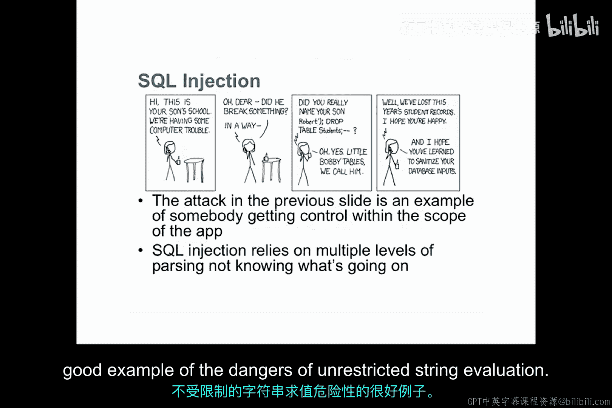

That script is translated into a SQL statement， so this is update table set the do all of this okay。

Here's the thing。An attacker wants to。Break that world。

 So what he does is where you've got this update command。 He， his string injects a terminator。

 an actual sequel command。 And then you'll notice these two dashes。

 which is sQL ease for the remainder of this is a comet。

 So what happens is this command instead of being update table food set。

Name equals waffles where ID equals three， what it now does is update table foods。

 set name equals waffles。It executes that that may not matter。

 it may just decide that's complete gibbmers， but it's got another command to execute select name and password from the admin table followed by comments so the previous statement is killed okay。

As a result， the attackerject injects， truncates a SQL command， and then adds another one afterwards。

 okay， the result is translated into multiple SQL commands。

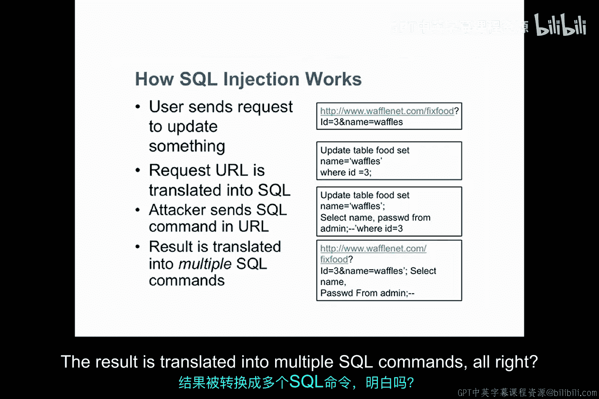

啊。Now the voodoo of SQL injection depends on a couple of things the first is poor sanitization of variables the second thing is the use of the double dash comments。

 this is used to indicate everything after this can be ignored the other thing is that people forget to sanitize everything in the case of PP nut for example it had a sanitization problem where it was constantly passing around the HTP refer tag is a parameter。

 so the attacker just threw a SQL injection into the refer tag to cause the attack。

OkayThere have been a variety of the key thing to remember about SQL injection SQL injection is injecting an arbitrary statement。

 so you see SQL injections to attacks take place using the most innocuous variables as a vector for attack because all they care about is that whatever they have as the variable is going to be passed directly to the SQL statement。

 things like counters for the number of pages that have been loaded。

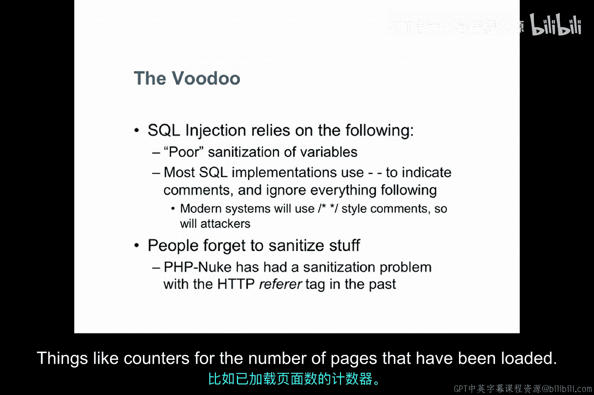

Now， I put poor in scare quotes because sanitization is。

Hard when you take a look at a SQL injectionjection attack。

 you are actually seeing multiple levels of redirection。 So the URL itself， Javascript。

 the CGI B interface， the content management system。

 the scripting language used by the content management system and SQL at。

You have to block somewhere along there。 And if the attacker is clever。

 he could have different parts of the system handle some of the evaluation and parsing for him at different layers。

 Aters will manipulate text to get their point across。

The other thing to keep in mind is where sQL ejection is really hurting us is it's doing something to a general。

HtTP， it's it's doing something with a general statement。

 it's basically throwing some values into something and running eval eval is a bad thing in general。

 try to avoid directly running code with anything close to the user nearby。

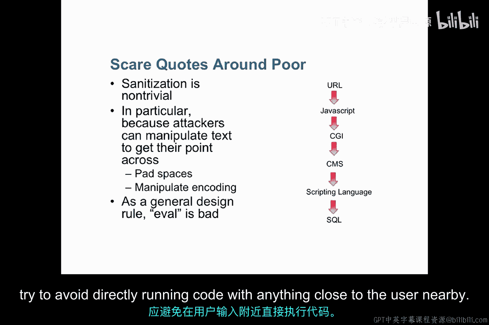

2。How do attackers attack websites， the first thing they do is they look for exploits。

The best way to do this is Google。 For example， if I want to look for a site with PP Nuke。

 I'll just look， I'll have Google do a search from PhP Nuke for me and find a list of sites there。

 The example I've got here looking for v with sites with the CG bin directory that I can pro at。

 oftentimes， attackers look for specific URLs directly。

 they will just run bots that automatically request common URLs。

 The key thing here is that most of the time the attackers don't care about the website itself。

 What they're looking for is exploitability， so they do things they do look for directories about CG bin or nuke。

 which is the PhP Nuke directory that for Pearl or Python scripts that are publicly announced things like that。

 So in conclusion， things to keep in mind。 there are a variety of mechanisms that the attacker can use to take over a website。

 When you look at this thing。 think of these services as think of services as security holes。

 They do provide additional functionality， but of course you're doing that。

 they open up the system to exploit。

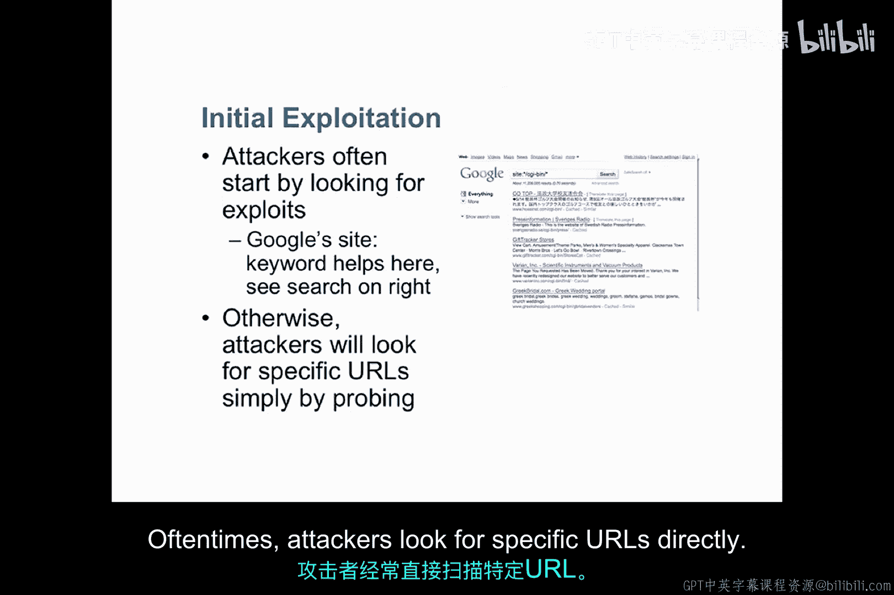

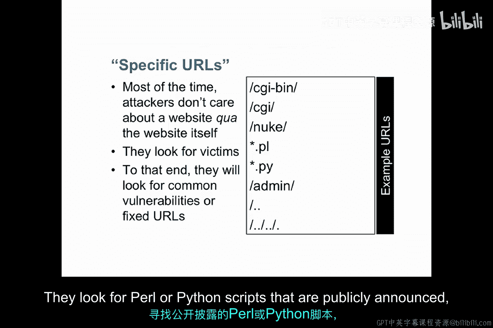

And finally， the other thing to keep in mind is that text parsing and evaluation is risky I am firmly convinced that most security problems we run into fall within a limited set of categories and one of the big ones is mixing up the control plane which is how we do things with the data plate。

 which is the information we're manipulating SQL injection buffer overflows these are all examples of this Anything where what you do is you take a string of data and you say it is no longer data It is a command that leads up that leads to risk and that's what we see happening here with the SQL injection attacks。

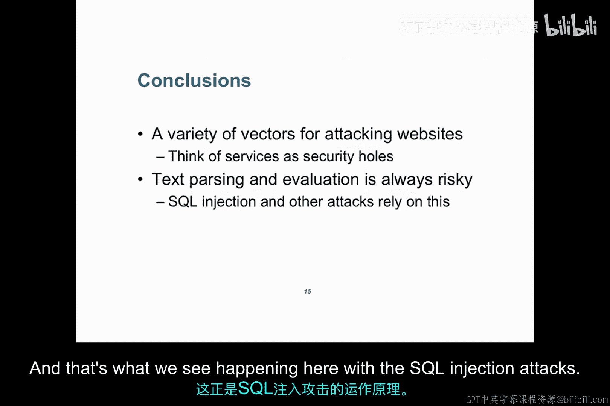