# 约翰霍普金斯大学《信息保障分析｜Information Assurance Analysis》中英字幕 p07 6_攻击分类学.zh_en -BV1Qz8EzYENX_p7-

This is 695，741， Mo 3， lecture 4。In this lecture， we're going to discuss the way that information and vulnerabability about vulnerabilities and exploits are reported at the end of this lecture。

 you will be able to list a series of sources that provide information on vulnerabilities in malware whether usages are and what their limitations really are You also be able to describe the difficulties in correlating between the different aid sources。

 We spend a lot of time juggling names for vulnerabilities in malware。

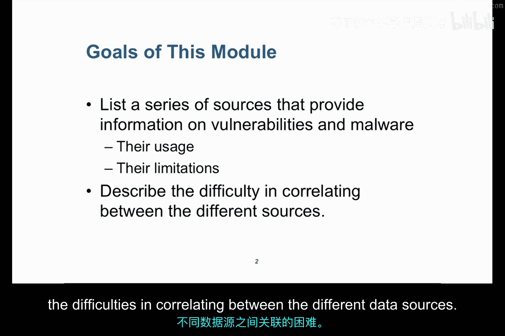

There are a variety of indices and technical notes available for tracing this stuff down。

 The problem is that there is just a variety of indices and technical notes for tracing this stuff down。

 It's kind of like any other standard。 The beauty of standards is that there are so many to choose。

 choose from。That do the exact same thing and everyone gets their own little camp around a particular standard。

 so why should this be any different？You're going to see a lot of cases where people use certain naming conventions and they want to stick with those naming conventions and they're not going to let any other data source dictate how they do their own naming conventions。

Which tends to be a problem， but it also means that each of them are very very much predictable in the way that things are done。

 So before we get into the different ways that vulnerabilities and exploits are defined。

 we need to lay out some definitions。 A big saying that you will see when trying to get information bound vulnerabilities and exploits is a looseness in with terminology。

 So let's keep things simple here。 when we've got， you can talk about things in terms of fault tolerance。

 our security terminology。 when you're talking about fault tolerance。

 you have things such as flaw of fault and failure。

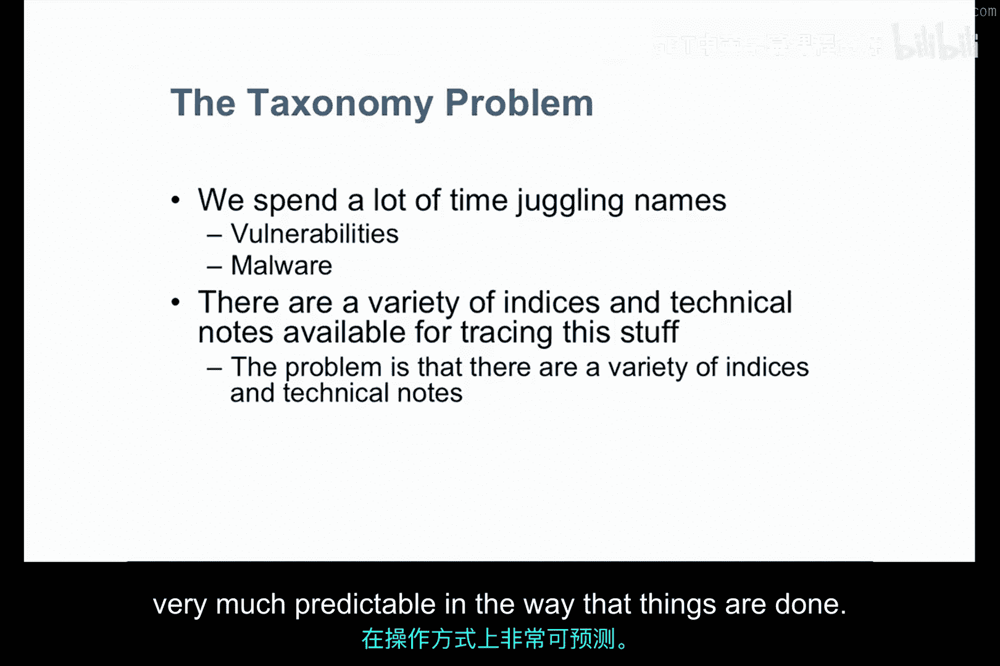

What you're talking about。Network security， you really need to be talking in terms of vulnerability and exploit。

 where vulnerability is a flaw that can be used by a hostile party to usur control。

And an exploit is a tool or mechanism that makes use of that vulnerability in order to reur control。

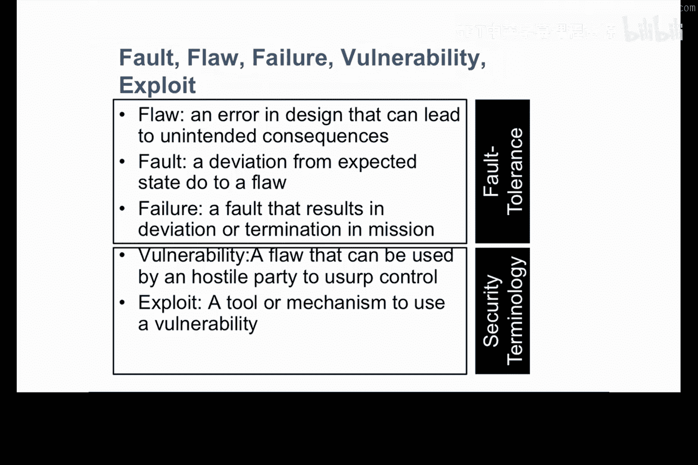

So there two slightly different things here buried it deeply tied together。

I am going to call nowware itty application that contains one or more exploits。

 A vulnerability is a flaw。 A flaw is not necessarily a vulnerability。But for overflows， for example。

 might not provide any benefit to the attacker， only attackers can。Differentiate malware。

 We successfully catalog flaws and vulnerabilities。 Semi successfully。

 we categorize specific exploits。We have some trouble with figuring out exactly what malware packages always use there。

 Sometimes it's very we can， sometimes we can。

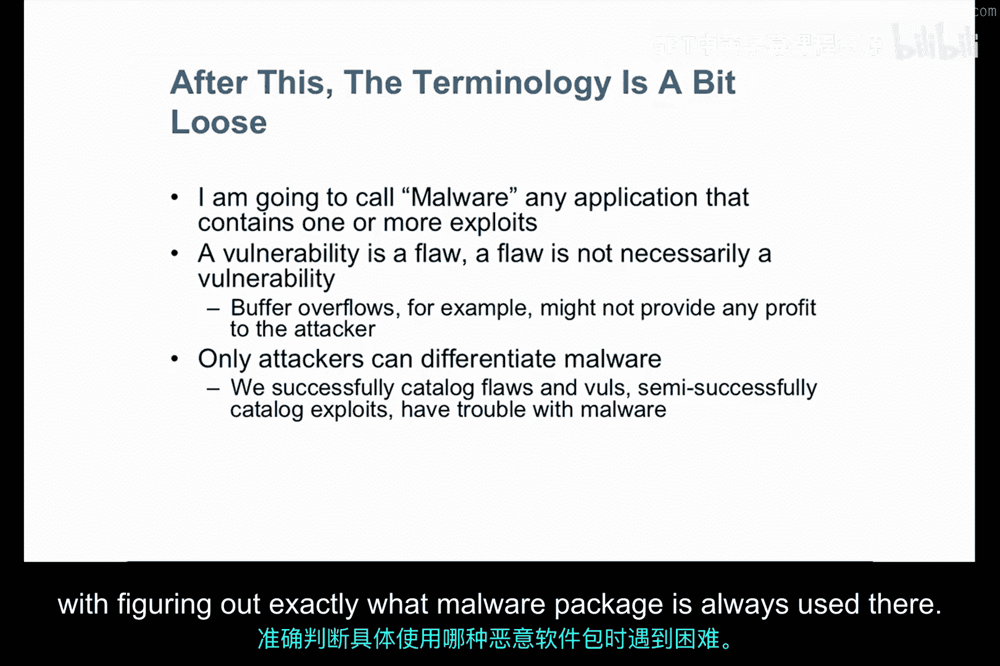

Every major and responsible publisher provides technical notes on current flaws or vulnerabilities that they have。

Oftentimes， these nodes are associated with patchs。We have a list here。

Of some of the major OS vendors， it's important to note that these are great sources for us and the attackers。

As they provide a roadmap to what can be exploited。

And if the user does not heed the warning of these sites。

 he or she is a potential victim for diligent attackers。Remember。

 you've got to actually update in order to inoculate yourself from an exploit that uses a particular vulability。

But not everybody always is as diligent as is necessary。

 That's why attackers can still use this information in order to design attacks that are indeed effective。

 Partment developers other organizations keep track of the state as well。

 Several are explicitly mandated to do so by the Government。 Lagely。

 this is like F F R Cs and the like and。

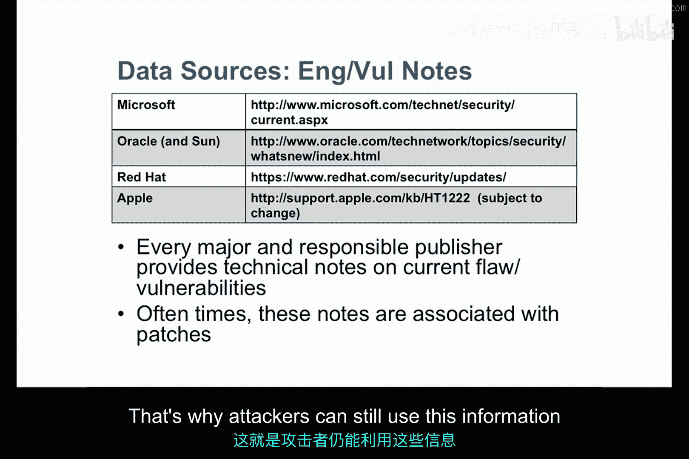

Others are just independent organizations that do this to further network security research and network security operationally as a whole。

It's a good practice to keep familiar with the information in both these and the vendor science。

 there will be overlap， but it's not a complete overlap， you will get unique information from each。

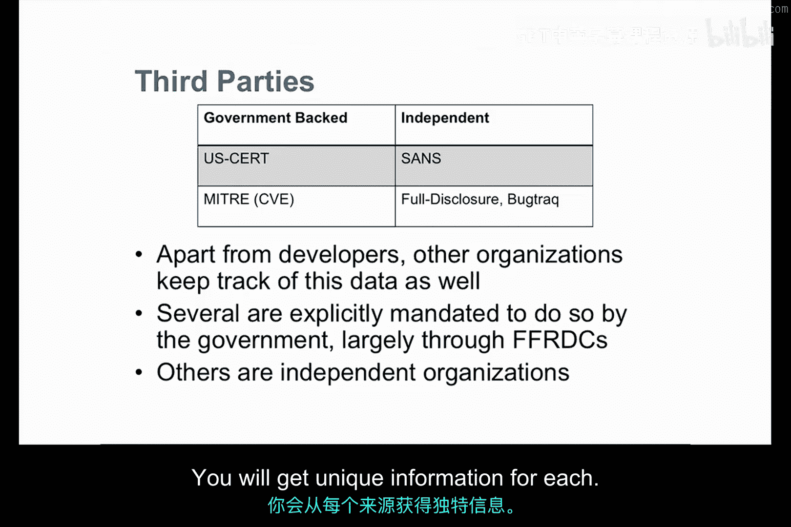

Now let's get into a little bit more specifics。

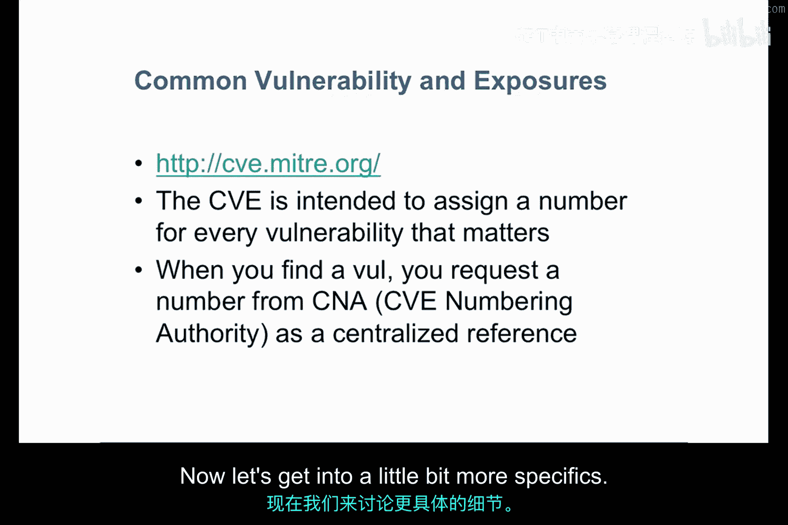

Y， actually skipped over one on accident there。Sert produces a set of advisories that can be found at the URL at the top here。

This is one of the Certs tasks to actually report this information and document it readily now this is done by US Cert and it serves as a central clearinghouse for vulnerability information。

US Cerrup produces a relatively small number three to four months。

 but these tend to be the big woods。What we mean by B here is these are the things that have a potential to affect the most people in a very short period。

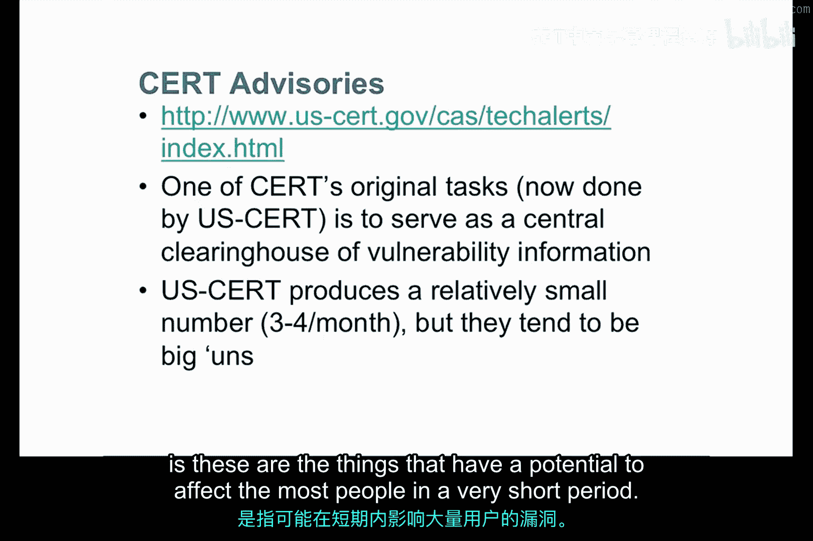

So anything that's going to cause will breed the output now we'll move on to CDE。

 which can be found at the URL here。CBE is intended to assign a number to every vulnerability that matters。

When you find a vulnerability， you request a number and see it from CNA， CE numbering authority。

As a essential reference。You can look up all of the numbers in a nationally maintained database called the ND。

 in fact you'll be using that in your assignment later on。

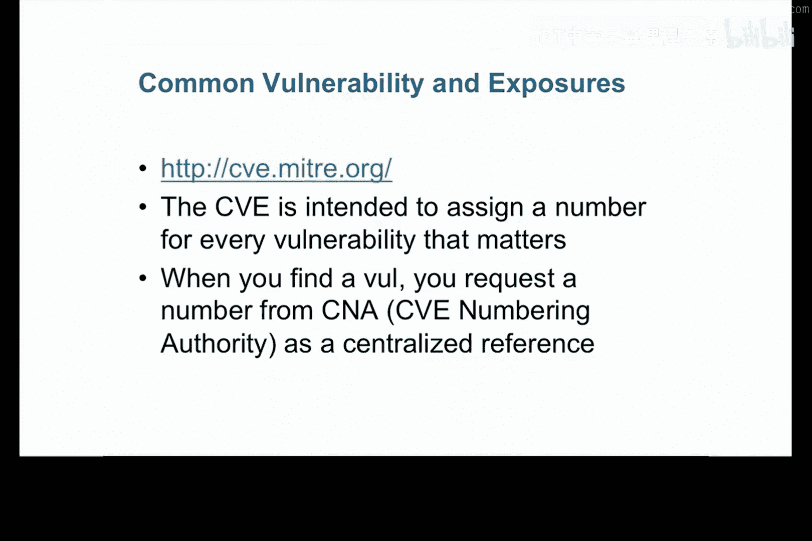

Finally， we have SAs， which can be found at this Sior。

The Science Institute is a distributed education， training and information interchange for system administrators and security professionals。

It publishes a regular report on security vulnerabilities， and these are generally。

These generally come from people who are practitioners in network security and it's written for people who are practitioners of network security。

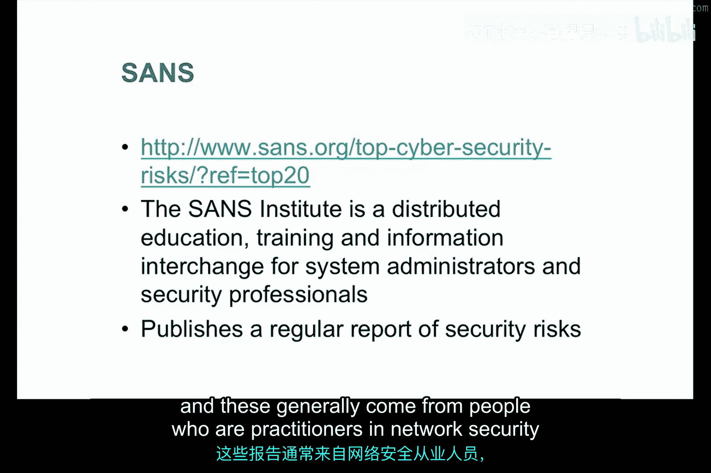

Now that we now we we're going to get into a little bit more of a liberal push to vulnerability reporting fall disclosure is a philosophy of viewing security that of viewing security events that evolved in the mid-90s。

It's in response to kind of this ivory tower attitude that many people in this field were thinking that the cert kind of started to have。

 so full disclosure holds that all vulnerabilities once identified should be publicly announced。

 along with their information as opposed to what the vendors try and do。

 which is keep that information， keep that information close their heart。Develop the patch。

 release the patch， and then let people know about the vulnerability。

So this is a completely different set of ideology。These groups are more interested in letting everybody know。

Some form of ground truth， assuming that ignorance is more dangerous than letting attackers know。

Where there is a weakness。

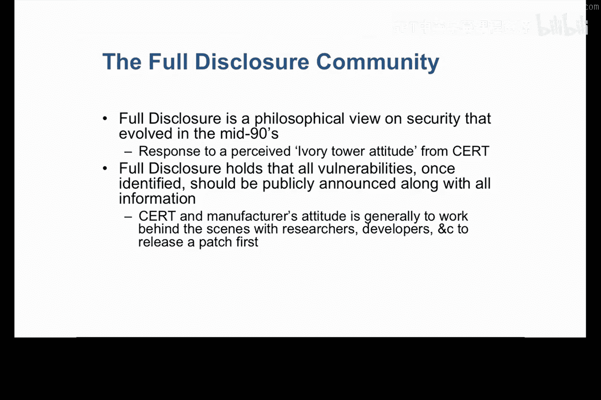

So full disclosure discussions tend to orbit two major mailing lists and we list out both here。

 first ones bug track and second one's full disclosure。Both of these are searchable。

 both these simple Google searches will get you right to the site and you can actually do searches within the archives great。

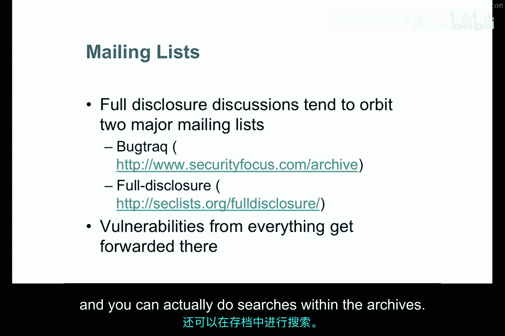

So we've discussed how we catalog vulnerabilities， now we're going to talk a little bit about how Malwares catalog。

Nowware is primarily cataloged by the A V vendors。 We've got several of them listed right here。

Many of these names should be immediately familiar to traditionally。

 malware companies assign variant names by slapping a letter on the end， which。It's kind of useful。

 kind of not it's nice for letting you know that two pieces of malware do have a relationship。

 but it does nothing to help you understand what the differences are without going to their site and looking around and actually doing the comparison yourself。

So to make matters more awesome for you， they don't use a state or naming convention between any of them。

For instance， here are a few examples of how。The naming kind of works for each of them in Mccafee。

 you've got like the O S that's affected slash name and a ver。 sevantic has O S dot name buried them。

 which there's an easy mapping there and， and so forth and so on。The problem is that these names。

 although they they you could actually produce a nice map in between some of these。

 if they were all maintained consistently， there is no guarantee that they're all going to be contained be。

Have consistent name。

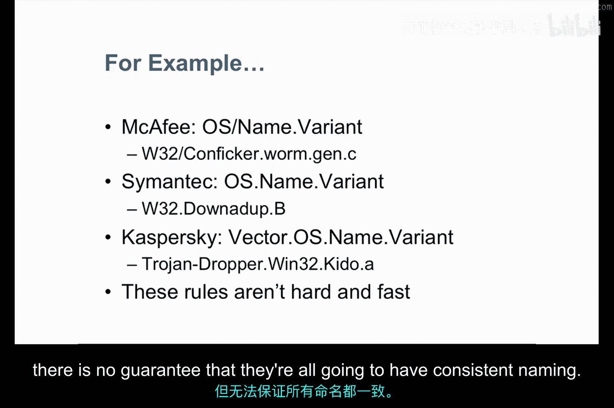

So all these variants are some form of conflict， all those variants in the previous slide。

 using the name that site referred to for confire， not necessarily a consistent name that maths throughout note although I do find this annoying。

 I can see why it happens and there really isn't an easy way to fix it。So for the time being。You。

 as the analyst， must stay on your toes and never dismiss a malware。

Spation because it doesn't have the name that you expect。

Consider that the information is telling you what the information is telling you and work from there。

 a name is just a name these guys actually come about。With their naming convention， with their names。

 based on the method that they found the piece of malware。

F for instance dense parallel research developments cause。

TheyThey might in the lab start calling things differently and that name gets propagated on up some are。

Related to how the worm was propagating。 That's where I thing。 So it's。

 it's understandable how this occurs。 It's not malicious ands。

 It's not them trying to keep you from using their information。

 It's really just a matter how the actual piece of malware was discovered。 So I conclusion。

 there's a variety of sites and organizations that provide information about vulnerabilities and exploits。

 While vulnerabilities。 We've got the vendor sites。 We've got Ffr RD Cs。

 And we also have independent groups that compile this information and make it readily available for network security Amp。

 malware is activelyly being catalogued by A vendors。 No kid， right。

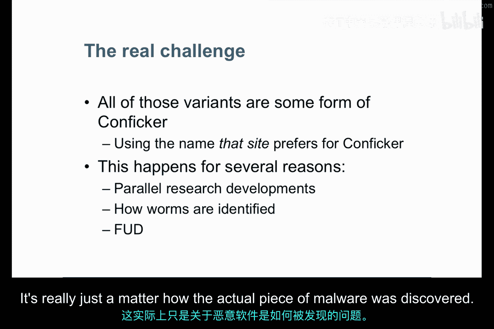

They do like the same naming conventions， but the information that you're going to find on there。

 once you do find out that two different names actually represent the same thing on two different sites。

The combining that information will be the best approach to you fully figuring out what's going on with a piece of bowware。

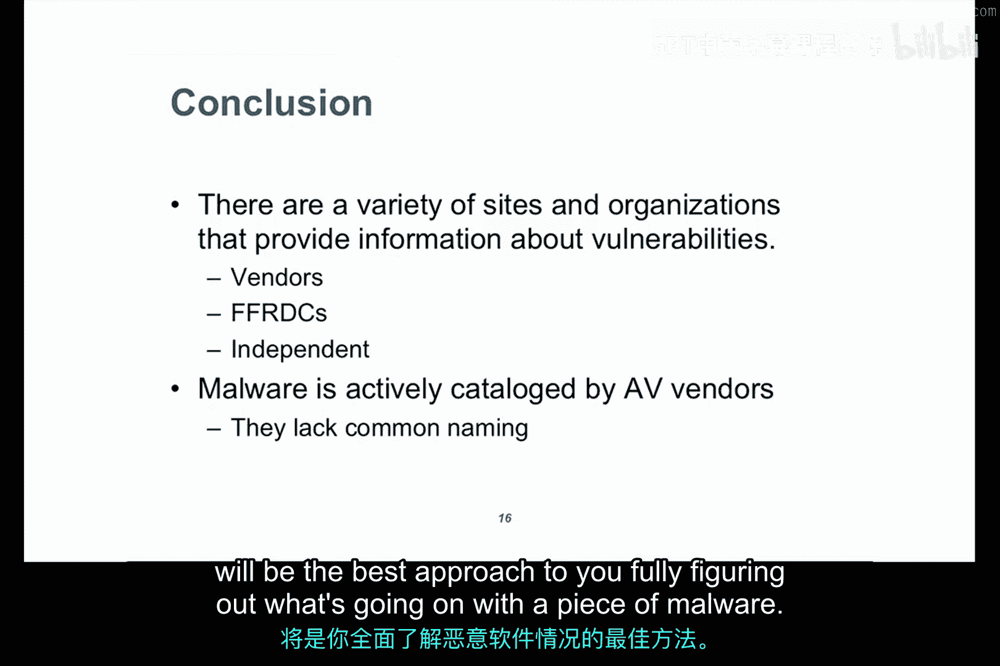