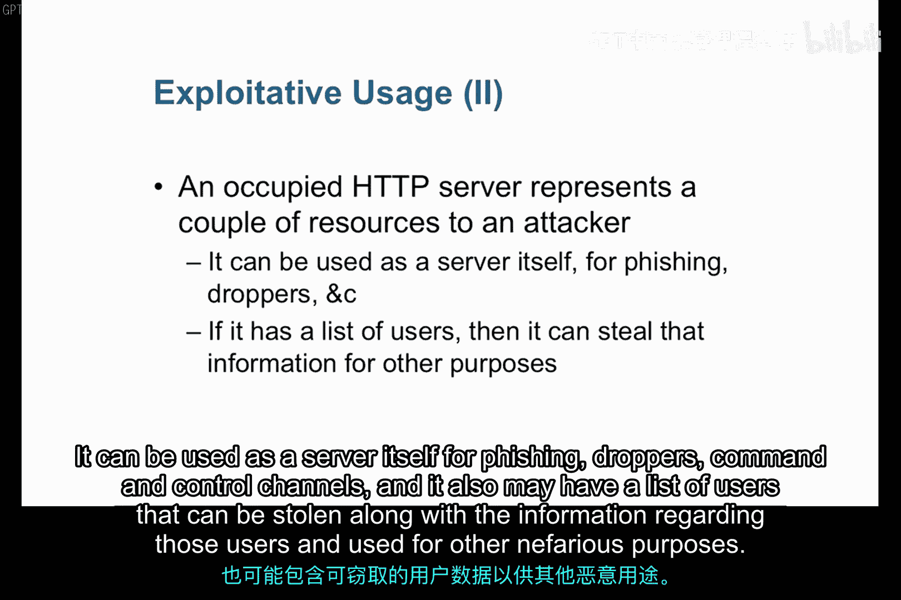
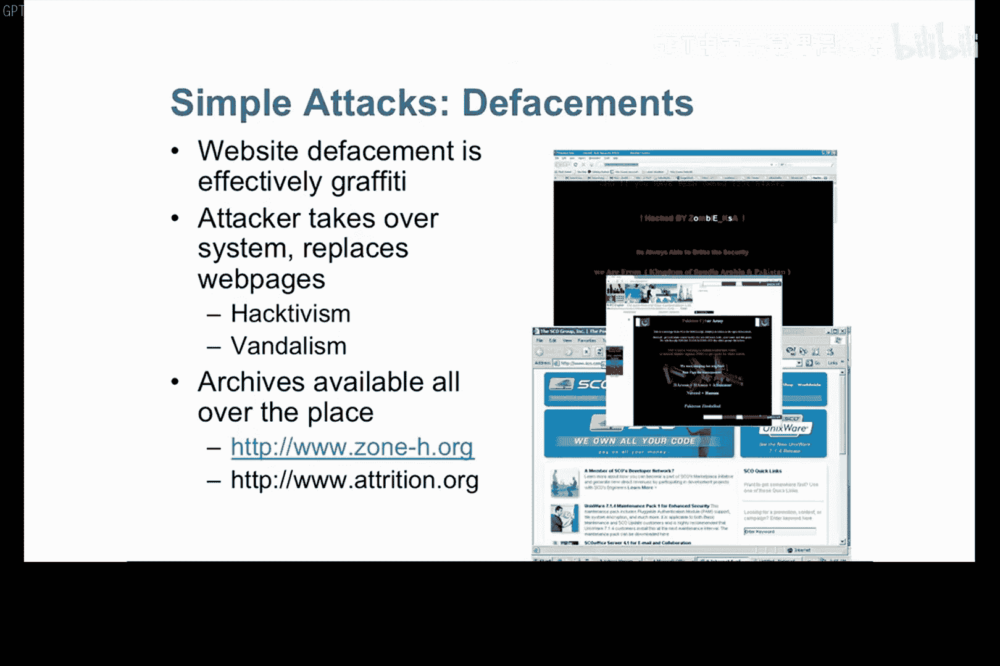
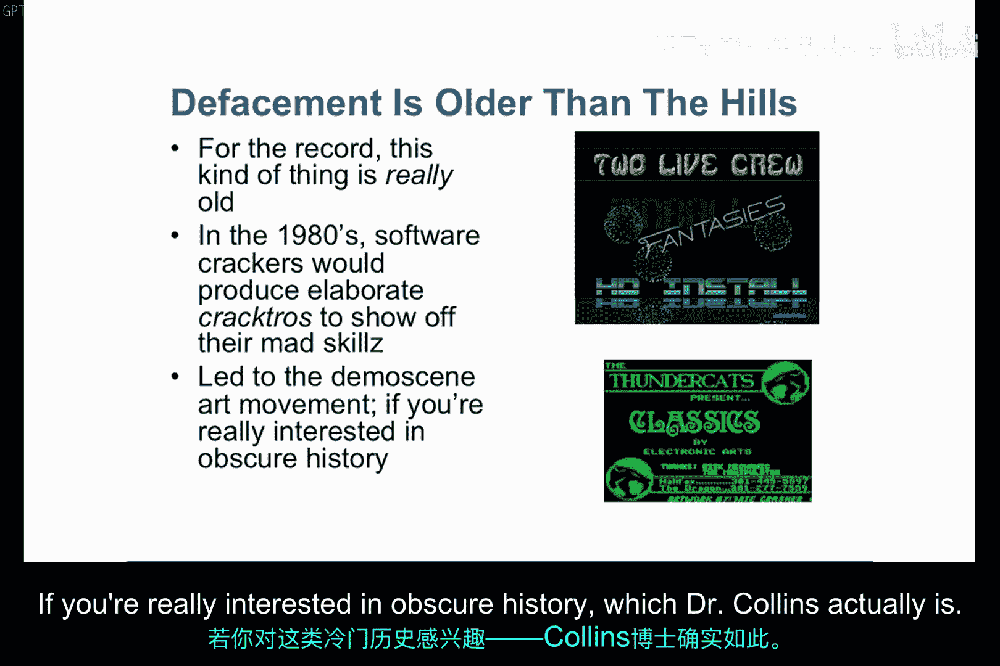
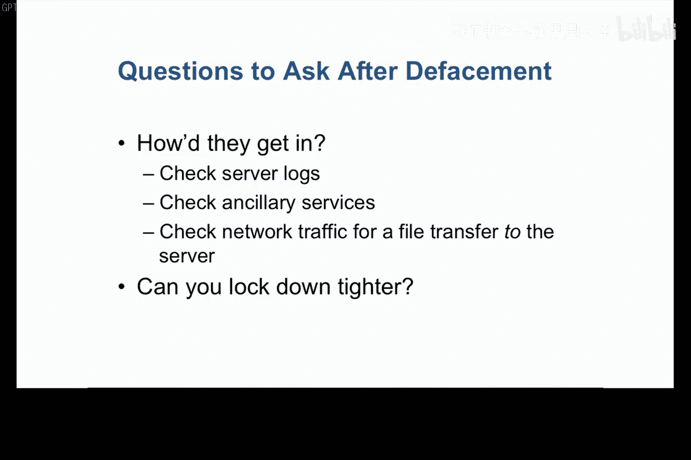

# 约翰霍普金斯大学《信息保障分析｜Information Assurance Analysis》中英字幕 p08 7_网站篡改攻击.zh_en -BV1Qz8EzYENX_p8-

This is 695-741。Module 3 lecture Fox and this lecture will be covering one of the most basic and easy to detect attacks of course I'm talking about the face the entire point of the attack is to show that you were able to make changes to someone else's website。

So an attacker might take over a site for the sake of the site。However。

 the majority of attackers that we expect to see。Have little direct interest in the site itself。

In fact。The way that an attacker sees it is。That a site is a resource to be exploited for a real attack later on。

In fact， although zoneone H is a simple archive of defacements。

 it can be criticized for pointing out the fact that sites are susceptible to attack。

 so although the site is simply defaced at that moment。

 it may have an increased chance of being used for more nefarious purposes later on by being compromised by something else。

So who really cares。It's just a server， right？Well， servers are kind of valuable to attackers。

More so than personal computers if you really think about it。

An occupied HTTP server represents a couple of resources to an attacker。

 it can be used as a server itself for phishing， droppers， command and control channels。

 and it also may have a list of users that can be stolen along with the information regarding those users and used for other nefarious purposes。

So I think everybody listening to this basically knows what deffacement of a website is。

It's basically like graffiti。Attackers take over the system and they replace the web pages。

 this is also called Haivism and vandalism。There's an archive freely available of several deffacements that have occurred and the archives are constantly updated。

 of course we mentioned Zone H before， but there's also this other one。诶。Atreton。

So for the record， this is kind of a really， really old thing。

In 80 software crackers would produce elaborate。Crack tros to show off their mad skills and the like。

 and this led to the Demo scene art movement if you're really interested in obscure history。

 which Dr。 Collins actually is。

So how do you actually detect the face map？Heres it a good idea。

 go check the page the easiest way is locally， I mean you can actually set up any number of hostse based intrusion detection systems such as Twire that can track any changes to files on your system。

You could also be a little bit more elaborate and proactive and actually have crawlers。

 p your website and compare the results that they get from their website on a periodic basis。

So let's say that she actually happenedt。You actually have been defaced。

The important question that you should ask at that time is how they get in？From that point forward。

 you actually have to open up a full F investigation。You need to check your server logs。

 you need to actually look to see if there's any additional services running on your system。

 you need to see if there's any services running on your system that you previously enabled that aren't being used that could have been used for this attack。

Edie also should probably check your network traffic for a file transfer to the server。

This is a good way to determine whether or not your server is actually being used for nefarious purposes。

And the。Number two question that you should ask other than after how they got in is how can you lock down your site tighter。

 obviously there is some deficiency in your security at this time that must be addressed。

