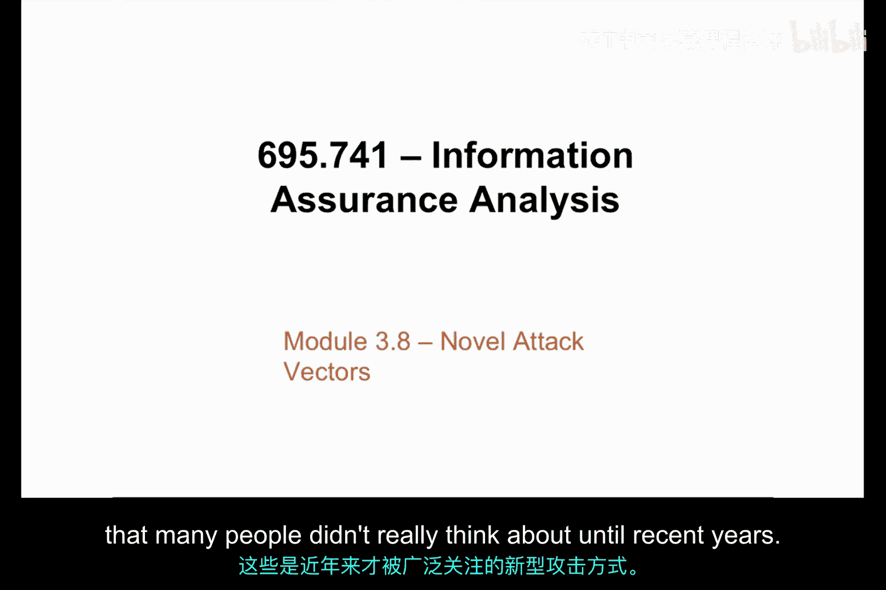
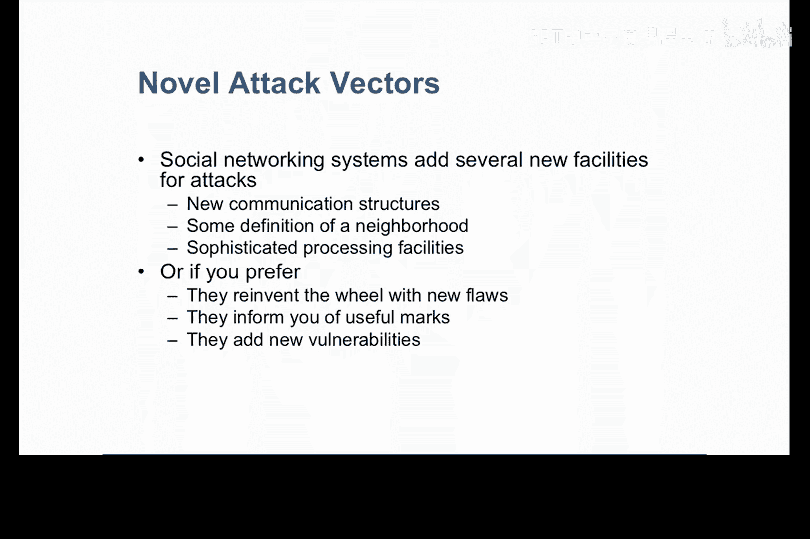
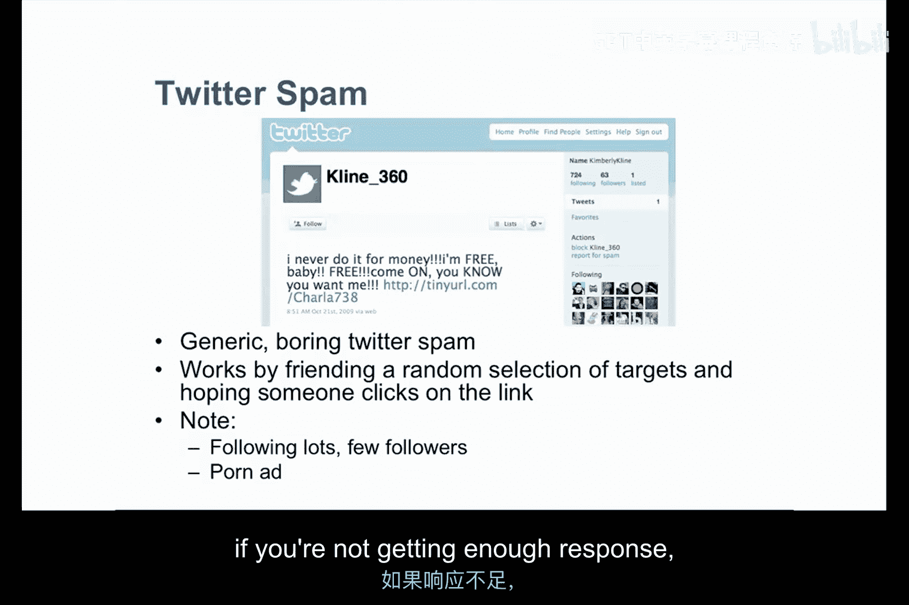
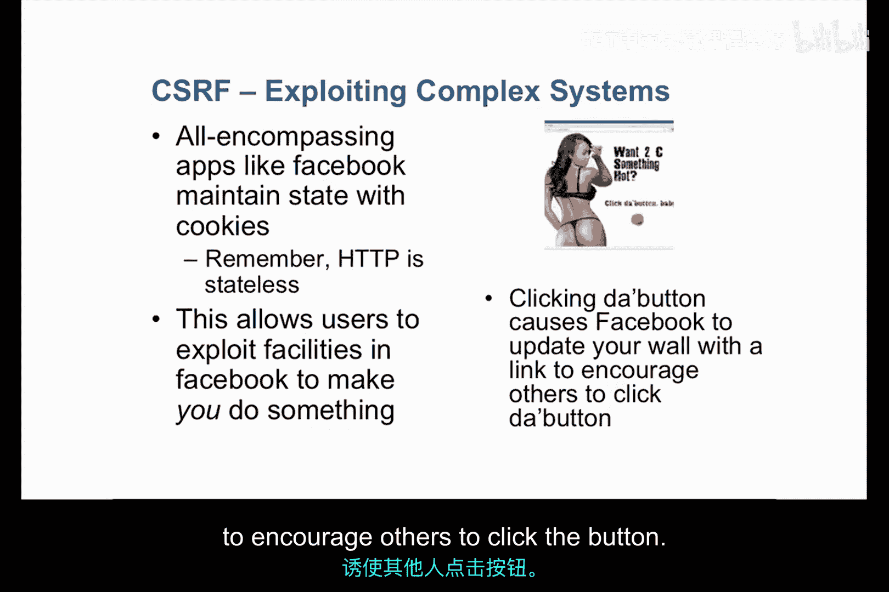
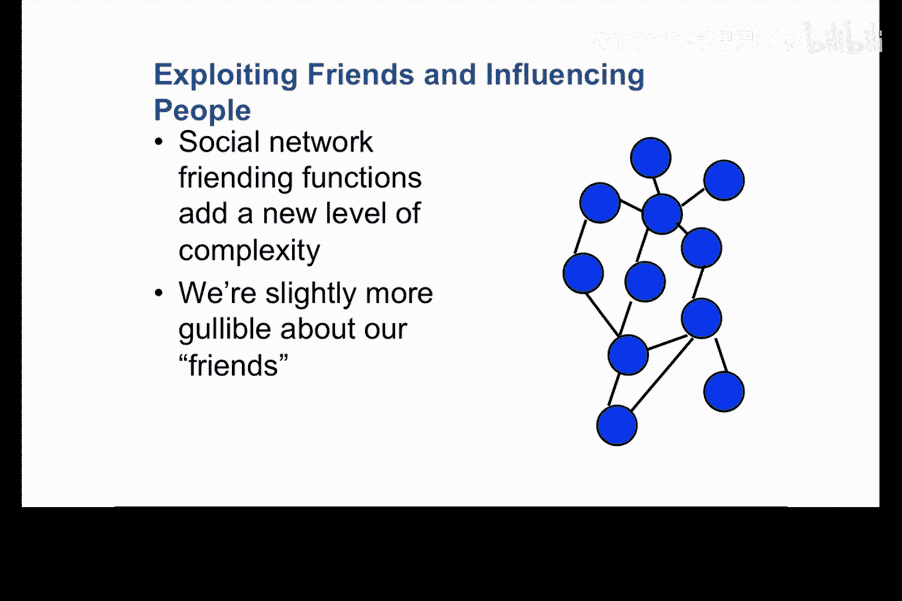
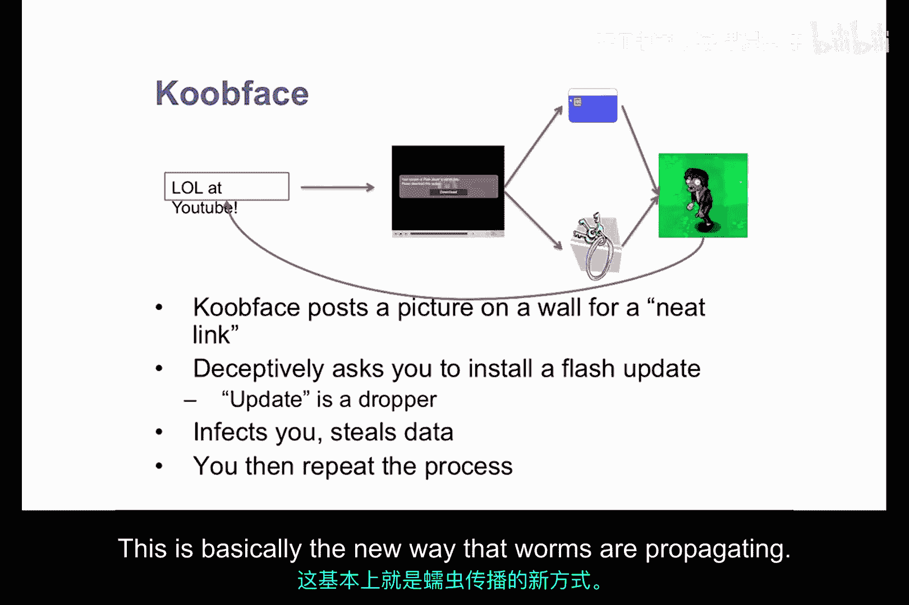

# 约翰霍普金斯大学《信息保障分析｜Information Assurance Analysis》中英字幕 p09 8_新型攻击向量.zh_en -BV1Qz8EzYENX_p9-

This is 695-741 module 3 Le 8。In this lecture， we're going to talk about some tech vectors that many people didn't really think about until recent years。

And start off talking about social networks， these are wonderful ways for different malicious parties to actually start infecting a large group of people with very limited amount of effort。

Basically， we've got these new communication structures that people aren't really well acquainted with how to secure。

 and they don't necessarily have the best security to begin with。啱。

Interesting thing about this is that if you compromise one host。

 you've already got yourself into a neighborhood of other entities that can be infected。

As we've talked about in several other lectures， people are more trusting of their friends。

 so if you infect one person。With a piece of malware。

 it is entirely likely that if you use their social network。

To develop a hit list for other people and use their credentials in order to send that the malicious piece of software to them。

 they're more likely to open。I said more likely many people are trying to be better about not opening。

Attachments and things like that， but。You're still going to have the case where people feel that， oh。

 it came from Joe so I can open that。Now another thing about the easiest way that we can actually talk about this is basically they've reinvented the wheel with all the o flaws that previously had been resolved with other communication means and。

They got a wonderful way of actually finding new and useful marks to its attack。

Let's start with the most boring of these。Twitter spam。It works pretty simply by。You know。

Work like getting a friend randomly start selecting a group of friends that you want to actually click on a link and exploit in some way shape or form。

There's some extra interesting notes about it， though。These are。

These users that actually are Twitter's famousrs。They follow a lot of people。

 They've got to get a bunch of people together， and they follow tons of them。

 but they're followed by very few people。Also， they tend to talk about porn more than your average teenage boy。

So they're a little bit predictable and easy to spot。But again， I mean， as with any spam， all you。

 if you're not getting enough response， just cast a bigger net to get more people。

Let's now move on to something a little more interesting， Cerf our crossite cryptine quest forgery。

These attacks are also known as One click attacks and sessionession writing。

All encompassing apps like Facebook maintain state with cookies。

 remember HGTP is stateless by itself。This allows users to exploit facilities in Facebook to make you do things。

Basically， click the button， cause Facebook to update your wall with the link to encourage others to click the button。

You could say， okay。On Facebook， this is kind of cute。But if you have other sites。

The use of cookies that use cookies to authenticate， this could be a big problem。

This has the ability to cause you to accidentally do things on other sites。

The way that works is simple， the deliciousicious link exploits the trust that a site has in a user。

 so basically it crafts a link to the site that it wants something from。When you click on the link。

 the link runs whatever the attacker wants from your browser。

You execute the attack you execute the code on the attacker's behalf。So， for instance。

 and this is a very generic example if your banking system allows you to craft you。

Transfer handles money transfers with URLs， basically having all the request information in the URL and you've got your cookie in your cash and they actually make you click on the link that says。

 okay， transfer $12000 out of my account。It's going to do that on your behalf。

That's the basic principle of highness。Now。That in and of itself is bad now how do we propagate this kind of thing again。

 I said you click on the link。You click on the link it posts something on your Facebook page that tells other people to click on the link。

So。In social network。Fridending functions add a new level of complexity to it。

 because what we're doing is we're。Putting something up there that allows other people to say， hey。

 this guy is more legit than some random spammer that I've encountered。

 So I'm going to trust him more。We're slightly more gullible about our friends than we are about anyone else。

So CSEF and other malicious links can come from friends， which we all know interestingly。

 this is one of the ways that Facebook worms Papagy。

。All right。Speaking of Facebook worms， we've got coopb， this is an interesting worm。

 it created a botnet that tried the steal FDP logs login log on information。

It posts a picture on a wall。For a neat link， and deceptively ask you to install flash update。

 saying， basically， hey， you don't have the sufficient version of flash you need to update to the newest version。

You click on it to go update your flash and what that really is is a drop that drops piece of malware on your system。

And affects you steals your data， and then repeats the process over again for other people。

This is basically the new way that warrants are propagating。

