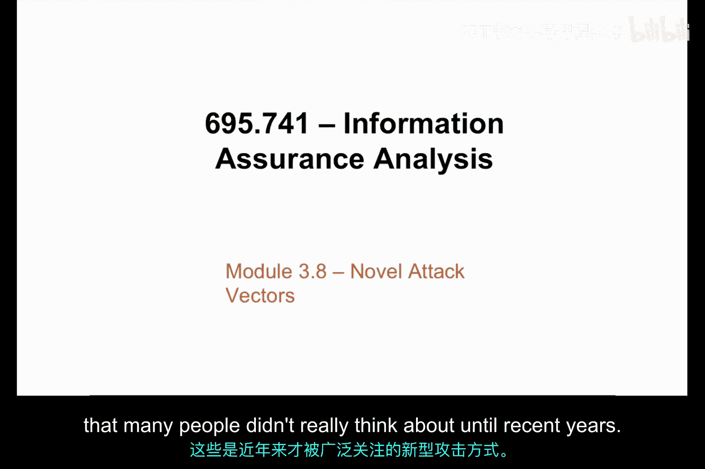
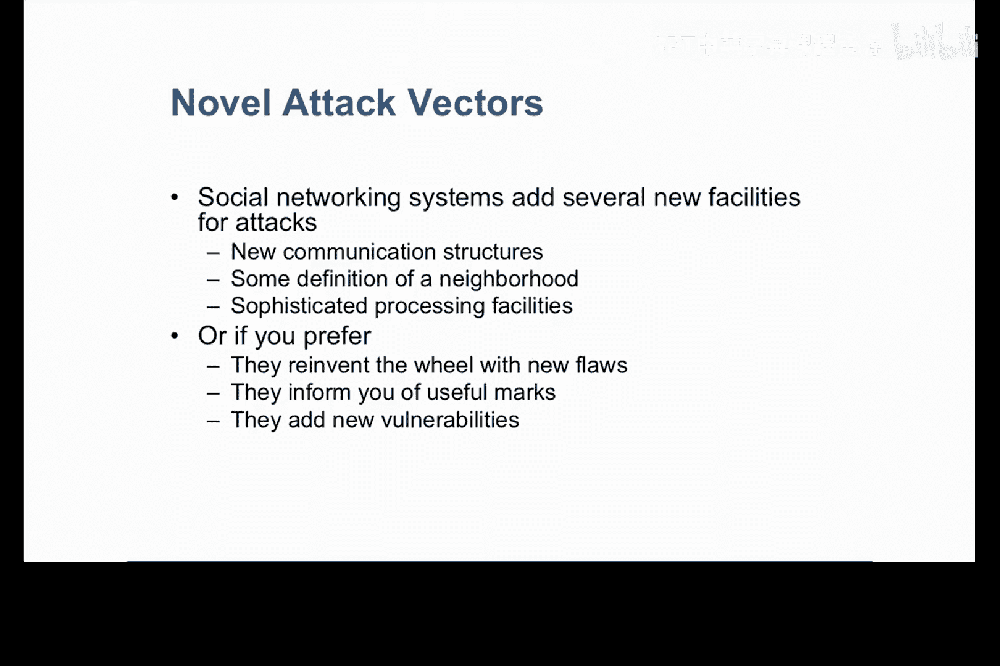
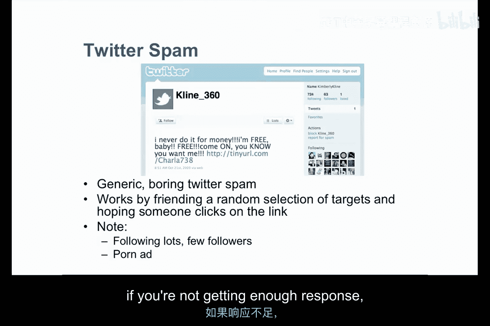
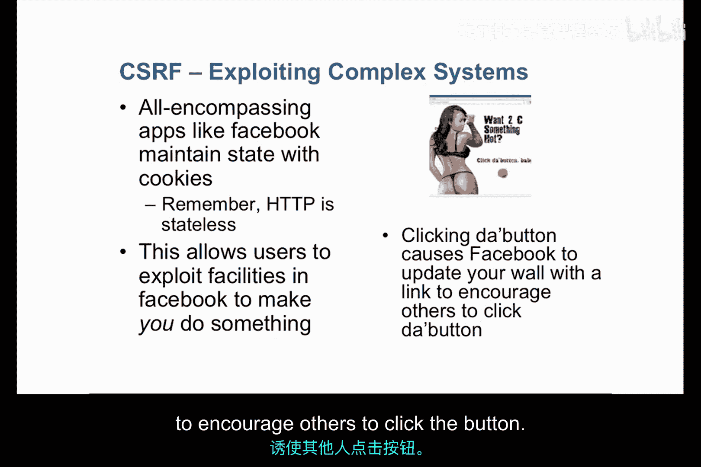
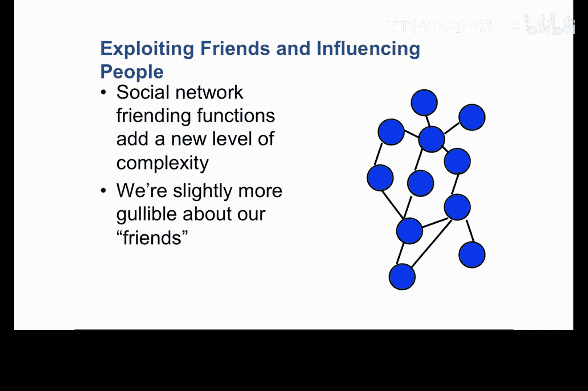
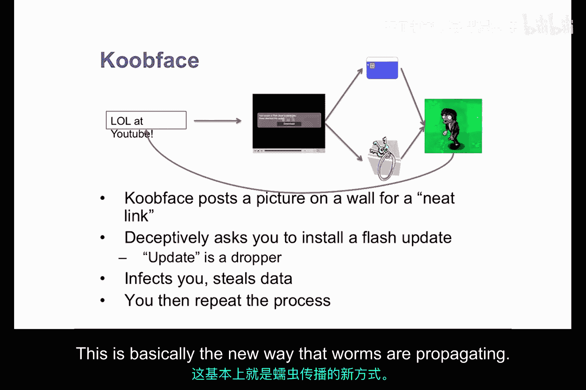

# 信息保障分析：3.8：新型攻击向量 🔓

在本节课中，我们将探讨一些近年来才引起广泛关注的新型攻击向量。这些攻击利用了我们日常使用的社交网络和新兴通信技术中的安全弱点，使得攻击者能够以极小的代价感染大量用户。

上一节我们讨论了传统的攻击方式，本节中我们来看看社交网络如何成为攻击者的新阵地。

## 社交网络：攻击的放大器

社交网络为恶意攻击者提供了一种高效感染大量用户的方式。这些新型通信结构本身安全性不足，且用户普遍不熟悉如何保护自己。

一个关键风险在于，一旦攻陷一个用户，攻击者就进入了可以感染其他实体的“社交圈”。正如我们在其他课程中提到的，人们更信任自己的朋友。因此，如果感染了一个用户，攻击者很可能利用其社交网络关系，筛选出目标列表，并使用该用户的凭据向好友发送恶意软件，从而大大提高打开率。

本质上，社交网络在通信方式上“重新发明了轮子”，但也继承了旧通信方式中已解决的安全漏洞，并为攻击者提供了寻找新目标的绝佳途径。

## 具体攻击类型分析

以下是几种利用社交网络的具体攻击类型。

### Twitter垃圾信息

这种攻击方式相对简单。攻击者随机选择一组用户，诱使他们点击恶意链接。

关于这类攻击有一些值得注意的特点：
*   这些发起攻击的Twitter账号通常关注了大量用户，但粉丝数很少。
*   他们发布的内容往往涉及色情信息，比普通用户更频繁。
*   与所有垃圾信息攻击一样，如果响应率不足，攻击者会扩大攻击范围以覆盖更多人。

### 跨站请求伪造

CSRF攻击也被称为“一键攻击”或“会话劫持”。像Facebook这样的大型应用使用Cookie来维持用户状态（因为HTTP协议本身是无状态的）。攻击者利用这一点，诱使用户在不知情的情况下执行操作。

其工作原理很简单：恶意链接利用了网站对用户浏览器的信任。攻击者精心构造一个指向目标网站的链接。当你点击该链接时，你的浏览器就会代表攻击者执行该链接指定的操作。

例如，假设一个银行系统允许通过包含所有请求参数的URL来处理转账。如果你已登录（Cookie有效），攻击者诱使你点击一个类似 `https://bank.com/transfer?to=attacker&amount=12000` 的链接，那么这笔转账就会在你的账户下被执行。

在社交网络中，好友关系为这种攻击增加了新的复杂性。来自好友的链接比来自陌生垃圾信息发送者的链接看起来更可信，我们也更容易轻信朋友。CSRF等恶意链接正是通过这种方式，借助好友关系进行传播，这也是Facebook蠕虫扩散的途径之一。

### Facebook蠕虫：Koobface案例

以Koobface蠕虫为例，这是一个有趣的案例。它试图创建一个用于窃取Facebook登录信息的僵尸网络。

其攻击流程如下：
1.  它在用户的“墙”上发布一张图片和一个诱人的链接。
2.  该链接会欺骗性地提示用户安装Flash播放器更新，声称当前版本过低。
3.  当用户点击更新时，实际上是在系统中下载并安装了恶意软件。
4.  该恶意软件窃取用户数据，然后重复上述过程，感染用户的好友。

这代表了蠕虫传播的新方式。

## 总结

本节课我们一起学习了社交网络环境下的新型攻击向量。我们了解到，社交网络因其固有的信任关系和潜在的安全漏洞，成为了攻击者的高效平台。具体探讨了Twitter垃圾信息、跨站请求伪造的原理与危害，并以Koobface蠕虫为例，分析了恶意软件如何通过社交关系链进行传播。理解这些攻击模式对于提高个人和组织在数字社交环境中的安全意识至关重要。