# 约翰霍普金斯大学《信息保障分析｜Information Assurance Analysis》中英字幕 p10 9_NetFlow流量分析概述.zh_en -BV1Qz8EzYENX_p10-

Hlow class， this is 695741 information assurance Ana， this is Dr。 Collins and for this module。

 we are going to be providing an overview of Ne flow。

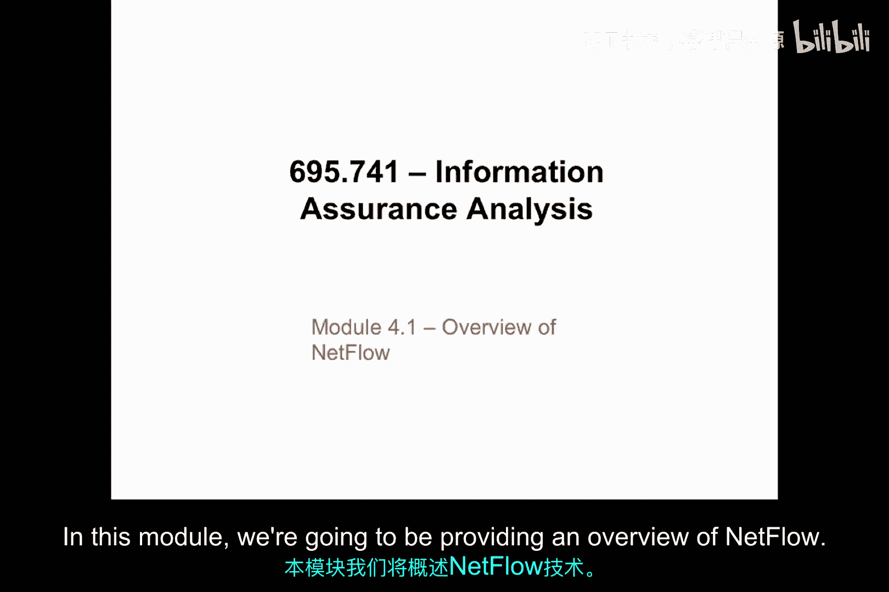

The goal of this module is to provide you with an introduction to the concept of netflow and to explain the difference between flow and packet analysis。

 We're going to talk a bit about why flow where flow has problems。

 but before I we get to that I want to emphasize something every data collection system has problems。

 Neflow has an enormous number of advantages which make it very useful for doing traffic analysis。

 but it also has problems， so does everything else。

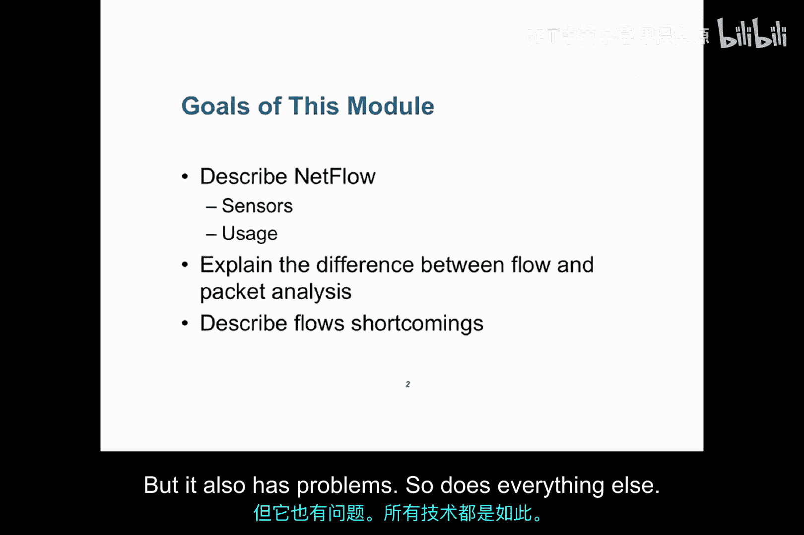

Now。We can do packet by packet analysis by this point you've experimented with TCP dump and BF。

The problem is that when you get to large scale descriptions。

 when you get to very large summaries of data packet by packet analysis is often problematic it's debaably useful for example。

 I don't need to see the middle 50，000 packets of everyone going to a streaming video of whatever dancing cat is the current internet me dejore。

And I don't need， for example， to see the in depth details of every packet scanning my dark space okay。

As a result， we have summary techniques the most common one is what's called NeFlow NeFlow was originally developed by a computer scientist named Casey Claffy。

 it was her dissertation topic and it was then developed into a debugging tool by Cisco the first commercial package was Cisco NeFlow and the story goes that Cisco was actually using as a debugging tool they did a demo and one of the clients asked what this thing in the corner NeFlow was they showed it and the client said we want that when it kind of grew from there。

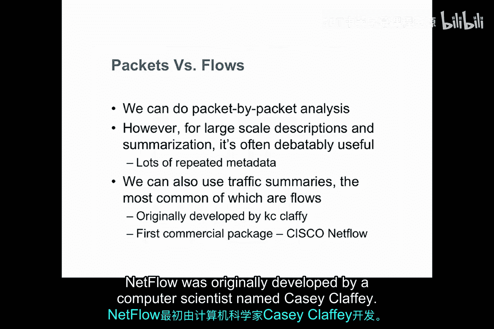

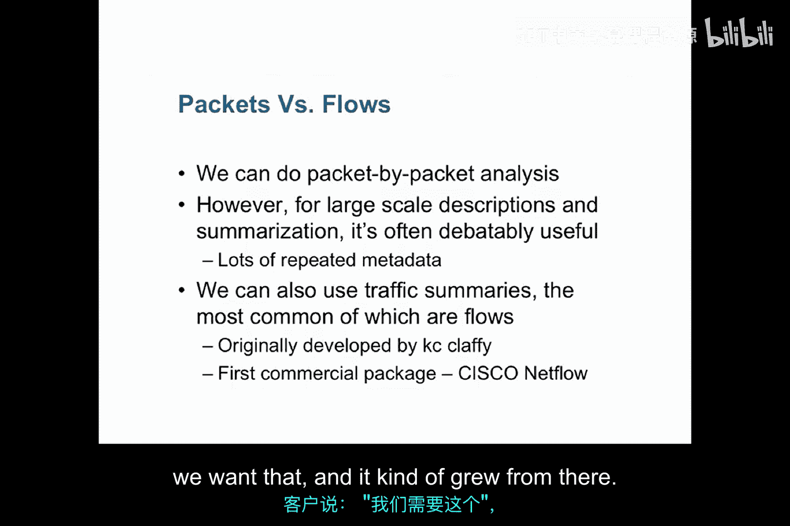

That。What are flows？A flow is a set of packets which are closely related in time。

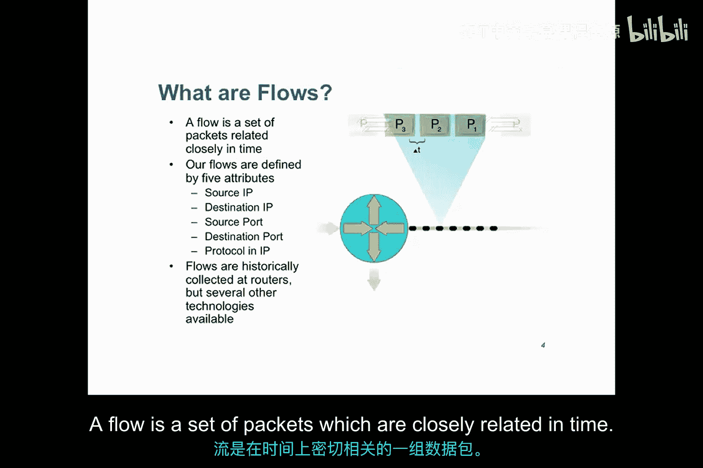

The original topic of Caey Claffy's dissertation was a very specific question， which is。

 if you take a look at two identically dressed packets。

 how likely are they to be part of the same TCP session if they are within K seconds of each other Now recall TCP depends on endpoint reassembly。

 you use the sequence numbers to reconstructt the order of packets in a TCP session but if you see you know this is extremely expensive to figure out you can't you need enormous computational resources to reassemble sessions without the away from the endpoint。

 but you can make a good guess as to whether or not packets are related in the same session by using by simply looking at addressing information So flows are defined by what we normally call the five tuple tuple in case you haven't heard the term and while is a CSs theoretical term meaning bunch of things。

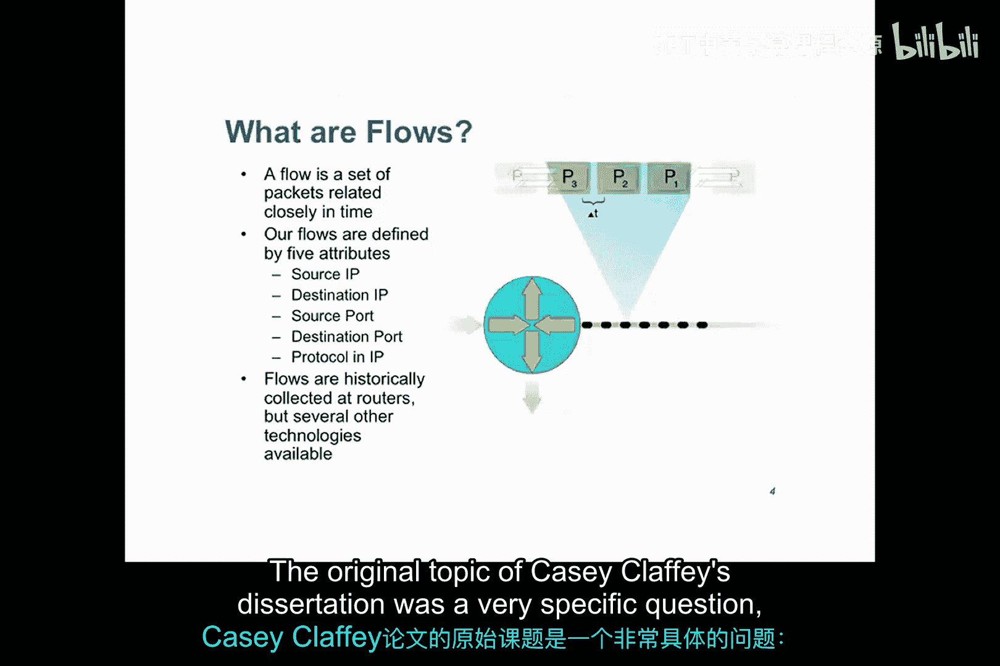

Now the five2 flow are the source of destination IP the source of destination port and the protocol now you might notice automatically that by talking about ports we're also limiting ourselves to TCP and UDP this is。

We're in the strictest philosophical sense。True。But Cisco is a company and engineers。

 so they're not a company's theoretical purists。So they're completely happy to group together EG ESP or ICMP or whatever packets where the bite offsets that indicate source of destination port are the same they're happy to group that into a flow too even if its relationship to a flow is teneduous at best all of that said the original goal of a flow was to reconstruct a TCP session and for that purposes ports and ports and addresses very good source you don't see the same port used over and over again you see people you see the stack move on to new ports now。

Flos are historically collected at routers， originally when Cisco implemented Neflow。

 it was a debugging tool for their routers was actually being used to more efficiently move traffic within the router。

 not intended to report anything else。 Other companies， for example， Juniper will sell you。

A pick which will let you do net flow reporting and there are other technologies available that we'll talk about later Now flow is timing based。

 What this means is if I have a sequence of packets packets available and those packets all occur within a timeout。

 which we call the active timeout they get grouped into a flow and a flow is in comparison to packets which happen in instant so you have packet happening exactly this time flows happen over a range of time they have a duration and starting in is a bit iffy if I have packets with a different addressing then they will be then they will be associated with different flows Now the key thing about flows is five packets that are closely related in you have the same addressing。

 but they're not closely related in time， they will get broken up into subsidiary flows This is particularly an issue with longlived sessions in SSH or tellnet。

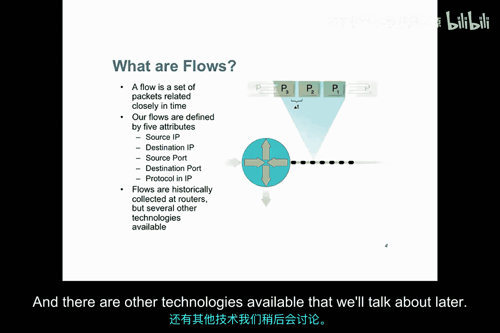

If you've ever used SSH Tement you know you can set up a session and then you can go off。

 you can play a game of Gaagher， you can have a midlife crisis。

 whatever and come back and youll find the session is still running this is done for the use of what's called a keep a life packet every five minutes or so they exchange a pair of packets simply to indicate yeah I'm still here please keep the connection open long livedved sessions and flow will rapidly turn into multiple flows mostly consisting of those keep lives。

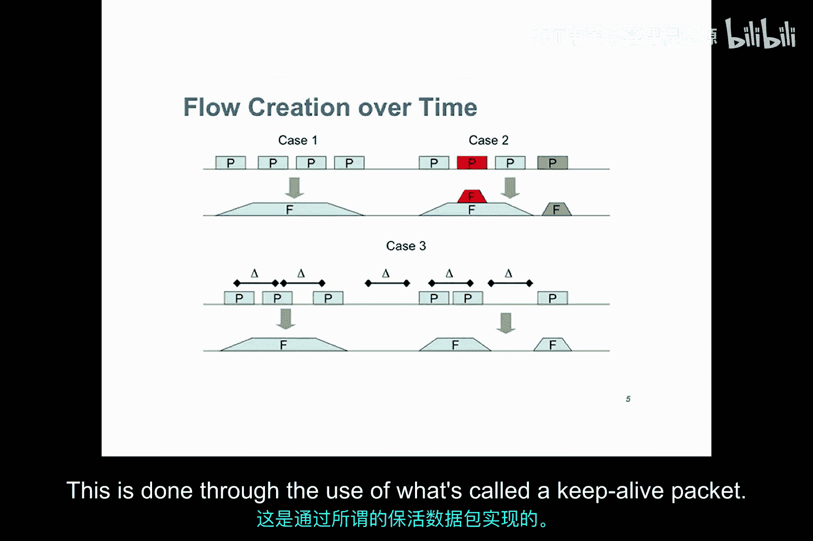

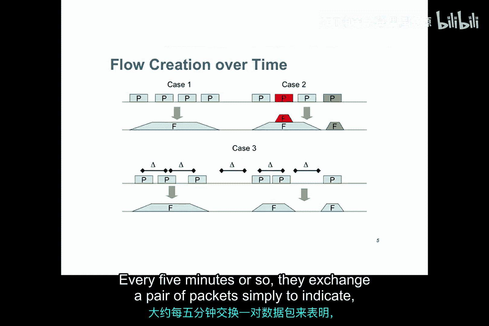

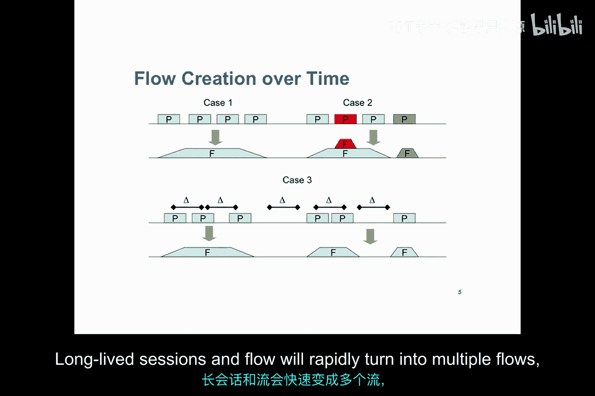

So why flows？Okay flows as I said， are yes， they're a guess which is intended for approximating TCP sessions because TCP make up most of what we care about。

 it is incredibly expensive to try to reassemble the sessions and to be frank。

 there's things actually we can never be sure of with that flag combinations， for example。Flow is。

 as the story goes a good enough approximation， it is intended for statistical analysis， for example。

 to do traffic analysis it's intended for billing， things like that。

 we can use it for security as well。

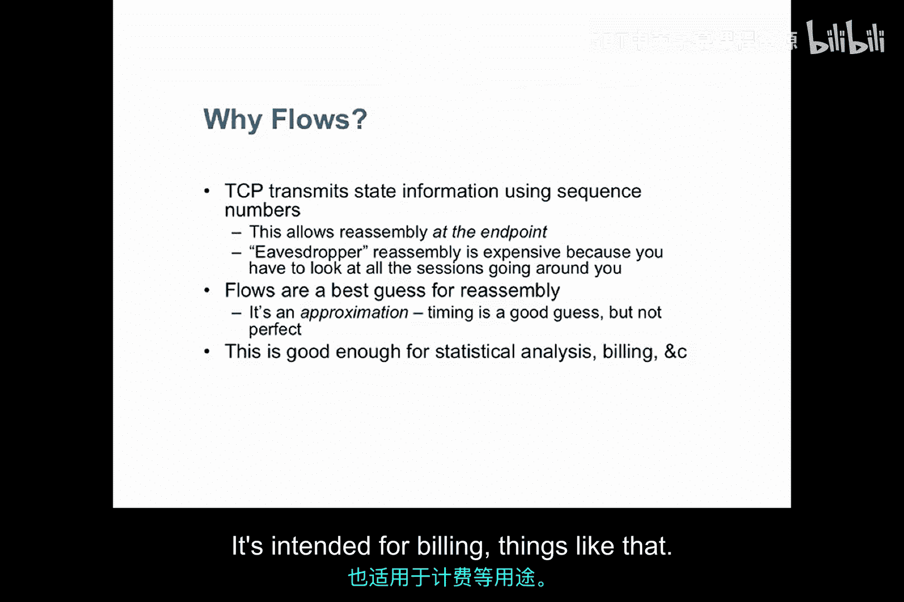

Now what's flow record look like okay this is a flow record as recorded by silkk。

 which is the toolkit that you will be by the end of this course discussedly familiar with flow record consists of at least these fields different companies will generate different types of flow records which will have different field combinations but the five highlighted fields will always be there because that's the five tuple the next set of fields to note are packets and bytes that summary so the number of packets is the number of flows that the number of packets that had the same addressing the number of bytes is the sum of the size of the packets now a net flow this is going to be layered three information so this means that an IP flow for example is going to have a minimum size of 40 bytes per packet sorry a TCP flow is going to have minimum size of 40 bytes per packet。

 a UDP flow 28 bytes per packet。Because you're going to carry along the IP header information Okay the flags is an ore of the TCP flags now this field may not actually make any sense no more than source border destination port would because you may be looking at a completely different protocol start time and end time where the times of the first and last observed packets so they are observational values and then the duration is simply the difference between the two。

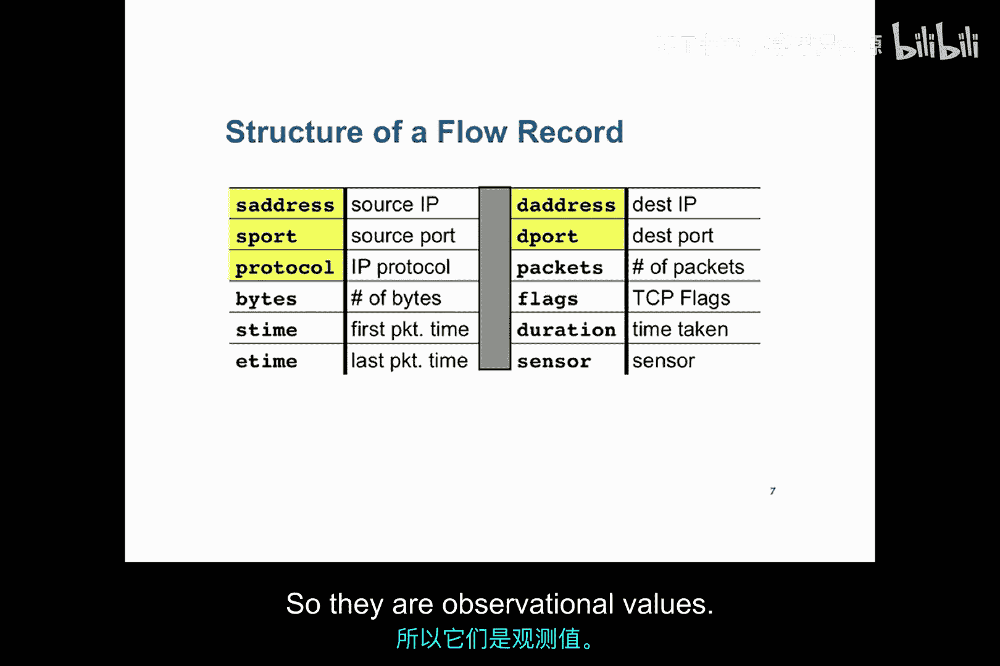

Okay。Now， why use flows， why not just do complete traffic dumps because complete traffic dumps are fantastically expensive。

Okay， and it's not just a question of saving the data， okay。

 if you're working on a network and you're working on a very large network。

 you have to move that data around， do you want to build two networks where one network is simply recording and transporting all of the information seen on your first network if you want to go to your CEO and tell them that。

I I applaud your courage and look forward to seeing what your next job will be Okay。

 netflow is a compact representation of traffic it gets basically multi megabyte sessions down to 22 bytes the other thing is that it's a big bang for the buck if you don't know what you're looking for you have no idea what you're looking for the values recorded in flow are the things to grab if you don't know and you have limited space Okay。

 the alternative is to do some kind of signature matching but then you're only going to find out whether or not you see the signature the signature is going to be a very small domain。

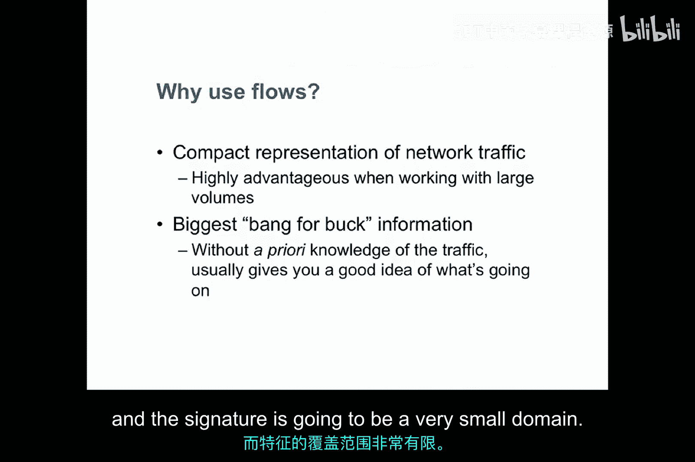

So。In conclusion， keep in mind， Neflow is a compact I'm going to emphasize this over and over and over again when we talk about Neflow。

 Neflow is a compact summary of interactions。 It is also undirectional meaning that what you get if you do a TCP session。

 for example， you'll have two flows， one from server to client。

 one from client to server Now quite frankly， the world of IP that makes a lot of sense because guess what Is unitdirectional Okay flowlow does not contain payload information。

 This is the thing that drives everyone crazy about flow flowlow summarizes information。

 it can't contain header data Okay and this leads to the idea that Neflow is the biggest bang for the buck。

 don't know what you're looking for， it's a good star。

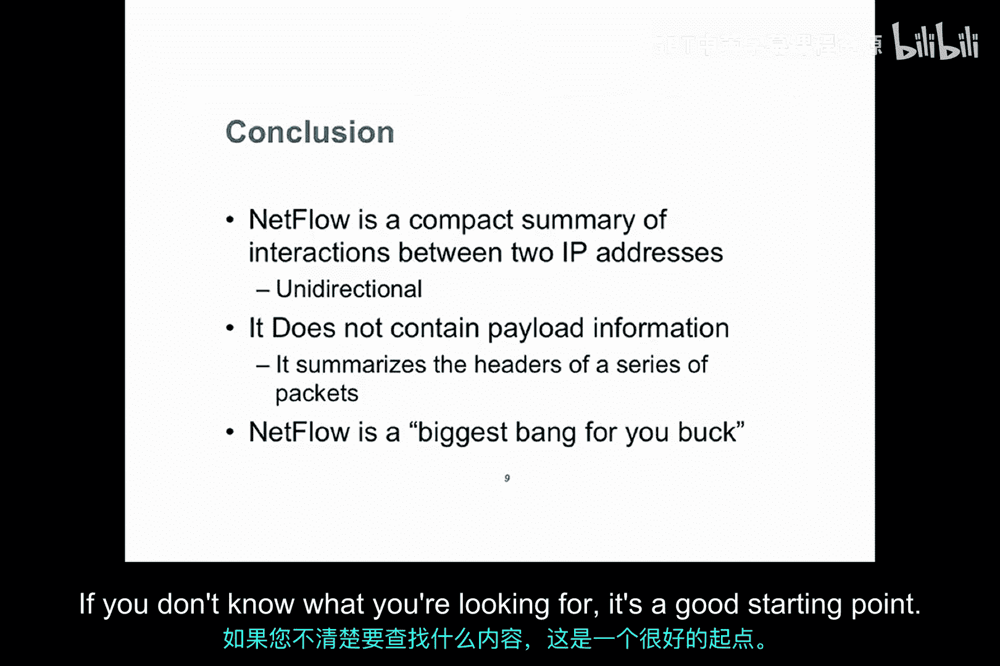