# 约翰霍普金斯大学《信息保障分析｜Information Assurance Analysis》中英字幕 p11 10_SILK网络分析工具套件.zh_en -BV1Qz8EzYENX_p11-

The applies That Collins since the 69574 wounded information assurance analysis。

 tonight's moduled rule is moduledule 4。3。Silk， tool suite。

the goal of this module is to give you a run through of the silkk tools family。

 There are a variety of tools inside silk， but the core concepts that I want you to come away with are the basic family of tools is R W filter and RW cut。

 and then the more sophisticated set and bag tools。

 The other thing is to talk a bit about the flow of silk operations to explain how you work with this tool set。

 So what's the silk tool set， Sil is short for system for Internet level knowledge。

 It was developed at Carnegie Mellon University around 2002 to 2004 to analyze a very very large set of Neflow data Silk is still maintained by the Cert of Carnegie Mellon。

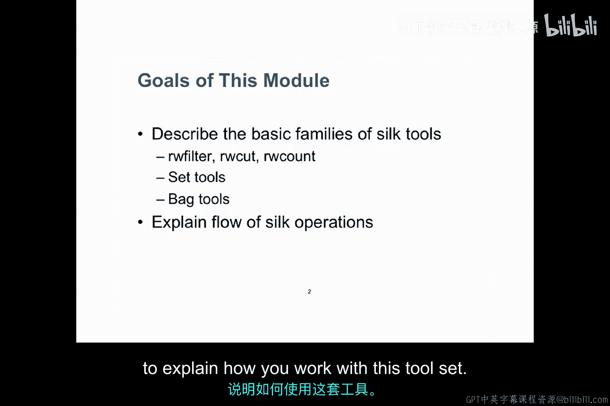

It' a very large software project for the organization。

 the SCI normally doesn't actually do software， so that should gives you an idea of how important it is that they're still maintaining us。

Silk is a modular set of analysis tools， and on the other hand it's also notoriously unfriendly。

 it's very unique see。So what we're going to cover as a result is some of the basic usage of the tool set to give you a feel for how do you answer questions。

 things like that。

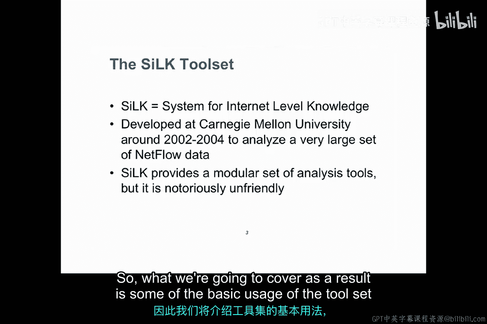

The command I have here， RW Silter proto equals 6 with a file name where that all flow file followed by the dash pass equal standard out。

 And then that is piped to RW cut。 This is the most basic st command is about as simple as you can get Okay The important thing I want you to note here。

 the use of pipes。 So there's an RW silter command and an R W cut command that they're joined by piping。

 and I want you to notice the use of this pass business here allows pass equal standard out。

 So what this is really doing is it say read a bunch of files and print the output。 The output。

 though， is binary and the only way to actually read it the only way for people to read it use R W cut。

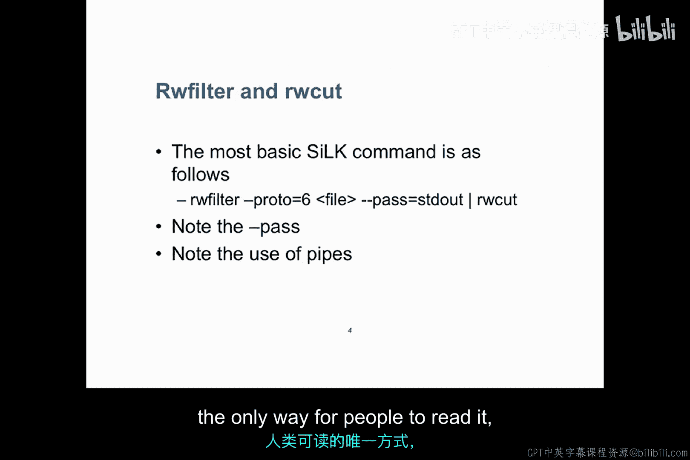

Now， this is very much what we might call the classic Unix mindset。

 the idea that you would have small tools other than stitched together with pipes on the hand silks tools can get pretty big that said silk is still tied to the idea of modular tools run through pipe。

And some commands， particularly RW filter， can use multiple pipes simultaneously。

 so RW filter has a pass output and a fail output， and you can set traffic to go in both directions and then run additional processes after there。

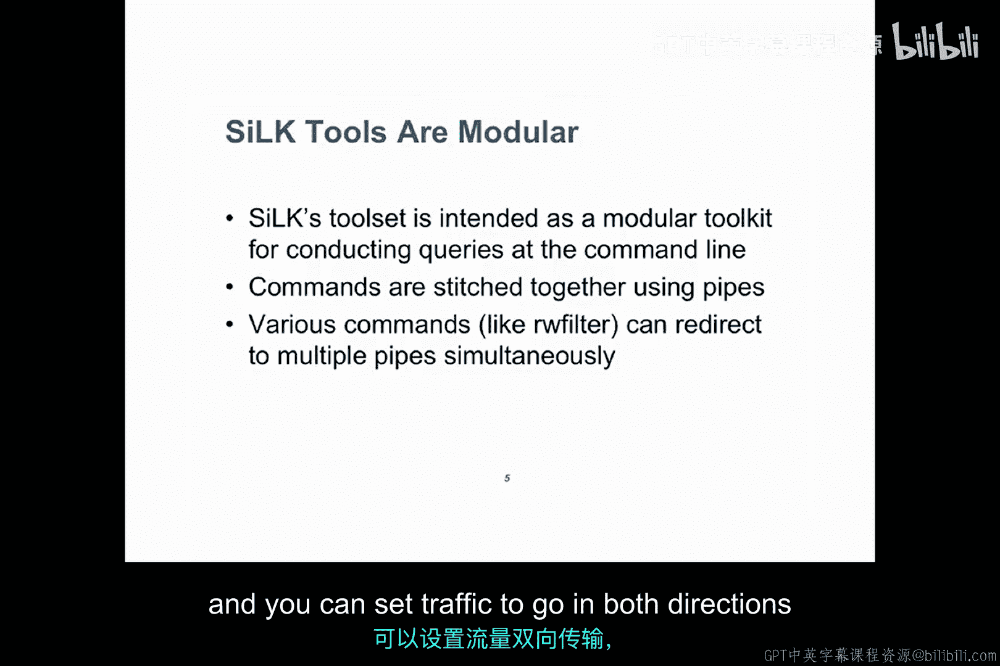

The fundamental tool is RW filter。What R W filter does is it lets you ethnic manline specify a filter。

 which is a set of tests for flow's attributes， and then it allows you to specify with those attributes。

 whether or not a flow passes or fails。 You can then send them to a pass pipe or fail pipe for further processing。

 You could， in fact， run R W filter after R W filter。

 You tend to do a lot when you're working with things like TCP flags kept。If you do that。

Instead of using a file， you can specify an input pipe to read that data。

Now our filter generally the filters are fairly easy。

 most filters accept either dashed ranges or you can use dashes and commas。

 so for example you'll notice this dash dash proto equals 6 comma 170 Proto is the protocol field in the flow。

 so6 comm 17 means that the filter passes if the protocol is 6 or 17t if I was feeling generous instead of using that comma。

 I could have used a dash at which point any protocol from 6 opune including 17 would have passed the filter。

The other thing to note， the next form a port equals 80 a port is8 port。

 so as remember have a source port and a destination port。

 though there's an S port folder which you can see following this， a Dport tourdit， and then a port。

 which is both of them。The way that RW filtering commands are constructed at the commanded line is that the predicates are an and。

 so a port equals  AD0 proto equals 6 passes if there's a port 80 and the protocol equals 6 to handle implicit or conditions。

 we've got things like a port of the language group together。

 source equals 80 or destination equals 80。then you see this S time time expression in is unfortunately very sloty。

 One of the things to note here is S。 That is saying the timing of the flow must be within this rate。

 It does not say that a flow that happens to overlap that value will pass。 if， for example。

 the flow going from031509 to001 to0901106 that would fail because the S time is not within that right。

 Now， R W cut is your basic exploratory tool。 It just takes R W filter output and makes it readable time as a result R W cut as much per de forranic options。

 you can specify the delimiter。 You can specify ICP type and code。

 if you specify this and ICP messages will predict their type and code rather than predict out as a quar value。

 and numberre， which limits the number of records。 although it's also fairly savvy about more。

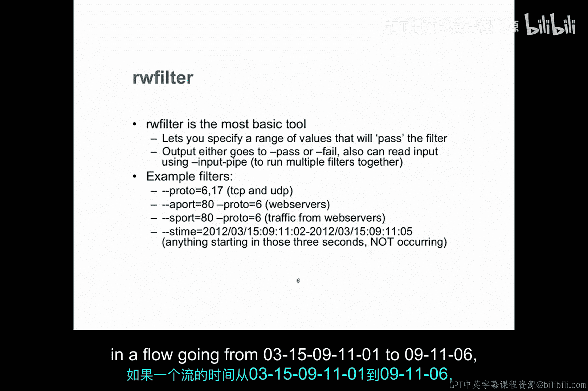

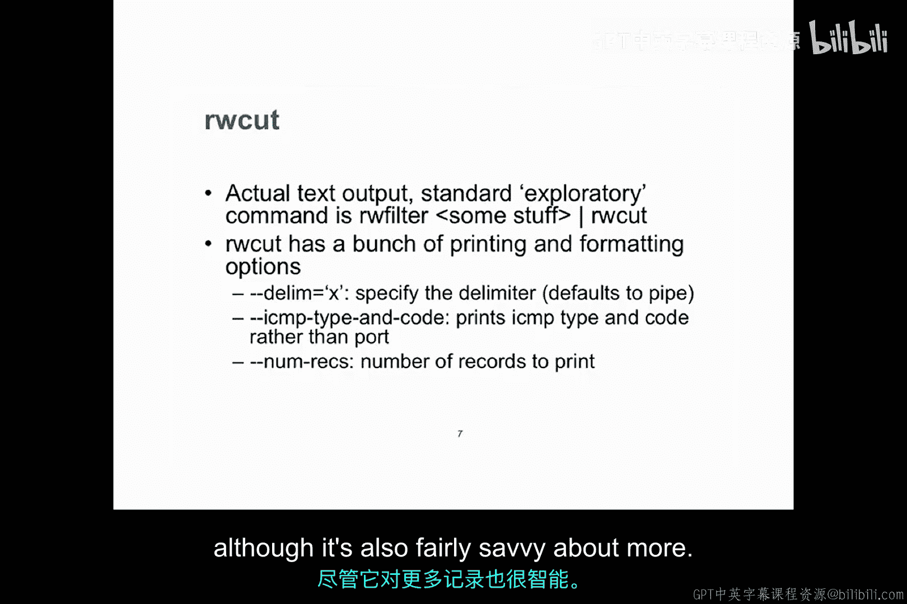

Now。With all that in mind， let's talk a bit about how you actually analyze files in silk。

 because that explains a bit of the tools。The general idea with silk is that you get a flow file generated by some source。

 and then you run an RW filter on to generate a new file。

 and you progressively run through these sequence of new files to progressively identify what you're looking for。

 So， for example， I might run RW filter proto equalals 6 and get all the TCP records and I would run RW cut。

 I would look through them。 and I might go oh， this is interesting with this IP address。

 I would then filter the IP address on that file to get all of the traffic that was those protocol 6 and from that I address。

 So the idea is that you do these progressively refined searches with smaller and smaller files And one of the things you can file do for example。

 with RW file info is get a history of the queries that were used to construct that file。Okay。

 when you get a final file， then you tools that provide ASCI output to generate a report。

 cutlor count， things like that。

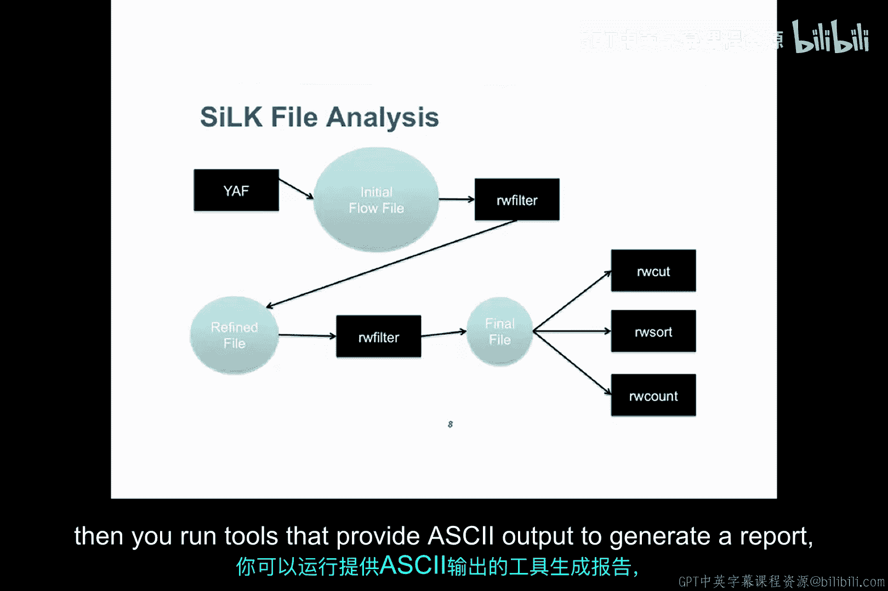

Now。The three major output tools are count unique stas。

 count produces output suitable for time series， in particular it was originally designed to pretty much plug directly into Gnu plot。

Unique will provide an dissociative already what this means is you specify a set of fields like protocol and it will group all the values there。

 so for example， if you do RW unique on protocol， it will give you the number of by number of packets。

 number of flows that occurred for each protocol of the TCP that occurred for each protocol in that data set RW stats is very useful for producing top endless list。

Now， I think to keep in mind when you look at all this stuff。

 Sil was designed to do with very large data sets。 and one of the things it does as a result。

 it has some highly optimized algorithms。 It will not， for example。

 sort unless it has to it least heaps， which are of more memory expensive。

 but much more time efficient， An utterly least sta example uses heaps for that reason。

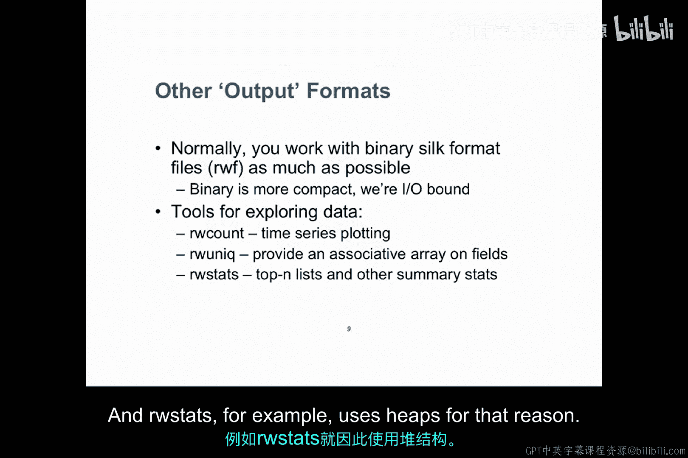

Now。That's basic。Bg standard silk， okay silkilt gets more interested when you start using sets and bags。

 A set is a binary representation of an arbitrary collection of IP addresses。

 It could be all the IP addresses in a particular slash at steam。

 It could be a list that you got hand。 It could be the results of another filtering task you did where these are the hosts that ended up talking to。

Seets are generated from files they can be generated either from flow files where you can say dump all the source IPs into a set or dump all the destination IPs into a set。

 or you can build them from text using our set built。Seets can then be manipulated。

 This set union is set intersect， so you can add or subtract elements to sets。

 But the important say is set R W filter as a sip set dip set in any set feel a predicate。

 which allows you to filter on the contents of an I set。

 You want to find out everything that talk to an I P set， filter with dash has set equals set set。

 and then you'll find out everything to talk to the set。

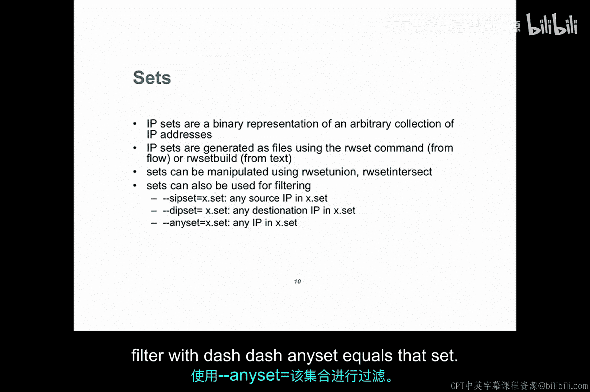

Now， comparing to sets or bags， bags are sets with stuffs， meaning that a bag。

Has an I address and that it has associated value。 You can generate them automatically to things like the number of bytes per IP address or you can just。

 but you don't have to I read a bag really is just a way to mark up an IP address and you grade them from flow files and grade them from sets and that you can manipulate them using bag or tool。

 which is extremely powerful SwissarV knife you can add。

 subtract or and all of that because who knows what type of encoding you want in your bag。

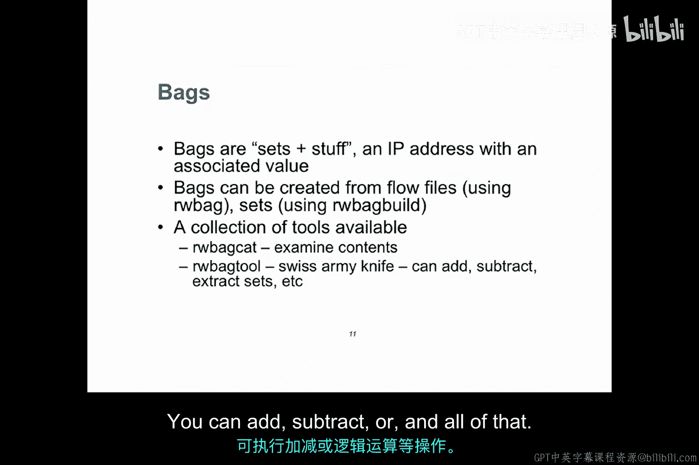

Now there's a couple of other tools to be aware of RWTt will let you gling together flow files RW file full let you redef files history and RWTck is the reverse RW cut It takes ASII input and generates a flow file output in silk provides access to a variety tools for analyzing flow files these tools are based around the idea of plugging together commands using pipes At the end of this you can get visualizations using cut count things like that。

 but before then you'll be piping together a lot of binary commands。

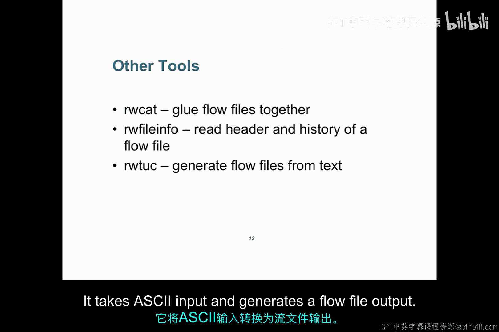

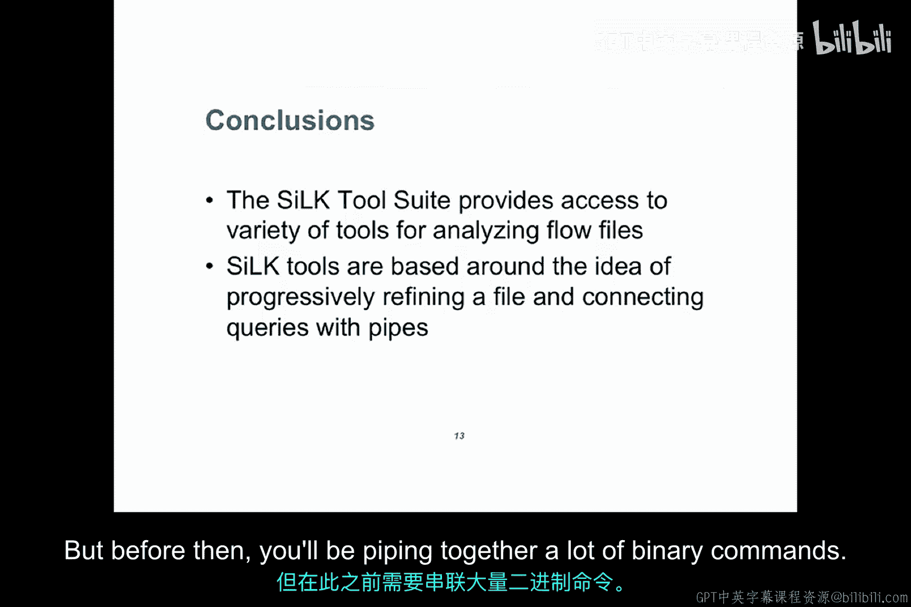