# 约翰霍普金斯大学《信息保障分析｜Information Assurance Analysis》中英字幕 p12 11_流量记录解析.zh_en -BV1Qz8EzYENX_p12-

One information assurance analysis and this is module 4。2。

 which is going to cover the collection and disposition of net flow records with all of this module is to describe the process by which we collect flow records and the attributes of the records。

 The collection process is very important with flow because it is possible to generate flow data from multiple different vantage points based on the type of sensor you're using which in comparison to everything else is actually fairly extensive we can do this with we can do this with hosts of the network。

 we can do this with dedicated servers and we can do this for routers each of these collectors provides us with different challenges or different advantages and disadvantages。

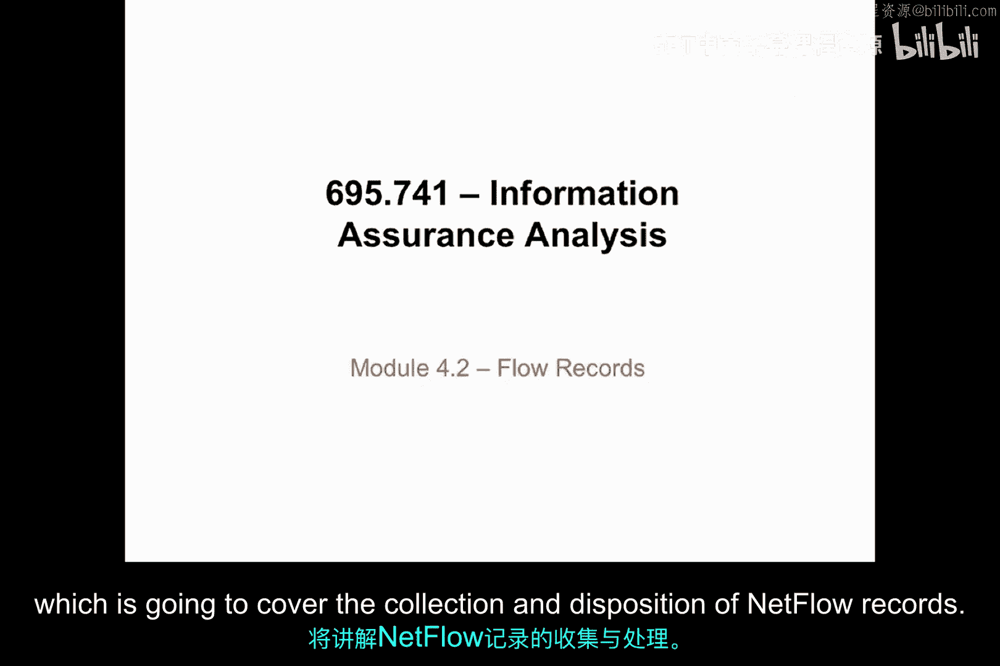

The other thing we're going to do is we're going to look at。

 as I said flow record composition The reason this is important is because I account't stress this enough when you're using a flow using summary which loses data。

 it is important to understand what type of data you loo now。

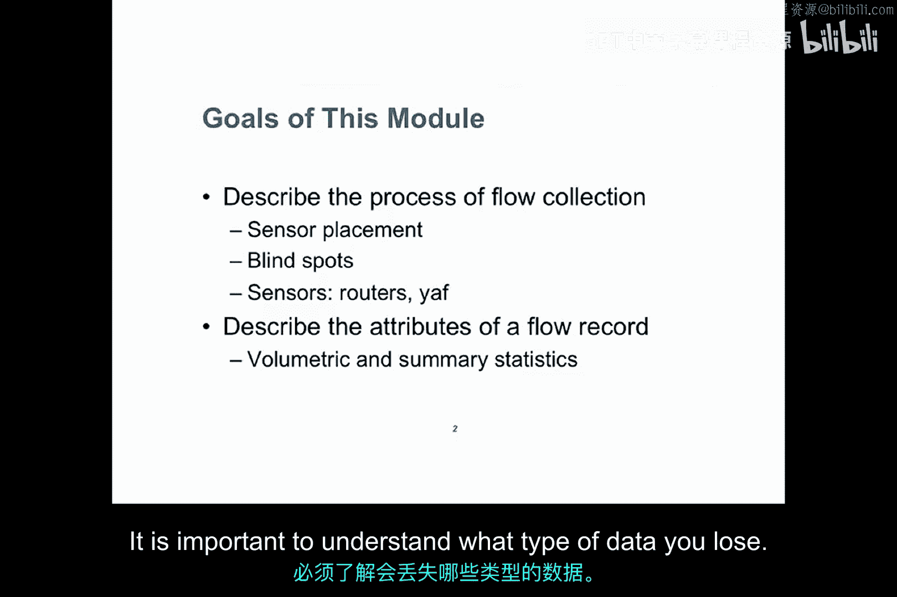

Let's first talk about flow construction。There are a variety of ways to create flow record。

 There are enterprise tools。 There are open source tools。

 There are embedded features and routers to do this。

 Each of these tools provides different capabilities。

 and the two major capabilities tend to be broken into families I call vantage。

 which are a function of the position of the sensor and compositionposition。

 compositionposition needs additional features added by the sensor。

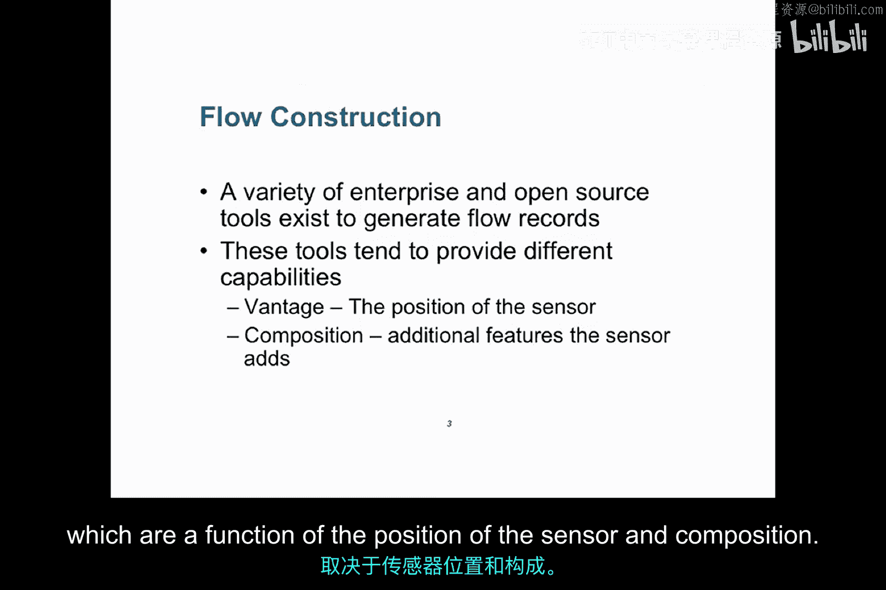

Now， while we talk about Neflow， we generally mean what we call netflow V5。

 This has been a standard reporting feature within Cisco i for years。 Now。

 for those of you in familiar with Cisco I， this is not your iPhone operating system。

 I is the operating system used by Cisco routers。 It tends to be a very flexible standard。

 There tend to be some fairly substantial changes between versions in particular with Neflow。

The latest stable release is the I 12。4 netflow configuration guide。 Go go it。

 Go take a look through it so you cant understand how flow is collected and generated it。 Now， Cisco。

 what he talks about netflow is talking about net flow at the router， okay。

Routers are configured to create raw net flow files and though there's a collection infrastructure which aggregates them and produces higher level reports。

 The reason for the segregation is because netflow is primarily a billing tool。

 It was not intended as a security tool。

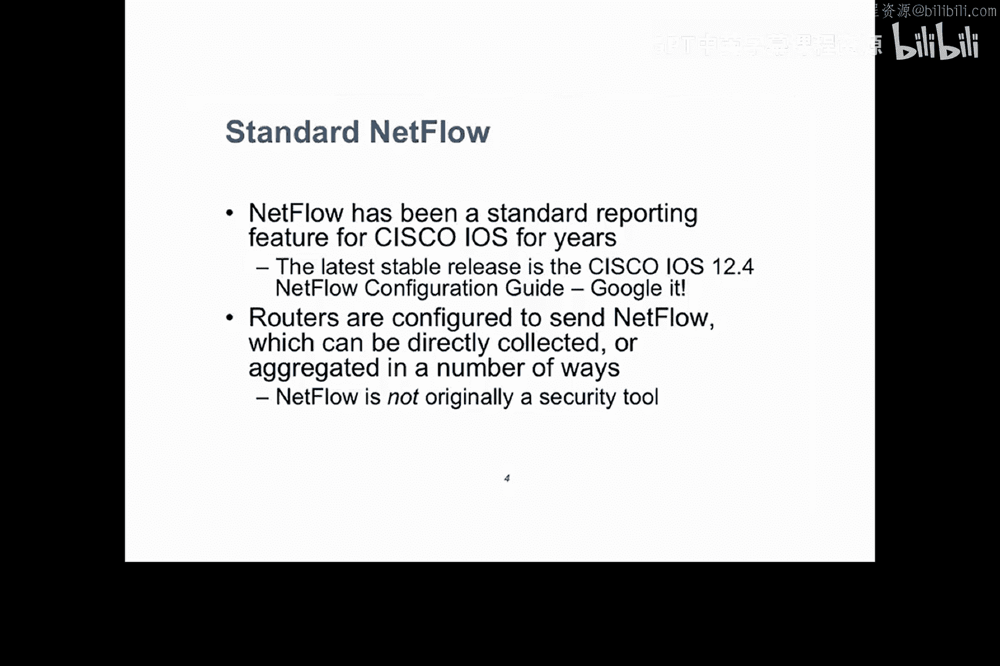

And ahead。Now。Well， we talk about Neflow。We generally talk about two versions。

Net flow V5 is generic net flow。 Most proprietary net flow implementations are net flow V5 was stuff。

Stuffed varies by the implementation， but is usually annotation， expansion， payload。

 sampling things like Santaflows do not contain。Netflow V9 is the configurable Ne flow standard that was developed by Cispo several years ago Now when I say configurable what I mean is that in version 9。

 which is a very XML heavy specification for netflow。

 NeF version 9 allows you to specify what fields you're going to report。Now。

 the IETF subversion of Ne flow Vine is IP fixed。Okay。

 and that is theum that is it is it is Netflixflow V9。

 it's just the IDTF version of it the open accessible to everyone。

 it's the standard whereas Netflixflow V9， that's Cisco's product now。

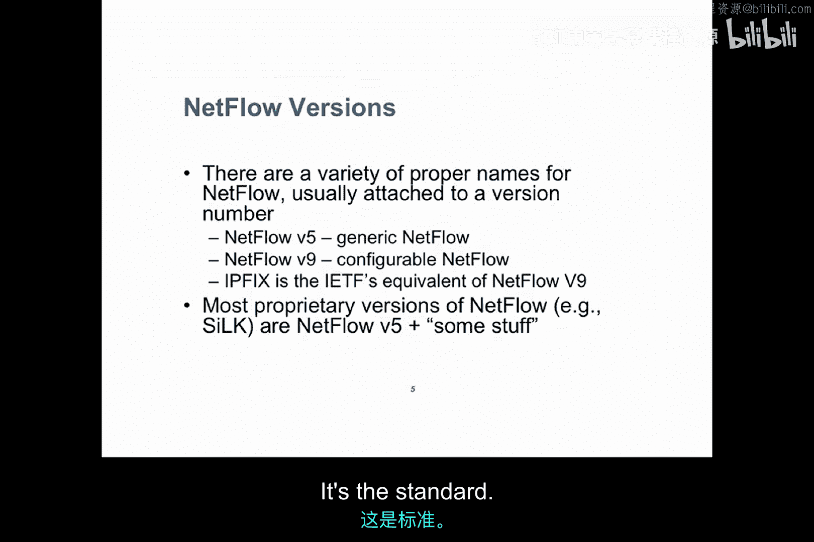

For the purposes of collection， the tool that I want you to be familiar with is yeah。

 you'll notice the URL at the beginning， we in the famous academic world refer to this kind of thing as a hint。

 you're going to want to take a look at that。You're going to want to know how it works。

 You're going to want to know how to install it set it up。 Okay， Yes。

 was the ITF's reference implementation of I P fix when the ITF produces a standard。

 It requires a reference implementation for that standard。 Yth was that was that representation。

 It's now an open source flow generation tool。 And from my experience at this point。

 it's become the default for V 9 flows。 Okay， you have to take Pcap or a camera off as an interface directly。

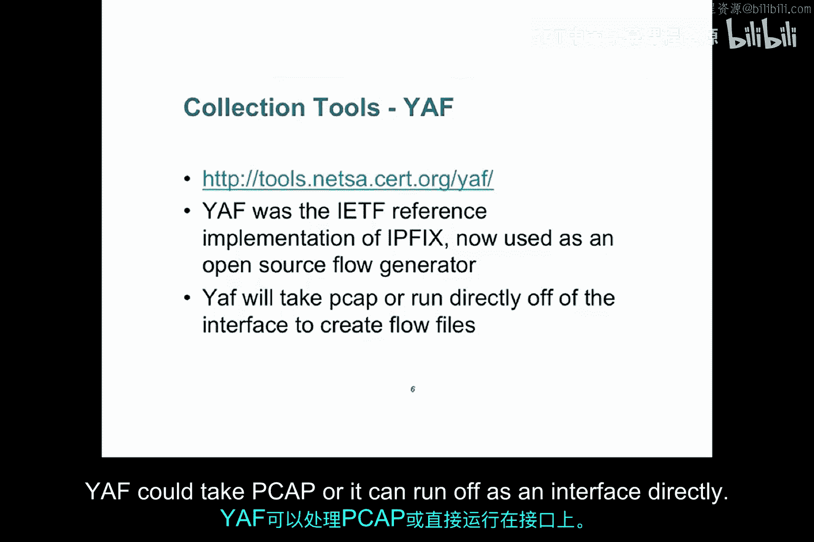

Now there are other tools out there， the earliest ones are the OSU flow tools set， there's NFD。

 which is their flow collection tool， and then there are a variety of proprietary tools， Q radar。

 for example， produced form。Okay，The other thing to keep in mind is that flow as originally conceived of is a router feature。

 so flow is available on most routers。

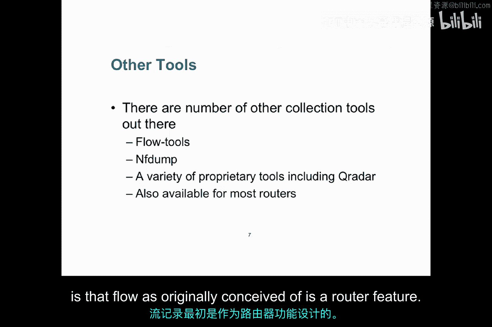

Now let's talk about what the records look like and why they look the way they do。Ting keep in mind。

 netflow is a summary in comparison to log files or TCP dump。 is's going to be some ambiguity。

 I don't have payload。 You don't have payload。 You're not going to look at payload。

 Information is lost when you constructstruct the flow。 Therefore。

 there's a lot of inference in net flow analysis。 Re this structure that we showed you previously as net flow。

 This is， in fact， about half of it。 If you take a look at the silkflow definition。

 you'll find that there are these additional fields。

 and you'll find that these is not even a complete list of the fields。 Okay。

 there are additional fields that are available， but these are the ones I felt were the most important to give you a representative understanding of the additional types of fields we can glue in。

 and you'll find that many flow records will have some things like。

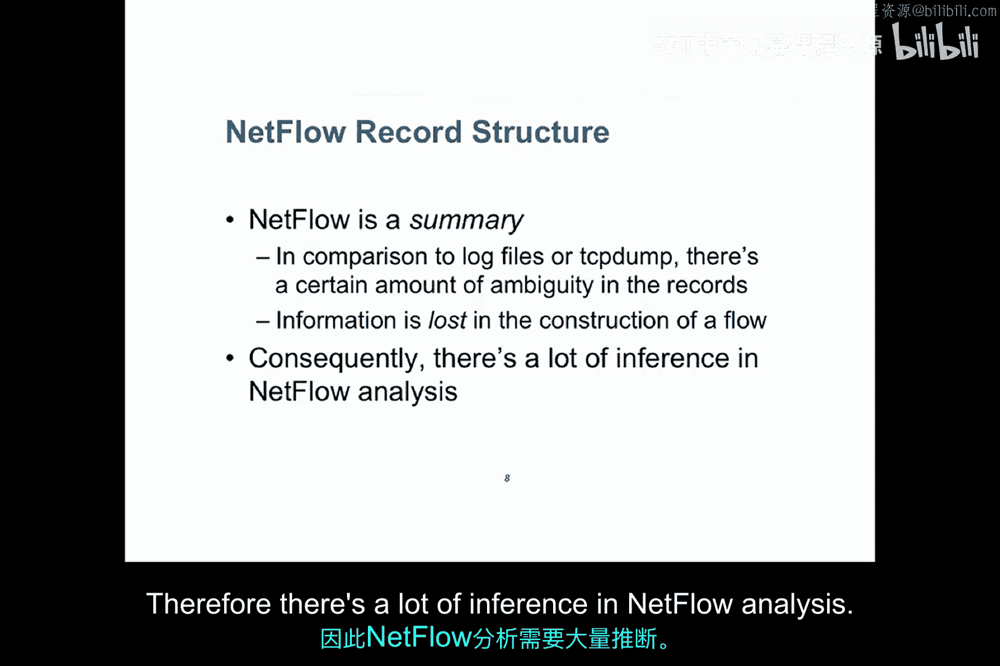

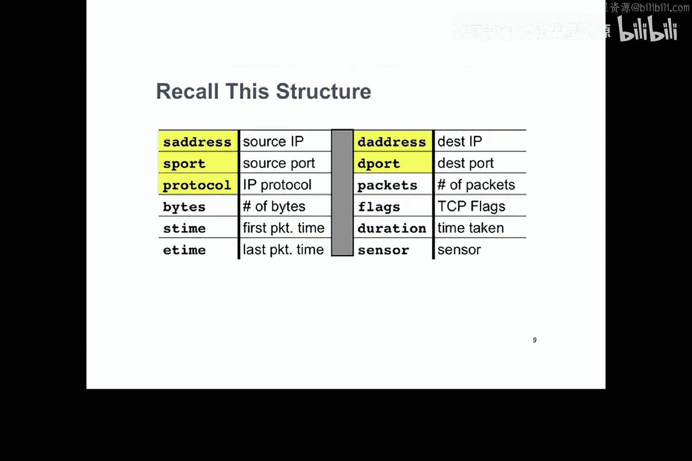

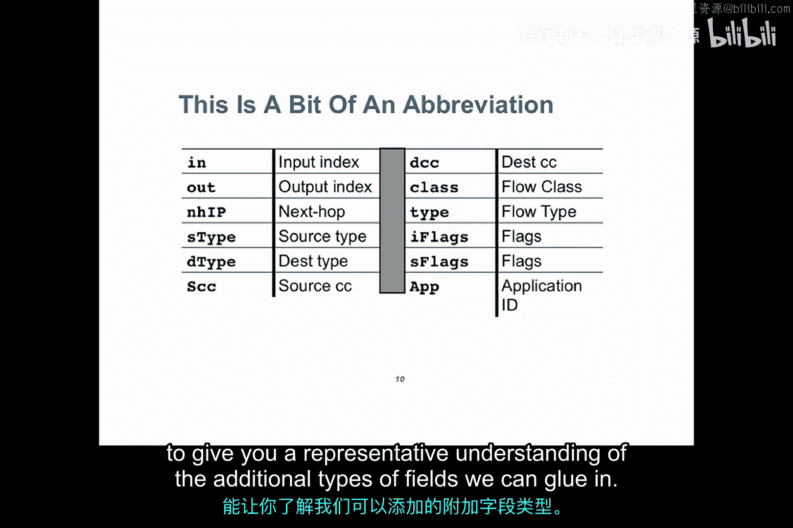

The reason the things note about this is first off。

 there are several classes to these fields as you go back to the previous slide。

 which I will do for you right now。

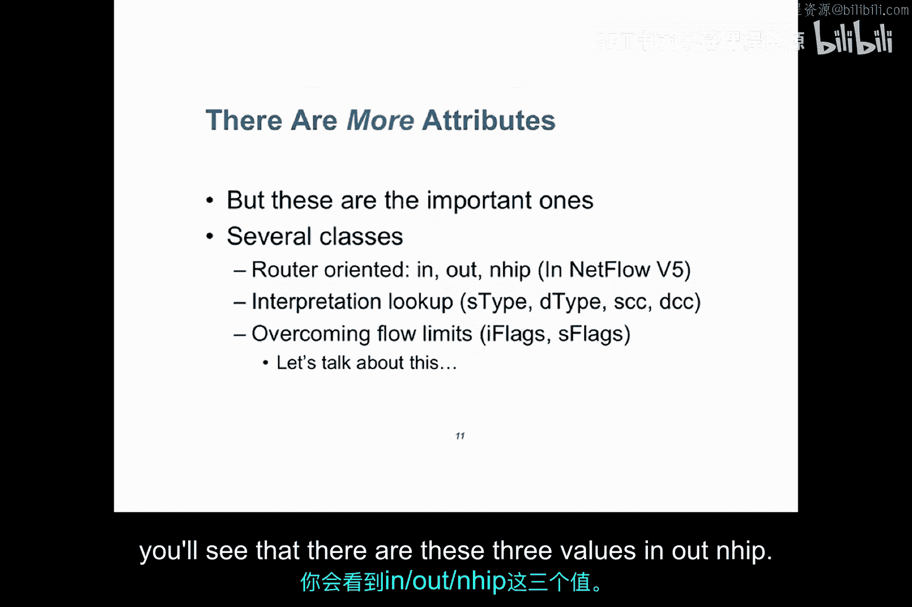

You will see that there are these three values in out NHIP。

These are router attributes this is actually telling you how the traffic is moving through the router this is actually in net flow Z size it's just it wasn't relevant to security and so we didn't talk about it。

Then we've got annotative fields， these things like source type destination。

 type source country code or destination country code these are fields that do not。

That are lookup tables，'re shorthand they're actually aliases to lookup tables using the IP addresses。

 so if you know the country code for an IP address， you will always see the same S value。

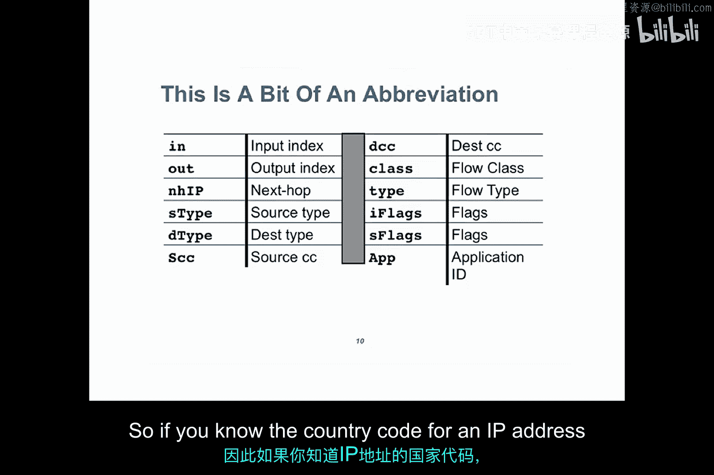

There's another category of fields in here， the initial flags and the Sim flags， which are。

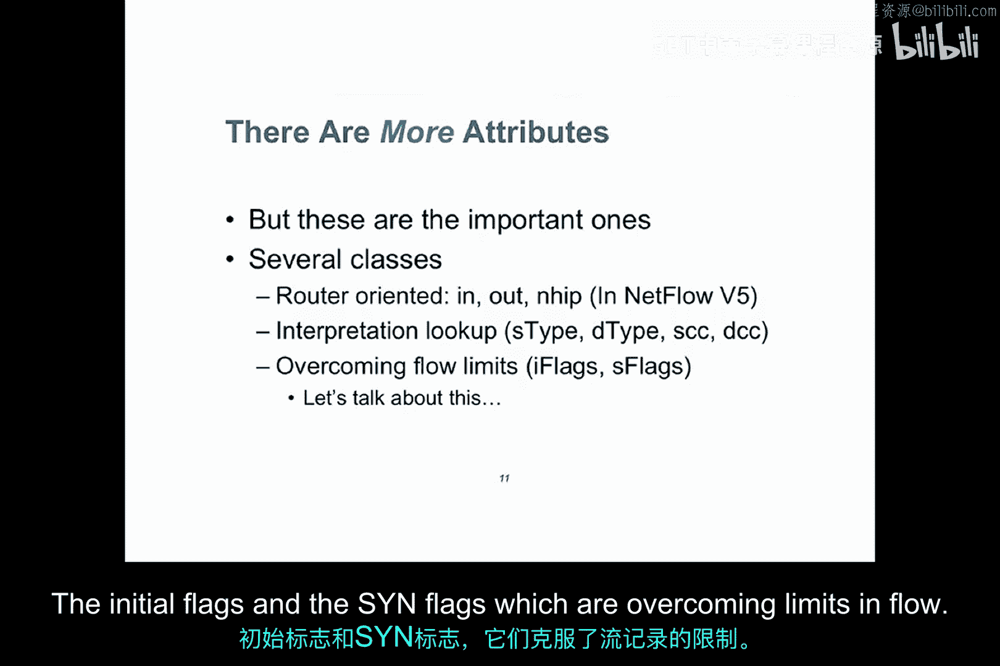

Overcoming limits int flow and what I mean by that。As we said。

 flows through traffic submarization this is normally a straightforward process。

 the number of packets of the flow becomes the packet field。

 the sum of the packet sizes for every flow that becomes the bytes field now by the way。

 the important thing to note here is that the bytes are actually at the IP level so TCP packet is always at least 40 bytes。

Flags are an oar。Of the flat。So that means that all flags tell you is whether or not a particular flag was raised。

10For certain TCP flags like act that is completely useless， Act is going to be raised。

So what silk did is in silk， we added initial and final flags to get the first and last packet。

 reasona to do that。 We want to see whether or not the first packet was a sin or a synap。

Because of the first packet， it's a sin。 that's the client。 If it's sin act， that's the server。

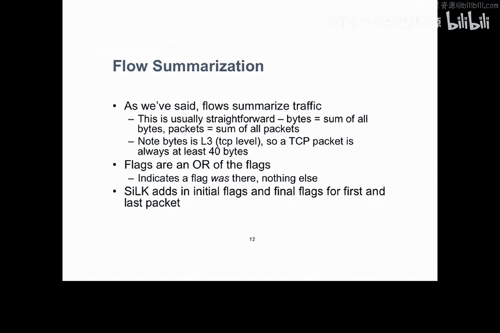

Now these annotative fields like a CCS type etc， are using lookup tables okay this accuracy is dependent on the table。

 the original tables accuracy， there are also fields like app which are actually created through deep packet and specship。

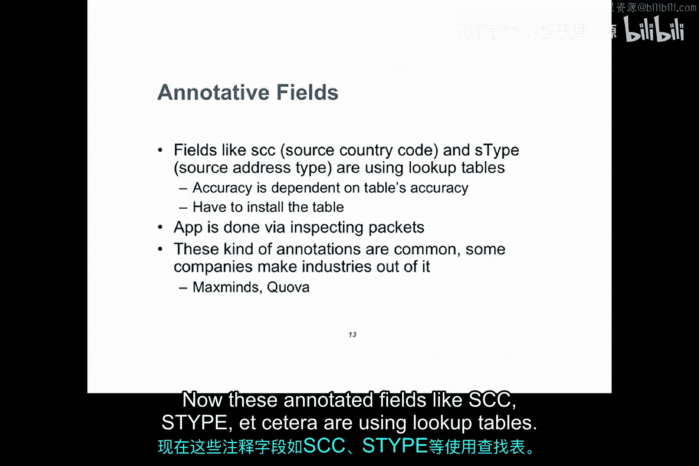

A lot of these annotations are fairly common and you can find that there are companies that make a business out of it。

 for example， max Mins and quas up are geolocation companies。

 they sell you tables of IP address to country code along with additional demographic information。

 and their business is making sure that these maps are accurate。

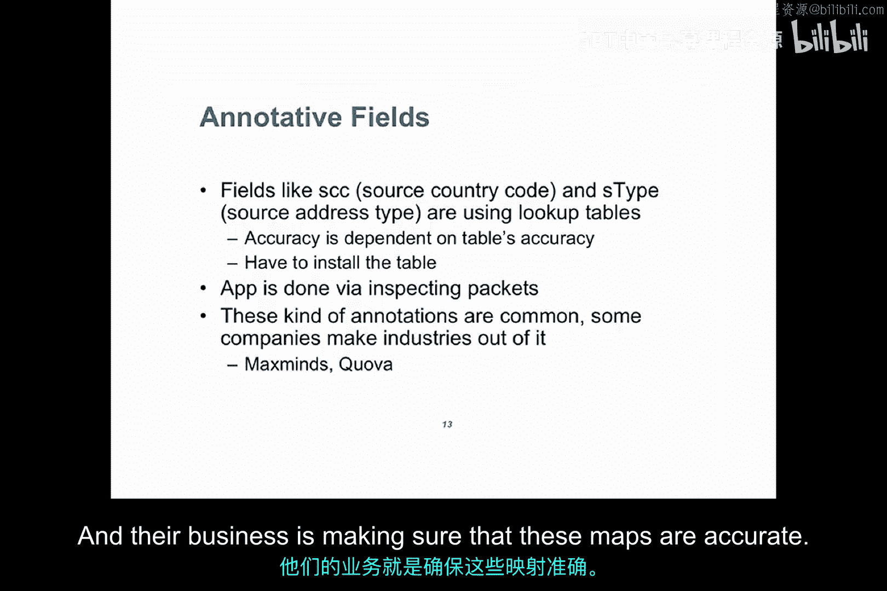

D。So that's， you know the structural issue， let's go back and talk a bit about blind spot when we collect information in flow。

 we got a point where we're getting the data and there's a couple of ways we can do this three major ways。

The first is you can physically tap into the wire。 This boxy thing over on the side is what's called a vampire tap。

 which pretty much does exactly what it sounds like。 It sticks its fangs into a cable。

 and that result can then be right off the collector。 He'll also run on the router。

 and that flow is a router process。The other thing you can do is you can run it in an enclave。

 you could have a host which is promiscuously running TCP dump watching all the traffic flow back and forth。

 okay？

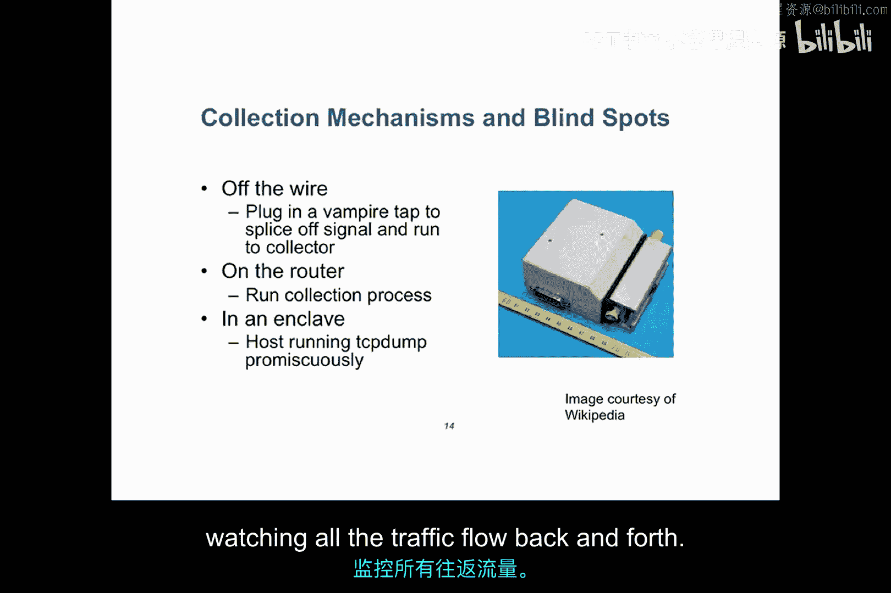

Each of these collection points has issues， so， for example， collecting on routers。

 the important thing to understand about collecting on routers is routers don't really want to report that flow a router's primary goal is to route traffic。

This means that netflow is the first thing to die when the router is stressed。

 it's a low priority process， and it's going to be relatively inflexible， it's not a new GPI。

 things like that that describes from the router's goal which just a shift traffic。On the other hand。

 routers have a huge scale event。 If you've done a router with 40 interfaces。

 you either click flow at the router or you set up 40 different collection processes on 40 different wires。

And看。Though in comparison to the software collectors are usually more flexible。

 some a system like Ya or Q radar R， and the reason for this they've got higher performance。

 they're able to do annotation， they can create a variety of different flow type records。

 On the other hand， they do exist outside the routing structure。

 which makes them very hard to manage。

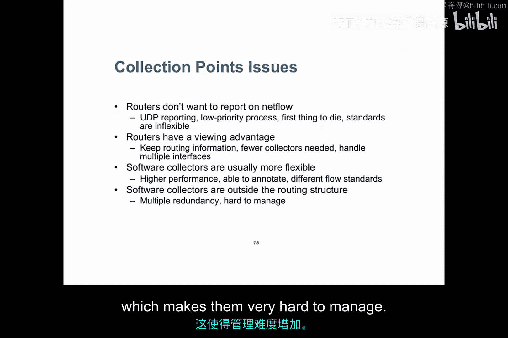

Now。The other thing we keep in mind is that you'll have this problemable of blindedness。

 traffic is to be seen to be reported。 For example。

 if I if I am on a network work with a hub and machinenet talk the machine B。

The router isn't going to see it。 That traffic was never routed。All right。

 so at least if you're running a tap， the traffic has to travel over the wire。

And when you get to multiple router interfaces， that's challenging。

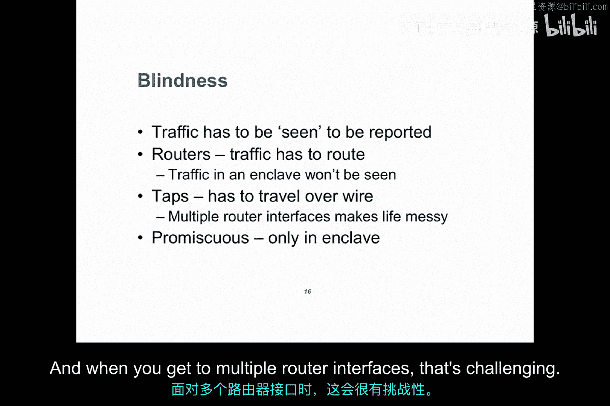

Promiscuous， you only get the communication in the enclave so in conclusion。

 there's a variety of tools you can use to generate netflow， one of those tools is yes。

You might want to look at yes， you do want to look at YaF。

Apart from that though the big T of minus is this flow is a summary。

 some values in that flow are just aggregates and other values lose information。

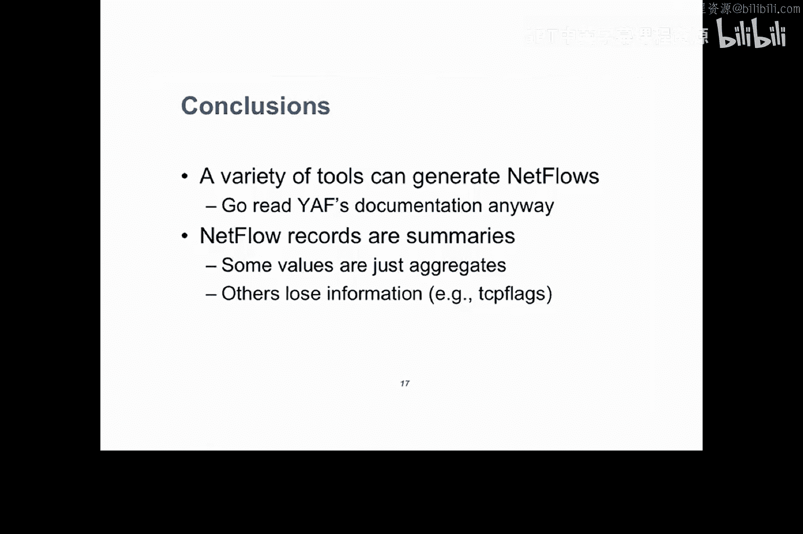