# 信息保障分析：4.2：流量记录收集与解析 📊

在本节课中，我们将要学习网络流量记录的收集与处理过程。我们将探讨流量记录的收集方式、其构成属性，以及不同收集方法的优缺点。理解这些内容对于有效利用流量数据进行安全分析至关重要。

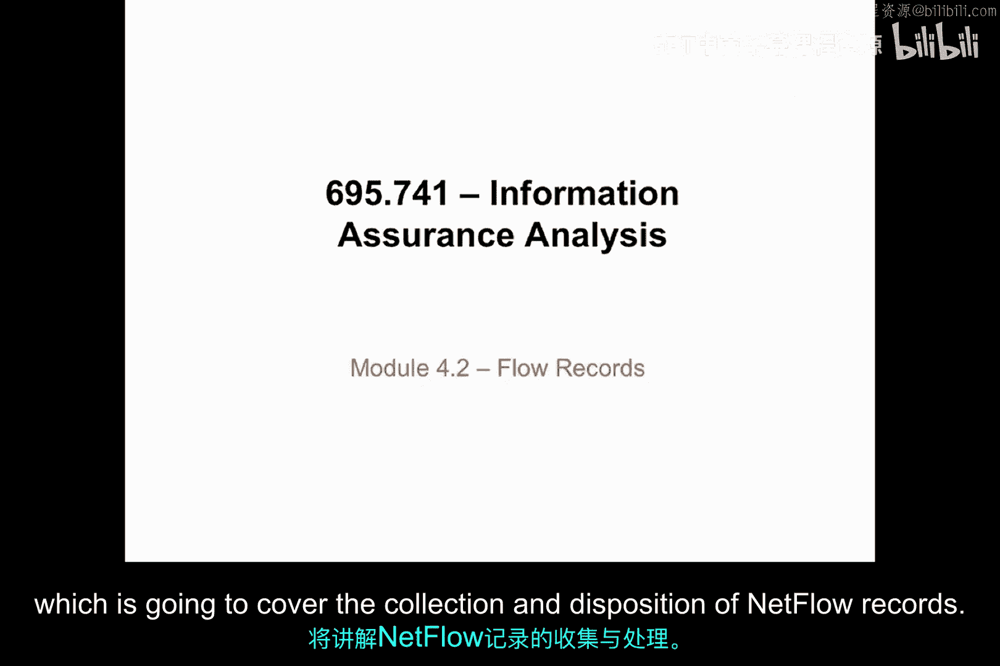

---

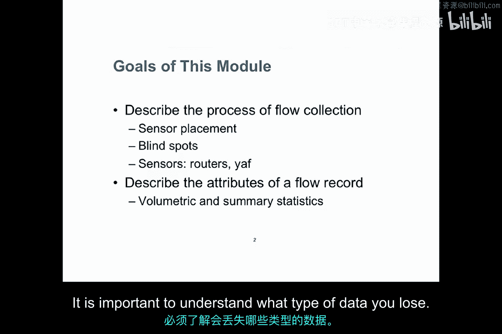

上一节我们介绍了流量分析的基本概念，本节中我们来看看流量记录的**构建方式**。

有多种方法可以创建流量记录。以下是主要的几种：
*   **企业级工具**：功能全面的商业解决方案。
*   **开源工具**：如YAF，提供了灵活且免费的选择。
*   **路由器内置功能**：例如Cisco IOS中的NetFlow功能。

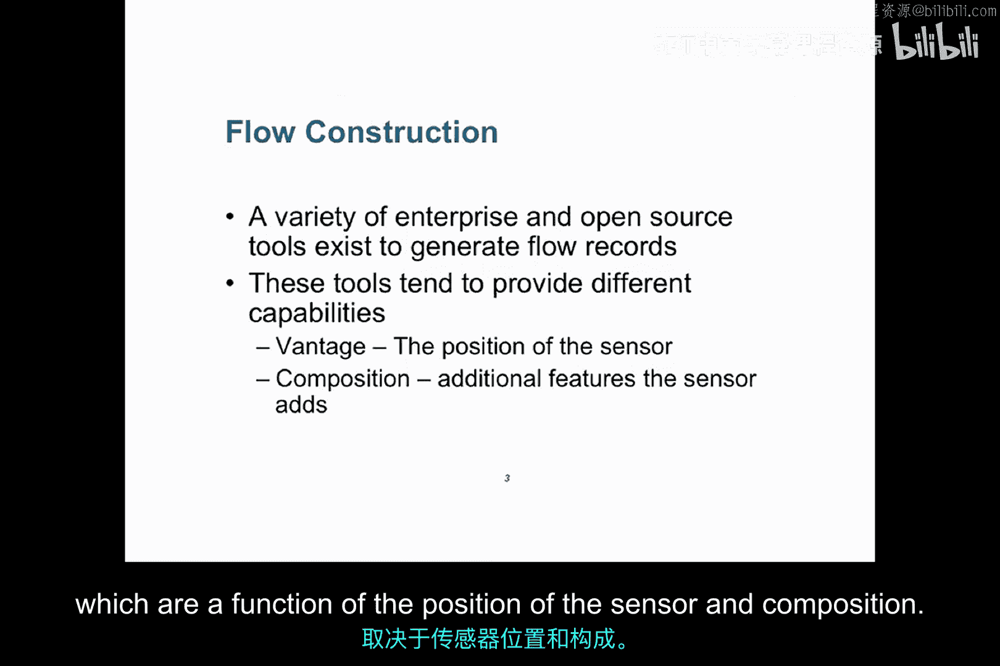

这些工具提供的核心能力主要分为两类：**观测点**（由传感器位置决定）和**记录构成**（由传感器添加的额外功能决定）。

---

在讨论NetFlow时，我们通常指的是**NetFlow V5**。这是思科路由器操作系统（IOS）中多年的标准报告功能。思科路由器被配置为生成原始的NetFlow数据，然后通过收集基础设施进行聚合并生成更高级别的报告。这种分离的原因是，NetFlow最初主要是一个**计费工具**，而非安全工具。

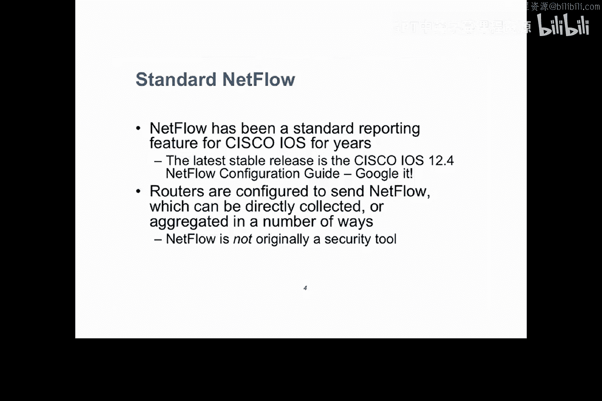

---

接下来，我们详细了解一下NetFlow的版本。

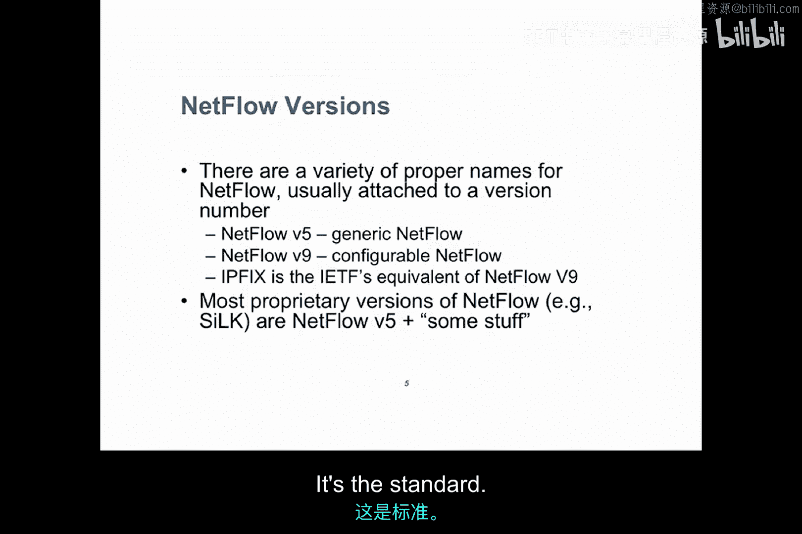

通常我们讨论两个主要版本：
*   **NetFlow V5**：通用的NetFlow标准。大多数专有实现基于此版本。其包含的字段因实现而异，但通常包括注解、扩展和采样信息。它不包含有效载荷数据。
*   **NetFlow V9**：由思科开发的可配置NetFlow标准。其核心特点是允许用户指定要报告的字段。IETF（互联网工程任务组）版本的NetFlow V9被称为 **IPFIX**，这是一个对所有人开放的标准。

---

对于收集工具，有一个重要的开源实现需要熟悉。

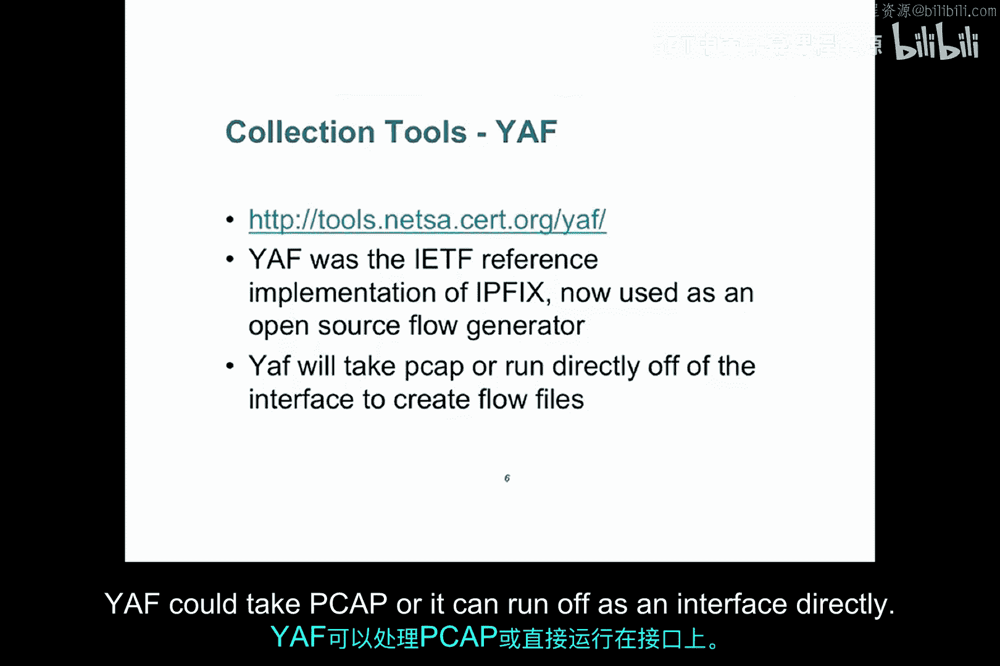

在收集方面，我希望大家熟悉的工具是 **YAF**。YAF是IETF为IPFIX标准提供的参考实现。如今，它已成为一个开源的流量生成工具，并且从经验来看，它已成为处理V9流量的默认选择之一。它可以直接从网络接口或抓包文件（Pcap）生成流量记录。

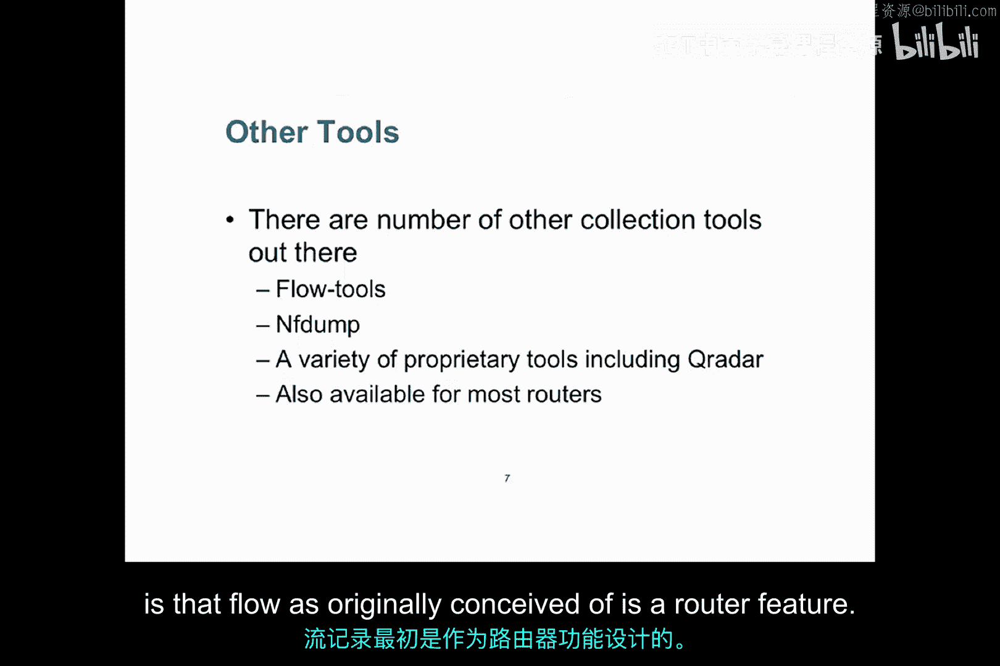

---

当然，市场上还存在其他工具。最早的包括OSU Flow Tools套件，其中的NFD是流量收集工具。此外还有各种专有工具，例如QRadar的Flow Collector。需要记住的是，流量记录最初是作为**路由器功能**被构想出来的，因此大多数路由器都支持生成流量记录。

---

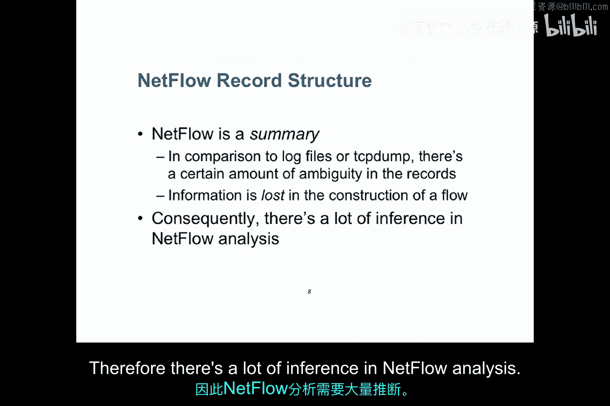

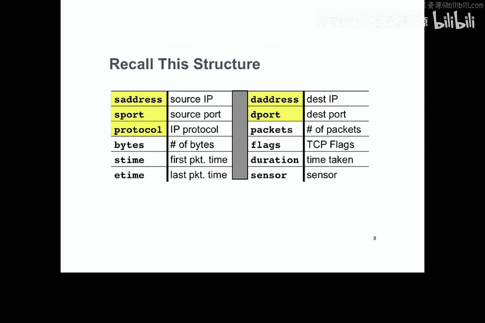

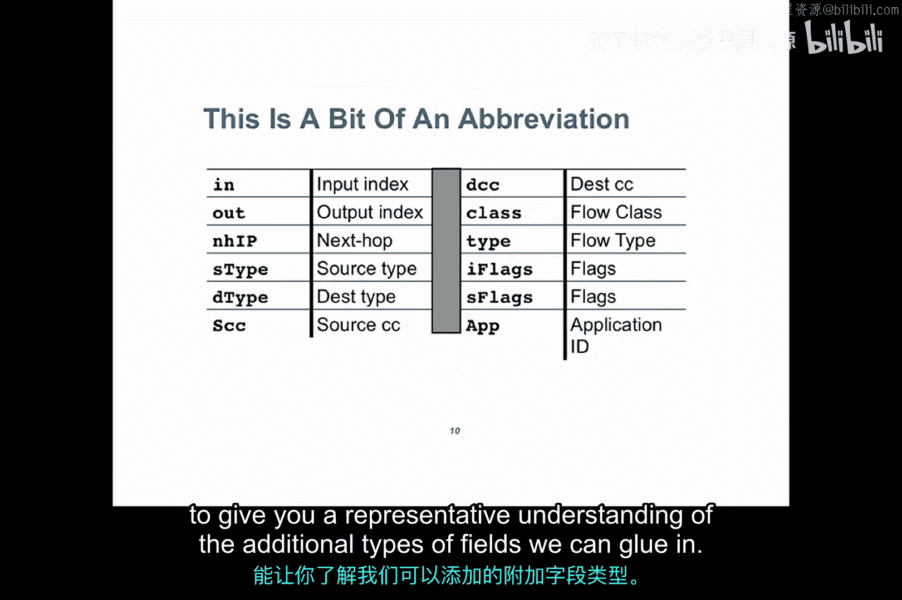

现在，让我们谈谈流量记录**具体是什么样子**，以及它们为何如此设计。

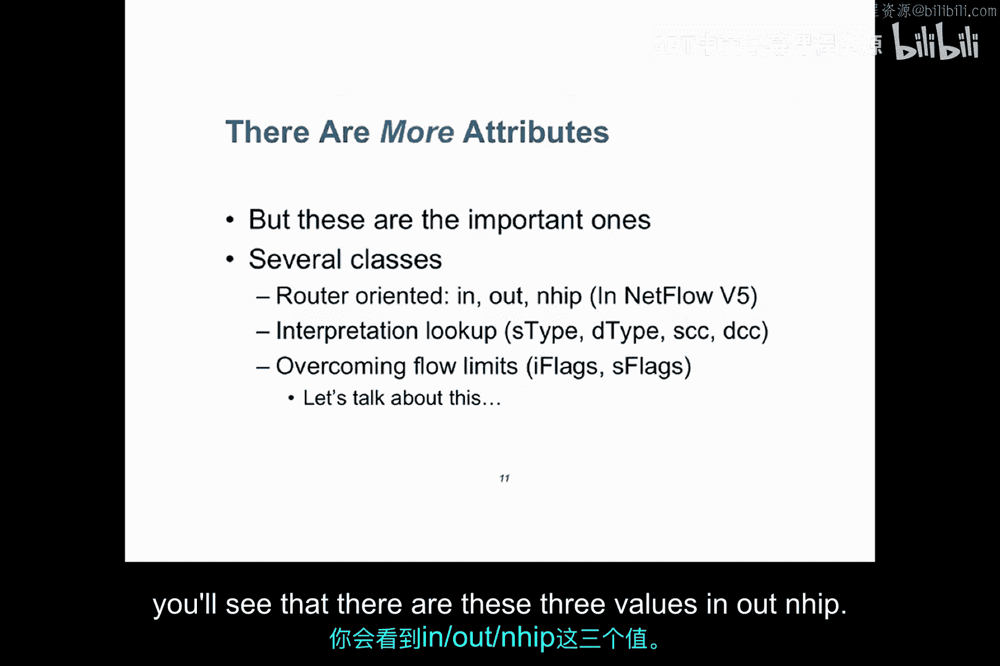

请记住，与日志文件或TCPdump相比，NetFlow是一种**摘要**。它不包含有效载荷数据。在构建流量时，信息会丢失。因此，NetFlow分析中包含很多推断。我们之前展示的结构只是NetFlow记录的一部分。如果你查看SiLK流量工具的定义，会发现还有更多字段。以下是一些我认为最重要的附加字段类别，它们能帮助你理解我们可以添加哪些类型的信息：

*   **路由器属性字段**：例如 `in`、`out`、`nhIP`。这些字段告诉你流量是如何通过路由器转发的。它们在NetFlow V5中就存在，只是之前与安全分析相关性不高，所以没有重点讨论。
*   **注解字段**：例如 `src_type`、`dst_type`、`src_cc`（源国家代码）、`dst_cc`（目的国家代码）。这些字段实际上是查找表的别名。它们使用IP地址进行查询，因此如果你知道一个IP地址的国家代码，你总会看到相同的值。
*   **标志位字段**：例如 `initial_flags` 和 `final_flags`。这是为了克服NetFlow汇总带来的限制。在标准NetFlow中，标志位字段是所有数据包标志位的“或”运算结果，这对于像SYN/ACK这样的TCP标志来说信息价值有限。SiLK工具添加了初始和最终标志位字段，以获取会话中第一个和最后一个数据包的标志，这有助于判断连接是由客户端发起（第一个包是SYN）还是由服务器发起（第一个包是SYN-ACK）。

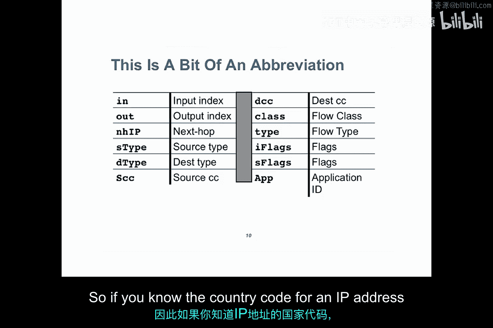

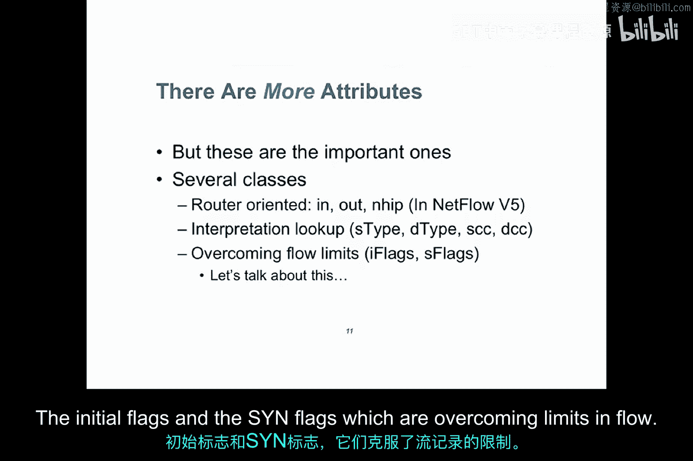

---

这些注解字段（如国家代码、类型等）依赖于查找表，其准确性取决于所用表格的质量。例如，MaxMind和Quova等公司专门从事地理定位业务，它们销售IP地址到国家代码（以及额外人口统计信息）的映射表，并确保这些映射的准确性。此外，像`app`（应用类型）这样的字段，实际上是通过深度包检测（DPI）技术创建的。

---

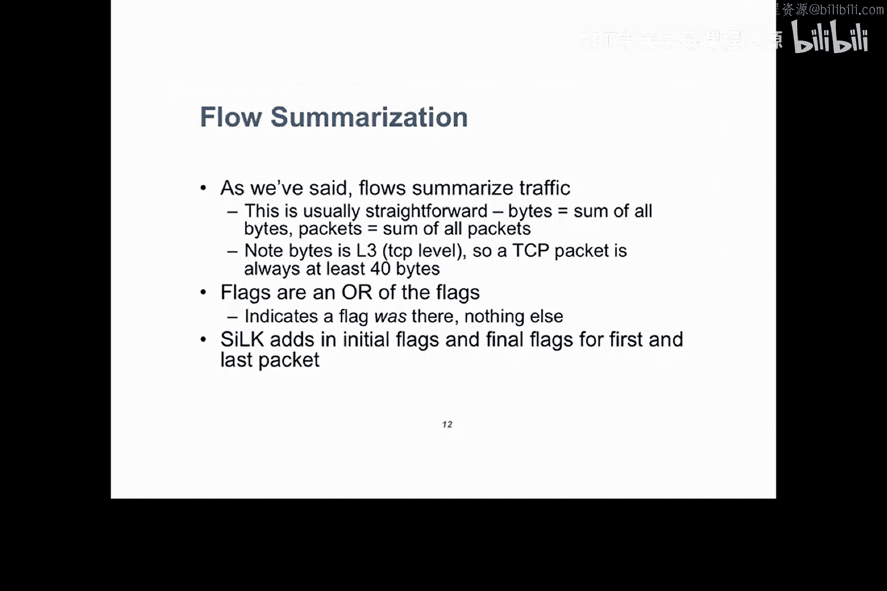

了解了结构问题后，让我们回过头来谈谈收集流量时的**盲点**问题。

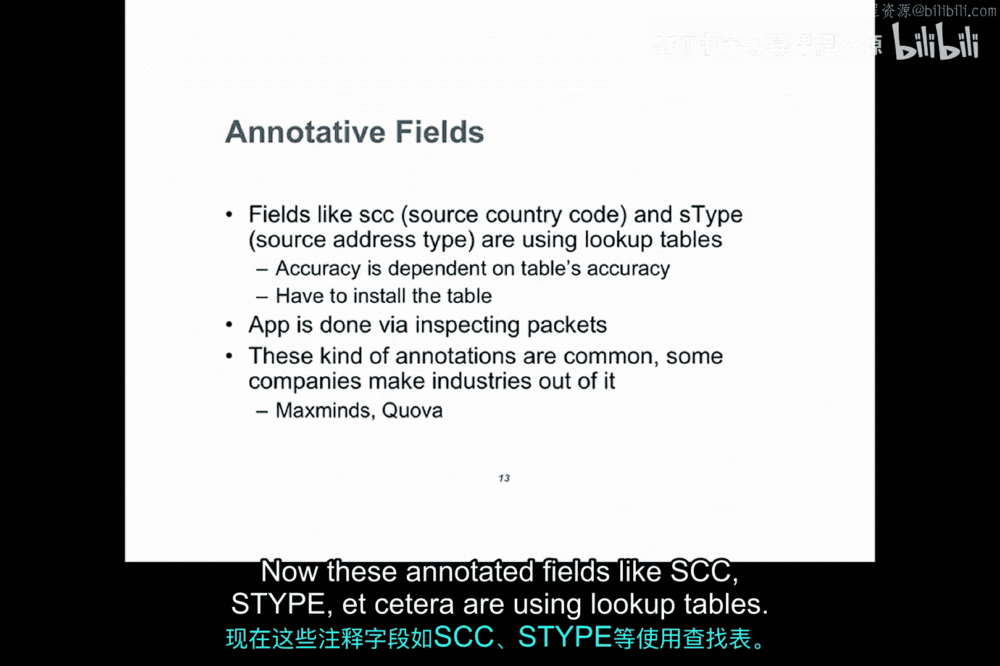

当我们收集流量信息时，数据是从某个观测点获取的。主要有三种方式：
1.  **物理分路器**：例如“吸血鬼分路器”，它直接刺入线缆获取流量副本。
2.  **在路由器上收集**：利用路由器自身的NetFlow功能。
3.  **在网段内主机上收集**：让一台主机以混杂模式运行抓包工具（如TCPdump），监听该网段内所有流量。

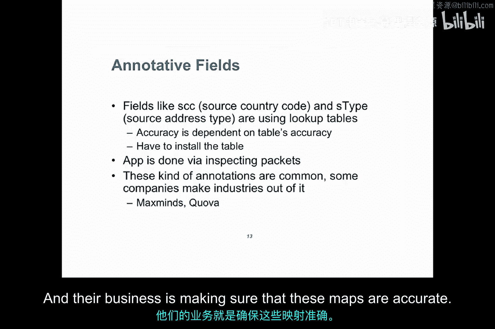

---

每种收集点都有其问题。以下是具体分析：

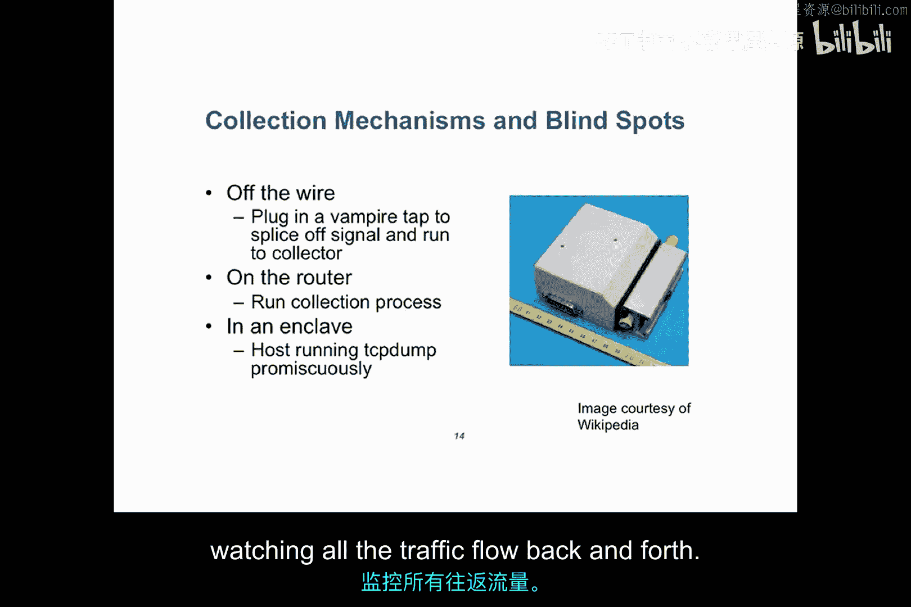

*   **在路由器上收集**：需要理解的是，路由器的首要目标是**路由流量**。因此，当路由器负载过高时，NetFlow这种低优先级进程会首先被终止。它相对不够灵活。但它的优势在于规模巨大。一台有40个接口的路由器，你只需在路由器上启用一次流量收集，而不需要在40条不同的线缆上设置40个独立的收集进程。
*   **使用软件收集器（如YAF或QRadar）**：相比之下通常更灵活，性能更高，能够进行注解并创建多种不同类型的流量记录。然而，它们存在于路由结构之外，这使得管理起来可能比较困难。

---

此外，我们必须时刻牢记**可见性盲点**的问题：只有被“看到”的流量才能被报告。例如：
*   如果在一个使用集线器（Hub）的网络中，机器A与机器B通信，**路由器可能看不到**这段流量，因为它从未被路由。
*   如果使用分路器，流量必须经过被分路的线缆。
*   当涉及多个路由器接口时，确保全面覆盖具有挑战性。
*   在网段内以混杂模式收集，**只能获取该网段内的通信**。

---

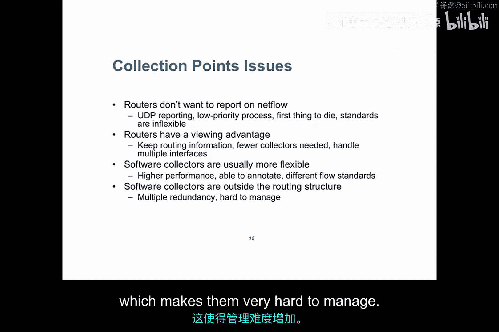

**总结**

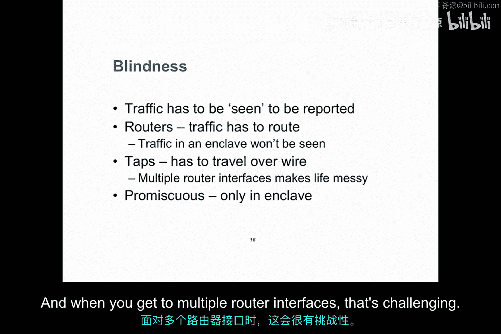

本节课中我们一起学习了网络流量记录的收集与解析。主要内容包括：
1.  有多种工具可以生成NetFlow记录，其中 **YAF** 是一个需要重点了解的开源IPFIX实现工具。
2.  流量记录本质上是一种**摘要**，会丢失部分信息。记录中的一些值（如包数、字节数）是聚合值，而另一些值（如标志位）则可能丢失细节。
3.  收集流量数据时存在**盲点**，流量必须经过收集点才能被记录。
4.  根据收集位置（路由器、专用传感器、网段主机）的不同，会面临不同的优势、劣势和管理挑战。

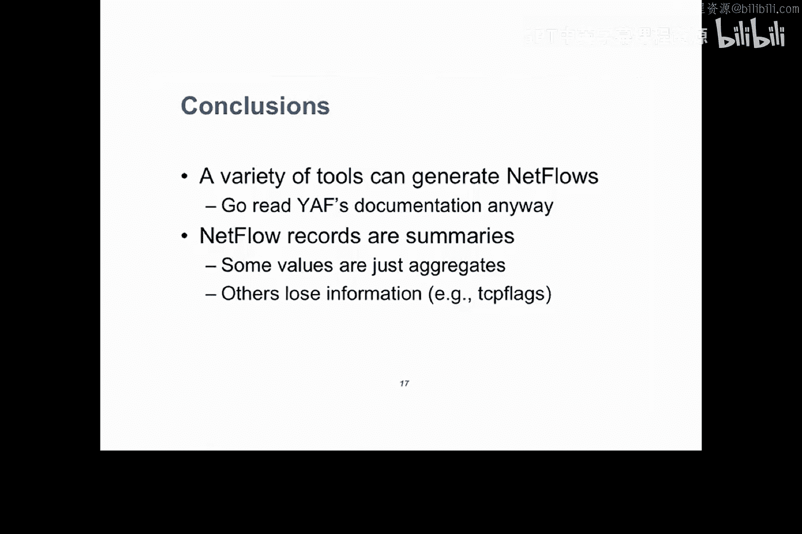

理解这些基本原理，是后续进行有效流量分析和安全事件检测的基础。