# 约翰霍普金斯大学《信息保障分析｜Information Assurance Analysis》中英字幕 p13 12_NetFlow数据分析技术.zh_en -BV1Qz8EzYENX_p13-

This is 165，741， module 4， Le 4。

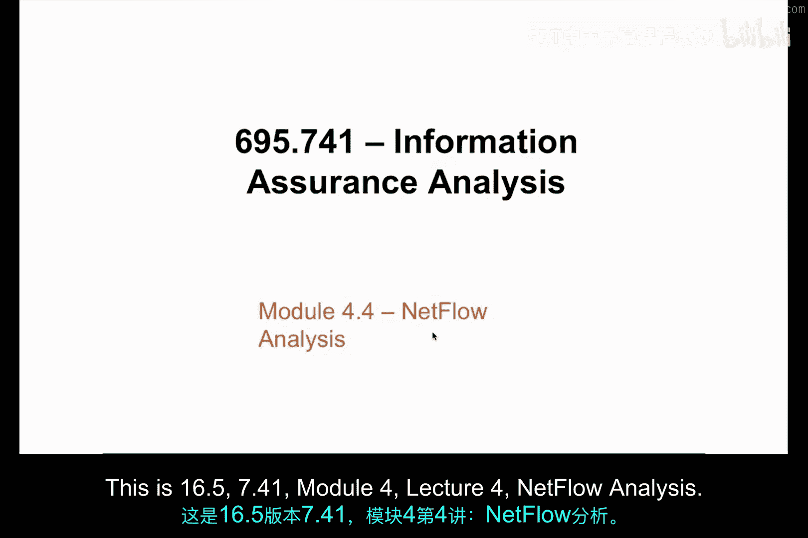

Net flow analysis。The goal of this module is to give you a little bit of practice with looking at Neflow。

What we want to be able to do is be able to interpret what the net flow is trying to tell you。

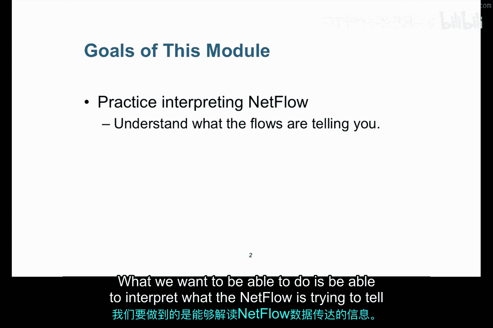

Towards that end we're going to do something a little bit different。

 this is going to be a little bit more interactive than any of the other training training slide decks that you're seeing thus far。

The next few slides contain flow data for each， pause the presentation and look at the record。

 take as much time as you want。 Just look at them and really try and see what the records are show。

 Each slide is going to be followed by an explanation of what actually happened。

For this really don't be a tool， don't flip to the next slide and just automatically say。

 oh that's what it is， really pause and take a look and try and figure out what you can determine。

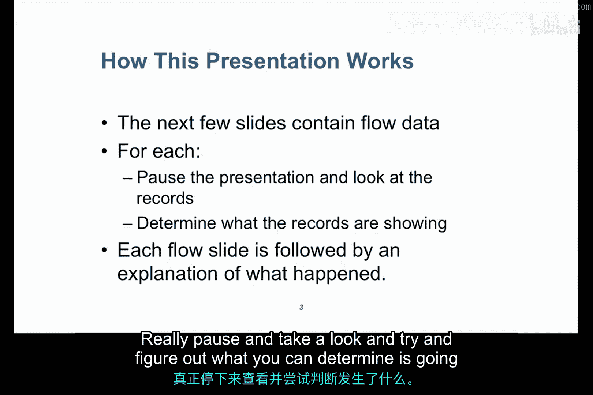

Is going on towards that end， I wish you to think about a couple of different questions。

What is the role of each the host that you're seeing each of the individual IP addresses？

What are each of them doing？What do you suspect the application is。

 do you think that it's normal traffic， Do you think that this might be something where further investigation。

 just really take some time。Awesome。Try and start thinking about what we can do with the timing information。

 I know that with flow records， we're not going to get packet into arrival times。

 but what you will get is some indication of how long sessions taking and how long。

The actual activity remains persistent。So without further ado， let's start with this。

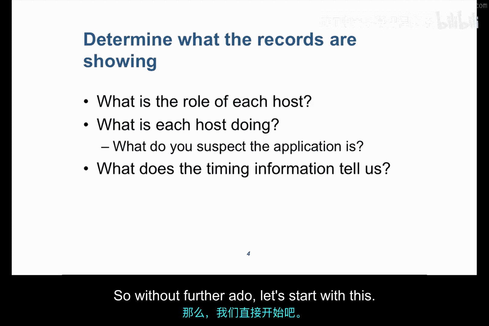

New pause， Okay， I'm going to assume that you paused and now let's take a look at what this actually is。

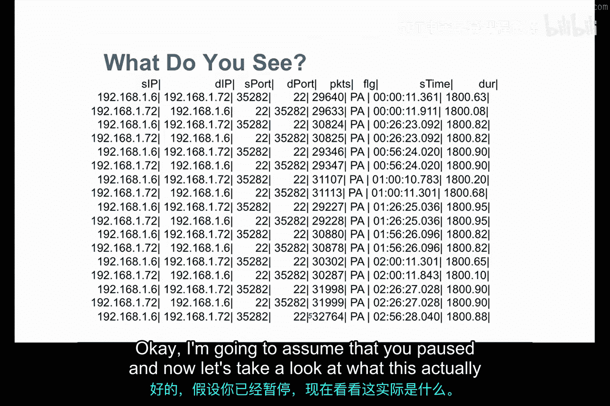

This is Do SSH track。The client in this case is 12。168。1。6， and it's connecting to the server at 12。

168。1。72。It's a really long standing SSH connection。

 which you see as you look back at the at the actual flow records， is that。

This session is persistent over an extremely long period。And because of that。

 the flow is broken up by the active timeout。In this particular case。

 that active timeout is set to 1，800 seconds。So every 1800 seconds， it just says， okay， we're done。

 we're going to print out this flow。After that， next flow record comes along。

next packet he comes along and that generates a new flow record。

 so all of these records are associated with one flow session， I mean with one SSH session。

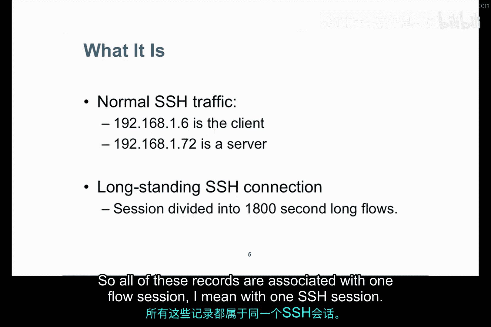

Okay， now pause。I can assume that you've paused now and let's move on to go into what this actually is。

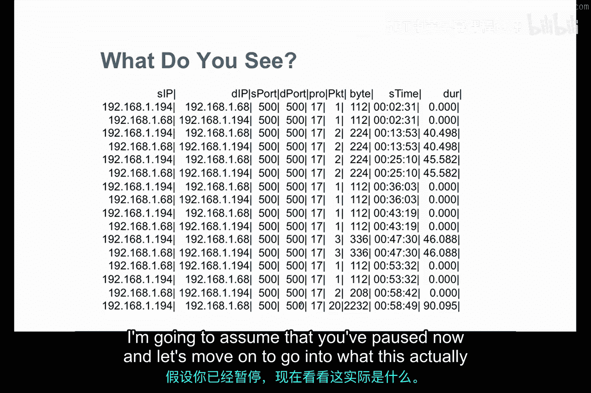

What we've got here is an OPec town。What you're going to see is a lot of keep alive。

 there's a lot of periodic messages that are sent back and forth just to make sure that the IP S tunnel doesn't get shut down。

Remember， it's not exactly the most the quickest process to set up one of these tunnels。

 So it doesn't make sense to continually shut these down and try and set them back up again。 Instead。

 once you've got one set up， you're going to want to send periodic packets just to make sure that it stays up。

You also know that the session becomes active at 584 if9。

So basically what ends up happening is they've got these this session going on where nothing is actually happening in any way shape or form。

 and then towards the end， all a sudden somebody starts doing some。

 so that activity starts translating up。That's what you see in that last foot。

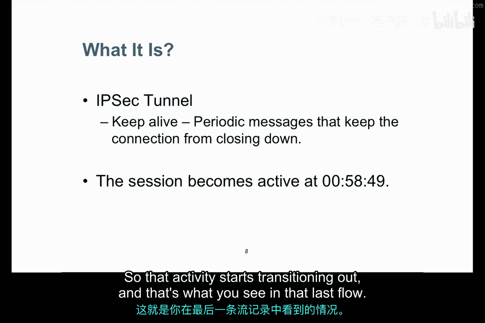

Okay， now what about this？

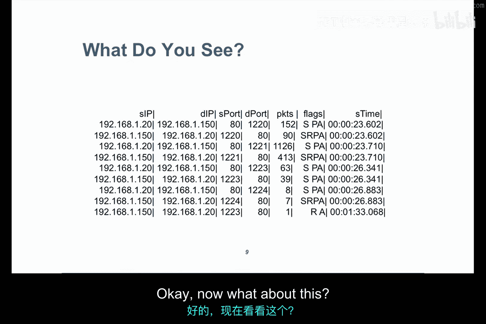

Bss， I'm going to assume that many of you instantly said that this was SSH traffic there was web traffic based off of the port ADD activity and you'd be right。

The client in this case is 12。168。1。20， the server is 1。168。1。5 and 150。

There's two interesting things about this。 The first is that the connections are closed with a reset instead of a fe。

 She'll remember back a few modules ago。 we talked about the fact that。

The proper way to close a TCP connection will be with a fen and waiting a for an acknowledgement to that fen and sending your own and then they send their own fen and you said an ament to that。

However。As we also said in those cases， in that lecture。Many times people just sent resets。

I just assume that the connection gets closed。 Now the interesting thing that you're going to see here。

 if we go back to this。

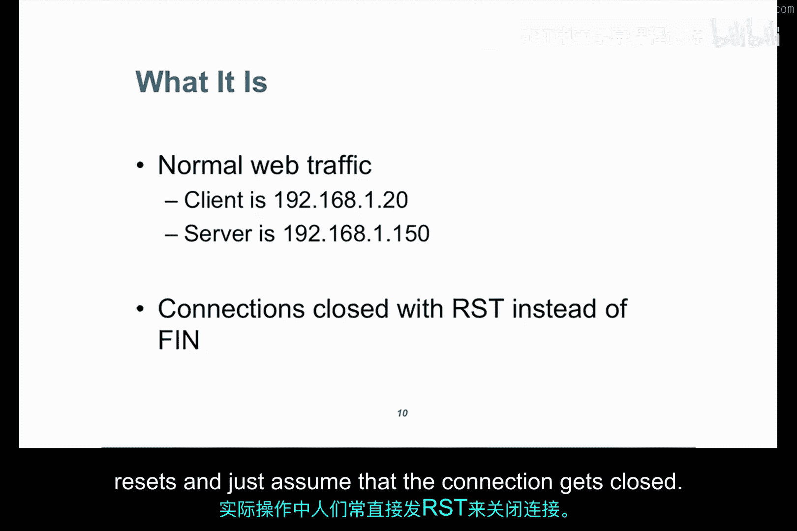

Is that we're not just dealing with one connection。 We're dealing with several web connections here。

That's very calm。And one thing that I want people to think about whenever you' looking at web traffic is that the web page itself is only fully constructed on the client system。

The index page for a web page can tell you to go to any number of different sites to download any number of different pieces to the web page。

Here we have。A grand total of five different connections that are present。

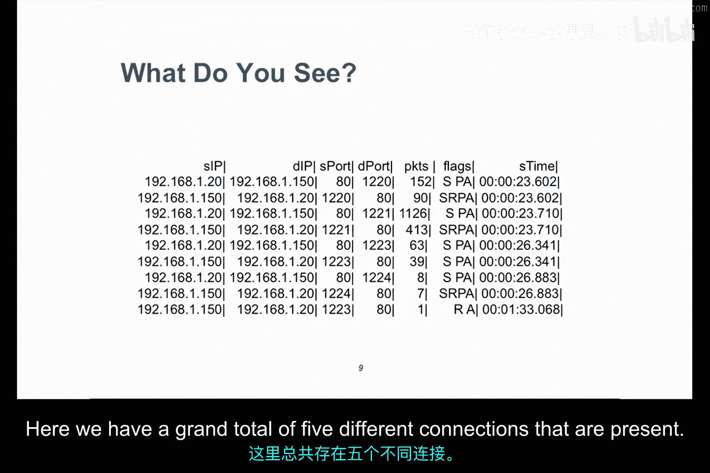

Now let's look at this food， O， Okay， now let's take a look at what this is。

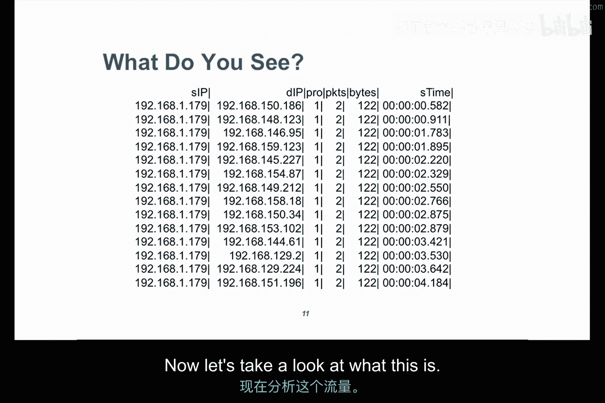

Ety apple， this is pinknk's weight。1I2。168。1。170 is hitting a large number of addresses。

 a couple of addresses of 1 ih。168。00/60。I almost slipped up there and said a lot of addresses because much this is a small subset of a much larger collection of records associated with this particular Pi suite。

And if you look at it， the protocol used here was I see him that's the reason why we can instant with said pig。

So that was just a brief， very brief。Collection of。

Flow records that give you an indication of some of the kind of things that you're going to sit。

If you look through this and you spent the time actually going through and really interpreting what was there。

 you have gained some valuable insight in how you should actually be developing your understanding of flow records and how you should be starting to interpret。

When you're looking at flow， some of the key things to consider are the protocol。

 the port number and the timing。 Of course， you can't assume that the port numbering is going to be a 100% indicator that an activity is indeed。

UmAs with the application that Ian associated， one of the things that I always love to bring up is the fact that port 80。

 that is basically where everybody starts putting all the traffic that they don't want everybody to see。

A they want to look kind of normal？But as you also saw， whenever we did do a web traffic analysis。

 you saw a relatively。Small number of different ports that were being used by their client。

Several different connections there， but they're not going to be long standinging connections。

 they're going to be really quick， give me this set up the TCP session and do a gi request to get the information that I can shut down that connection。

So。That's something that you should also be considered is what the application should。

 another thing that I want everybody to take away is that flow。

Is not a one to one mapping to a session。For one， it's interdirectional。

At least you should see two sides to the connection。At most， you're going to see any number also。

Longstand sessions are long， yeah， long lo connections will generally represent themselves in multiple flow records。

 especially if they exceed the active time out， which， in our example that we had previous to this。

 was 1800 seconds，30 minutes。 That concludes this lecture。

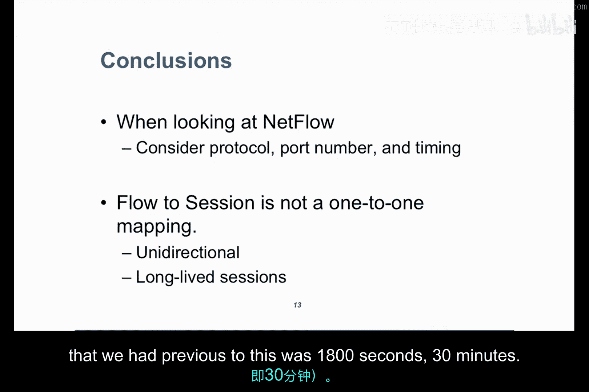