# 约翰霍普金斯大学《信息保障分析｜Information Assurance Analysis》中英字幕 p14 13_分布式哈希表与P2P网络.zh_en -BV1Qz8EzYENX_p14-

This is 6 by5 P741， moduleule 5， Le 6， DHT and P2 P。

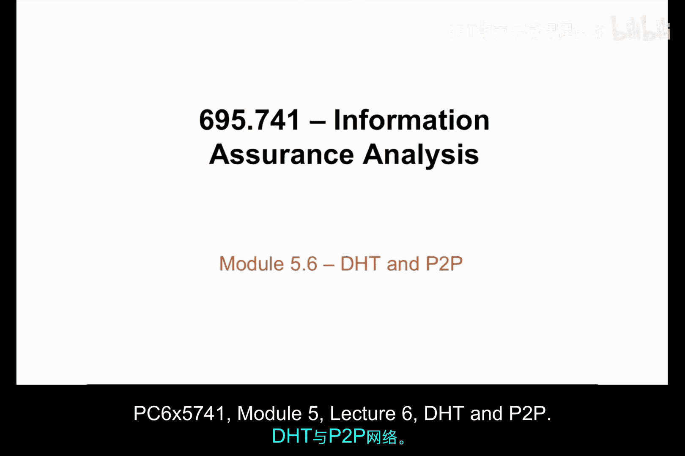

At the end of this lecture， you'll be able to describe P2 P cyst， some history about them。

 some uses of them， and you'll also be able to describe the emergence of DHT and its use。

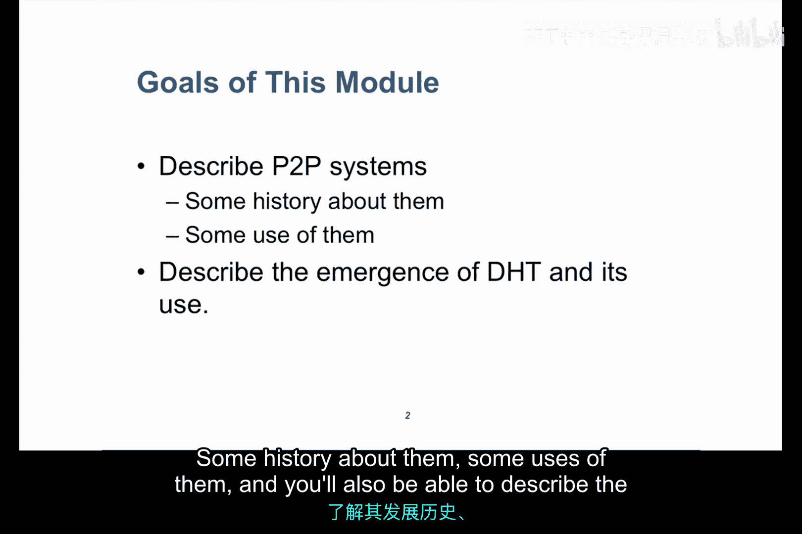

When anonymity became。All right， back in the late 90s， we had some interesting things pop up。

We had the advent of P2P file sharing， we had Naster。Nella， Bitot， whiny， Clwire， kazza。

He also had bear share and other things that also were were were。

Harshly associated with each of these， yet all kinds of variants are floating around and all kinds of file sharing that was going on。

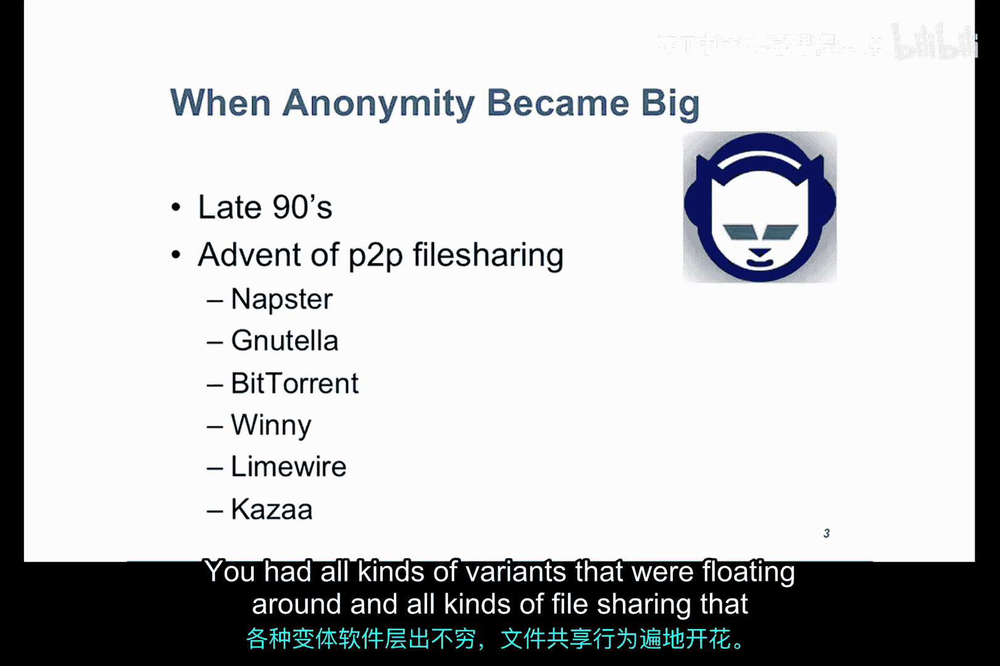

Now。Early systems relied on central servers。 Everybody here probably remembers Naster。

 Youd go to a central Naster server， and had had an indication of what falls were on each of the hosts systems。

嗯。So the interesting thing about that was if you wanted to take one of these systems offline。

 all you had to do was take down the central server。Had knocked out at freeson。

This is something that many many people learned to dread in the original Naster cases because they had a complete central server that could be taken offline and that server had information on every single user。

That ever connected to the system。

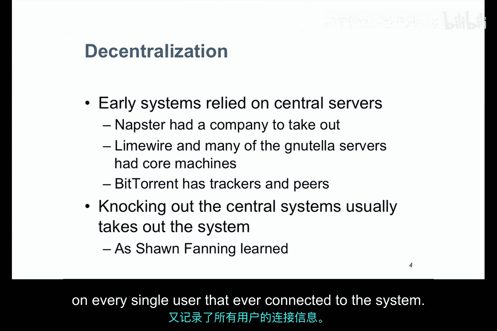

So it had her ability to track all peers。So eavesdrop protection does exist。

 let's put aside the issues of freedom of information and deal with the major problem that you see with file sharing systems piracy under current laws is illegal file sharing music is is likely to be prrus。

So the RIAA is interested in crushing it like a bug and they want to get everybody to stop doing that so that they can get them to buy CDs again。

Not exactly the how I think that it actually will play out， but that's a different story。

Users are interested in not being crushed， so a lot of what they ended up doing was starting to try and figure out ways around this kind of central server that stores all their information and。

Possibly leaves them with a。

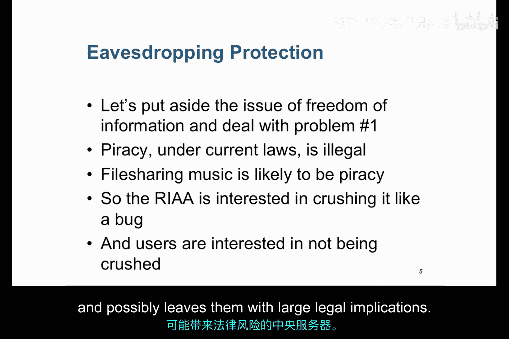

Large legal implications。And there's another component to this that you've got to consider that whenever you're talking about file sharing our。

Piracy or any sort of intellectual property issue。On the Internet。

 you've got a plethora of legal scenarios that you've got to deal with。

 You're working in an international community。 Well Ive one of the best examples of this and how this gets kind of murky is Wikipedia in various countries。

 Wikipedia and America， you can show all the pictures of Godzilla and all the different pictures of it in its Wiki page。

 But in。Japan， you can't。TheThe privacy actual intellectual property。

Laws are written in such a way to where you can't necessarily show that image。

 so some cultures started relying more heavily on text based sort of descriptions of things as opposed to these nice image displays。

So in addition to what we currently have with the music industry trying to stopun and stamp out piracy and that's branch out into several other industries as well。

You also have this more relaxed and more strict intellectual property issue watch you cross into the international borders。

So protection to the actual users of the system。You can use encryption and that will actually help you out in the regards that it it。

Mits a lot of the impact of deep pack of inspection techniques。

But the biggest thing that you're going to want to do is you're going to win a decentral。

Instead of actually relying on the LsI layers that we currently have in order to handle all the routing and all that stuff。

 why don't you build on top of that， why don' you make a nice overlay so you can have a distributed system that just uses the current infrastructure but not everybody who is connected to the internet can necessarily connect to the system。

 only those people who are members of the overlay， members of the actual P2 P system are able to actually connect together。

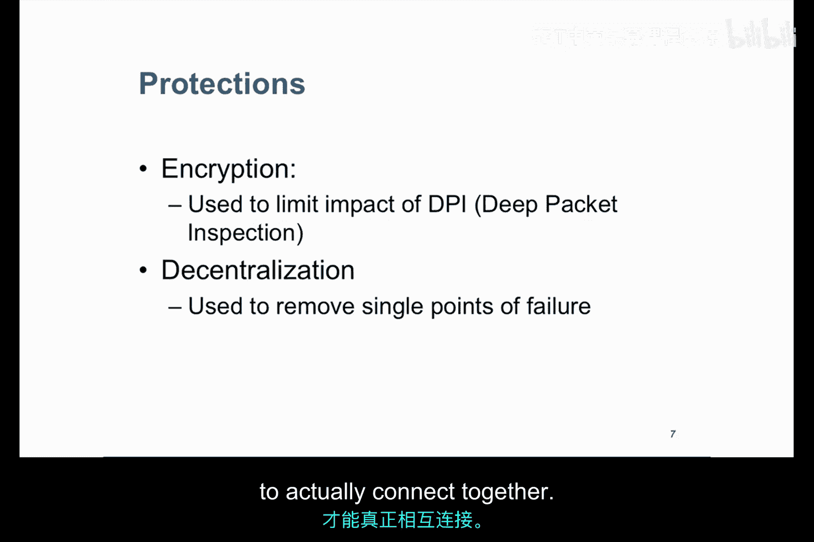

And the way that they do this is they have a decentralized approach that is distributed hashtag。Now。

 what this does is it allows you to remove central servers from the mix entirely without it。

 you don't have a single point of failure so nobody can just walk into a room。

 flip a switch and take out the entire network。 So it's not like Nas or anything like that。

What we've got here is basically individual nodes that are starting to maintain information about other notess。

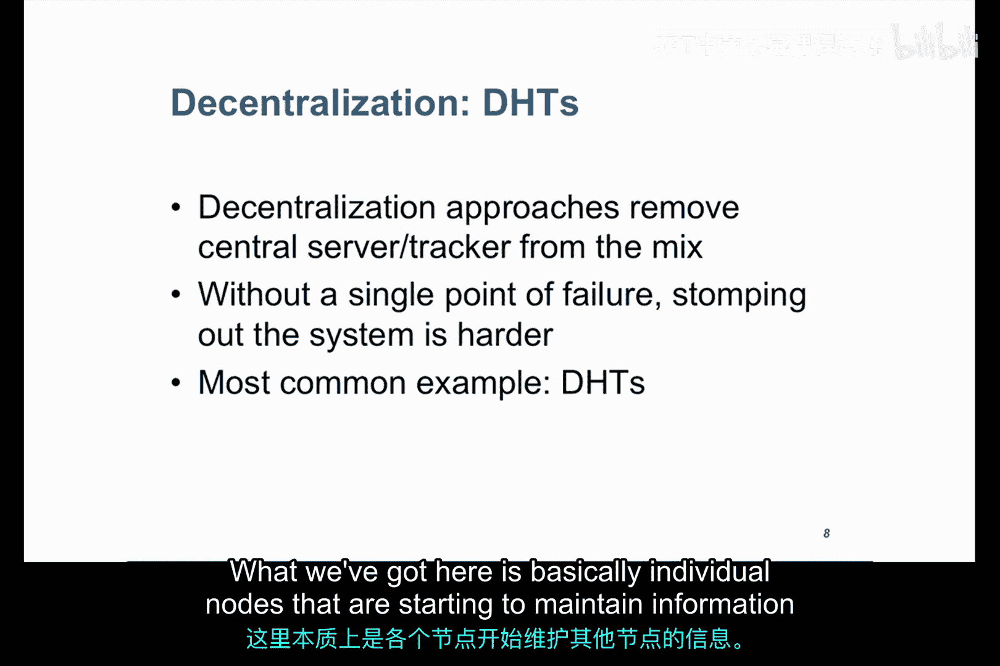

And those notess maintain informationation about other nerds。

 those notess and maintain informationation about other nerds， et cetera， et cetera。

 and you've got a lot of examples of this that that have been developed from academia and also from。

Private end。Some key examples of this are ch tapestry， pasttry。

 these all work on some sent on a very similar con。Everyone gets assigned a universal ID。

And what you have to do is figure out the routing structure。U the overlook。

 so using the other nodes in the network in order to get from one ID to another。

The way that this works is it's kind of a gentleman's group。

Every me of of the overland out of the pi out。Says I will route traffic for you if you route traffic for me。

And that's a general statement for everybody in the evil。

So what happens is all you've got to do is just like with all of your other network loads routing。

Get your packets to the guy who is next closest to your final destination。

 You don't have to know what the final destination is。

 You don't have to know what country they're in。 You don't have to know how many hops away they are。

 You just have to know somebody who is just a little bit closer than you are in order to make the message prop gave for it。

So。That's basically how DHTs work。 Each node maintains a list of unique ideass and I P addresses of hosts that are in the network。

And whenever asked to route something， they try and round it as best they can。

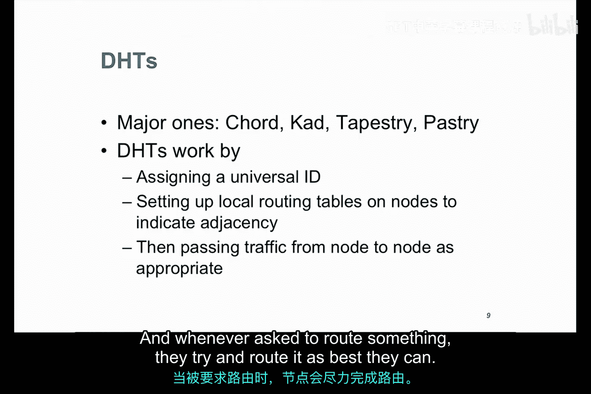

Ary implements this with a 128 bit integer。And basically。

 it assumes that the unique IDs are evenly distributed。

So the way that it handles routing is if your destination。Has some sort of unique I。That is。That is。

Completely， completely like a。MionsMillions of digits away for years。

What you do is you find the guy who has the next closest prefix link。To the final destination。

 and he route it directly。So you're routing it as close as you can to something that has a similar number to the guy you're after。

And he， in turn， does the same。Nakai does the same and eventually what happens is the message actually makes it to the note that has the entire prefixction。

That is exactly the site， which would be the actual destination that you're interested at。

This is a very interesting sort of method。 It really does not。Here too much about about locality。

 There are some additions to ministry that that actually do work very heavily on generating locality and actually being a little bit more bandwidth。

Bandth restrictives。Basically， what they start doing is they is individual hosts well it will start to maintain information about how well they can round stuff and they will be more。

Widely used by the local hosts that are closer to them。

But these are just all additions to pastry itself the bottom line is what they do is they just use this actual unique ID in order to handle all the routing。

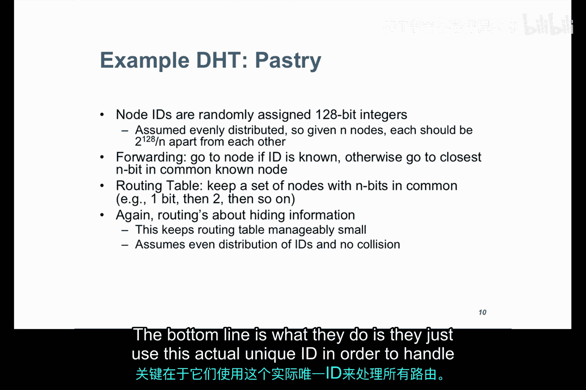

So。😔，Enncryption has been。Has been a bit toward for years we're going to jump gears now says wanted to let you know that although some people fought against including encryption in this。

 it has been around it uses trackerless DHT features as well。

 something that Pirate Bay has been a strong advocate for。

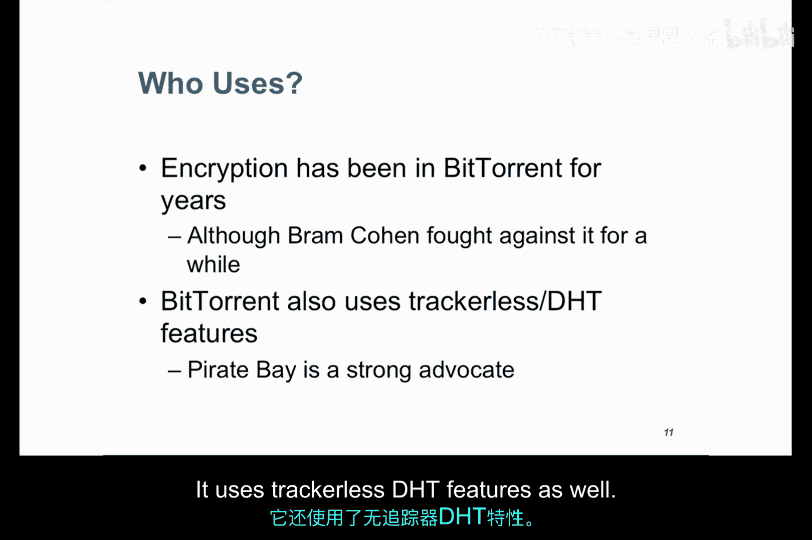

But。Bottom line is whenever we're looking at these things， there's， there's。

Whenever you're looking at a P2P network。If you're not in the mid 90s， it's going to be decentensral。

 So all of the same principles that we've gone through for the entire module about how routing is actually done with BGP。

 how we actually decide on on。How to get a message from point A to point B。

 all of those lessons are applied once again。And P2 P。

So it's kind of interesting because it uses all the lessons learned and just makes this overlay that completely ignores everything。

 all the the principles that were under it and just uses the core concept of。

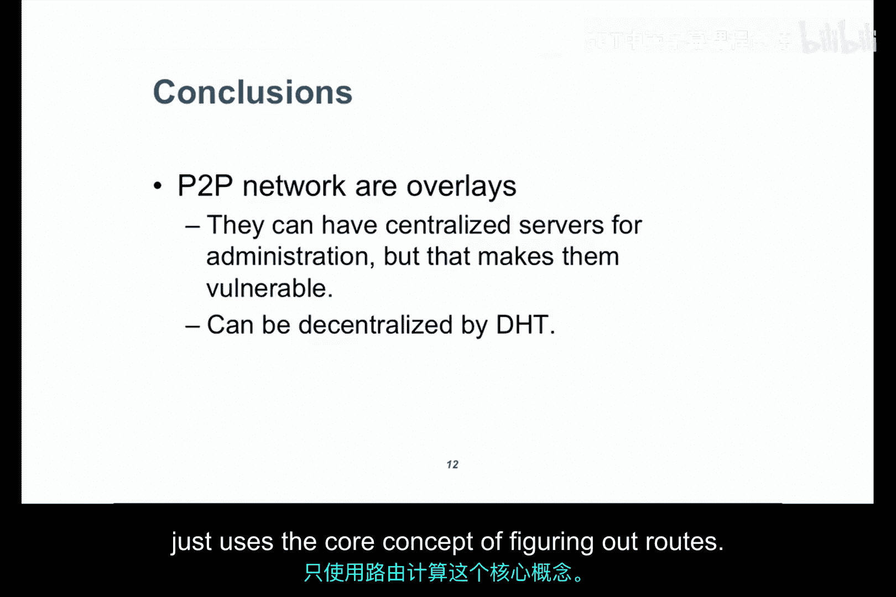

Figuring out routes。