# 信息保障分析：5：分布式哈希表与P2P网络 🧩

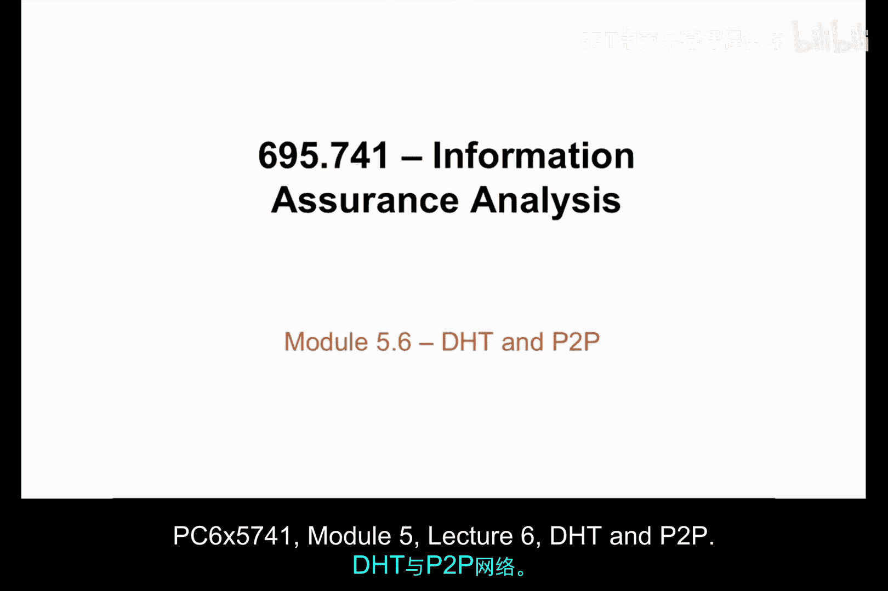

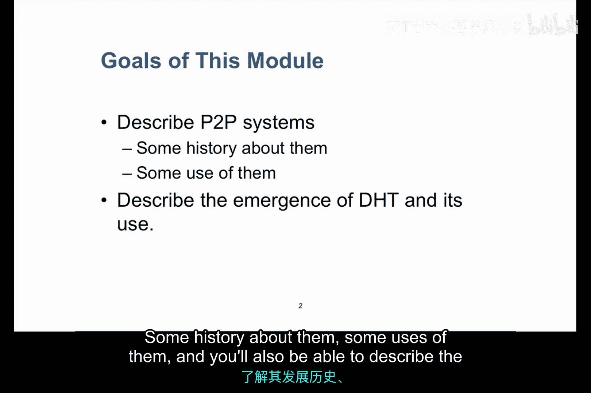

在本节课中，我们将学习对等网络系统的基本概念、其发展历史、主要用途，以及分布式哈希表的出现及其应用。课程结束时，你将能够描述P2P系统，了解其历史背景和主要用途，并掌握DHT的基本原理及其在P2P网络中的作用。

---

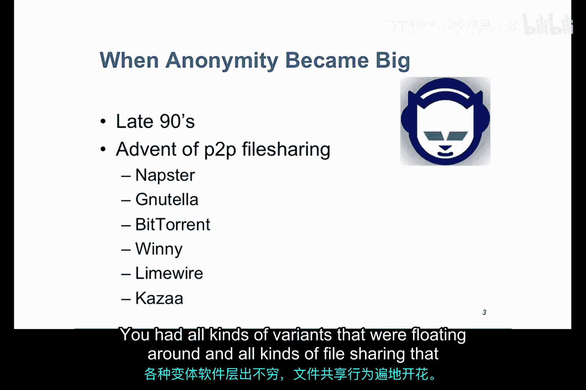

## P2P系统的历史背景 📜

上一节我们介绍了课程概述，本节中我们来看看P2P网络的历史背景。

20世纪90年代末期，出现了一些有趣的技术。P2P文件共享技术开始兴起，例如Napster、LimeWire、BitTorrent、Winny、Kazaa、BearShare等。这些系统彼此之间存在紧密关联，同时也有许多变体在流传，各种文件共享活动非常活跃。

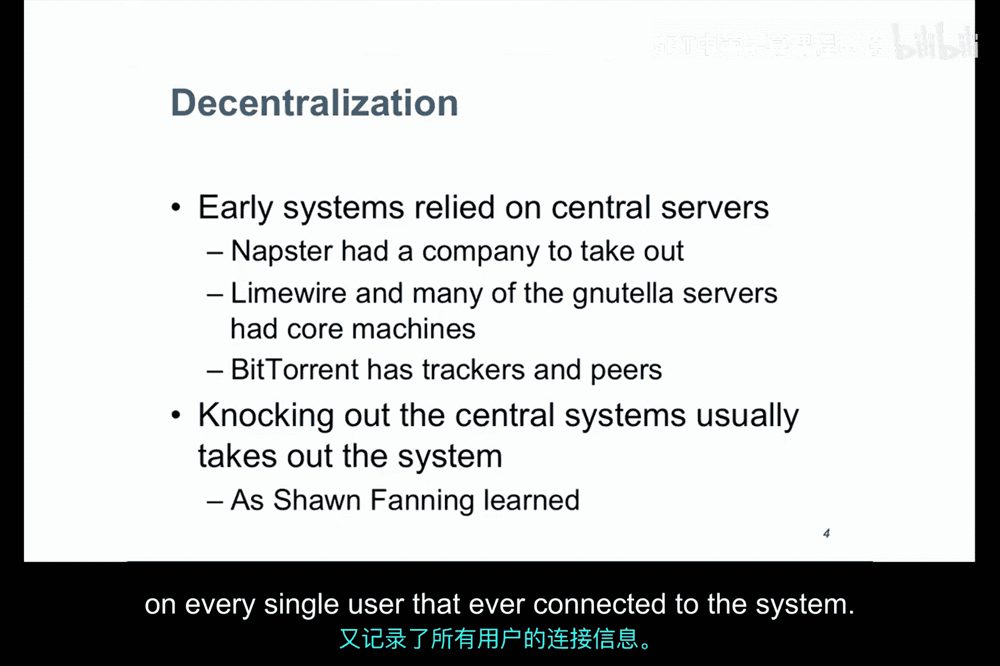

早期的P2P系统依赖于中央服务器。例如，Napster就有一个中央服务器，用于记录每个主机系统上可用的文件。这种设计的缺点是，如果想使整个系统离线，只需关闭中央服务器即可。在Napster的案例中，这一点尤为明显，因为其单一的中央服务器记录了所有连接用户的信息，一旦被关闭，整个网络便无法运行。

---

## 中央化架构的问题与法律挑战 ⚖️

上一节我们回顾了早期P2P系统，本节中我们来探讨其架构带来的问题和法律挑战。

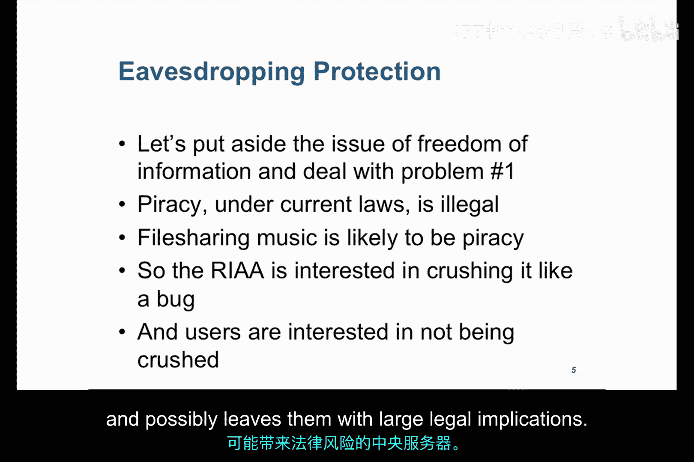

中央服务器有能力追踪所有对等节点。虽然存在窃听防护措施，但我们需要暂时搁置信息自由的问题，关注文件共享系统面临的主要问题：根据现行法律，盗版和非法共享音乐文件属于侵权行为。因此，美国唱片业协会等组织极力打击此类行为，希望阻止文件共享以促进正版销售。

用户则希望避免法律追责。因此，他们开始寻找方法，以规避这种存储所有用户信息、可能带来重大法律风险的中央服务器。

此外，在讨论文件共享、盗版或任何知识产权问题时，还需考虑另一个因素：互联网是一个国际社区，涉及复杂的法律场景。一个典型的例子是维基百科在不同国家的差异。在美国，维基百科可以展示哥斯拉等图片，但在日本，由于知识产权法的限制，可能无法展示相同图片。因此，一些文化更倾向于使用文字描述而非图片展示。

除了音乐产业打击盗版的行为已扩展到其他行业外，跨越国际边界时还会遇到知识产权法规或松或紧的问题。

---

## 去中心化与覆盖网络 🛡️

上一节我们讨论了法律挑战，本节中我们来看看如何通过技术手段保护系统用户。

用户可以使用加密技术，这能在很大程度上抵御深度数据包检测技术的影响。但更重要的措施是实现去中心化。与其依赖现有的网络层来处理所有路由，不如在其之上构建一个覆盖网络。这样，可以创建一个分布式系统，它利用现有基础设施，但并非所有互联网用户都能连接，只有P2P系统的成员才能相互连接。

以下是实现去中心化的关键方法：
*   系统采用分布式哈希表实现去中心化。
*   这允许完全移除中央服务器。
*   消除了单点故障，无人能通过关闭单一节点使整个网络瘫痪。

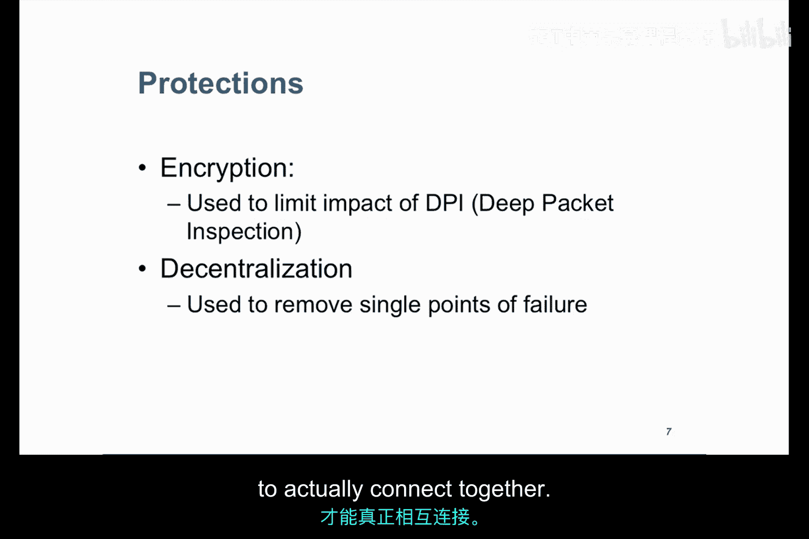

---

## 分布式哈希表的工作原理 🔍

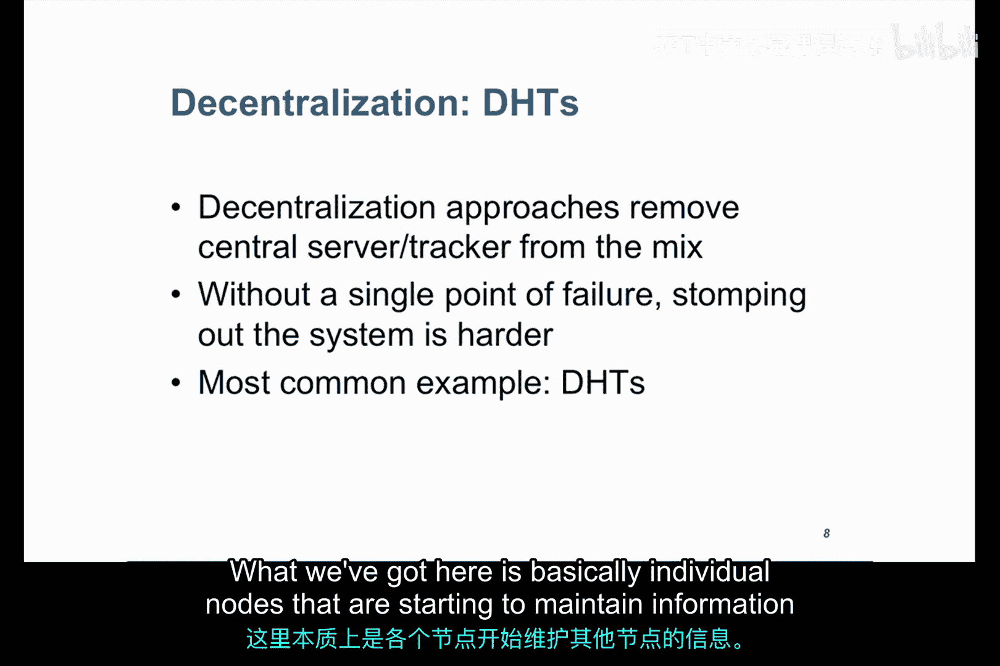

上一节我们介绍了去中心化的概念，本节中我们深入探讨DHT的具体工作原理。

DHT的基本原理是，各个节点维护网络中其他节点的唯一标识和IP地址信息。这些节点又维护着其他节点的信息，依此类推。学术界和私营部门都开发了许多此类系统的实例。

以下是DHT的关键示例和共同概念：
*   关键示例包括Chord、Tapestry、Pastry等，它们基于非常相似的概念运行。
*   每个节点被分配一个全局唯一的ID。
*   核心是确定覆盖网络中的路由结构，即利用网络中的其他节点将信息从一个ID传递到另一个ID。

其工作方式类似于一种“绅士协议”：覆盖网络或P2P系统中的每个成员都承诺“如果你为我路由流量，我也为你路由流量”。因此，就像传统网络路由一样，只需将数据包发送到比你自己更接近最终目的地的节点。你无需知道最终目的地的具体位置、所在国家或跳数，只需知道一个比你更接近目标的节点即可。

---

## Pastry路由机制示例 🧮

上一节我们概述了DHT的工作方式，本节中以Pastry为例，具体看其路由机制。

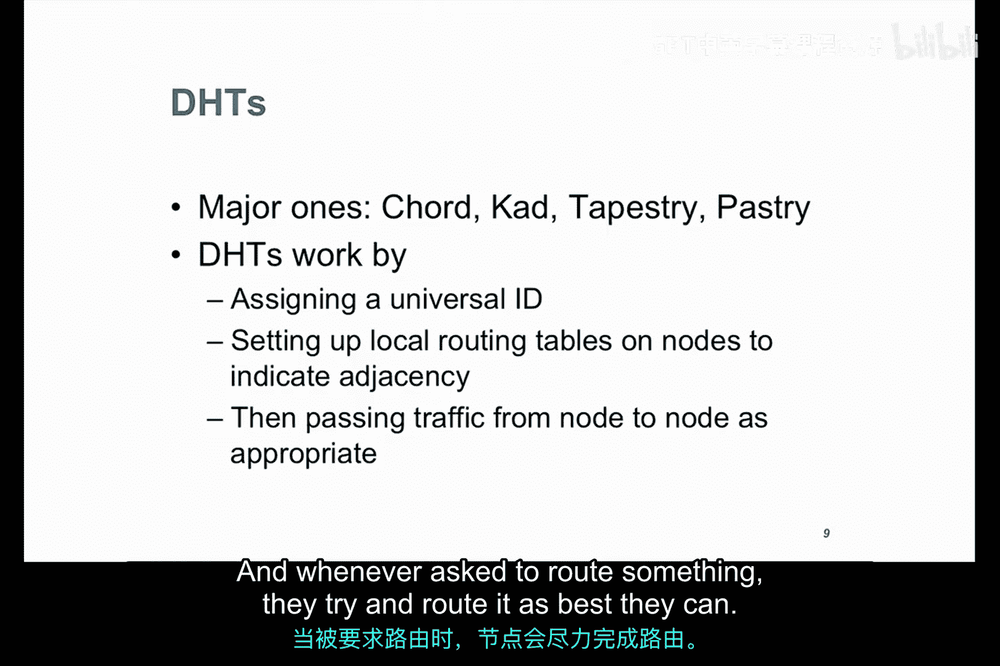

Pastry使用一个128位整数作为节点ID，并假设这些唯一ID是均匀分布的。其路由处理方式是：如果你的目标节点有一个唯一ID，而该ID与你的ID相距甚远（例如相差数百万），那么你会找到那个拥有与最终目的地最接近的前缀的节点，并将信息路由给它。该节点再执行相同操作，最终信息会到达那个拥有完整、匹配目标ID的节点。

这是一种非常有趣的方法，它最初并不太考虑网络位置（ locality ）。不过，Pastry有一些改进版本，会 heavily 考虑位置信息并更节省带宽。这些改进的基本思路是，个体会开始维护关于路由效率的信息，并且更靠近它们的本地主机会更频繁地使用它们。但归根结底，它们都是利用这个唯一的ID来处理所有路由。

---

## 加密与无追踪器DHT的应用 🔐

上一节我们以Pastry为例说明了路由，本节中我们来看看加密技术在P2P网络中的应用。

加密技术已存在多年。尽管曾有人反对在此领域使用加密，但它确实被广泛应用，并且也利用了无追踪器的DHT功能。海盗湾等组织一直是这方面的积极倡导者。

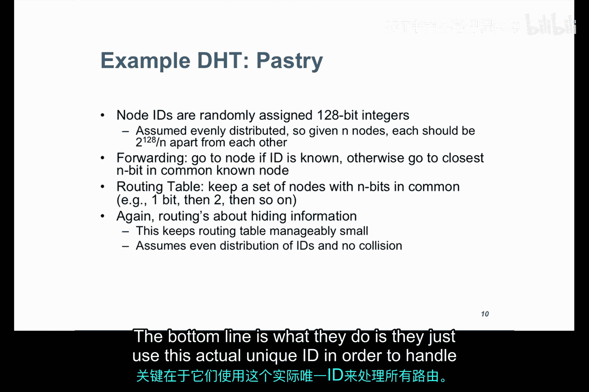

---

## 总结与核心概念回顾 🎯

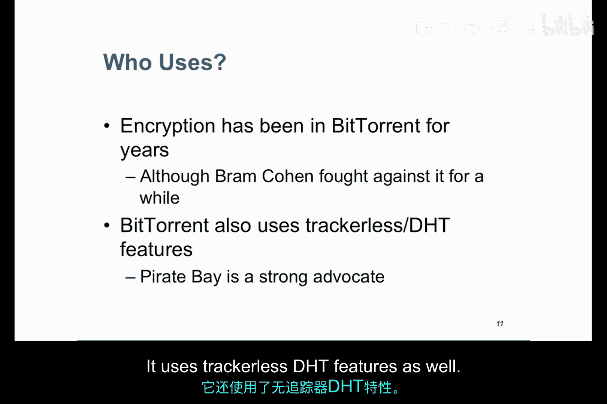

在本节课中，我们一起学习了P2P网络和分布式哈希表。

总而言之，当我们观察这些P2P网络时，只要不是90年代中期的那种，它们基本都是去中心化的。因此，我们在整个模块中学到的关于BGP路由、如何将信息从A点传递到B点的所有原理，在P2P网络中再次得到了应用。

这很有趣，因为它运用了所有已学的经验教训，创建了一个覆盖网络。这个覆盖网络完全忽略了底层的所有原则，只专注于**路由发现**这一核心概念。

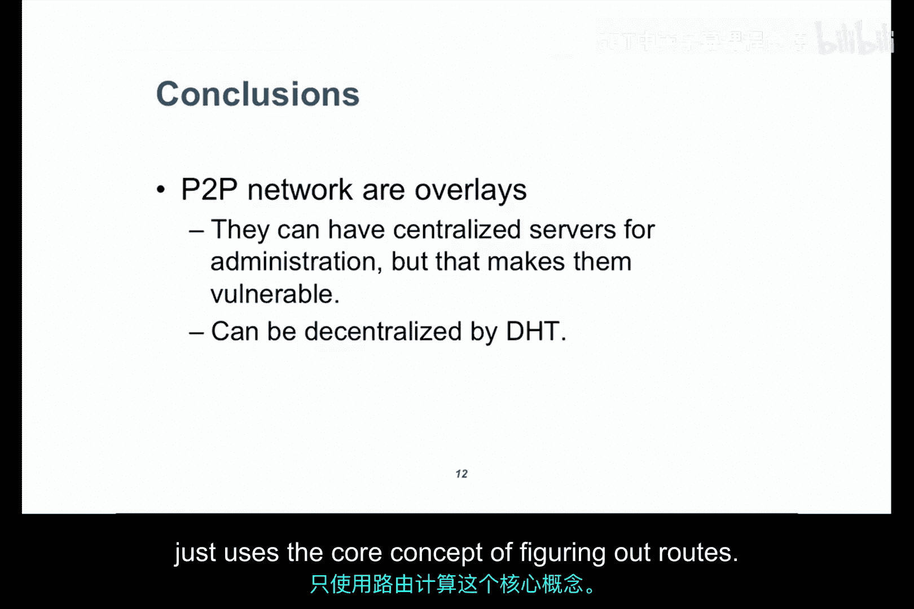

其核心机制可以概括为：**节点通过维护一个（唯一ID， IP地址）的映射表，并依据ID的相似性（如前缀匹配）将查询或消息逐步转发给“更接近”目标ID的节点，直至到达目的地。**