# 约翰霍普金斯大学《信息保障分析｜Information Assurance Analysis》中英字幕 p15 14_边界网关协议(BGP).zh_en -BV1Qz8EzYENX_p15-

6 95741 Information assurance analysis。Professor Collins talking against module5。3G Adv warning。

 this is going to be a long talk so when we talk to you out here。

 the basics of PGP communication and how to pull information about PGP from multiple sources。

In the course of this， I will also be discussing the terrible secret of B， G P。 is truly horrifying。

 And I will keep till the end。 What is B G P。 O， B G P is a protocol。 It is a TC P protocol。

 It operates on port 1，79。 It is an nominally peer to peer protocol。

 It is a protocol that is used exclusively by routers。

 It is how routers transmit information to each other。Now， B GP is used to maintain ribs。

 which are what are called the routing information bits。 A ribby is for lack of better term。

 a magical knowledge base that routers use to figure out how the internet is wired。

 The reason that I'm using the magical here is because B GP is a couple of little capabilities that allow it to decide routes based on its own internal Wis。

 Anyone one who tells you that they know that how B GP works perfectly is lying。😊。

BGP is a very eccentric protocol。BGP routers during normal operations。

 they just send bits of their ribs to each other basically updates。Now。

 let's talk a bit about what BJP has composed of。 BGP has got a core element of well thought out ideas。

 Basically， it is a shortest path algorithm， which is not uncommon for your routing algorithms， so。

What happens is is BGP builds a graph of the internet。

 the nodes in this graph are what are called autonomous systems add the links to the physical plugging you together of these autonomous systems。

And the idea is you go through the shortest number of hops necessary。

 the shortest number of autonomous systems to get from your beginning I to your ending I。

 Everything on top of that gigantic bucket is plunged。

 As I said suitable shortest path idea on the other hand。

 there's a lot of little other things stern at local preference。 T Tls MPLS。

 you will the protocol that basically allows you to create take other protocols and rip them off fart like silly body in autonomous systems。

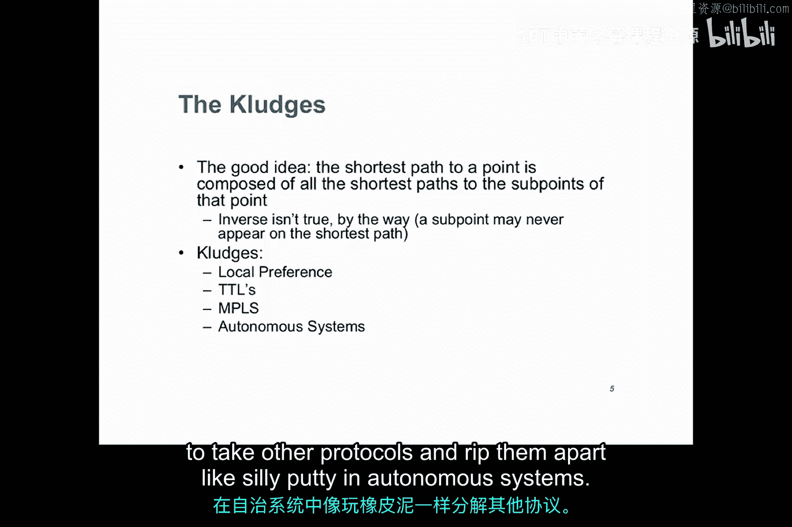

Now let's talk about what a rib actually looks like this is an exercise you can do yourself The address route server。

ip。at。net is a router you can physically go to it and you can take a look at a BGP rib。

So as you see what I did here is， I went to the server and I typed show IPBGP。

 that is the command for router。Who had this variety of router。

To see the rib and you'll see that I get these numbers， these numbers are cider blocks。

 a next top ID， and then a path。

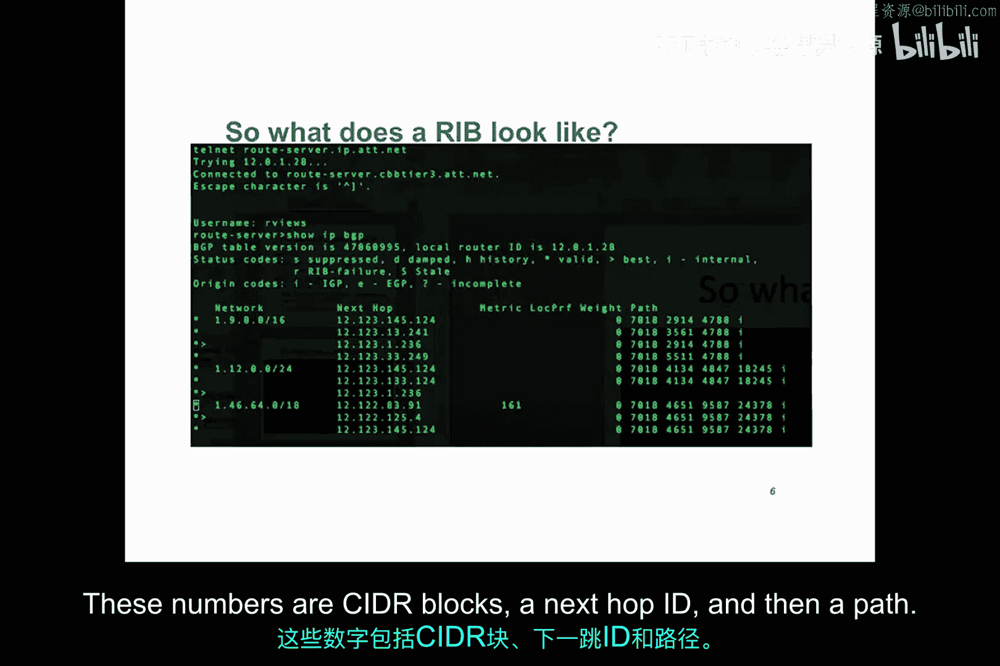

Okay。So what do we see the destination cider block？We see the next top address。

 we see the inter ofous system metric， local preference， a weight and a past。All right。

 so what do all these things well？First off。BGP does not talk in terms of IP addresses BGP talks in terms of ASs autonomous systems。

An autonomous system is a sealed off chunk of the Internet。

 The point to an autonomous system is that once you've entered A， the A S。

 you know how to get in and you know how you can get out。

 You have no idea what's going on inside there。 Maybe it's just one router。

Maybe it's a dozen routers in the mesh framework， they need to collect those squirrels that physically print out the packets and our trades to pass them back and forth among each other。

 you don't know that information and you don't care okay。All right。

 the A S owner says what it owns and it says how it's wired。 Now。

 the important thing about what it owns， this is where cider blocks come in and A S owns a cider block。

 So I will tell the world that I own 1 22，0，024， for example。There we go。😊。

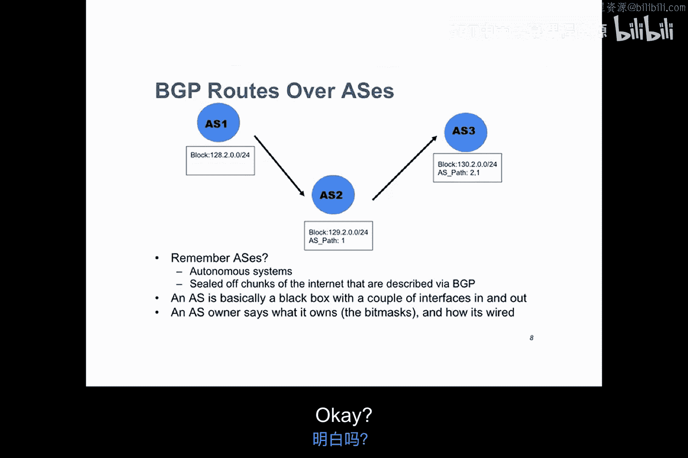

Now if we go back to the ribbon and look at that， you can see， you know。

 I cannot tell how to get to 19415 directly， I can get close to it I go to 1900 okay。To do that。

 I have to go through the sequence of a essence， all right。So 7082914，4788 and then internal。

So what does all that mean Well， what that means is if you take a so what this means is that if I want to get to my final destination。

 I'm going to have to pass through this sequence of autonomous systems to get there， all right。

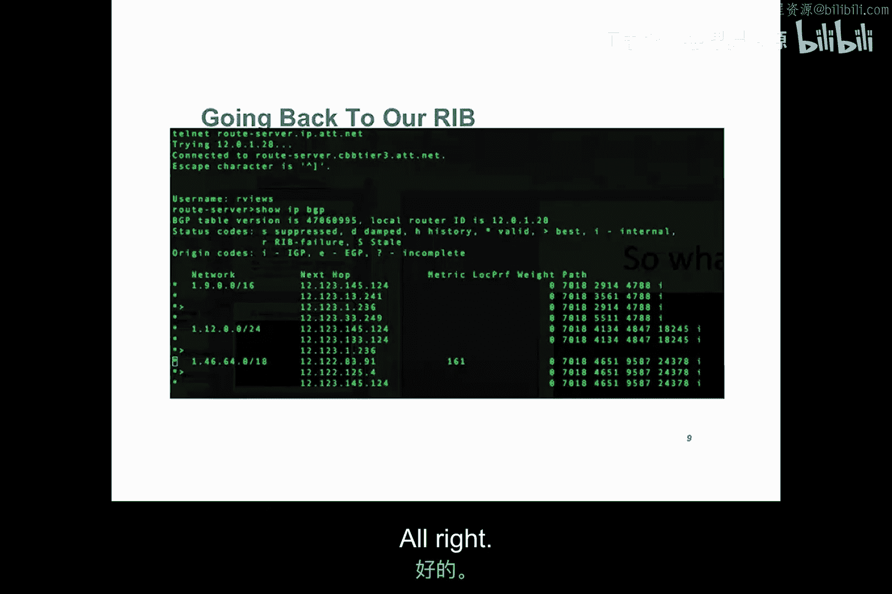

Now let's talk a bit about forensics， autonomous systems are owned entities。

So what I can do is I could actually do lookups on them。

 easiest way for me to do this is I can go to one of the who is servers。 So for example。

 Anic I literally enter in address。 and you can see that when I do that。

 I get the ownership of this particular s 16 from Anic， which is the Asia Pacific Asia Pacific N。

 and you can see。I can actually get information I can find out where noally owns it and find out takes the changes and I can get all the contact information for it All right the only thing is to go to it's like peering Db where I can also do queries like this and you can see I do a query on telecom Malayia Now you'll see that that gives me my that gives me my ASN 4788 so let us go back and take a look for a moment and our rip you see that primary ASN that 4788 there。

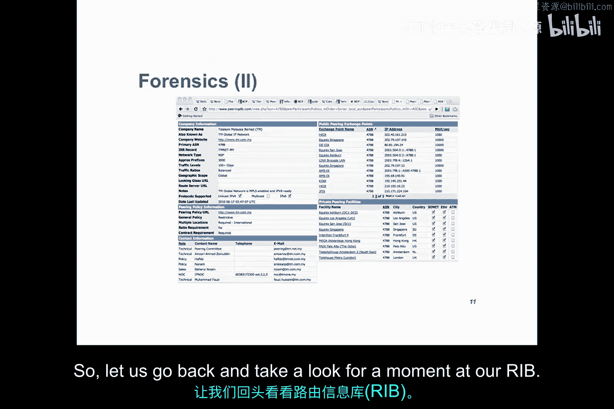

All right， so I go back and lay look at the rib。And you can see 4788 that is the last top I will use to reach my destination。

 so what you can see actually is that these hops are what's closest to be followed by ongoinging courts what's going to the end and if you take a look at the next top addresses。

 you can see those coming to relationships these are all 12123 and they're all part of 70T。

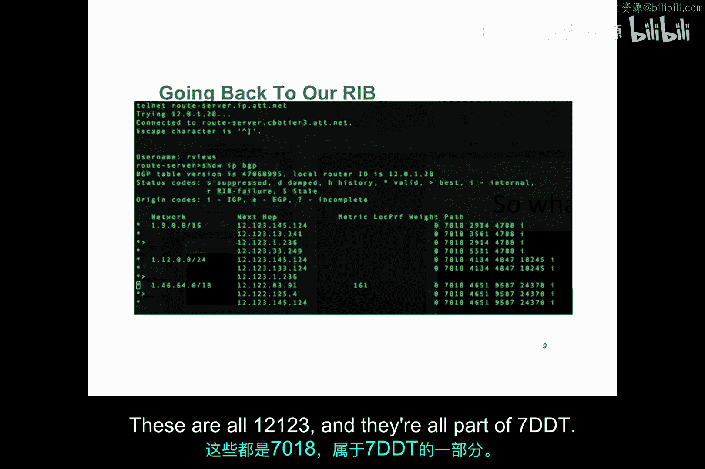

If I can use peering DB to find out the A， I can find it that say I said。

 I can take a look at the protocols it supports， and you'll also find out who it's plugged into。

 you will notice that all of these are that this AS is connected to these following exchanges， right？

没有。Have I take a look at another example。Allright， the big thing I want you to notice here is not so much the。

Not so much The information on the left。 I'd like you to look at the information on the right。

 Do you notice that everything is connecting to Equinix Ashburn just for the record where I'm lecturing know in D。

 C， where youre listening to this probably in the Maryland area。

 we have a good shake of the Internet connectivity in Ashburn， Virginia。Sir。

And right and so what I've done here is I've basically been going through all of the various steps to get to my end。

 7018 Marque so 8 and T， so let's just step backwards for a second to 7018。

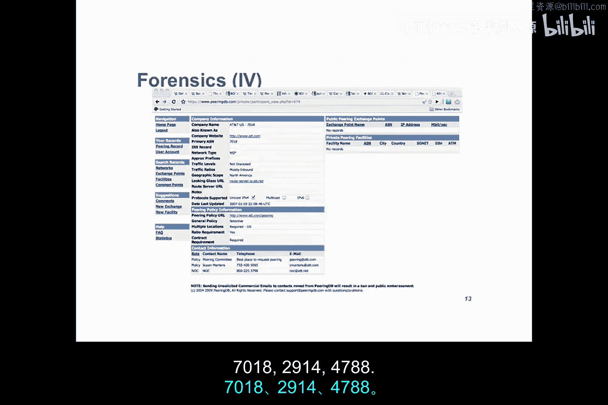

29， 14， 4788， so let's go back and look at those numbers again， you can see 7018。

29144788 now is AT&T servers in the continental United States。

 so it's going to go to that AT&T server first， so it goes to 7018 that AT&T server that it goes to 20914。

 which is going to do via Es Ashburn and then it goes to 4018 so what you can see is you can actually see the political entities。

 the people with the organizations that hold the route and I want her to keep that in mind in the previous lecture I talked about the idea that the routers is physically connected together using sources like peering DB and APic you can slide who owns a particular route and you can figure out who they are connected to。

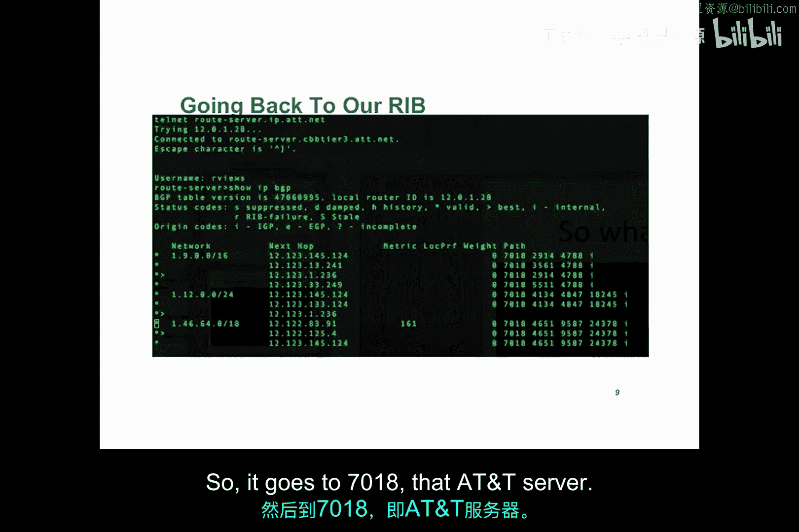

Her。对有。With that in mind， let's talk about where routers themselves exchange routers exchange BGP messages。

 The four big ones are open。Now， when we talk about BGp， BGP is peerto peer protocols。

 So we don't really talk about clients and servers， we talk about speakers。

 So you open a connection what you're having is you're having the two speakers acknowledge each other。

 You've give got update that pushes updates to the routes。

 normally routing updates happens either because somebody's an new cheap route or because something's ya odd doubt。

 notification is used for errors， either there's a keep a live message when you start a BGP connection。

 you just keep it running。 And if you don't send anything every few minutes。

 you go and send a message just to say I'm still here。

This is what a BGP open message looks like the version this is just the version of BGP。

 then' the auto ton of a system number， the BGP identifier and an id opticalal parameters okay。

 an update consists of a list of unfeasible routes and any path updates。

And this gives to the idea of how you actually take the path first off。

 it's not simple there are a lot of factors that go into choosing a route。

 some of these are kind of arcade。The key feature is that internal routing is a black box。

There's a weight metric which is supposed to reflect that。

 but I't get too excited about the weight metric on the whole。

 what you see is try to go through the fewest autonomous systems is possible。

And then theres some basic things you can use， there's the shortest path。

There's a value called local preference， there's a weight value and there's an origin attribute。

 whether or not it's internaloid st and all and so on。

 and unfortunately there's a good chunk of vium here all。

The reason for this is because B GP is a collection between a technical goal and a business goal。

 The technical will easier a route from point A to point B。

 The business goal is to make money doing this because of this peering arrangements appearing B G P。

 And based on how people sign their arrangements， that may also affect the route chosen。 Okay。

 Let guess see what peerers are peers of the organizational entities are routed。

 If I agree to outd to you， we are peererce。 And there are several layers of peering agreements。

 The most mysterious of what's called private peering， O。Below that there's transearing。

 Transapp appearing is what you will deal with your entire life unless you refer tier1 ISP Transappearing means you pay money to another ISP to move your data with the tier1 ISP。

 which is to say the 15 or so ISPs level 3 ET and T。

 they have agreements with each other on how to move data。

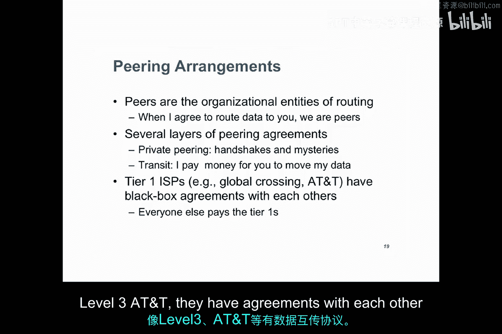

Everyone else pays them and this sort of gets to the terrible secret of BGP。

 this has going to become more apparent in the next lecture worth that I'm giving。

 which is good to talk about the infamous Pakistanstead YouTube incident。

 but here's the key thing to understand。The Internet is maintained by a group of people who are actually in quick contact with each other。

 Now there's a joking nicknamed the sushi cabal because these used to go for big sushi dinners at nanoanog meetings but understand。

 you， there's a finite number of tier ones。 There's a smaller number of tiers large number of tier2s but these people all know each other。

 you are the rod god for AT and T。 you know the routd god for levels for you know the routing dog for hurricanericane E。

 I you guys have you know gotten soccerer together。 You've been at nanoog meetings together。

 things like that。 There's an awful lot of handshking and informal agreement which actually manage as Bgp and you know the sushi cabals a bit of a joke。

 but understand at the heart of it。 this is a socially maintained protocol and it is not an autonomous mechanical thing know came out of this involves people who do do know each other and now how to set up in communicated informations to each other。

 So thats a true chapter。

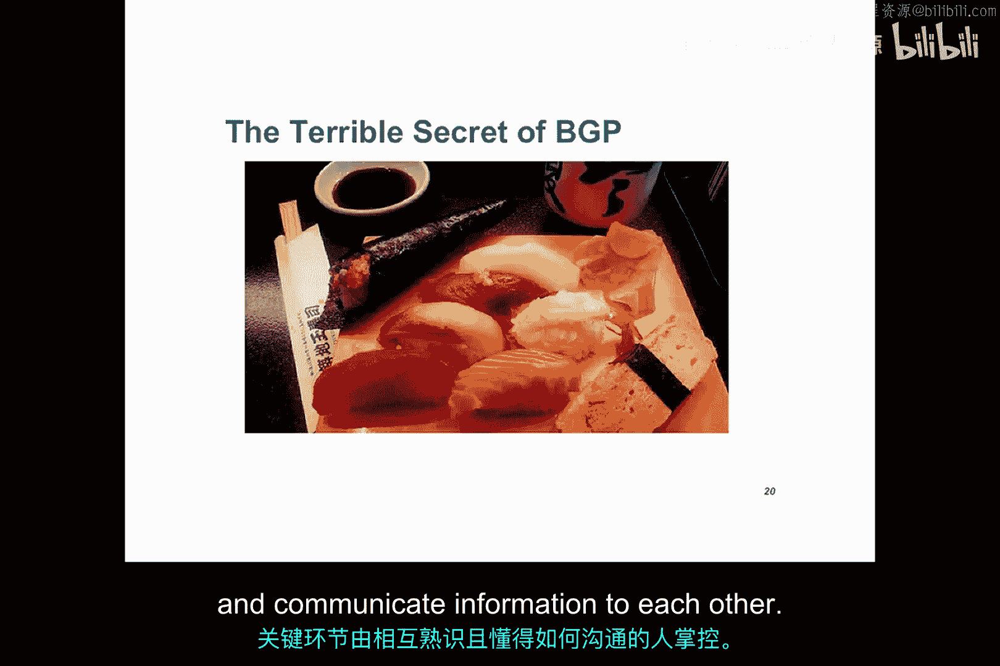

We talked about BGP structure， I tried to relate that route that I got from the table tangibleful forensics using a source like peering Db。

I can look up the associations of any particular of any d routing organization on the network and I can use that trace to the route and I think key thing that I want to get out of that is the idea that there is this ownership and business relationship that drives all of this it's very easy to talk about these things sort of abstract identities floating in the sky but understand business decisions and the personal relationships and often grudges drive this and that led to what I like to think of as the terrible secret of BGP and you are now initiates into that have a good day。

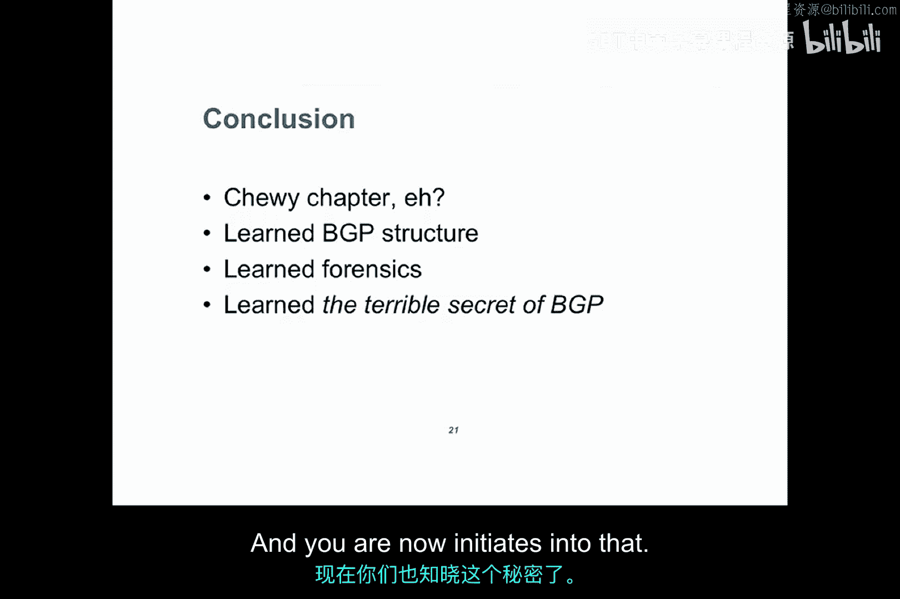