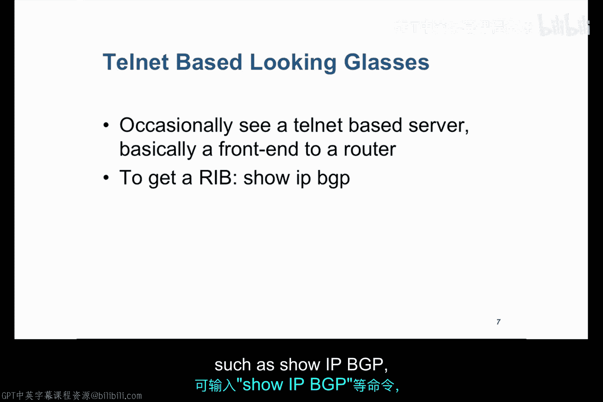
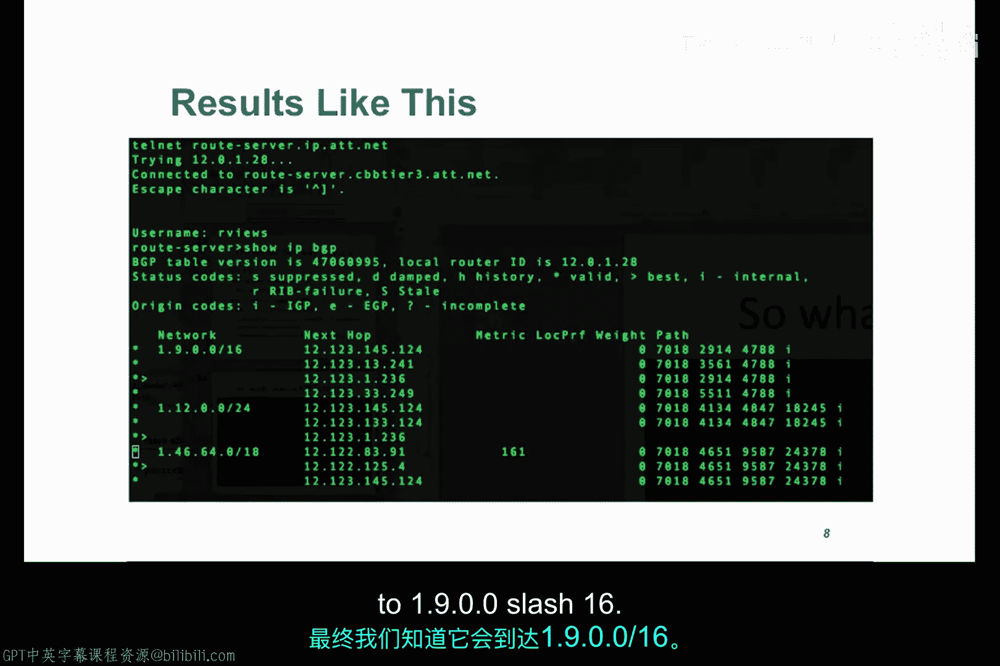
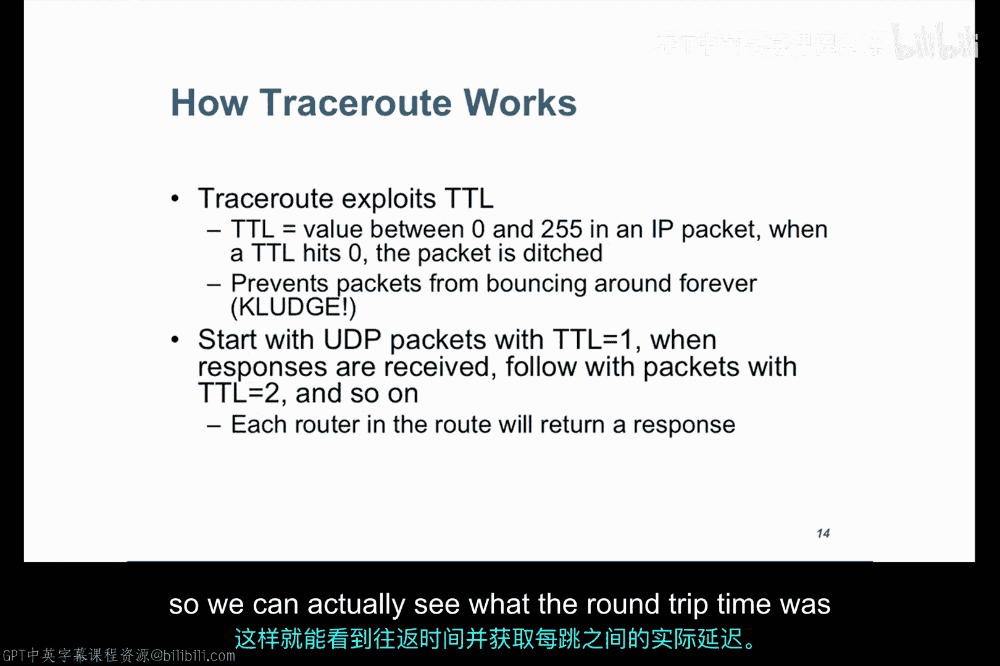
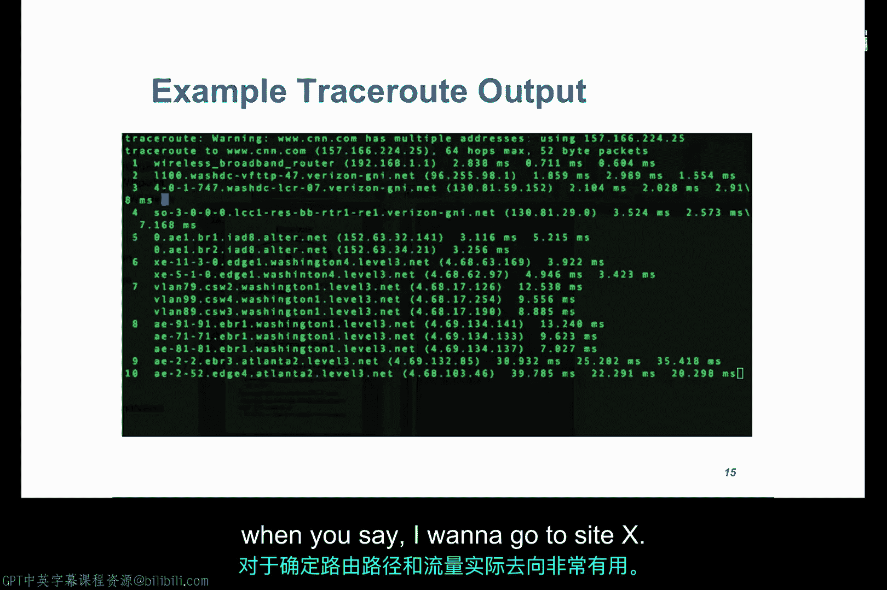
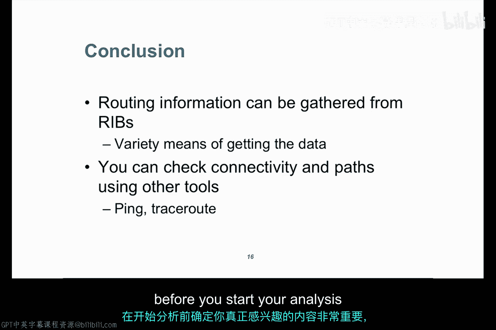

# 约翰霍普金斯大学《信息保障分析｜Information Assurance Analysis》中英字幕 p16 15_BGP源数据分析.zh_en -BV1Qz8EzYENX_p16-

N Bob71， module5， lecture4 BGP source data。If complete in this lecture。

 you'll be able to list few resources for analyzing and getting info about routeuting。

You'll also be able to discuss how to use a subset of tools that examine paths such as P and tracer。

Now in order to analyze BGP data， it's very easy to find a variety of different sources of data。

 some of the key pieces of data that you're going to be interested in whenever you're talking about routing is going to be Rs files。

 Rs files are routing information based files and generally they're provided from a variety of sources and these sources will tell you BGP announcement would pass were selected and the like。

And two of these are routeut views and looking glass。

Now Route Views is a University of Oregon project。It stores BGP data for multiple tiered。

 the data is stored in this MRT format， which is a multi threaded routing toolkit format。

And tools for parsing that can be found at the URL found below。

 basically it's a nice little compact format that is compact and consistent format that allows you to actually store all the routing information。

away now looking glasss is a little bit more interesting Lookinglas is more of a general term it's a term for a class of server software effectively a front end to a router so this generally comes in two wonderful flavors HTTP based or townnet based。

Now whenever you're talking about HtTT based you're going to be using general purpose sort of tools tellnetface is going to be generally more as a command line approach to it。

 but HtTP generally will have the nicer looking goy frontron air there's several there's several HtTP servers listed below here。

Now again， whenever I say nice little slick interface， I really mean nice little slick interface。

 a lot of them will say， okay， here step one， you select where you want to be looking from， step two。

 you select what what sort of destination information you want， step three。

 how you want us to get it， paying trace route， look at EGp。What来。The Tnet that again。

 this is more command line based， occasionally you'll see these and they're basically a front end to a router where you can type in some sort of information such as show IPBGP and get some information that looks somewhat like this。

Now， the information that you're sending here is basically a bunch of path information forget getting to various IP addresses to see 1。

1。9 slash 16 do0。016 that's where we're trying to get。

 That's the destination network we're trying to get if we try and go to that one the next hop is this 12。

123。145124 there's other next hops that can be taken And then after that you actually get to see the full path of what it's going to try and do So again we're not we're kind of worried about where the ultimate destination howre is the ultimate destination but we don't necessarily have to worry about every step of that we just have to worry about what the next hop actually is in this case So we know that next hop we know it's IP address we can actually route information to that guy and eventually we know that it's going to get to 1。

9 do0。0 slash 16。

So。There are some key details that I want to make sure that everybody's aware of。

First of which is routing is not。If A roused B。It may take this really short， really quick， nice。

 simple， lowest latency path。 B might take this really long。

 really obnoxious goes through Singapore and Shenland and then goes back to America to get back to a。

Doesn't matter。Both of them are able to route their packets。

 you don't need symmetry in order for the undergradal work， in fact。

 that's one of the active design goals。So we're not too worried about the fact that that it's not。

 There's several reasons why it wouldn't be。 First off， you know， cable placement。

 peering arrangement and， all that sort of stuff actually starts dictating this。

 But this is kind of stuff that's under the covers that the end user doesn't really need to know about。

And most people， even if they are active in this really don't need to know about it， however。

 BGP allows us to actually say， okay， given these set of circumstances， how do we route around？

And that's really the entire so we've talked a little bit about the routing itself。

 we've talked a little bit about how to get at that rib information now we're going to spend a little bit more time talking about some tools that people generally use to figure out what's going on from their system to another system。

And two of these that I'm going to spend a lot more time want are paying a trace route。Honest。

Whathi you're going to need whenever you're using some of these tools？Well。

 not necessarily paying a trace route because you can do that directly from your system。

But if you want to narrow what things are like from。

 say a system in Japan to a system in North Korea， South Korea。

You might want to actually go to a router that's closer to that area to get a better indication of what's going on between those two sites。

Doing a p from here really doesn't help you that。So where is a bang bang， quite simple。

 ICMt based tool。Everybody's probably used this before。

 so I'm not going to spend too incredibly much time on it。

 but let's just hit some of the high details anyway。

Ping sends out an ICMP message that has a code of zero in a type of8， so that's an echo request。

If the end host accepts this request， what they will respond back with is an echo reply。

 which is a code of0 type0。Again， the IC message。Now。😡。

You can actually encode some state some some state information in the packets in the echo replies are in the echo requests。

 and this allows you to disambiguate stuff because generally speaking。

 whatever you type in ping and you say let's say ping go do co you're not going to send the one ping you're going to send multiple ones and what that will allow you to do is just get several different attempts And whenever we're saying several different attempts。

 you don't always have to have every single one of them functioning exactly it's say。

You can adjust a lot of stock， you can adjust the payload size for the ICMP message。

 you can adjust the TTL so you can say， all right， I want this ping to only go3 Sw this P goes or this ping goes to the maximum。

And just， you know， see the differences that can occur there。Now。

Ping can be used for some offensive sort of attacks。 I mean， there is the classic ping of debt。

 There's ping flooding。 There's smurf。 All these things are present。

 We're not going to get into much detail about them right now。

 but I do want people to be aware that these things do exist。

 And there' are several resources available for actually。

Going into greater detail about what these things look like on the why Now let's go into traceville trace fors another one of the fun ones because you can actually see the exact path that S takes。

Now Tce Roads basically a routing analysis tool and diagnostic tool。What I mean by that is， you know。

 if if we are trying to figure out。Why we've got such latency between two different points。

 one thing that we can quickly do is just type trace route from one point。And say the destination be。

Say in this case again， gocom。It's going to give us the exagger latency between each hop。

From the path from our computer to Google。com。Wherever that Google docom big。

Wonderful part about this is you also get a listing of every single router on that path that has a name and that is willing to report that name。

So。Trace routeouts are wonderful to thing as it allows us to also exploit TTO。

The TTL value is between 0 and 255 in an IP packet。When TTL hit zero。Haett done。

 Ha could just get stitched。Wevent packets from bouncing around for aling ever。Well。

 this allows us to determine what the actual minimal T TL must be in order to get our packet from pointing。

 Joly speaking， we don't have worry too much about this。 But again。

 if you're actually trying to trying to map things out and look at things at the network。 what layer。

This is the type of information that you definitely will be needing。Now。

Trace route starts with the EDP packets with a TTL of one when responses are received。

 follow with packets， it it follows with packets with TTL equal2， so forth and so on。

Each router and the route will return a response。 And again， that response generally includes。

 you know， the response to the message， which gives us some indication of what the router is。

Way it is。 And， of course， we have a timing。 We have a timer that we set up after each of these so we can actually see what the round trip time was and get actual latency between each of the hop。

 So if you just go to your command line and type and trace route on a Linux box or a trace R T on a Windows box。

 you're going to get something that looks a lot like this。

And you can actually see this developing over time and it'll tell you the exact milliseconds it took between each hop and it'll tell you where the packets go。

Very interesting tool， very useful for determining how things are getting routed and where your traffic is actually going when you say。

 I want to go to siteex。

So in conclusion， routing information can be gathered further。

 there's a variety of means of getting bad data and there's a variety of means of getting at other useful information such as paying and trace route。

Now when you're looking at these things， I want people to consider the fact that using your system will give you the routes from your system。

 using looking glasses will give you the routes as viewed from other parts of the world。

Very important to determine what you're actually interested at before you start your analysis so that you can gather after action from the appropriate sources。

