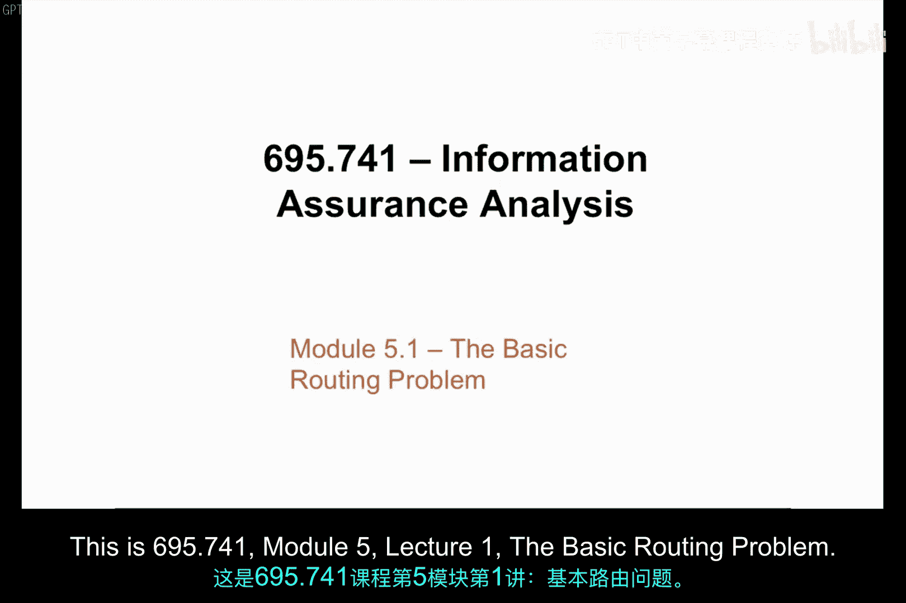
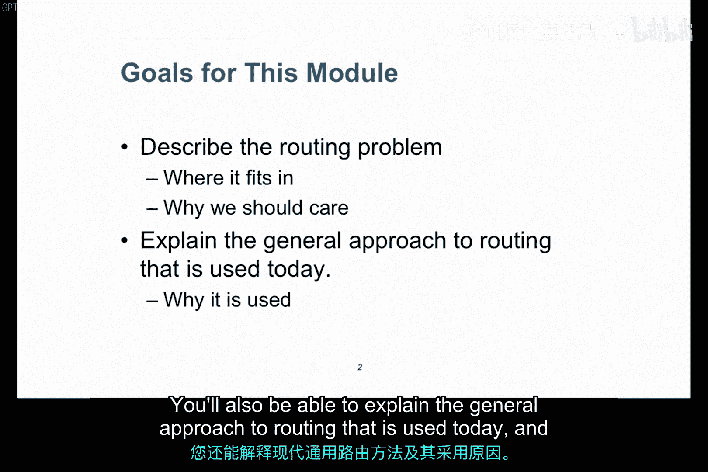
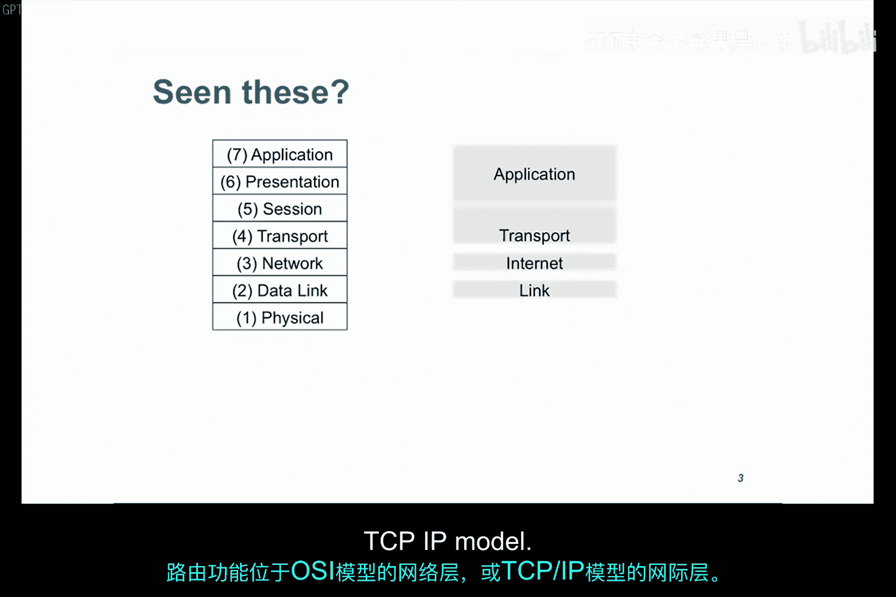
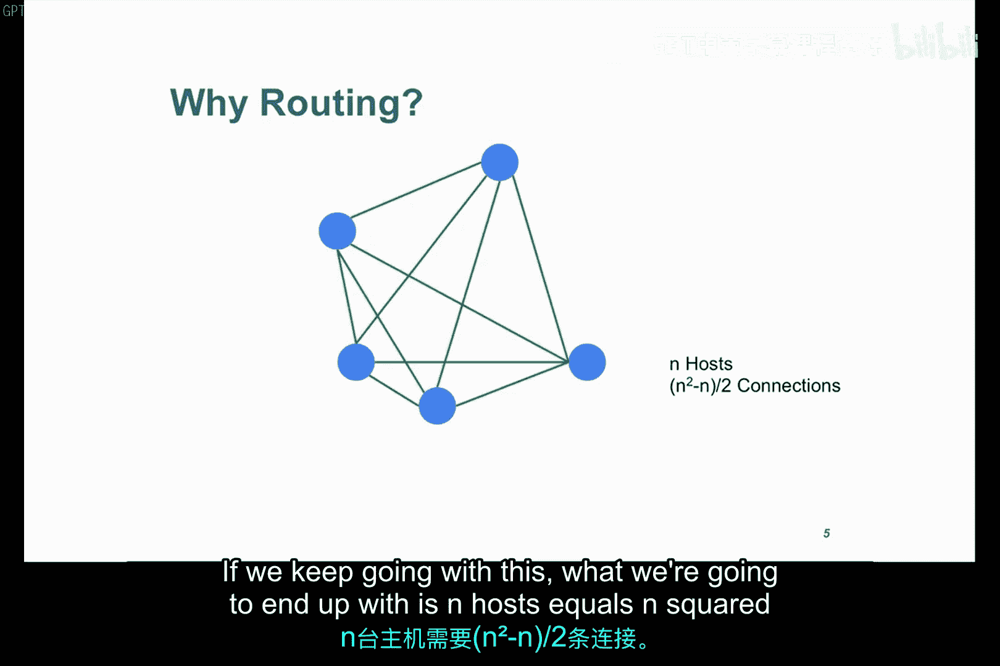
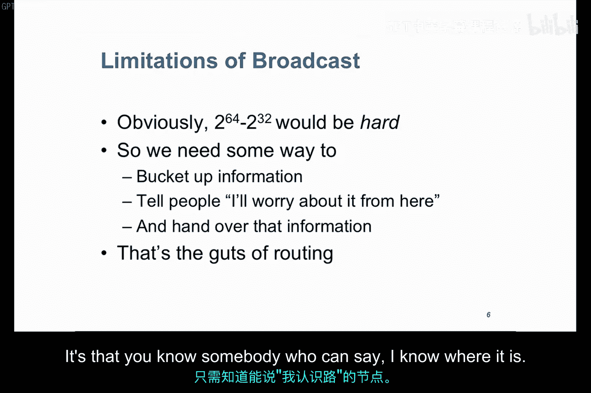
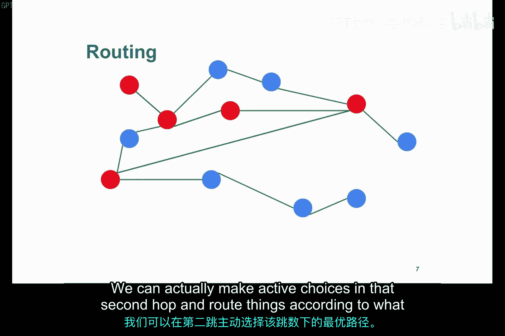
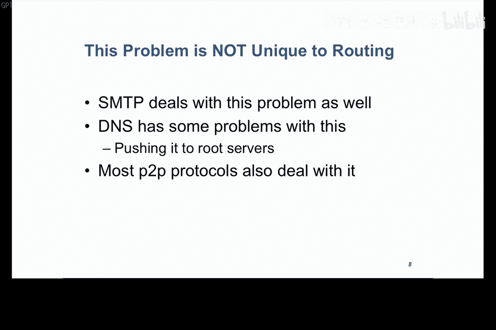
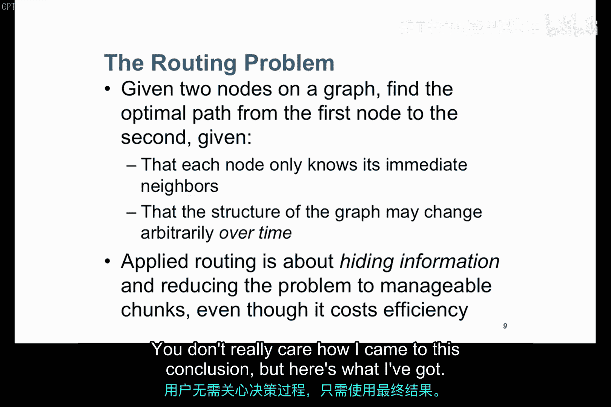

# 约翰霍普金斯大学《信息保障分析｜Information Assurance Analysis》中英字幕 p17 16_基础路由问题解析.zh_en -BV1Qz8EzYENX_p17-

This is 695741， module P lecture 1， the basic routing pro。

At the end of the dis modulech， you'll be able to describe the routing problem of where it fits end in the general scheme。

And why we she even really care？We also be able to explain the general approach to routing that is used today。

And why we actually。Let's start talking about where we're going to be working in this module。

You already know the OSI model on the left here。Where each part of the stack depends on the other parts doing their job。

For example， as we've got web， we have HM that's over TCP over IP over ethernet over twisted pairs。

 And， you know， each of those has to actually be functioning properly in order for the one before it to be to work correctly。

 You can't have H TTP without it TCP。Working if it， if it helps you。

 you can actually think of it in terms of the TCP IP view of the world on the left there。

Routing is handled at the network layer and the OSI model or the internet layer in the TCPIP model。

So that's basically where we're going to be working and focus。N module。B editta link layer。

It is layer two and it tends to be a broadcast every host dumps data onto the bus。Um。

 and just has everybody else try and shelter out according to what belongs to them or not。So。

It sorting out which messages are interesting to a particular host。Has to be handled。

At the next level and particularly what we need by this is that that we've got to figure out exactly what information is important to us based off of something above that layer。

 So layer 3 that network layer and that in that actual。Inter layer。Just for example。

 let's assume that everything is connected and everybody sees everything。If we got three hosts。

That means three connections。And we assume that everybody has a connection to everything。

It's as soon we have this fourth guy over here。 That's going to give us4 hosts with6 connections。

 Okay， let's add another one。 So we got  five hosts with 10 connection。 If we keep going with this。

 what we're going to end up with is n host equals n squared minus n over two connections。

 That's obviously not going to work that everybody's going to have connections with everybody else。

 And on top of that， what's really not going to work about that is storing the information about each of these individual connections。

I don't know about you， but my computer does not have two to the 22 to the 32 Hrtzs on。So。

And when I said port， I'm talking about physical ports， not TCP ports。UmSo。That's very hard， very in。

So we need a way to actually bucket information together to have things that are being able to tell what they're connected to。

And actually pass information to where it should be based on what they're connected to。

So the way that it should really work is that。Somebody says who can actually get this message to this different location。

 somebodybody actually has to raise their hand or say， you know， don't worry about it。

 I know where it is， I'll send it there。That's what the gods of routing are。

It's not that you know exactly how to get every single place。

 It's that you know somebody who can say， I know where it is。 I'll get it closer to。

 So what we end up with is。

These kind of connect graphs here to where not everything is interconnected。

 but there are a lot of connections that will form interesting pets。So。

If you've got something that's going from the top left there and needs to go to the bottom left。

We don't have to announce it everybody， we just have to announce it in such a way that says， hey。

Do you know where this is and the guy who does or is going to get the message to the next closest place？

Automatic re chimes in knows what it's doing， takes that message。

 repeats the process until it gets to its final destination。

We don't have to include all these other nouns。 We just have to include the ones that are important and on top of that。

Just because one time。A message went to some other destination doesn't mean that it always has to go that that every message has to go through that destination。

 we can actually make active choices in that second hop。

And route things according to what is best for th hop， so this is not a problem that's unique meet。

To just this layer S andTP deals with this problem as well。 So does DNS。

 it has the same sort problem where it basically doesn't。Your DNS server。

 your local DNS cache does not know every single DNS name I P address period It just knows the one sets areene。

 and it knows where to go to get more information for specific sex。

 Most PD P2 P protocols also have this。And this is a very interesting problem。

 especially whenever you look at protocols like pastry。

 which do deal a lot with localization of their node collection and optimize。

Same sort of principle present。

So given two nodes， one a graph。We need to find the optimal path from the first node to the second。

 given that each node only knows its immediate acresers and that the structure of the graph may change arbitrarily over time。

People don't like to think about it， but there's a simple fact， the internet is constantly changing。

In fact， one of the ongoing jokes I used to have is asking people true or false with enough sky miles and a pickaxe。

 I can take Australia off the mat。 Now， if I go there and I start hitting every major every major physical connection that goes under under the water to Australia。

Take out each of those lines。As I'm taking out a line。

Roouting is going to BGP is going to allow us to route around。This。

Pippe that are this big pipe that I just cut in half。So basically it's a self healing kind of system。

 doesn't heal the best way， it just heals and a way that work now。

Another thing about this is that was a fiscal issue。 We can also apply this to。

Drop down to handle sort of circumstances where two separate entities like large telecom telecoms。

Are allowed to say I'm going to charge you X amount of dollars to route information through me。

If you， as one telecom have the option of routing through this guide is going to charge you 50 bucks and a guy is going to charge you 10 bucks。

 chances are you're probably going to try and put together a pass structureer that routes people through the tin0 book connection more often than the 50 buck。

Now， granted， there's going to be cases where the 50 buck connection needs to be done because that 10 buck guy can't handle it or doesn't know or doesn't have any efficient path to where you actually need to go。

 So in that case， yeah， you still need to go through the 50 buck。

 but all this stuff is hidden away from the user and all this stuff is hidden away from from from almost every。

It really just boils down to here's the path that I've got。

 I don't you don't really care how I came to this conclusion， but here's what I've got。

 use it as you will。

