# 约翰霍普金斯大学《信息保障分析｜Information Assurance Analysis》中英字幕 p18 17_数据包路由机制.zh_en -BV1Qz8EzYENX_p18-

Hello class， this is Professor Collins and this is a 685741 Information Insurance analysis。

 this module is module 5。2 on packet routing。

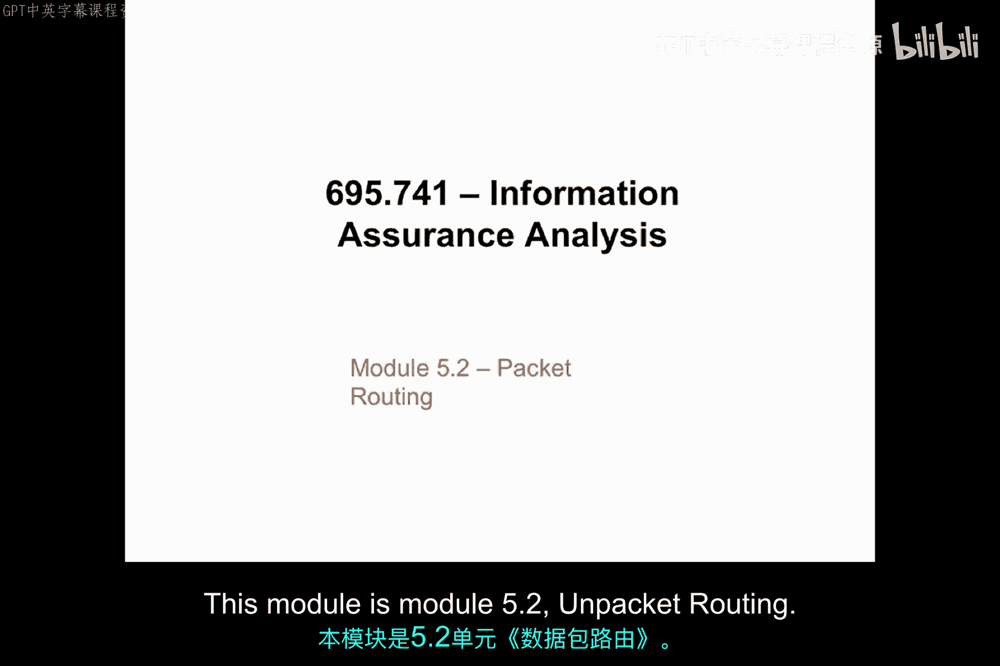

The goals of this module are to review some material that we covered earlier in the class about the interaction between link protocols and routing。

The key reason for this is because up until this point。Apart from submission mention of C D Ns。

 we've basically talked about the Internet as sort of。Effectly。

 a gigantic broadcast medium packets get from point D to point B。

 but it's not entirely clear how they do so。Routing is the physical infrastructure that enables us to happen。

 and in order to understand what's going on， you have to have a clear idea of how routers operate at the IP level。

 this is also involved the role of the TTL which as you know has been sitting in the IP packet we've talked a bit about it。

 this is where it really comes in。

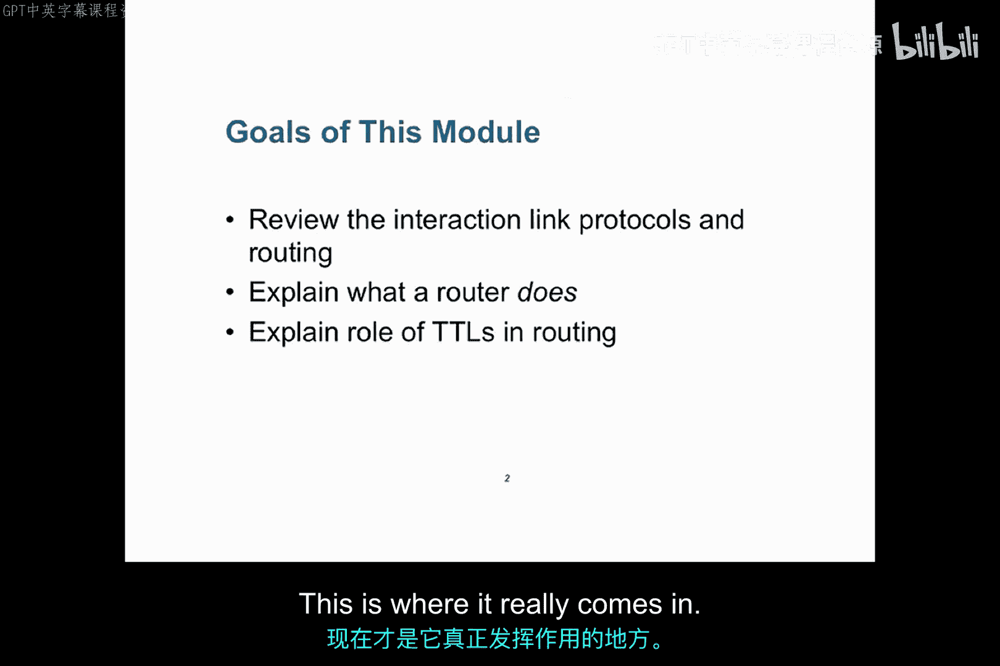

So。Let's start with what a router is。The simplest definition of a router is a router is a multihomed computer。

 This means that a router is a computer that has multiple interfaces that connect to other networks。

 For example， you can nominally consider most。Modern。

PCs to have at least some router functionality because they have both a wireless physical internet and a physical ethernet interface。

What routers do is routers enable you to hop between networks that enable the packets to engage in the mechanical act of moving from a router's perspective。

 this means receiving a packet on one interface and then using a pile of information to determine that it goes out on another interface。

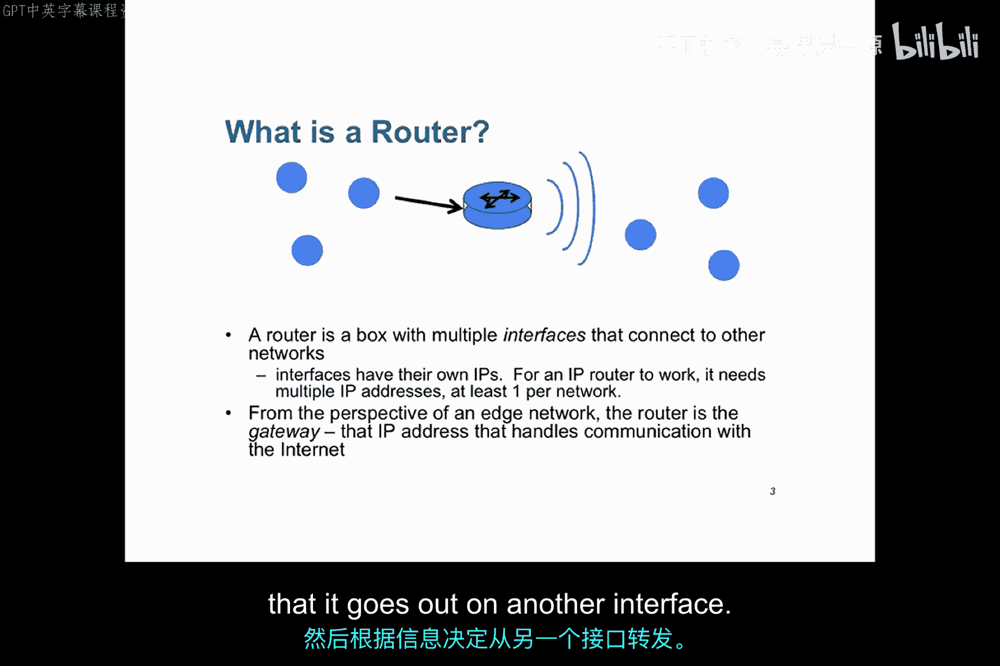

Okay。Now。This is a messy， messy situation。Routing is really the point when all of the illusions we've built up about how the internet operates fall apart。

First off， this is because we're dealing with multiple protocols。

The cornerstone of Internet routing is a protocol called BGP。

 the border gateateway protocol BGP is a TCP protocol。

 but what it's doing is it's a TCP protocol for managing information about routing routing in turn is actually handled at layer2 it's the actual link protocol for convenience from mostly talking about Ethernet。

 and then there's this ap protocol which relates the physical Mac addresses。

To the IP addresses now this is all after we've already figured out where we're going， I mean。

 we haven't even touched on DNS here okay。

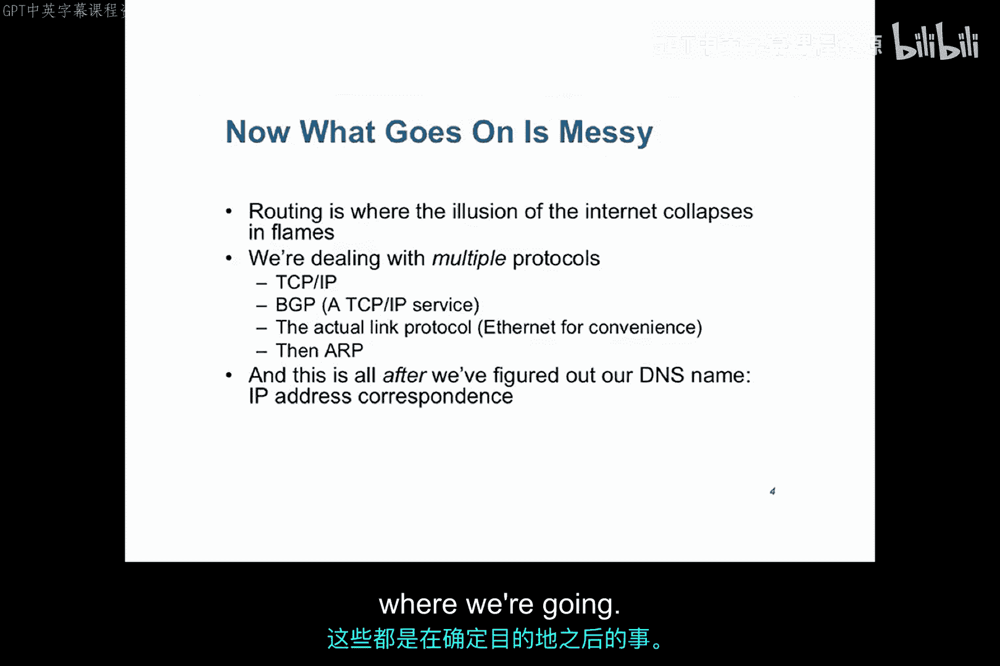

Now we start with it， recall the ethernet frame。Recall that Ethernet is a blink level protocol。

 and so what it's doing is it's transmitting information between two hosts。

It's transmiting information between hosts， but it's doing so in a broadcast fashion。

So when the Ethernet。Packet is issued， it goes to all the hosts of the network in which everyone has the appropriate destination Mac reads it。

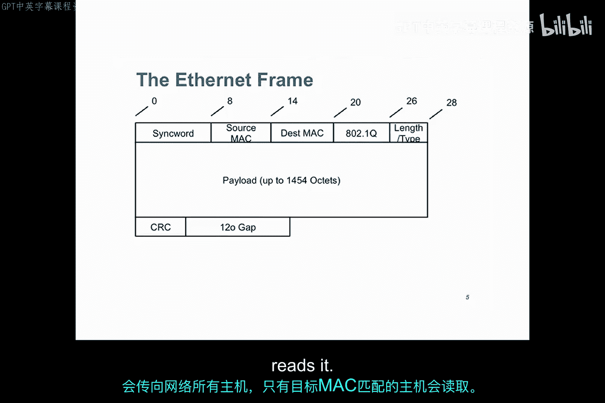

你这。Now。These cement addresses are Mac addresses， Mac addresses now Mac addresses are sixoctet addresses。

 they are unique identifiers for the hardware and this is an important feature of Mac addresses in comparison to IP addresses Mac addresses on the whole have have a physical breakdown of the 48 bits that make up the address 24 of them are already reserved for the corporation that built the machine question this is then split into the know this global or OUi。

 the corporate identifier and then the niC ID， which is another 24 bits Now obviously you can see that there will be overlap I mean well this really gives you is gives you 16 million unique potential Mac addresses but ideally you shouldn you know those you have less than 16 million cards under your network you should ever be dealing with collision baring breathta para now。

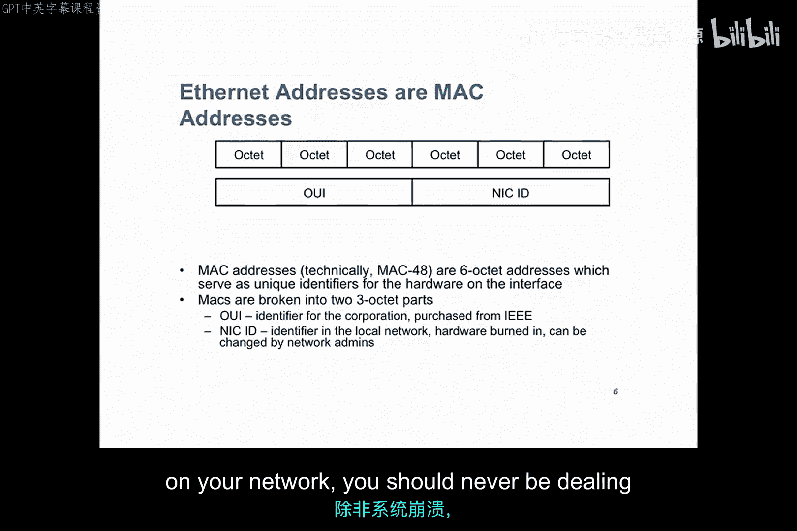

Recall these religion broadcast。 what this means is that。

Messages are sent across the shared circuit now when you do later2 networking。

He talk an awful lot about how things are physically wired together， start topology。

 bridge topology and so on。 what happens is。When you are working in this environment。

 you are going to say everyone is going to read， write simultaneously and the protocols have to manage that interface。

 This means that these things have scaling limits。 and this is the core feature of routing。

 We don't route because we want to reroute because we have to。

Ethernet works by broadcasting a message to everything on the shared bus If we tried to do that on the entire in that internet。

 it would collapse， think about it， communicationic goes up by the square of the number of hosts。

 see the explosion Now in layer2 because you're contesting a common resource there are a couple of classic ways of handling this there's a synchronization which is how things I can't handle it there's temporary control。

 which is what token ring does and then ethernet simply resends on collision。

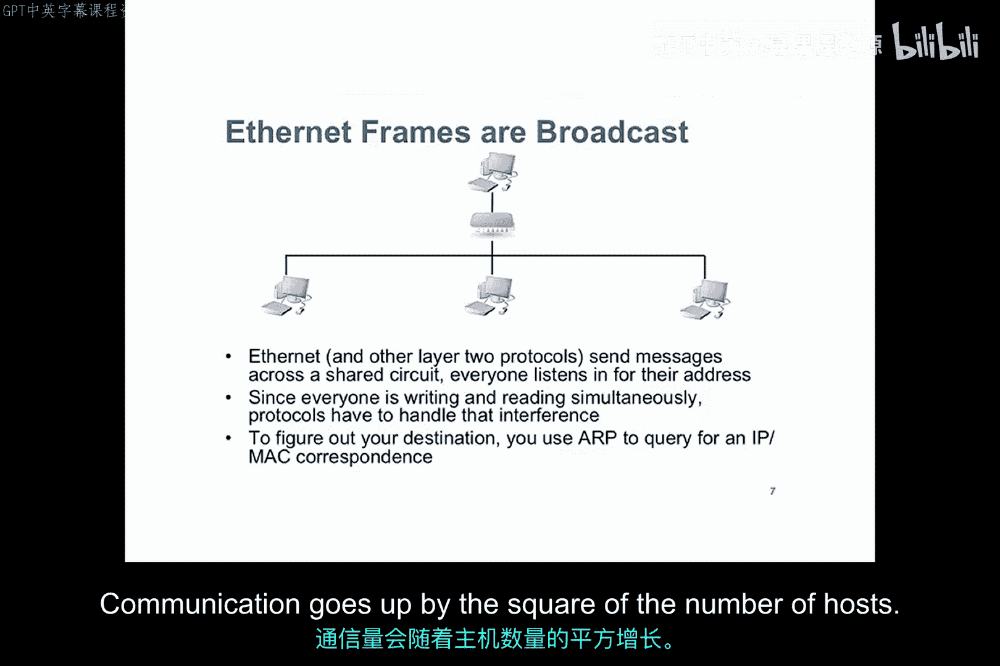

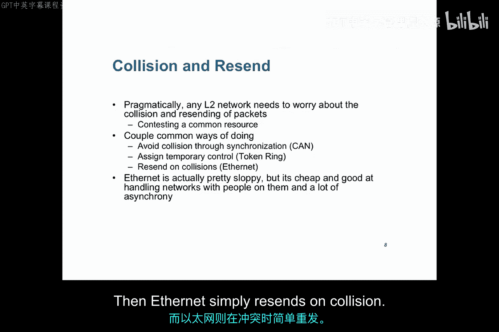

But collision in the resends cost is why we end up with this issue of frame size。

 you may remember that we talked about having a 1500 byte MTU limit this is going to be a fiscal limit on the size of the packet Ethernet informs TCPI pay okay。

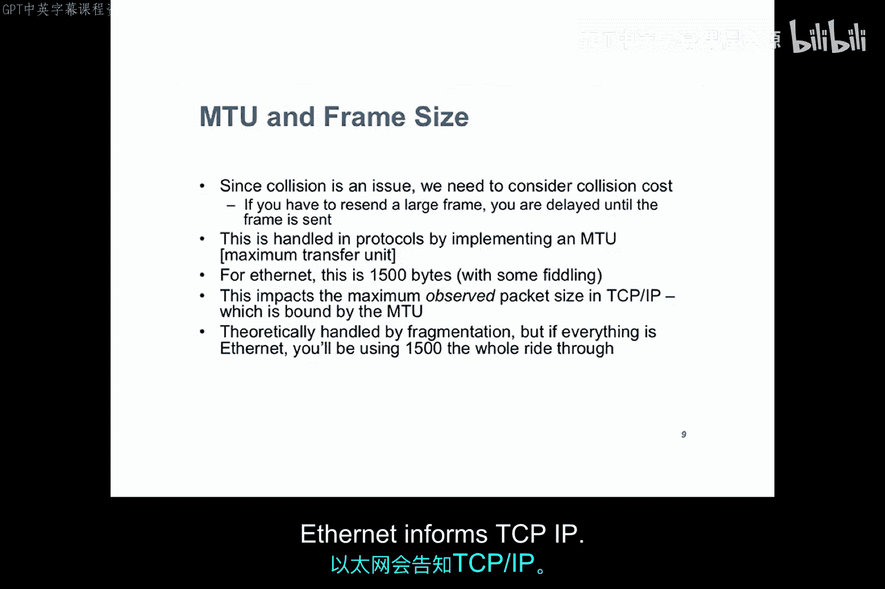

Now， why does all of this matter， okay？The structure of a packet is dictated by the network it's acrossing。

The physical process of shifting from network to network is what we call hopping， okay。

 hopping is managed by routers， okay。A hop moves a packet from one network moderated by BGP to another BGP network。

 How does it do it， It physically copies the packet。 Remember。

 the router is a computer with multiple interfaces。

 A hop means that the router receives the packet on wind interface and then moves it to another interface。

 so what does this look like。

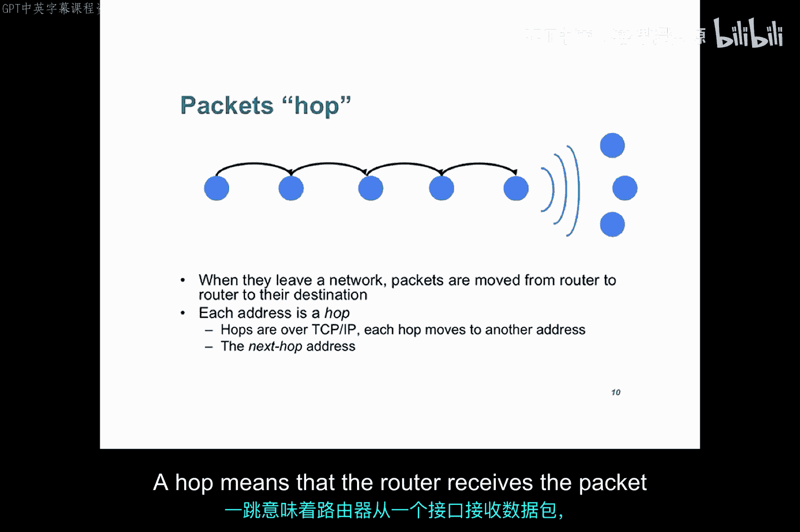

， let's consider the physical act of hopping I have。A packet， it has a source IP of 122111。

 a destination IP of 99， 143311。So what I want to do is I want to get it from my network to the appropriate destination IP network okay now this brings up a very important point about the internet。

 which we。Tend to alllight When you send a packet。 once you get past your wireless network。

 You are actually dealing with a physically traceable route。 Had I a diving suit and enough patience。

 I could physically walk the route that a packet takes to get from point A to point B。

 I could keep my hand on the cable the whole way along so I could dig through the loop。

 dig down to the underground cables。

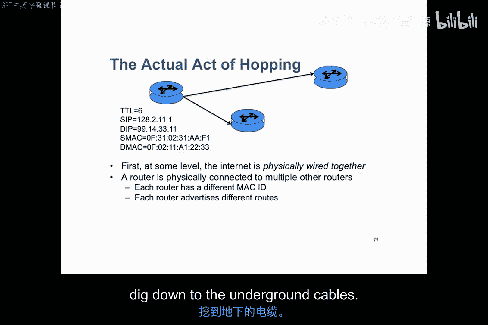

亮。What happens during a hop is the packet is passed over to another router。

 the address sent to the address that the router manages is called the next hop address。

the TTL is decreased now the other thing you will notice the Macs have changed。

 the reason that the Macs have changed is because you have moved to a new physical interface。

 so you know the IP addresses is global on 28 to111 remains the same throughout the communication。

 but the actual Mac addresses that are handling the transmission changed with each app on the router。

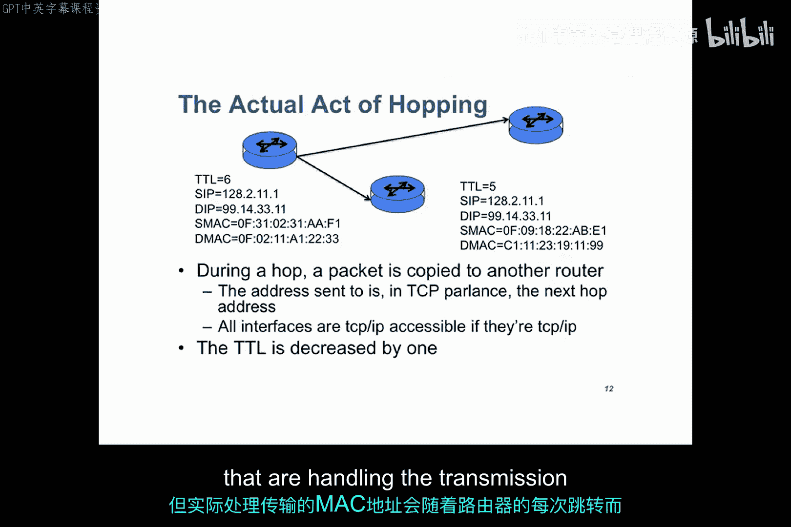

Why the T TL All IP packets have a TtL， It's the time to live value is's decremented by one for each hop。

 The reason for this is because if we didn't have it。

 packets would echo across the network for eternity。

The detail is a fungible quantity what I mean by that。Is that gives a variety of initial values。

 different stacks specify by different initial TtLs。

The other thing is that there's nothing preventing you from modifying it on route。

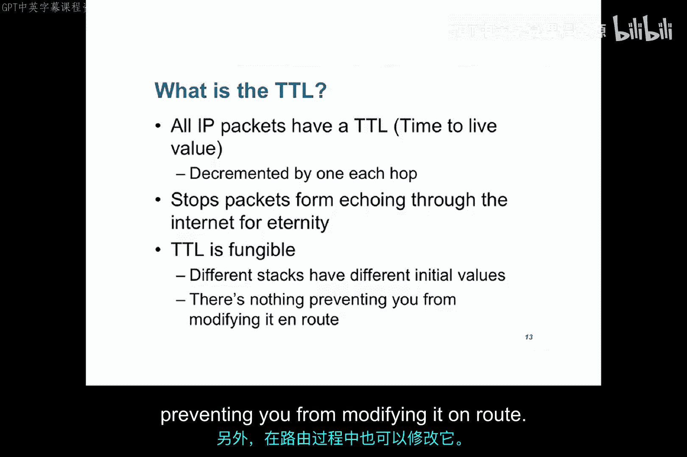

This is in fact the beowwick of protocols like in PLS。So。Things to keep in mind first。

Physical routing impacts higher layers we tried we've tried to abstract it away I talked about this in a previous lecture I'm reviewing it now okay。

Neither than in mind， the routers are physically plugd together。 It is possible。

To do damage to the network simply by attacking that physical asset。

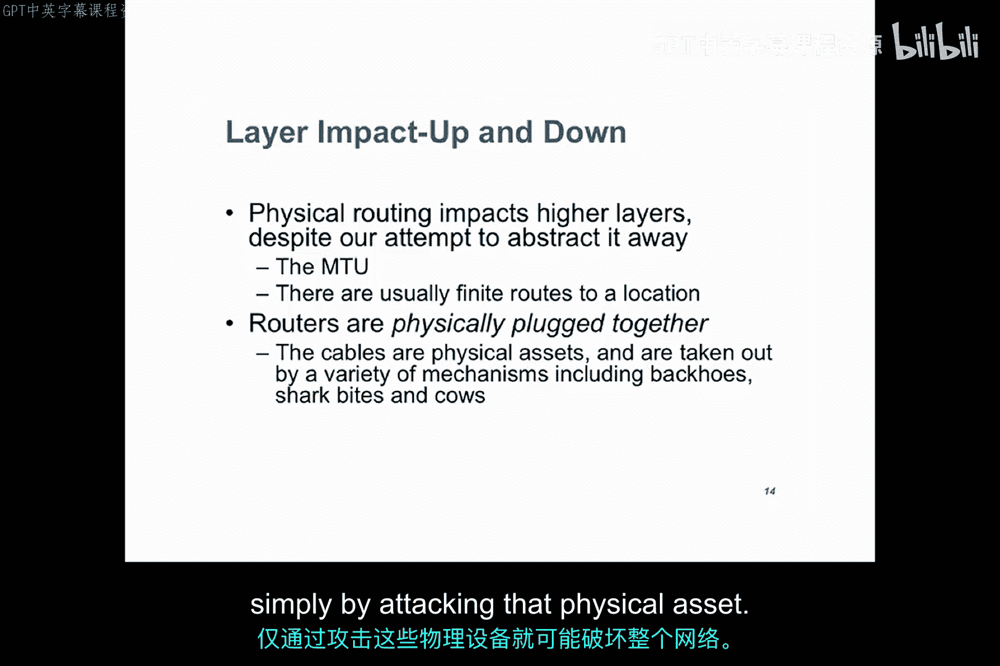

So in conclusion， we've reviewed the multilayer relationships to routing。

 I've discussed a bit about Ethernet structure and collision avoidance， here's the real takeaway。

Ethernet's a broadcast protocol。In fact。AllAll of our layer2 protocols are to a large extent broadcast across shared bus。

 we cannot engineer a bus the size of the world， The reason routing exists is to hide。

Individual networks from each other to make sure that collisions interface noise。

 these are reduced to a manageable volume， and we do this by sending information along controlled channels。

 These interfaces between routers are generally well maintained， physically monitored assets。

 but just the concept of hopping and routing。

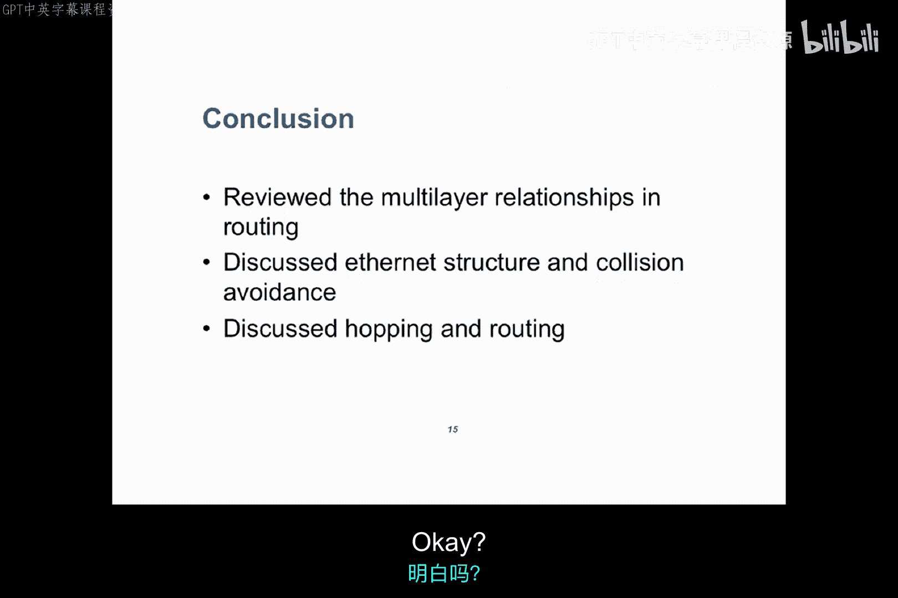