# 信息保障分析：5.2：数据包路由机制 🚦

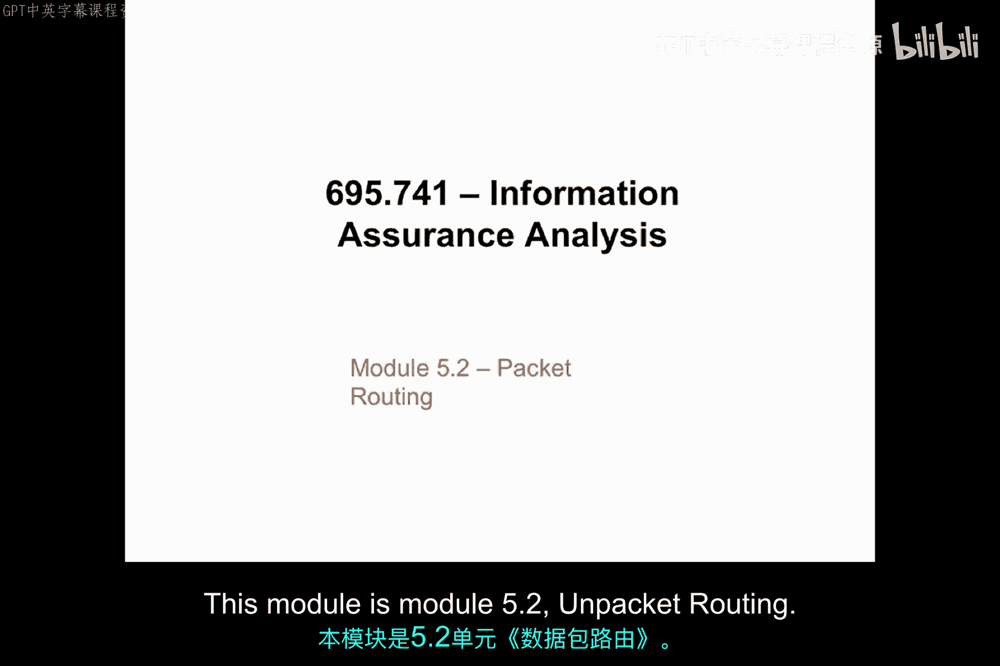

在本节课中，我们将学习数据包路由机制。我们将回顾链路协议与路由之间的交互，理解路由器在IP层的工作原理，并探讨生存时间（TTL）字段的实际作用。

---

## 什么是路由器？🖥️

路由器最简单的定义是：**路由器是一台多宿主计算机**。这意味着路由器是一台拥有多个接口、可以连接到不同网络的计算机。例如，大多数现代个人电脑都具备一定的路由器功能，因为它们通常同时拥有无线网络接口和有线以太网接口。

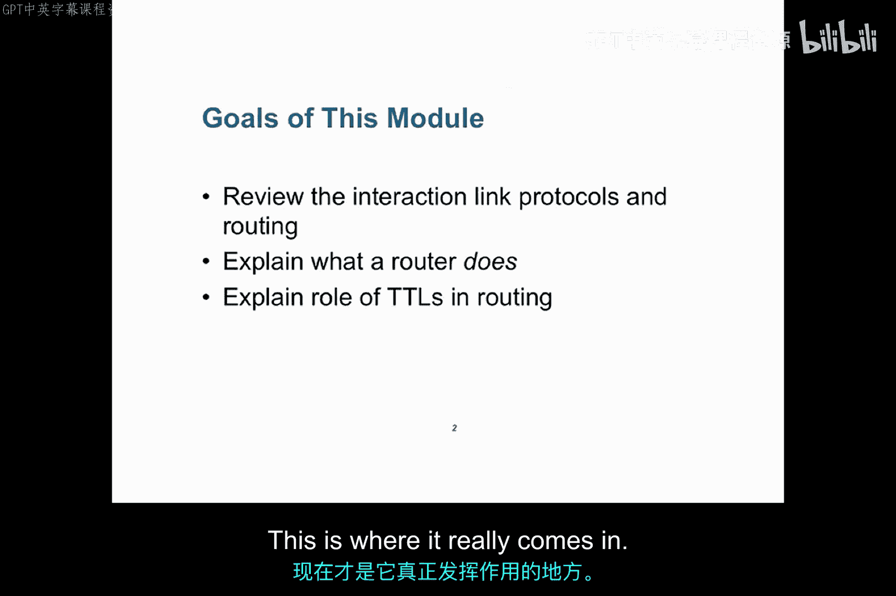

路由器的作用是使数据包能够在不同网络之间“跳跃”。从路由器的视角看，这意味着从一个接口接收数据包，然后利用一系列信息决定从另一个接口将其发送出去。

---

## 路由的复杂性 🔄

路由是互联网运作中所有抽象概念开始瓦解的地方。这主要是因为我们需要处理多种协议。

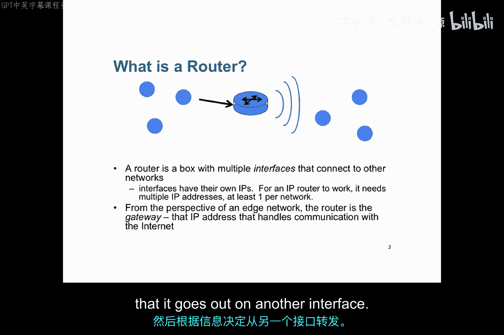

互联网路由的基石是**边界网关协议（BGP）**。BGP是一个TCP协议，但它用于管理路由信息。而实际的路由转发工作是在**第二层（数据链路层）**完成的，通常是以太网这样的链路协议。此外，还有**地址解析协议（ARP）**，它负责将物理MAC地址与IP地址关联起来。所有这些都发生在我们已经通过DNS确定了目标地址之后。

---

## 回顾以太网帧 📦

以太网是一个链路层协议，它在两台主机之间传输信息，但采用的是**广播**方式。当一个以太网数据帧被发出时，它会发送给网络内的所有主机，只有拥有正确目标MAC地址的主机才会读取它。

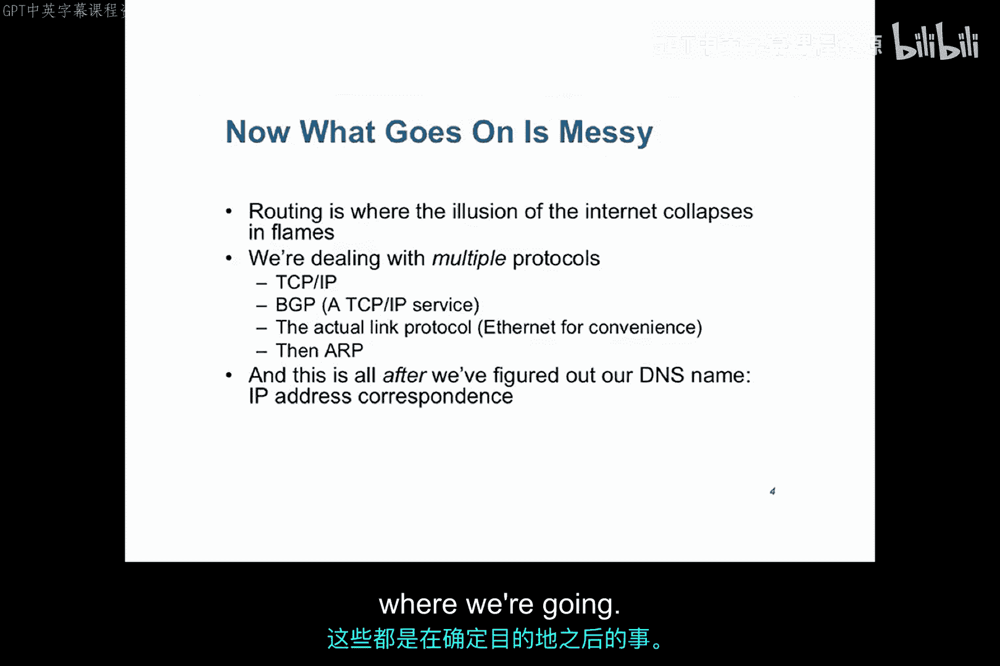

---

## MAC地址详解 🔢

这些硬件地址就是MAC地址。MAC地址是**6个字节（48位）**的地址，是硬件的唯一标识符。与IP地址相比，这是MAC地址的一个重要特性。

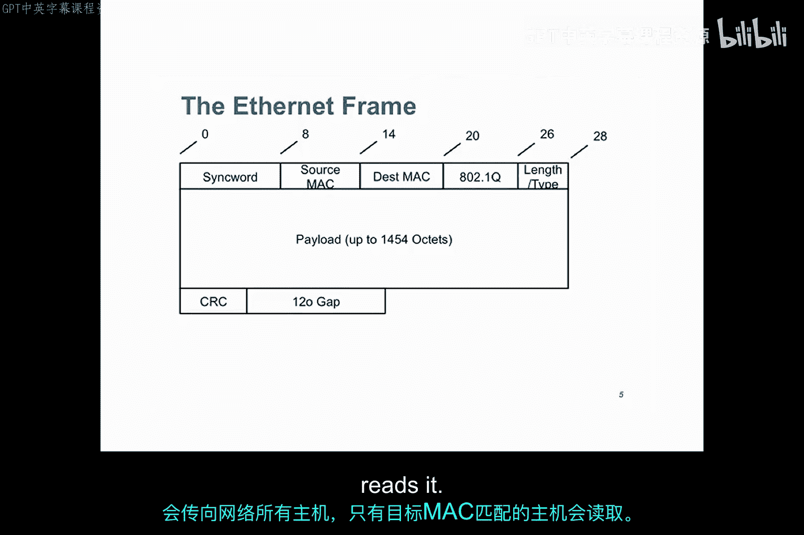

MAC地址的48位结构如下：
*   **前24位（OUI）**：分配给制造该硬件的公司。
*   **后24位（NIC ID）**：由制造商分配给单个网络接口。

理论上，这提供了约1600万个唯一的MAC地址。在理想情况下，一个网络内的网卡数量不应超过这个数字，以避免地址冲突。

---

## 广播与规模限制 📡

广播意味着消息通过共享线路发送。在第二层网络中，我们经常讨论物理拓扑（如星型、总线型）。在这种环境下，所有主机都可能同时读写，协议必须管理这种并发访问。

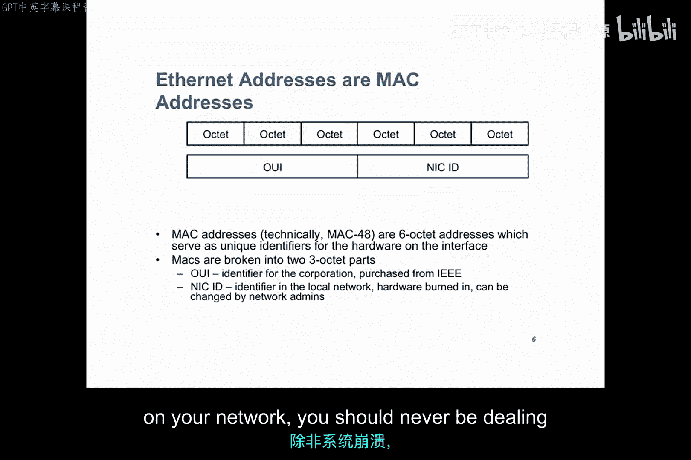

这带来了**规模限制**。这也是路由的核心原因：**我们进行路由不是因为想，而是因为必须这样做**。

以太网通过向共享总线上的所有设备广播消息来工作。如果我们试图在整个互联网规模上这样做，网络将会崩溃。因为通信量会随着主机数量的平方增长。

在第二层，由于要争用公共资源，有几种经典的冲突处理方法：
*   **时分复用**：像令牌环网络那样。
*   **冲突检测与重传**：这就是以太网采用的方式——发生碰撞后简单重发。

---

## 帧大小与MTU 📏

碰撞和重传的代价，导致了我们对**帧大小**的限制。你可能记得我们讨论过**1500字节的MTU（最大传输单元）**限制。这是数据包大小的一个实际限制，以太网通过它来通知TCP/IP协议栈。

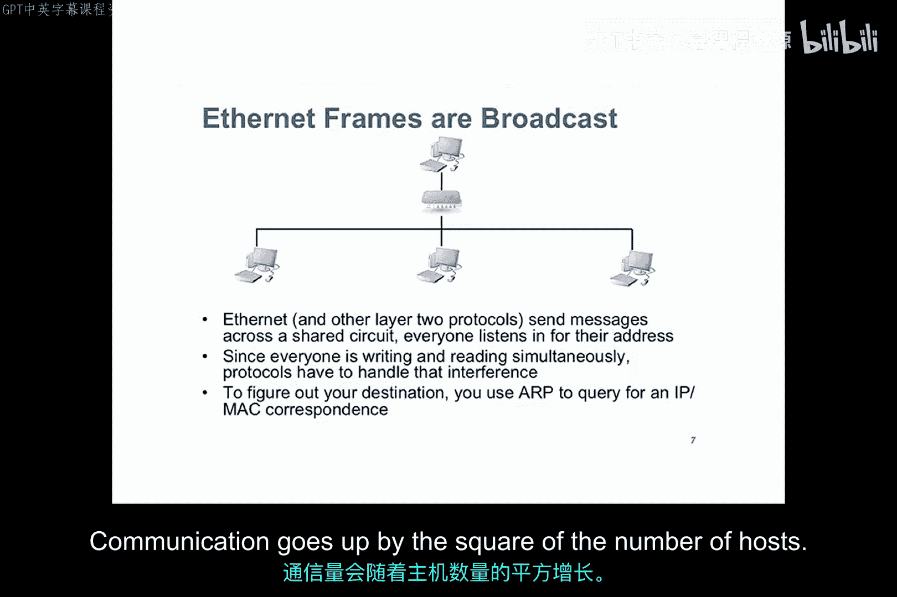

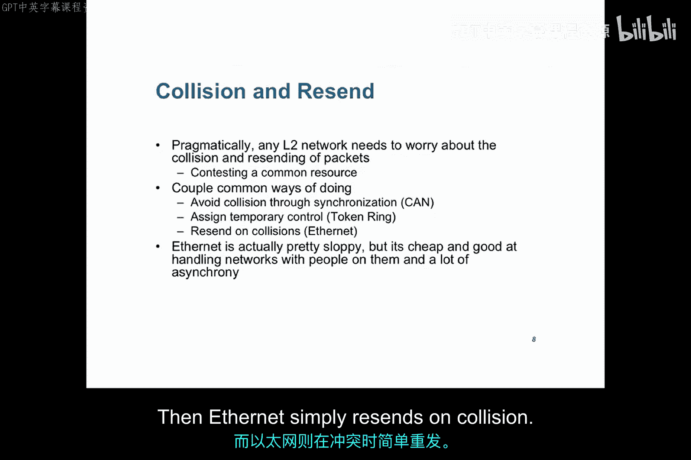

---

## 路由与“跳”的概念 🦘

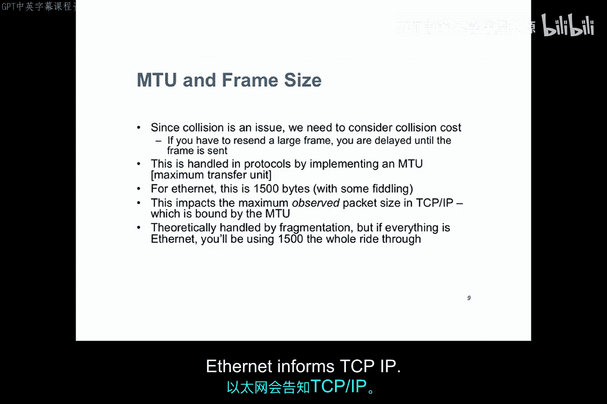

数据包的结构由它穿行的网络决定。数据包从一个网络转移到另一个网络的物理过程，我们称之为“**跳**”。

“跳”由路由器管理。一次“跳”将数据包从一个由BGP管理的网络移动到另一个BGP网络。它是如何做到的呢？路由器**物理上复制**了这个数据包。记住，路由器是一台多接口的计算机。“跳”意味着路由器从一个接口接收数据包，然后将其移动到另一个接口发送出去。

---

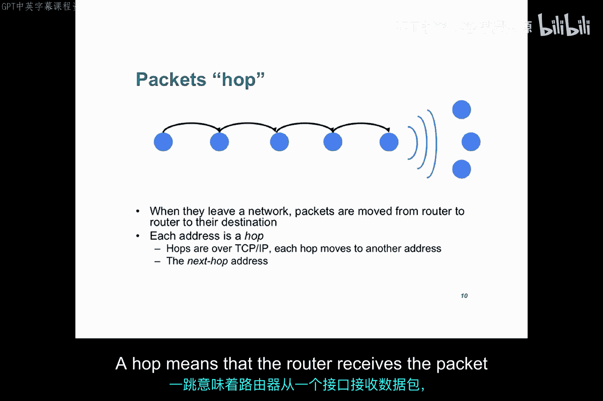

## “跳”的物理过程 🛣️

让我们考虑一次“跳”的物理过程。假设我有一个数据包：
*   源IP：`122.0.0.111`
*   目标IP：`99.143.0.311`

我想把它从我的网络发送到目标IP所在的网络。这里引出了互联网的一个重要但常被忽视的特点：**一旦数据包离开你的无线网络，它实际上走的是一条物理上可追踪的路线**。

在一次“跳”的过程中：
1.  数据包被传递给另一台路由器。
2.  发送到的这个路由器地址称为**下一跳地址**。
3.  **TTL值减1**。
4.  你会注意到**MAC地址改变了**。原因是数据包移动到了一个新的物理接口。因此，IP地址（如`122.0.0.111`）在整个通信过程中保持不变，但实际处理传输的MAC地址在路由器的每一“跳”都会改变。

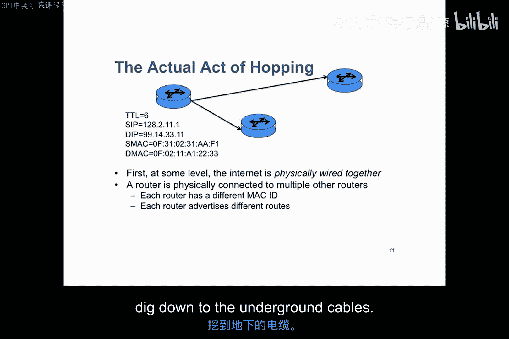

---

## 生存时间（TTL）的作用 ⏳

所有IP数据包都有一个**TTL（生存时间）**字段。每经过一跳，TTL值就减1。这样设计的原因是：**如果没有TTL，数据包将在网络中永远循环下去**。

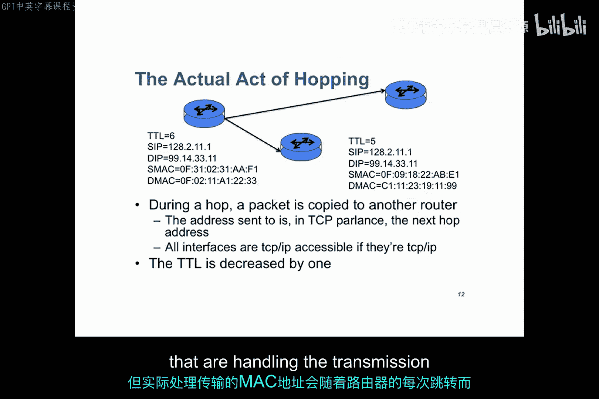

TTL是一个可变的量。不同的协议栈会指定不同的初始TTL值。此外，在路由过程中修改TTL值也是被允许的，这实际上是像**MPLS（多协议标签交换）**这类协议的基础。

---

## 需要牢记的要点 💡

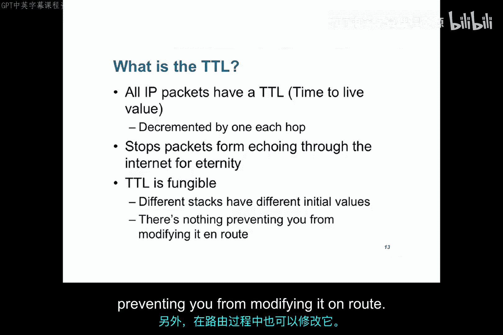

首先，**物理路由会影响更高层**。我们试图将其抽象化，但底层物理连接是基础。

其次，**路由器是物理连接在一起的**。有可能通过攻击这些物理资产来破坏网络。

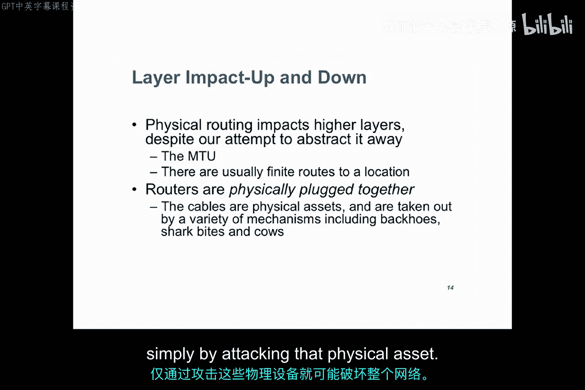

---

## 总结 📚

本节课我们一起回顾了路由与多层协议的关系，讨论了以太网的结构和冲突避免机制。核心要点如下：

以太网是一个广播协议。事实上，我们所有的第二层协议在很大程度上都是在共享总线上进行广播。我们无法建造一个世界规模的共享总线。

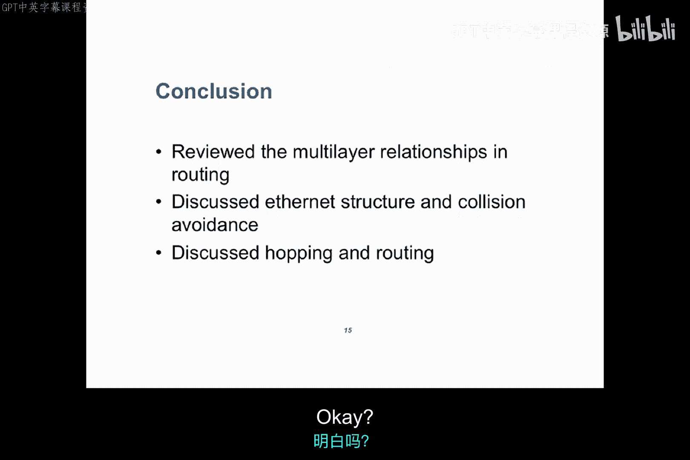

**路由存在的意义，就是将各个网络彼此隔离**，以确保碰撞、接口噪声等问题被控制在一个可管理的范围内。我们通过沿着受控的通道（即路由器之间的接口）发送信息来实现这一点。这些路由器间的接口通常是维护良好、受到物理监控的资产。这就是“跳”和“路由”概念的核心价值。