# 约翰霍普金斯大学《信息保障分析｜Information Assurance Analysis》中英字幕 p21 1_匿名性的形式化模型.zh_en -BV1Qz8EzYENX_p21-

Last this is 695741 IA analysis module 12。1 formal definitions is anonymity The goals of this module will provide you with an operating vocabulary for discussing how anonymity is covered in Ina anonymity is one of the most heavily covered topics in computer security research for example。

 the major academic conference computer security， the Oakland Conference on security and privacy and anonymity being part of privacy plays a major role in the conference there are a variety of variety of terms used to describe anonymity including mixes。

 there are qualities of mixes， there are things that mixes intend to do and there are ways that we can strike an anonymity we want to go through these that you understand how anonymity is achieved and to understand how a particular set of choices make you more or less an in order to understand anonymity it helps to begin by recall the Pro's fallacy if you don't remember that it's very early in the course the prosecutor's fallacy。

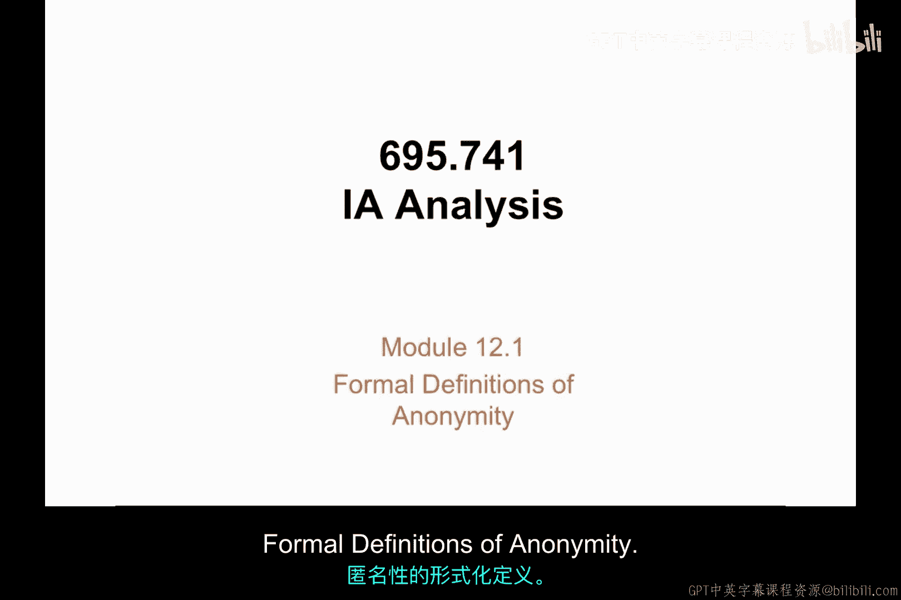

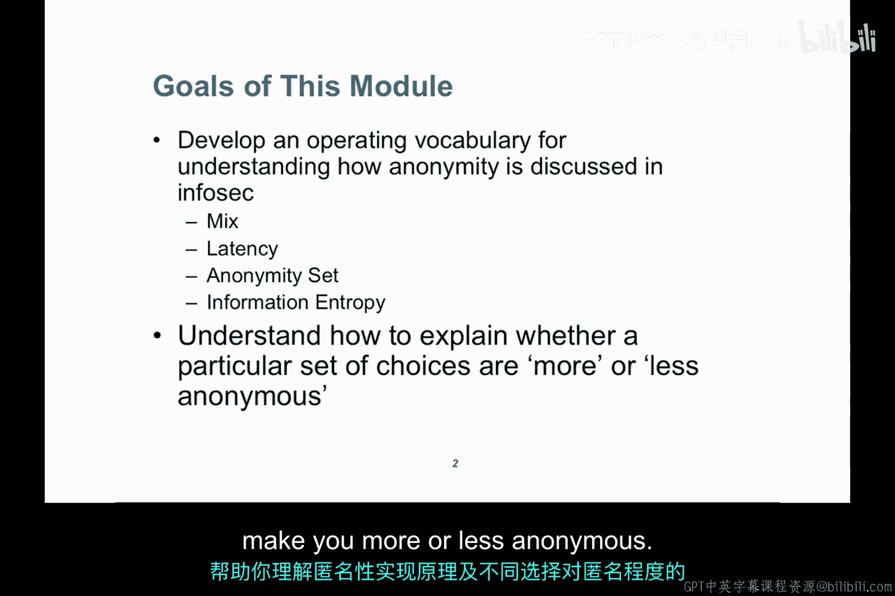

a statistical make mistake comment loss where the assumption is that because something two events are rare。

 the probability of them both happening is inordinately rare classic example the prosecutor's fallacy involved Sally Clark a woman who was accused of murdering her children and the argument that she murdered her second child was because her first childhood died of sudden death syndrome and her second child died of sudden death syndrome so the prosecutor multiplied the probability。

That both that a child would die from Sid。 He took that probability multiplied it against itself and said。

 therefore， this is ridiculously small。 However， if you compare families who have sinids。

 the category of people who have had a child die of Sids。

 There is a higher probability that they will have a second child dying of Sid。

 These are related rather than being unique events。

 This concept of a group in this concept of a group of entities is what we want to focus on。

 when we are engaged in finding or engaged in discussing anonymity。

 what we're talking about formerly is the ability to emulate the behavior of a sufficiently large crowd that you can't be distinguished from other members in that crowd。

 crowd is what we call an anonymity set。 How do we say remember crowd。

 we're really talking about the data that's collect。

 So if I take a look at set of everyone who's using network traffic is my behavior sufficiently indistinguishable from everyone else that I don't have to worry about being distinguished。

 The process of deonyomization involves。

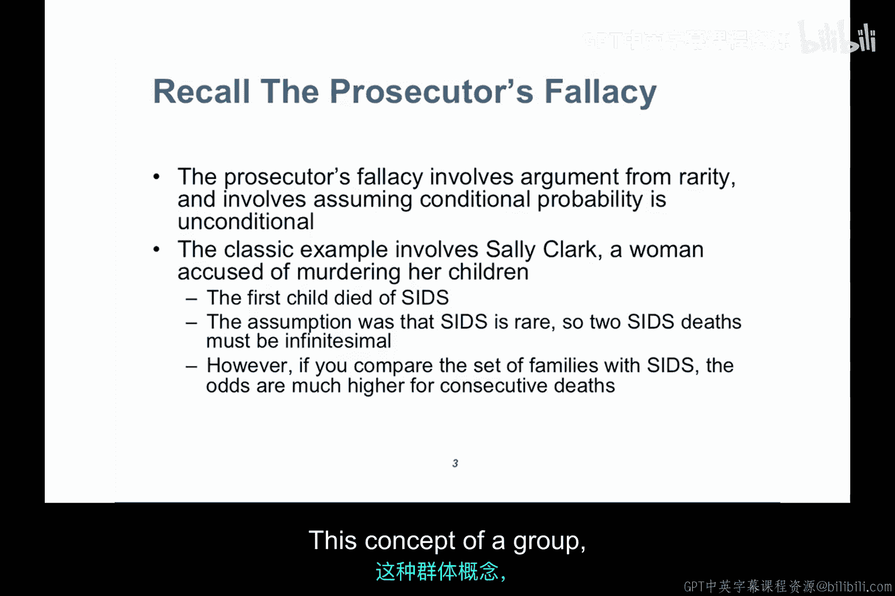

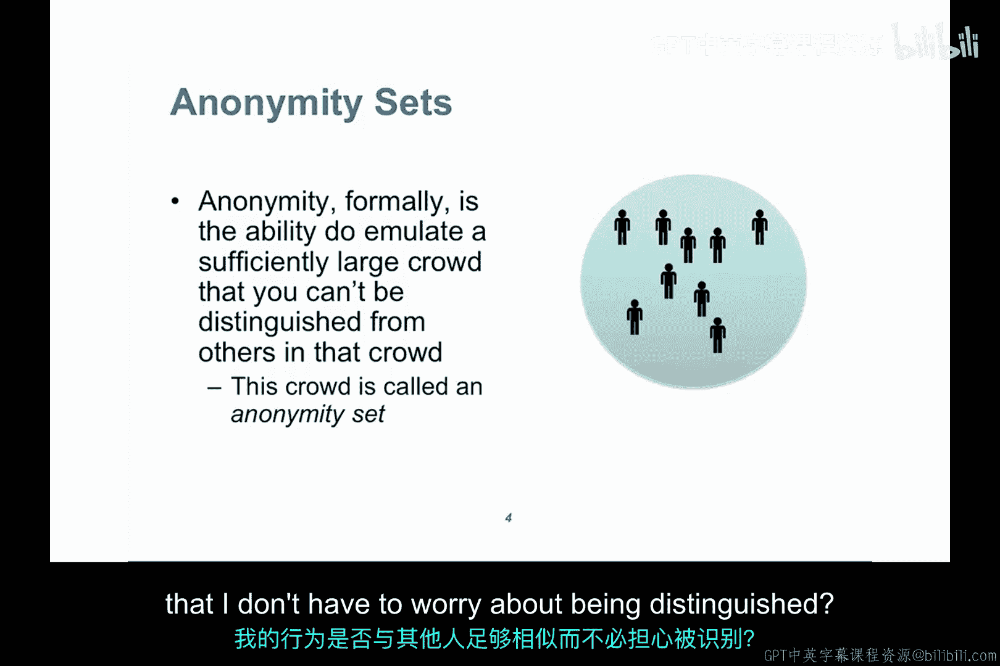

Breaking anonymous sets into smaller ones for example， if we don't just look at network traffic。

 but we look at photograph or we set up a system that can identify everyone wearing a fruit hat as I have used in this particular demonstration the role of deonymization or the tactic of deanonymization involves finding the set and breaking it down into smaller set finding something that we can use to identify in profile preferably down to there's a like term in database design which is called K anonymity the difference between anonymities I've described it up until this point is the anonymity of the previous sections as a behavior whereas K anonymity as a goal it is a design criteria within a database the goal is that if you have a combination of fields in the database if that combination of fields could be used to identify someone you should have at least k surrogates within the database so that individuals cannot be identified by that field combination so for example。

 if we kept hair color。

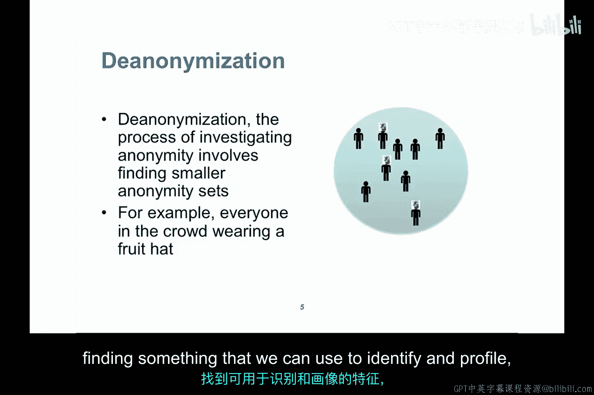

Just preference for something of that nature， we should have at least key instances of each of those combinations to ensure that we cannot point to what an individual by that combination Now obviously this brings up the question of why do we want anonymity a variety of reasons preserving dignity。

 free speech inating prosecution are the ones that I'm going to focus on the most right now preserving dignity in this context what I want you to think about is the idea that there's embarrassing information about you or there's information that may cost you your job may cost you your societal it may cost you you know so the position。

 whatever and this does not necessarily this does not mean that you bad person or criminal or something of that nature it's just found that if you have a diies enough money to looking into a database they can figure out a way to identify people through a variety of meat there's paper by s Schmaticco and Naya which I put in the reading where they。

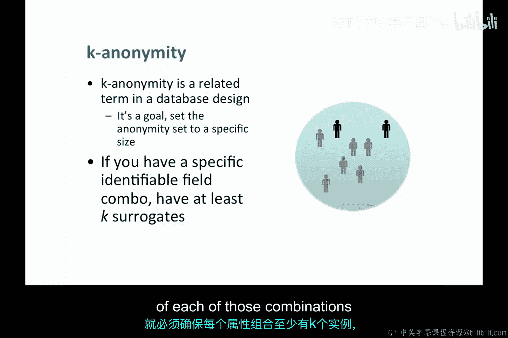

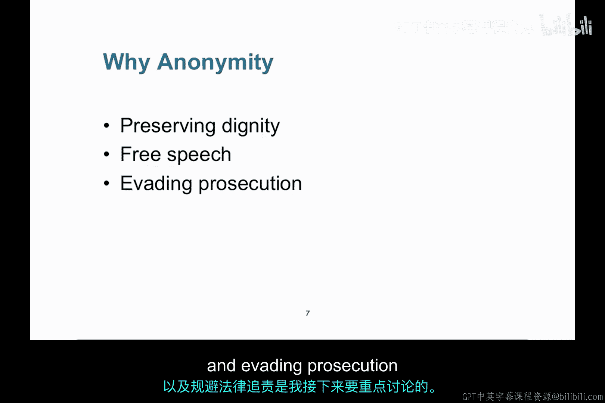

act able to identify people by their Netflix preference if you want an obvious example this consider hip don't want people to know what diseases you have if its their business the next one is free speech I'm going to be cynical at this one this has been common argument for anonyization systems I just don't buy that these systems work I don't disagree with sentiment I disagree with the result tools like or and free net。

 which we will discuss later were designed to be censorship which meant that the operators can use them to communicate without fear of prosecution There's also work here that does not work there's an infamous disaster that happened about two years ago involving these system called hastack that will touch on The last category this not a judgment call but anonymity tools are technical tools they' software they do not make a judgment call So they're going to be able to evade Iranian law or US law equallyConsequently there are people who uses are entirely。

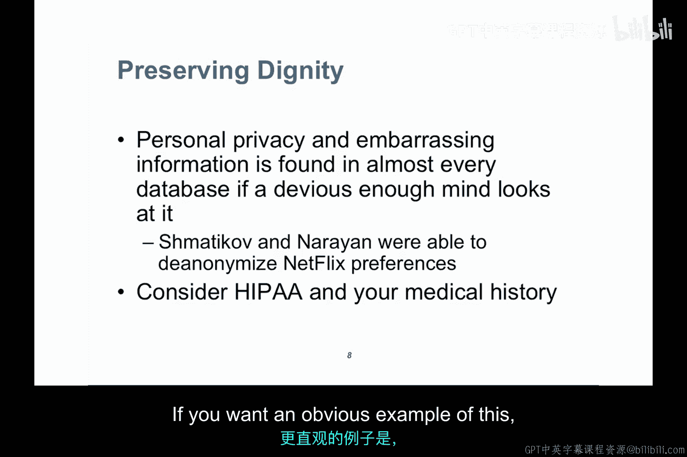

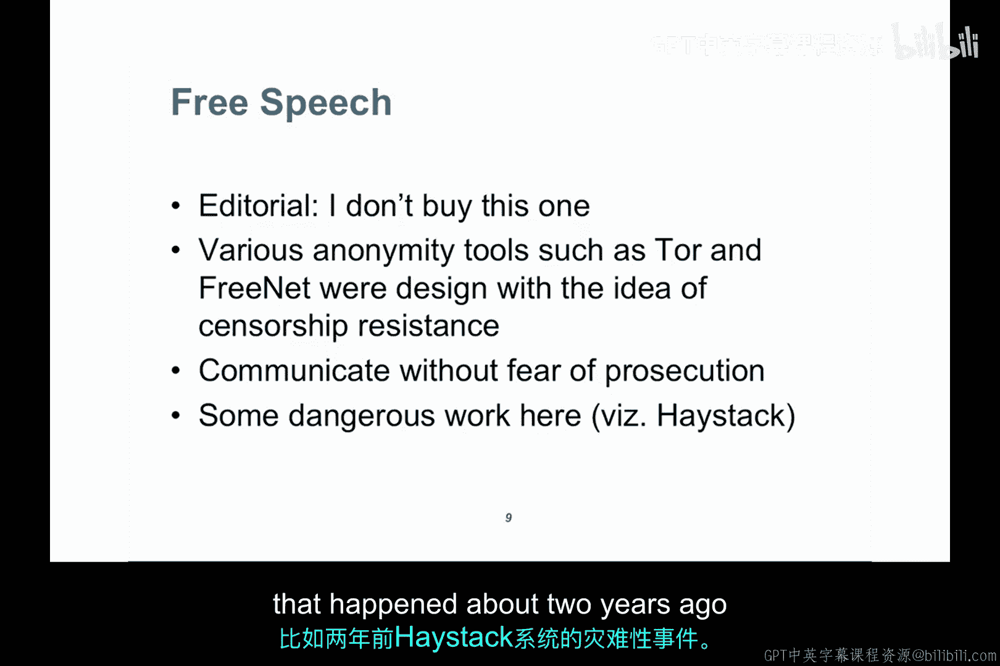

innovat the image on the right is a tour hidden site called Silk Road This is a system that you cannot actually read unless you use。

 which is a routing system designed to make your traffic ontraceable Silk Road is in fact wart goes further than that that it uses tour and a anon electronic system called so that users can preserve their anonymity how do we achieve anonymities and said anonymity is achieved by generating an anonymity set Now K anonymity is a design crion in daily basiss to achieve that but in network traffic this is generally achieved via what we call mix is a collection of routers that move traffic across an now When I say router in this contact I do not necessarily mean a BGP router the original mix systems which came out of David Chms working the early 80s are entirely email email routing was in fact the first form of anonymous communication Key difference between Mi routing。

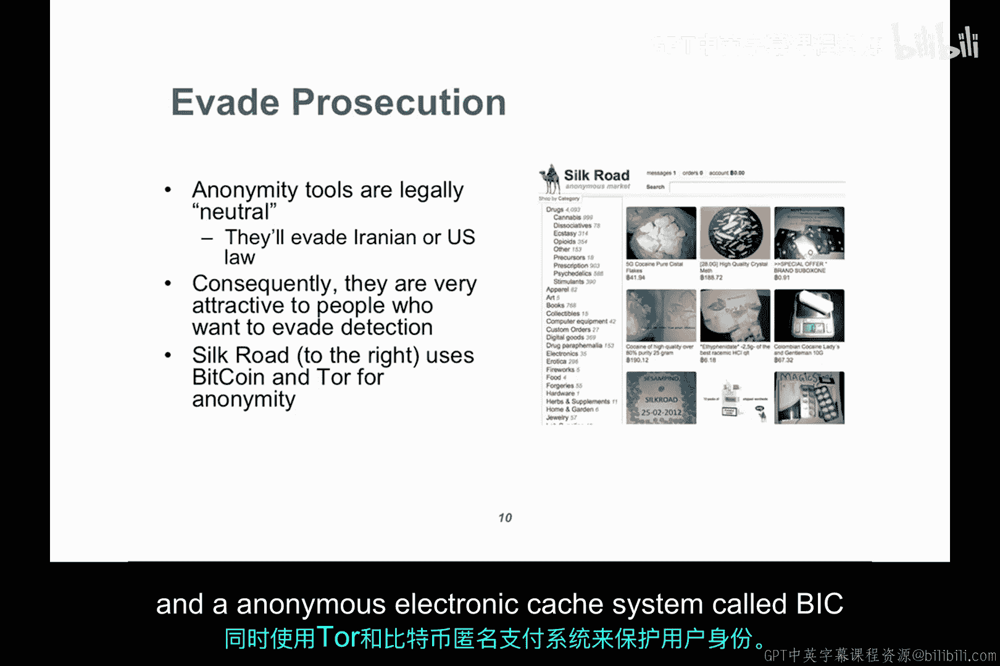

And classic routing is that mix routing is focused on sending traffic and confusing an unpredictable route classic routing shortest mix routing。

 send it through systems so that it is hard to trace mixes are traditionally broken into two categories based for other performance high and low latency This is really a shorthand way for saying can a person use it without going crazy high latency mix is something like email where traffic is sent not necessarily slowly although that's the word I'm using in the slide traffic is sent to its own pace you can't really predict when it's going to get there and if you're waiting for the mail you're going to be waiting for a while in comparison to low latency systems are designed to support things like web browing So low latency mixes will send traffic rapidly enough to make the system usable browsing tends to be the type of example that shows up in addition to this general requirement for latency you should keep in mind anonnuity tools generally do not run It's not a priority for。

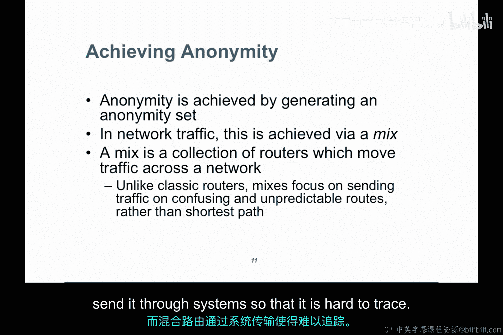

anonymity systems and in fact it is something where there's a direct the goal of an anonymity system is to shuffle packets around the user can't be traced that means they're going to take long routes and they're going to take unpredictable problem in order to design a system you generally in order to design effective usable systems you unm data into what anonymity need the biggest problem for anonymity is entropy is a measure of struck it's a description of how much information is contained in date classically neuro scienceence when we talk about entropy we're talking about Shannon entropy and Shannon entropy when you encounter it is a measure in particular of compressibility if information is structured if there's a lot of repeated that that information going to be information is going to be low entropy it's easily compressible and you're going to find that there's a lot of things in there that can be identified root apart。

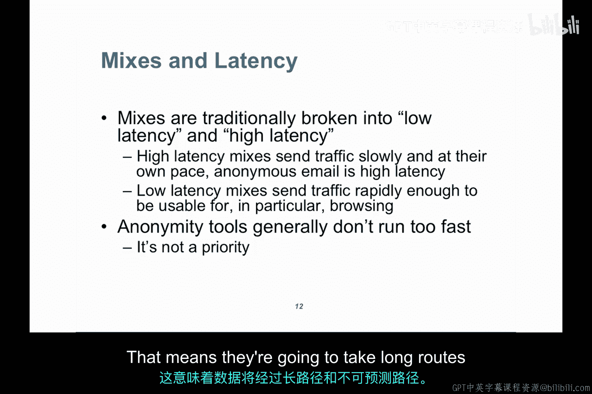

Your class countered this if you ever done cryptography。

 the goal of cryptography is to look like line noise， it's to look random and if it's random。

 it's high entropy， that's why encrypted data is hard to compress。

 Internetnet data is structure This means that there's low entropy and there's a high probability of various things popping at this point。

 we discuss the core concepts of anonymity， anonymity sets latency and anonymity sets are the tool by which we describe whether or not something is anonymous。

 the bigger the set， the more an an is latency is a quality of anonymity tools。

 latency means that you have achieved anon you how feeling for how speedily information used to the system and how usable it is the person and mixes are the primary tool we use to achieve anonym。

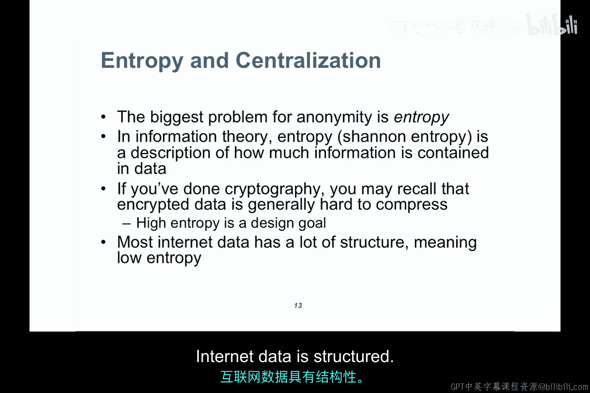

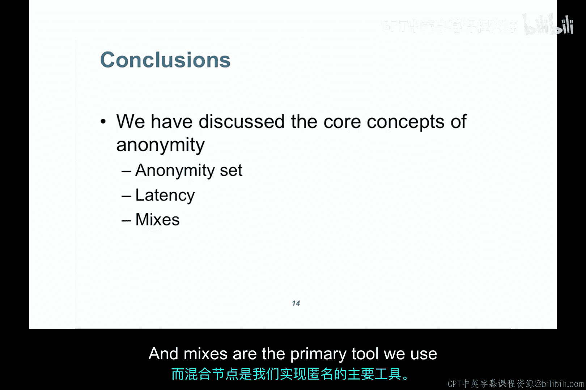