# 约翰霍普金斯大学《信息保障分析｜Information Assurance Analysis》中英字幕 p22 2_混合节点与分布式哈希表.zh_en -BV1Qz8EzYENX_p22-

Clas this is 65741 information assurance analysis This is Pross Collins speaking Nightwa 12。

2 mixes in DH goal this module is to get you understand some of the core tools used anonymization systems which networks in DH' also going to describe trafficking analysis in these tool I'm going to talk in particular about the choices a bit of a repeat from lecture I gave earlier in the class on routing but I wanted to put it again in the framework of anonymity so that you understood what these tools were for and how they let's a bit about history the internetically indifferent to edit what I mean by that is that there is some anonymity built in if you recall the IP address lookup exercise you remember that we were able to figuring out where an IP address who owns IP address what its name is it's also the case that several years ago there was a lot of called traceback if somebody sofed an address we tried to figure out where it really came from so there's some internet traceback doesn't work there is some anonymity built in it's not for that。

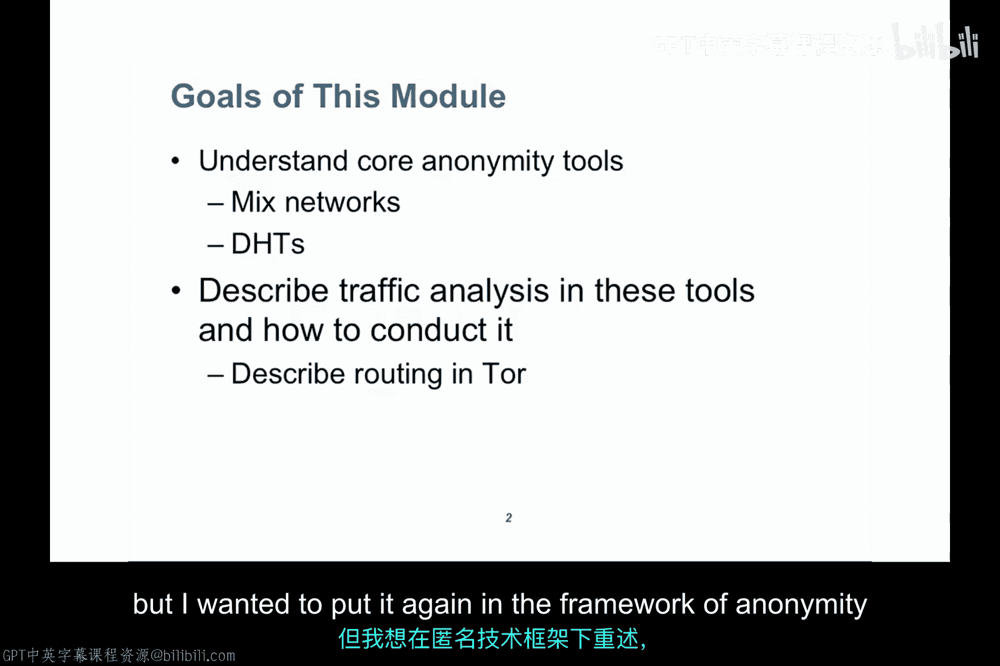

More of an oversight accident rather than a design principles there are also centralized structures that put the kbosh on anonymity you can try to be anonymous but if for example your web browsing。

 you're going to have to work really hard at it because just about every web page you fetch is going to talk to Google or advertisingyity on the whole became a flashpoint in the mid to the late 1994 there is research going on in cryptography and anonymity in particular an enormous amount the department of Def sponsored research there's also a mailing list called cipherunk Cypherpunks is composed over called cryp anarchists where people who generally take just a libertarian perspective and believe that by using advanced cryptography they'll be able to ensure their personal freedom if you read Bruce introductory text applied cryptography that's cipherpunkish point of view whereas is later book secrets and lies is written from a perspective that crypto doesn't solve doesn't save the world Other things happen during this time Na and a very large amount of。

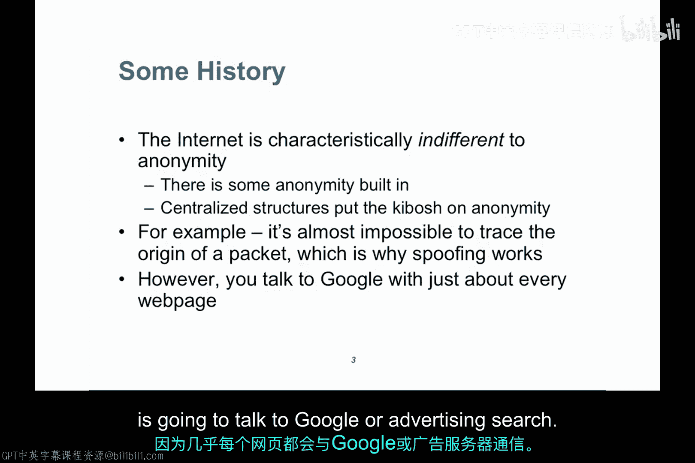

and had arguments with the Church of Scientology in particular there were at the time we called anonymous reers which were in particular there was this famous one Annana that this was a Finnisher which was by forward Scientologists to leak an enormous amount of information the church considered copyright it the church had copyright this became a flash point and they eventually shut down the server because threats and the like from the church this pited issue is a good example of a general observation about anonymity which is that there's vulnerability when you have a single solution to this has traditionally been what we call mixed a mixed network is a network of route reenders systems that forward traffic and they send traffic appears without keeping track of the point of origin the original concept of a mixed network came from a paper by David Choum in 1981 The idea is that by shuffling data through the mix the point of origin becomes untraceable Now it is not just a function of the routing Mies generally。

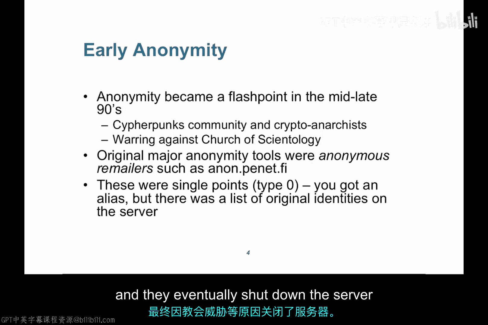

Truly encrypt information So when you start at point A you encrypt message to point and so if you are not at point B and you don't have that key。

 you can't decrypt the message。 If I said classic mix networks were defined by Ch the cpherps in turn characterized emailers by a variety of attribute type1 emailer stripped transmission data So at this meant you recall if you take a look into SMTp message you get from header things like that the type 1 email or scrumses from the email message and basically treats it as it just came either that reer or a drop set identity as well the type 2 mix mixes where your classic Ch mixer or and particular system called mixmaster the type 31 was a improved version of the Ch system called mix mini and it added a variety of and techniques forthrough offending against attacks that have been identified after the original design Now recall that mixes are broadly divided into high and low latency mixes high latency mixes don't care about when you receive the information while low latency mixes have performance constraints。

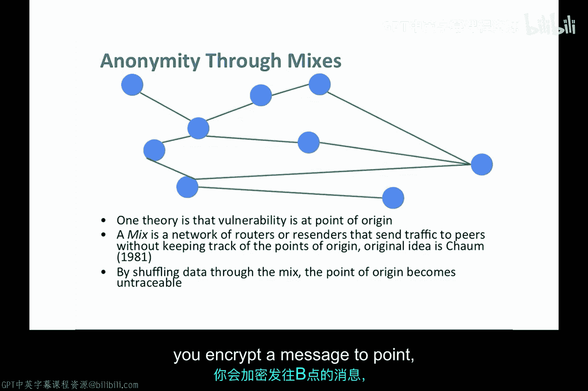

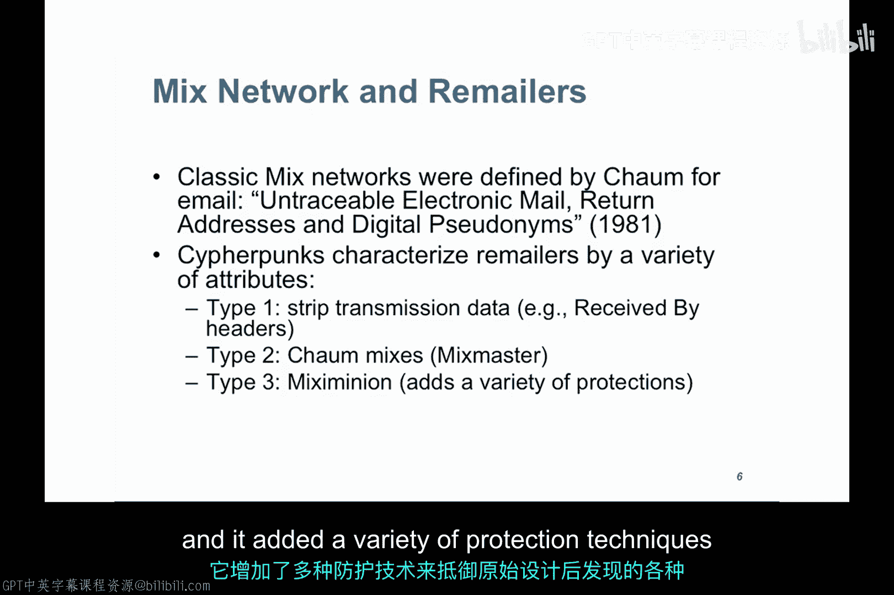

Mixes have been a lot harder to the first major one was built by a againmic Rder at loosecent at the time that system is called Cs in addition there's To which is the one that was going to consume the most of our conversation The thing see is that and not it costs you perform you are intentionally picking an inefficient route as it's going to be because it's going to reduce traceability In addition systems that highly sea mixes in particular traffic shaping and timing systems to protect against the tap the C mixes are vulnerable the timing attack for example if I wanted to trace a route through a system I can take a look at the original system and look for response I might have for example the web page something I might have a piece of jobs on the web has to be processed and set every few seconds by taking a look at that regular pulse of activity I can start tracing the route a lot of this basically view boils down to you want addivity you pa with inconvenient highly and C mixes generally are more have better protections because they do things like traffic shaping and control release packets。

 things。

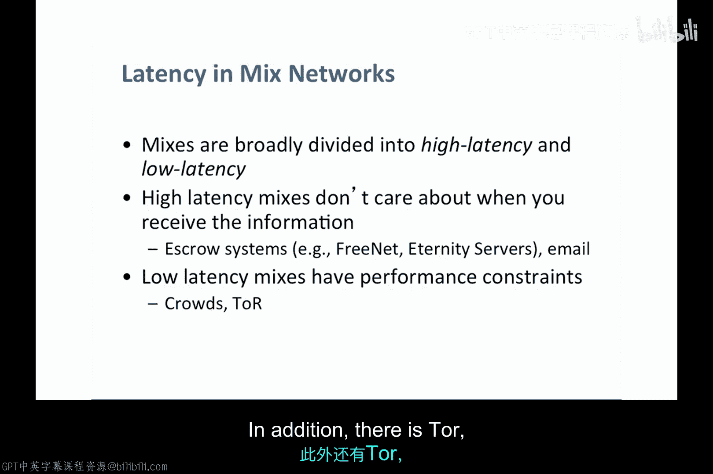

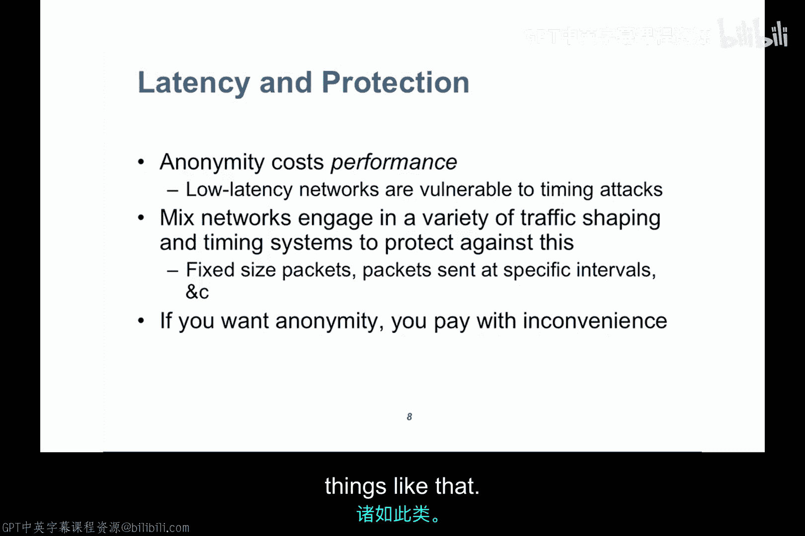

But let's talk about To is short for the onion This is the most popular and most successful mixed network in history。

 It was originally developed mathematically by Paul Cy in it in Aral。

 the actual limitation was by Roger Dingll died in a group called Tor it is a low late browse the web with To and a lot of people do it effectively replaces routing with what we call union routing replaces too strong a word it provide unionion routing on top so let's talk about how tor actually message you generate the route entirely from step from the start get entry node go through the selection of nodes available in Tor Now you may not you probably do not know the full set of node you know a subset that is sufficient for you to generate a connection to an exit node and then to leave that node to the Internet decide on your route you decide on it at the point of construction So this from classical routing that you are not doing it router by router base you know all this information ahead of time and the reason you know all that information ahead of time is because you are going to progressively information onion routing。

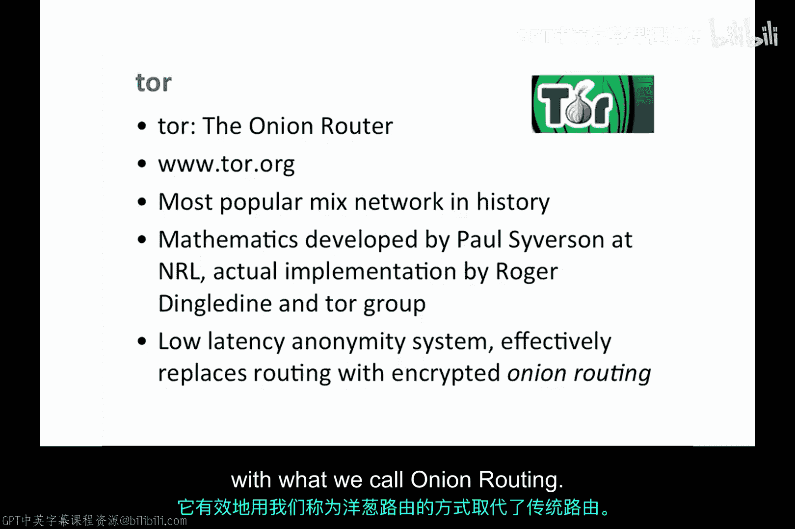

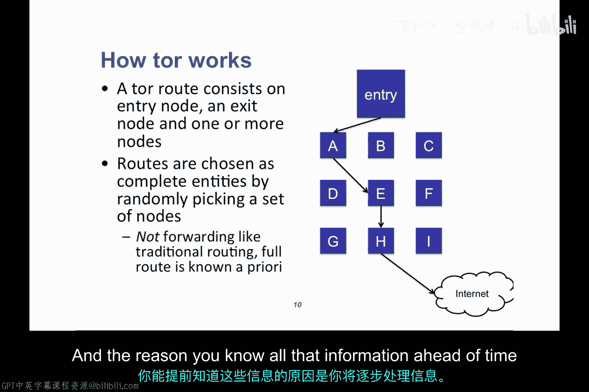

Works by combining forwarding add decryion when you create your message aggressively encrypted destination information add the public key of the destination site the destination then decrypt that information and repeats the process for example I'm where to go to a then to E then to H to that means I start with my message cry it with H is public and I then say go to H as part of the public information I encrypt that with E's public key include the message repeat the process and then I encrypt it with A's public key and send it to a A in turn strips the message and the only thing it knows is it's got a package that has to go to E receives that message strips a decry it to strip off that and finds out it as a package of encrypted data it can only send to a with any instructions to send it to a only H can understand what's in there So if for example I was to compromise if I was to compromise I cannot look at the message because it's encrypted for A。

And the only entity that can decrypt that message is8 the only way that I could actually read the message is if I compromised H itself Does To work To has a couple of problems The most notorious one is a traffic to have exit nodes that interface with the internet Several operators of exit nodes have been arrested Uni that run exit nodes regularly have discussions with the police about running the other thing which is probably most significant though you have to behave anonymous can visit sites that you normally visit you can't you have to worry about DNS resolution you can't use cookie do anything to run reveal your identity you shouldn't run spyware you want to do this from a clean machine and that is a non trivial primary challenge for most users with anonymity they set up their set up their tour access and the first thing they do is they is they go somewhere that has Facebook and it turns out they kept their Facebook cookies so bluey things that could hurt we're going to take a look at that the next a variety of techniques have been developed for attacking tour timingbased there's techniques involving limited compromises of nodes's look at' discuss these in more。

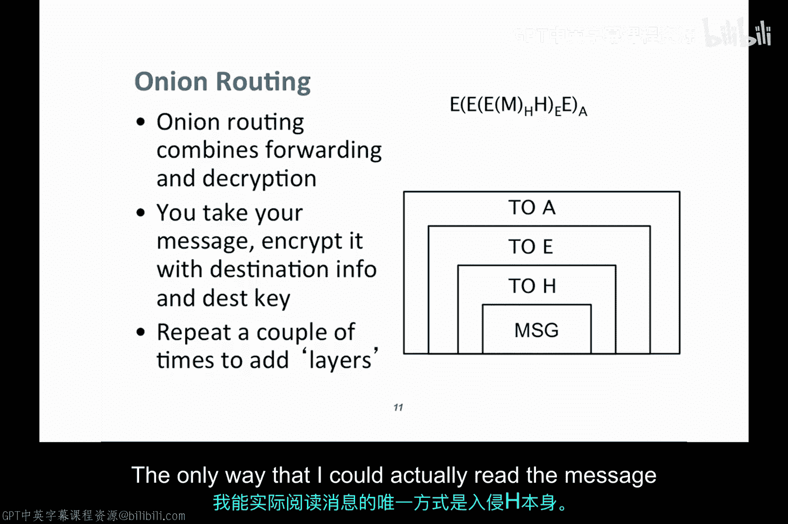

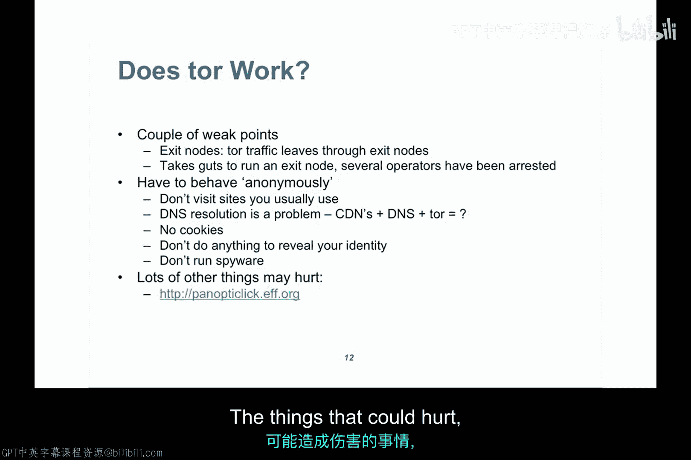

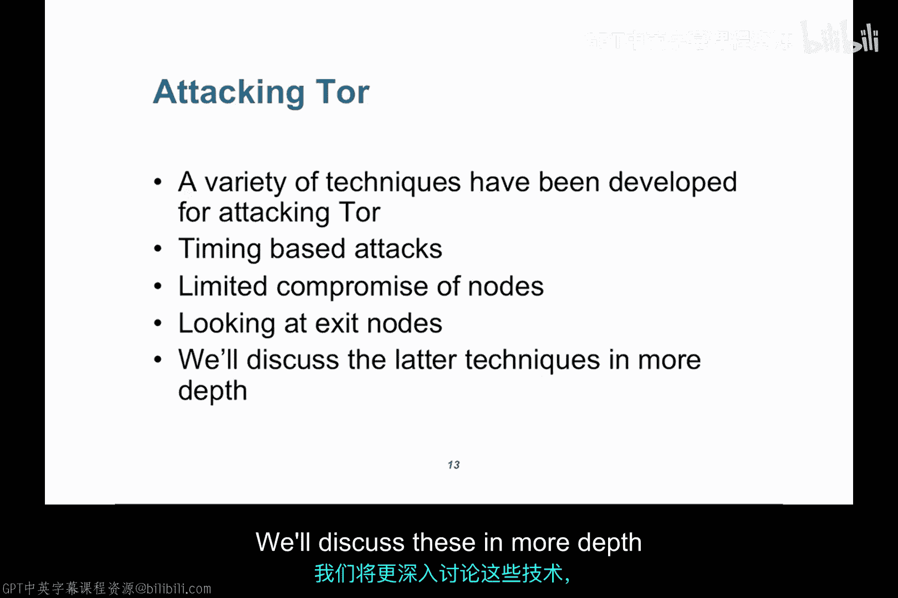

And some of the assignments I've passed involved Now the thing to keep in mind about anonymity is that Tor is not the only thing Tor is the most successful variety of systems were built in the mid-90s to today to deal with as I said before。

 many of the responsive Scientology and other batchchelor in response to NA instead of common principles among these systems decentralization replication of services in cryryp the reason of course that that anymity became big is Naapster was shut down for those of you who do not remember Naapster maybe a disturbingly large group of this class actually Naapster was the first peer file sharinghar music application it came around in the mid90s was the beginning of the like a of a variety of file sharing tools were developed after Naapster includingnutella Tor into system called Winnie livewiiring these systems generally got shot because they relied on Naapster for example at a company and that company was many of thenutella servers and livewi had core machine Torent uses trackers and peers and as we will discuss。

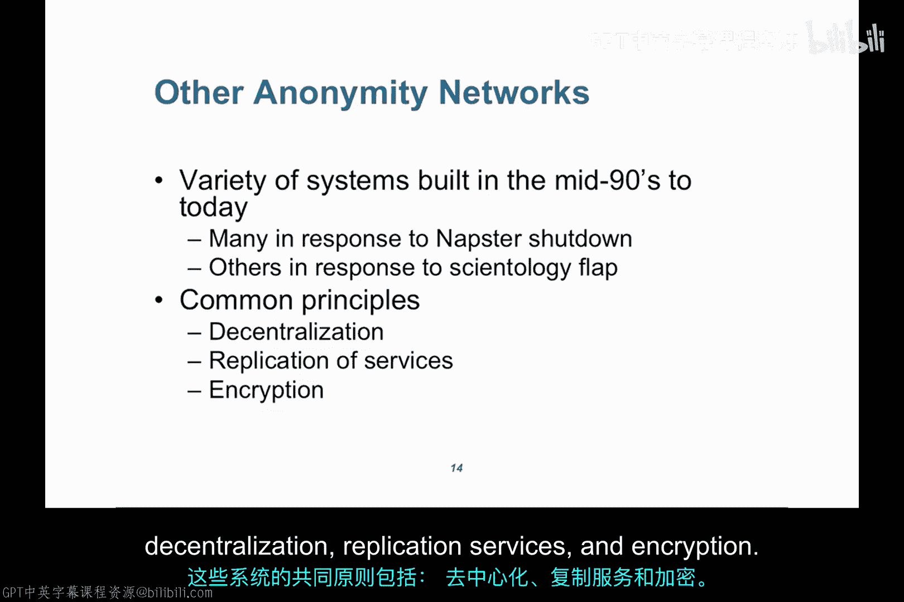

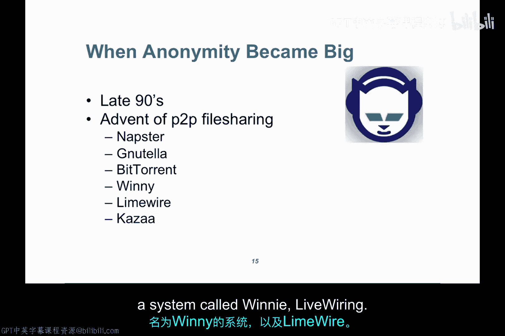

Those trackers are taken down that can knock out the bit of network。

A lot of these systems have been stopped by taking out the centralful note or of the things that Naster learned the heart。

 When we discuss anonymity or protection system have to make this disclaimer we put aside the freedom right now piracy is illegal file sharing is likely to be that I sharing is likely to be private because of that interested in anything like that users are interested in not being crushed caity morality it introduces a problem for us because users are now more and more aggressively interested in keeping all of their traffic anonymous problem for us is we want to defend that problem the problem is that from the user's perspective we' internal police So they're not going to na to us on what they're doing let's be IP issues can be very serious One of the most interesting examples to me visual examples is probably a better term comparison between the Japanese and the Wikipedia the Japanese Wikipedia this is actually frequently asked if you go to the Japanese Wikipedia you will find our practically no image It is almost entirely this is the function Japanese IP law a lot on the copyright。

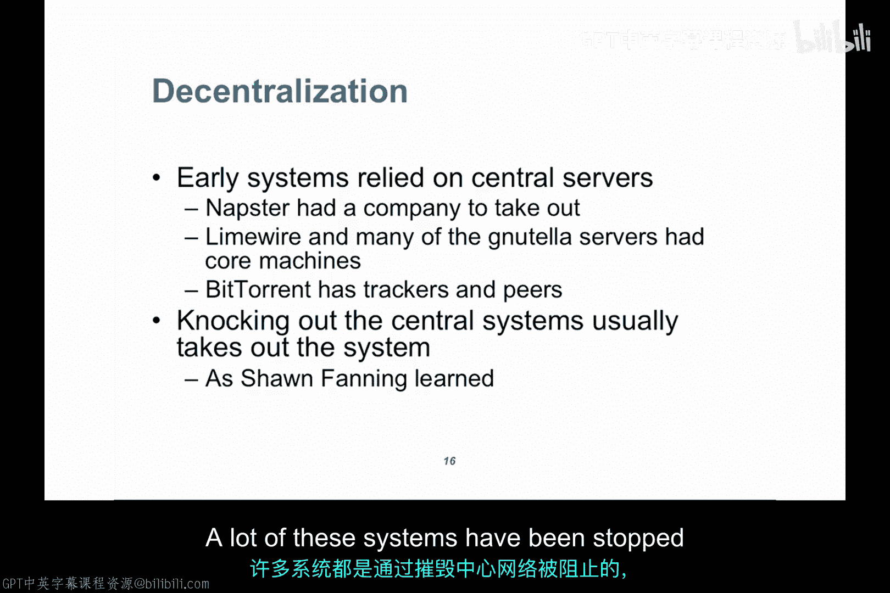

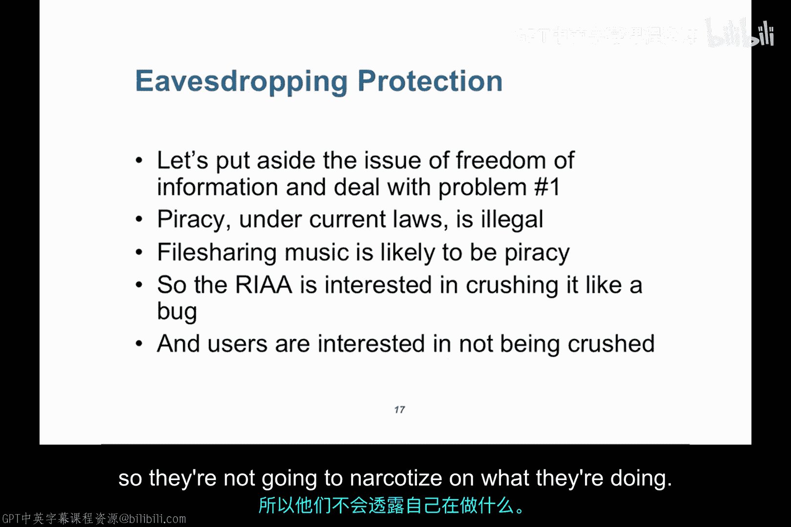

Then in the US the US you have to defend copyright in Japan。

 you just have to assert it if you don't defend it。 that doesn't hurt。

 But the net result of it is that in Japan， they don't put any images on the Wikipedia pages whereas the U tend to be image The other thing to keep in mind is we're talking about this againonym and inia a bitrrsed sitesga rapid we run into the single point to failure system as's legal fight would expect this to cause explosion bitent but as this was all demon tracker demon of the popular torrent sites and means the these systems are interested in protection the major ones being encryption and decentralization encryption fairly cut and's talk about decentralization in particular it's called distributed hash table is routing mechanism decentralization remove a central server from the。

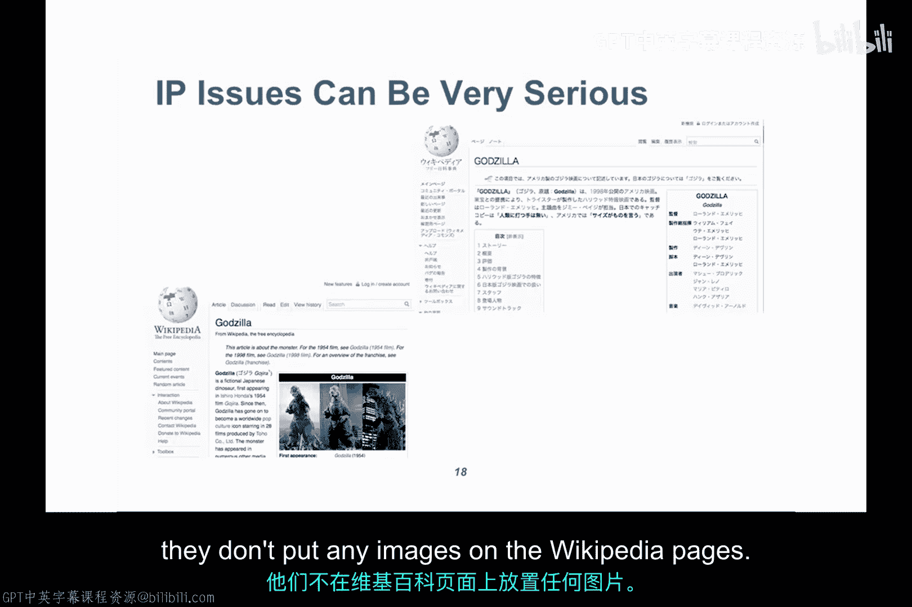

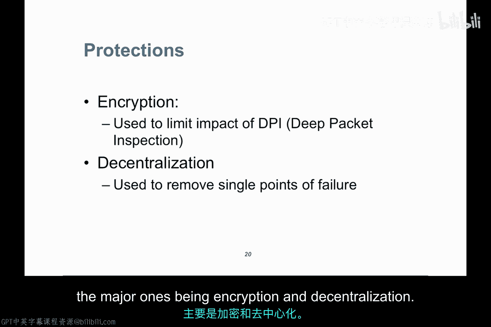

ByDoing this they keep the system when a single point of failure would hurt they generally emulate various routing techniques。

 the most common form is what's currently called a DHT or distributed hash table DHs are interesting to me because they were an academic concept about four years before practical limitations appeared I almost never see anything in academia take only four years to get into the outside world so this was something that in particular appeared to appear crowd adopted rapid and the reason was that way they don't have to deal with this situation here there are a variety of major DHs the big ones are usually ch CAd tapestry and pastry these systems work by creating a mechanism to assigning universal ID to a node and then they set up local routing tables on nodes to provide an adjacency function and then past traffics from note to node soH the idea is when you use bit torrent and you go to the tracker the tracker tells you where to find a particular instance of a file or a bit of a file with a DHT you said to search out。

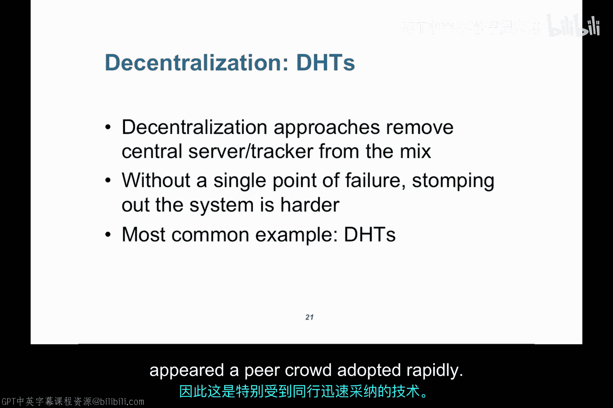

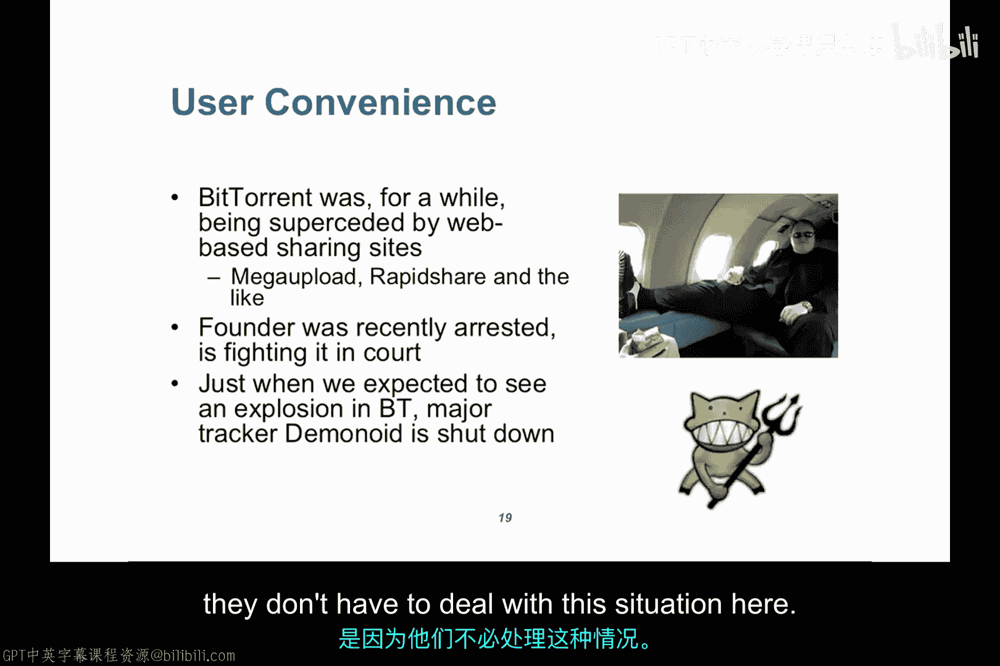

To the network passes you and I you go to wherever that ID is without going to that s track the DHT is used to organize the information An example DHt just to give you an idea of how these normally work is past pastry is signs randomly assigned 128 bits to nodes and assumes even distribution so if you have a network of nodes you should have they should have a distance of two to the 128th over n so you know if you add if you two to the 32 nodes it'll be two the 96 parts so obviously these are huge hash spaces for the ID The way that pastry work if a node ID is node you go to the closest n bits you have in common so what happens is you keep a 28 entry routing table on your node gives you pointers to nodes that have n bits in common this is a routing technique so what we're doing is we're writing information keeping routing manageably small and by assuming even distribution of Is it should only take you it should only take you a limited number of searches to reach your target。

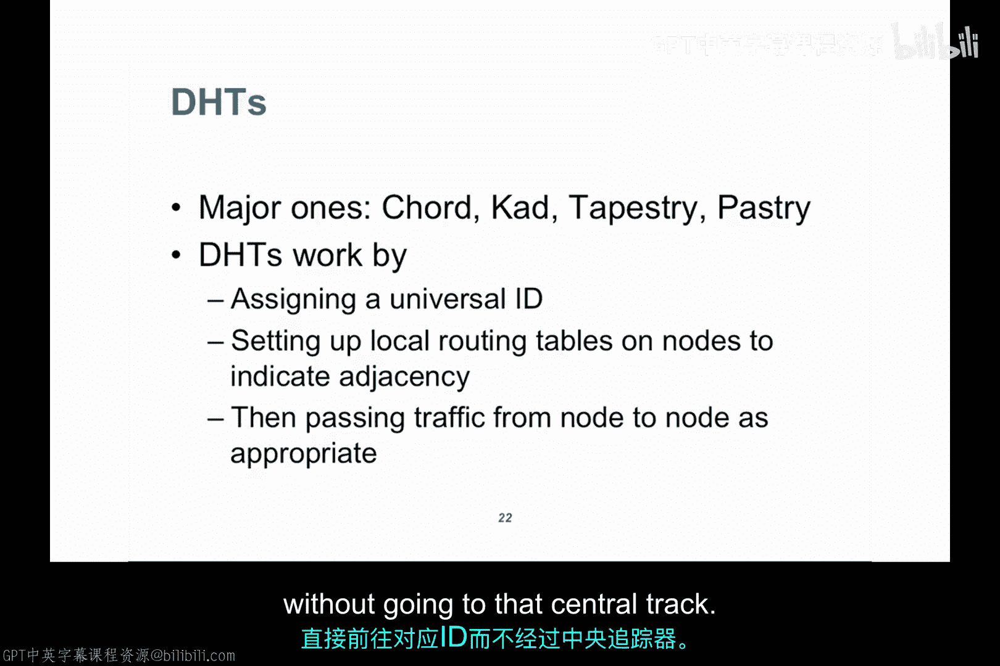

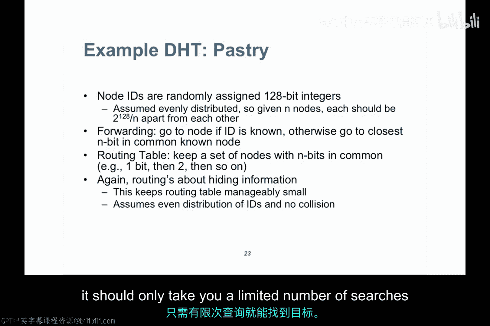

These thingsSpri enough surprisingly enough these have been very aggressively adopted by the bittorrrent community If you download a current bittorent client like Aurrus you'll find first off native encryption has been supportedInterestinglyly enough the inventor of bittorrrent brand Cohen fought against encryption originally because he felt that it undermined the idea that bittort was a legitimate protocol for transmitting information if you don't know the history of bittorent it was originally designed to transmit Red Ha ISO bittorent also has trackerless feature so if you take a look you will find that it has DHTbased lookup available and sites like the pirate are very strong advocates of using trackerless you will find that there are certain bittorent site that will accept communications unless they are done in a trackerless fashion or using offport numbers in order to hide the identities of the user what we' done in this lectures we've discussed the basic tools and anonymous system mixes and decentralization we've talked a bit about how these distributed systems。

I've shown you some examples of applied systems that use them and we've discussed some points of use it in the next lecture。

 we're going to discuss why anonyity is such a pain to achieve。

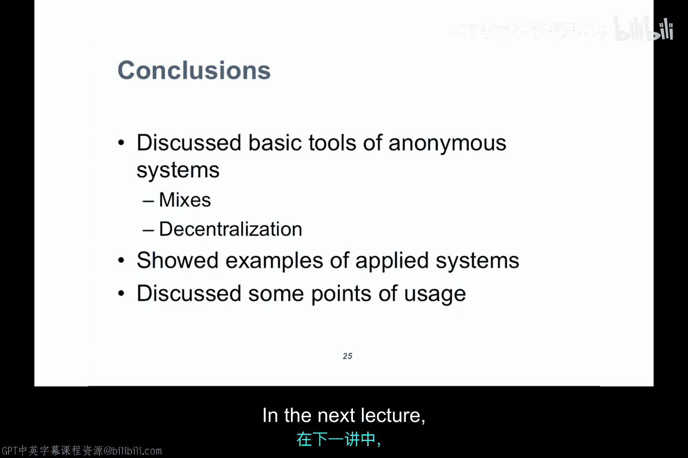