# 约翰霍普金斯大学《信息保障分析｜Information Assurance Analysis》中英字幕 p23 3_实现匿名性的困难.zh_en -BV1Qz8EzYENX_p23-

Hello class， this is module 12。3 of 695741 IA analysis。

The goal here is to talk about why anonymity is so hard to achieve anonymity is difficult。

 It's been a holy grail for a certain chunk of the information security community for years its。

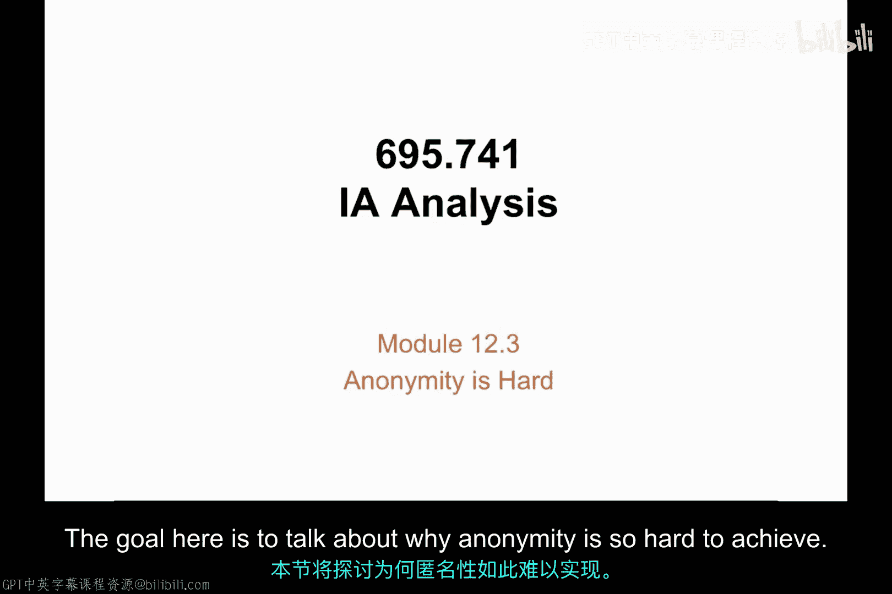

Surprisingly difficult to achieve and in particular， in order to achieve it。

 you have to act anonymous。 So the goal of this monitor for you to understand why that is the case to understand the low entropy involved in human behavior at the centralization of services So let's talk about Tor if you want to use to anonymously。

 there's a variety bunch of things that you have to do First off。

 you can't log into any site requiring a password in an ID。

 You can't visit common sites you normally use。 you can't name cookies。 You check your DNS。

 You don't want to run malware and you don't want to run browser plugins there's this big problem that there's an awful lot of tracking and tracing going on on the software you're running already。

 that makes life a bit inconvenient to use tor anonymous like okay。

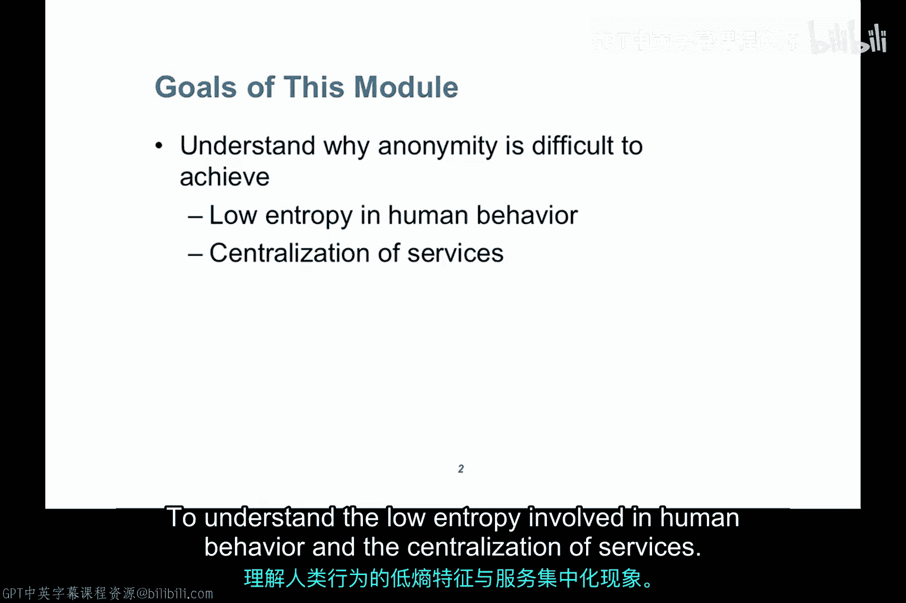

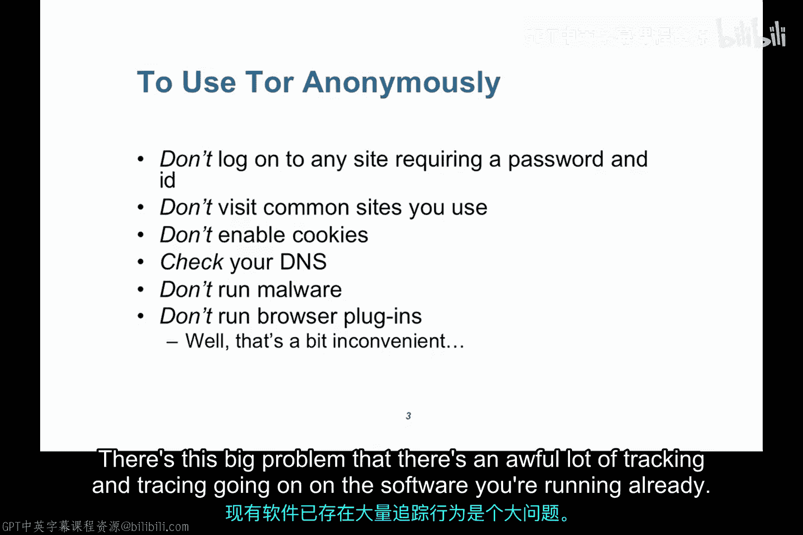

And the other thing you got do is you can't act like yourself there's a classic exercise in computer science which involves statistically analyzing the authorship of the Federalist papers if you're familiar with Federalist papers。

 then you know that they were all published under the pseudo named Pus and were written by Madison。

 Hamilton and gay and what they find out is that there's a variety of techniques that you can use to identify whether or not a paper was written by a particular author in particular choice of words。

 but there's a variety of metrics that have been used Coword analysis。

 errors in grammar frequency with which specific terms appear unusual terminology in particular there's a wonderful term from the translation community called a Hapx phobbinon。

 which is a word that appears exactly at once sentence length all of these things are all of these things are habits you develop effectively your personal style。

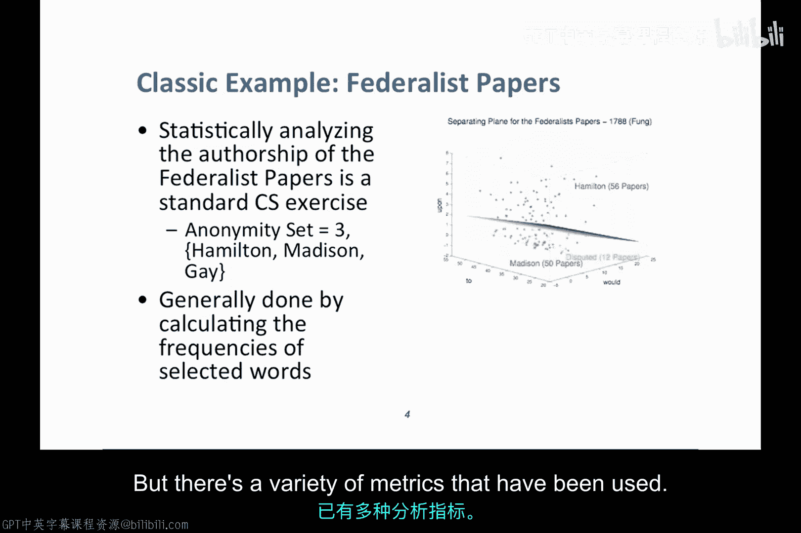

That identify you and can be used to figure out who you are even if you are using the most advanced routing system and encryption system in the world and this is why anonymity is hard anonymity is hard because we organize and centralize a lot of things to make life convenient we develop habits and how we write we develop in habits in how we surf I go to a specific set of sites every day I go to New York Times our Technica a variety of information security sites it's also hard because in order to get the internet to work。

 we've had to centralize a lot of services Google and CDNs take up a lot of traffic of the Internet and no matter what you do you're probably talking to them okay。

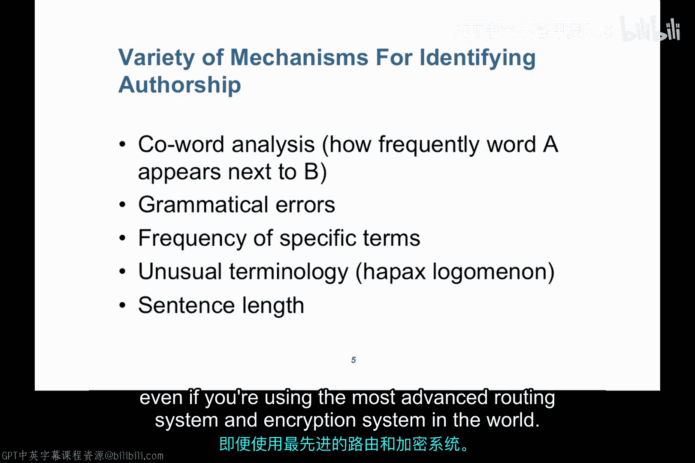

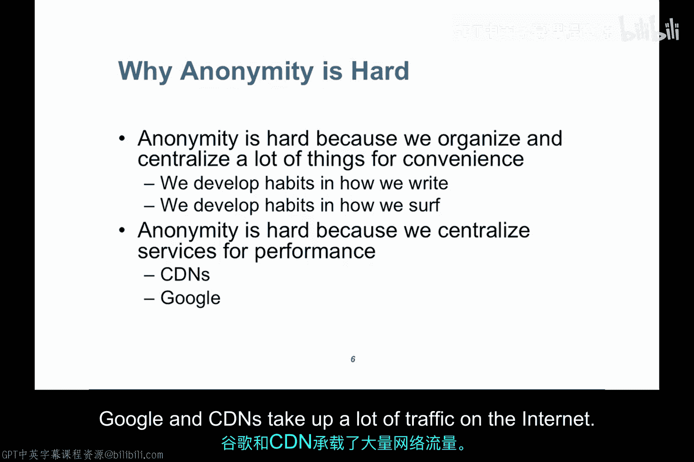

To give you an example of this， there's a system called Panoptic click。

 which is a project by the Electronic Frontier Foundation Okay。

 the results were published in the 2010 province See Encing Technology Conference with system calledop with this Panopto click system Panoptaclick is a website you go to and what it does is it statistically analyzes the configuration information of your browser which is easily accessible。

 although in the case of Panoptoclick it uses a couple of metrics which are。

Which to require JavaScript or some form user or acceptance to do okay？

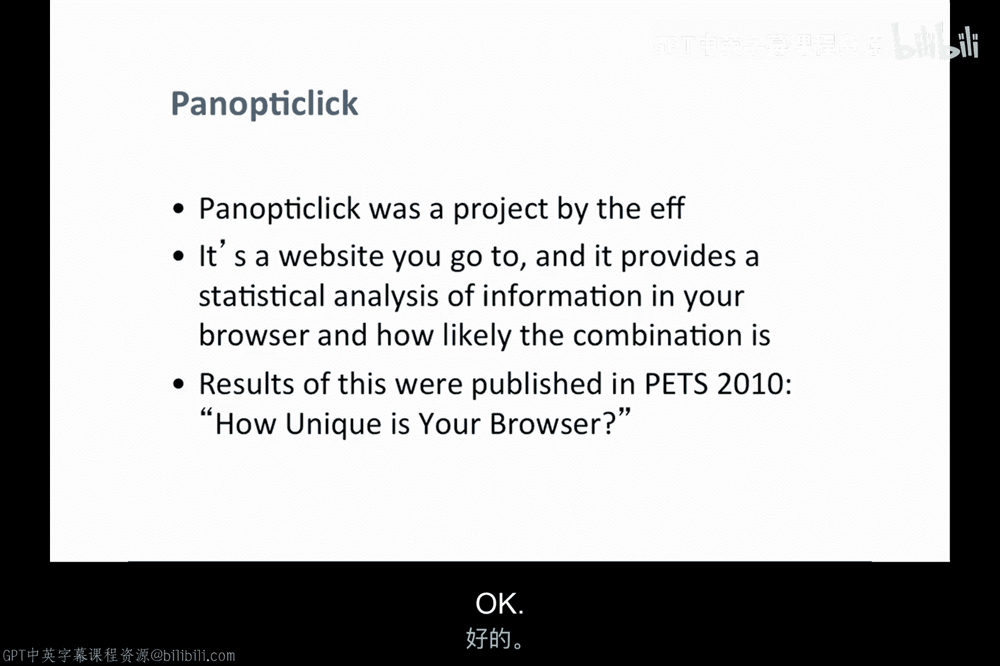

So if you go to the Panop to click site， it actually will go and it'll tell you the probability that you will have the probability that a value you have is unique to you how many browsers are likely to have that and how much entropy is with that value okay a couple of things it checks a user agent。

 HtTP accept browser plugins， time zones screen size， system font， cookies。

 a variety of cookie based tests okay all of this is browser configuration information。

 so this is mechanical information， your browser passes in order to help your user experience。

 it's completely hidden from you but it's just part of your HTTP session okay。

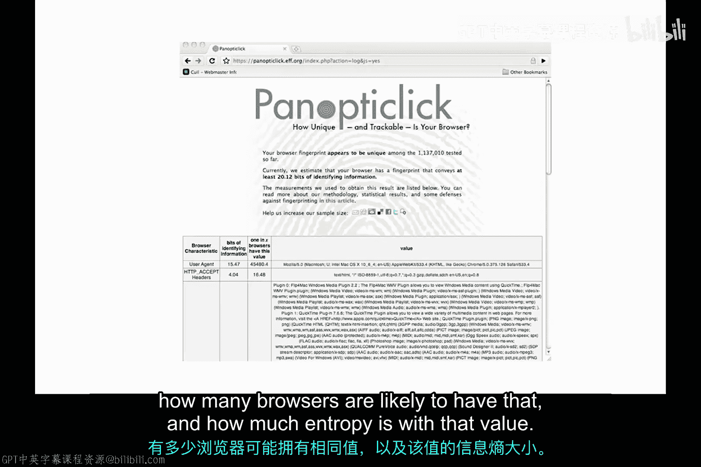

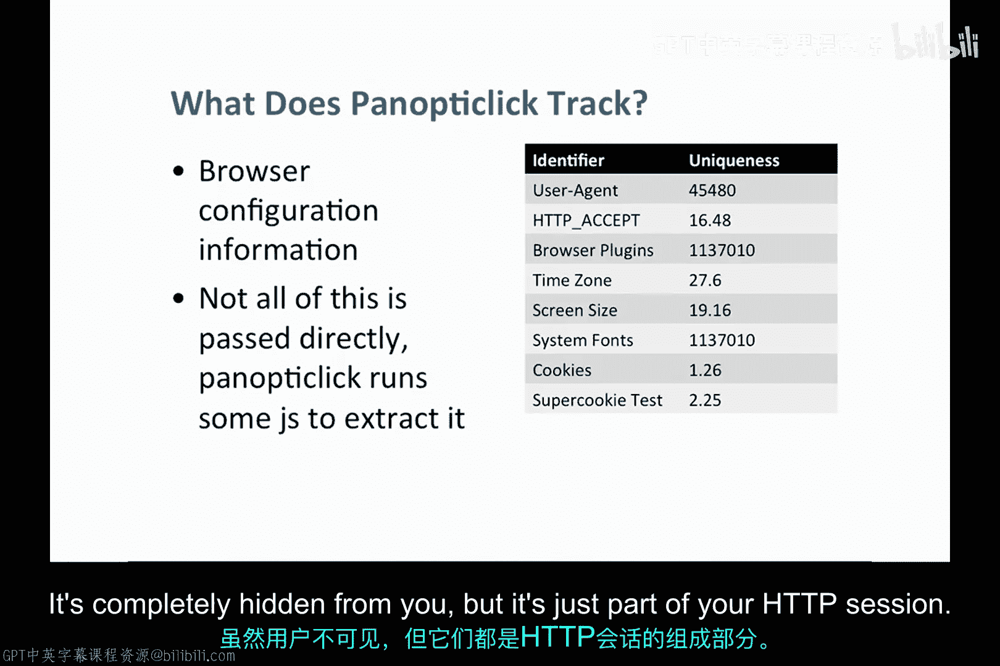

In my case， I am distinctive because of a particular because I had a particular font。 I had Tingmar。

 which if you're not familiar with it， is from J or Tolkiken。 And at some point。

 I've been reading something and I wanted to see the fonts。 So I installed it。

 A lot of the identification techniques， the Panopto click uses are based round browser plugins。

 Okay， and browser fonts， things that you install and sit up on your browser on a personal basis。

 So if you install some cute some interesting looking font。

That's probably going to be able to be used to identify you， okay？

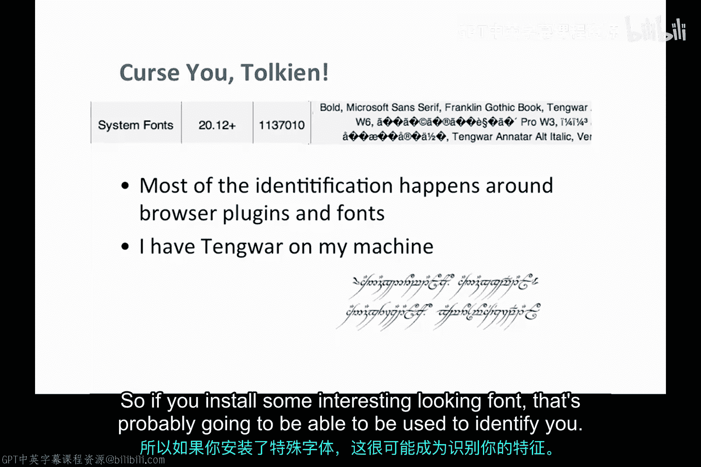

And this is the cornerstone of the issue。 Okay， it is possible to behave anonymously。

 But if you behave anonymously you are making things difficult for yourself。

 anonymity is not convenient。 anonymity is difficult。

 And one of the problems that we've run into an information security and in particular。

 in the politically sensitive communities that are working on anymity is we have to be very careful not to sell people a Bill of goods in order to use an an anonymity system。

 you have to behave like your hiding。 if you don't do that。

 you are going to you are going to reveal facets of your identity。

 I would not casually browse using Tor。

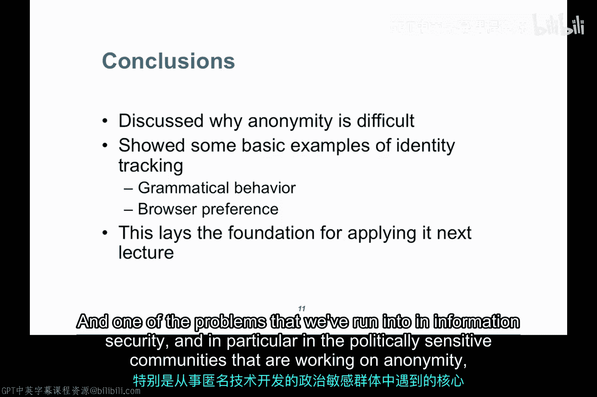

Okay， I'll say they flat out if I'm going to use tour。

 it's because I am doing a specific limited activity that I want to be untraceable。

 but I'm not going to do a lot of user interaction with it。

 I'm not going to you know if I'm going to send mail with it I'm going to be as succinct as possible and I'm going to try not to talk like I normally do okay。

There are a variety of basic behavioral identity that can be used to track you grammatical behavior。

 browser preference， biometrics， these are techniques that we'll use in the next lecture to start talking about how you might actually break anonymity。

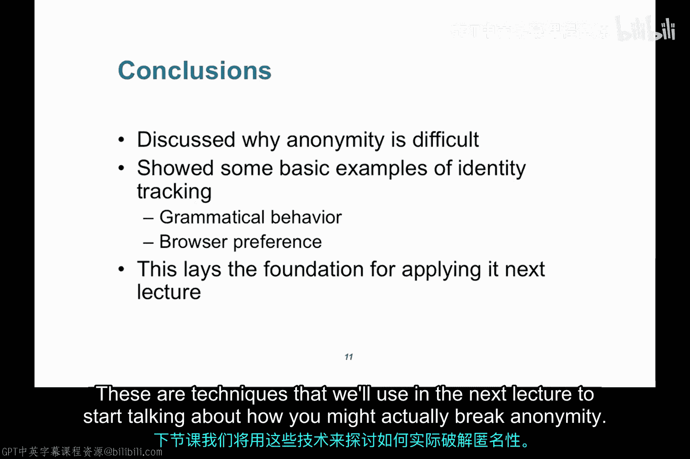