# 约翰霍普金斯大学《信息保障分析｜Information Assurance Analysis》中英字幕 p24 4_流量去匿名化.zh_en -BV1Qz8EzYENX_p24-

Hello is professors Cols talking for 695741 analysislysis and covering module 12。

4 here which is about deanonymization The thing to keep in mind here is that we don't really have a set of rules anonymizing traffic I'm going to do in this module is discuss various techniques for covering user identity or tracing it in an these techniques basically boil down to looking for the user some are behavioral techniques theres we to discuss more advanced techniques which of which are covered in the papers provided for this module is no system for attacking anonym of literature written on looking for common habits and quite frankly I would say anything about anonym that guarantee that I can submit the results into a court of law but there are a set of rulers to operate the first is to not play by the rules of the system the second is look for common habits and the third is to look at secondary services and dependencies Now what I mean by not playing by their rules is this anonymity systems on the。

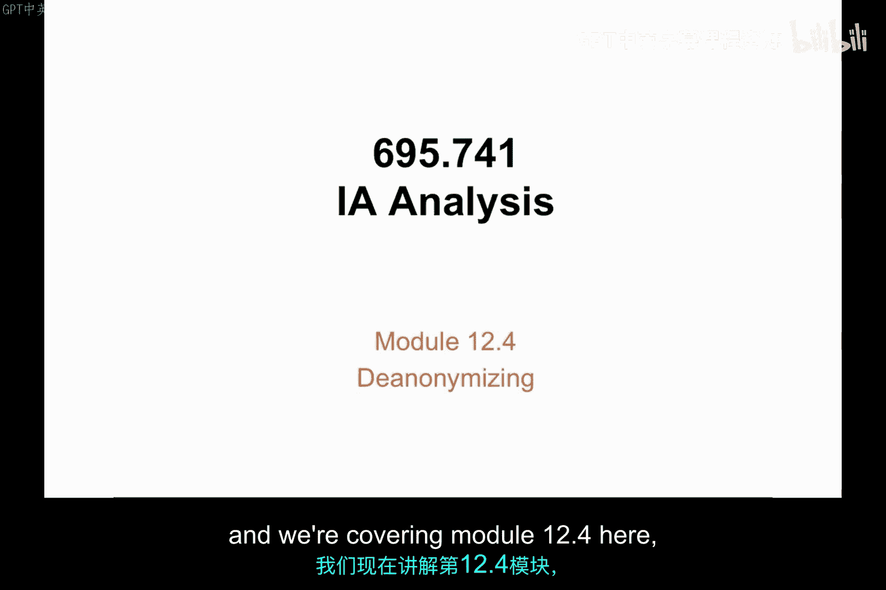

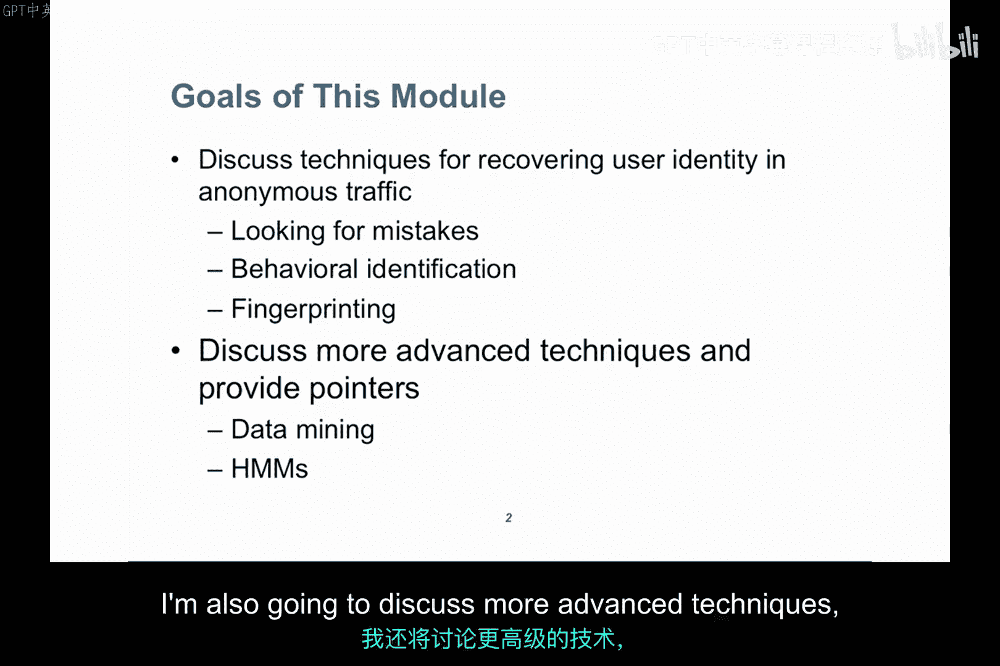

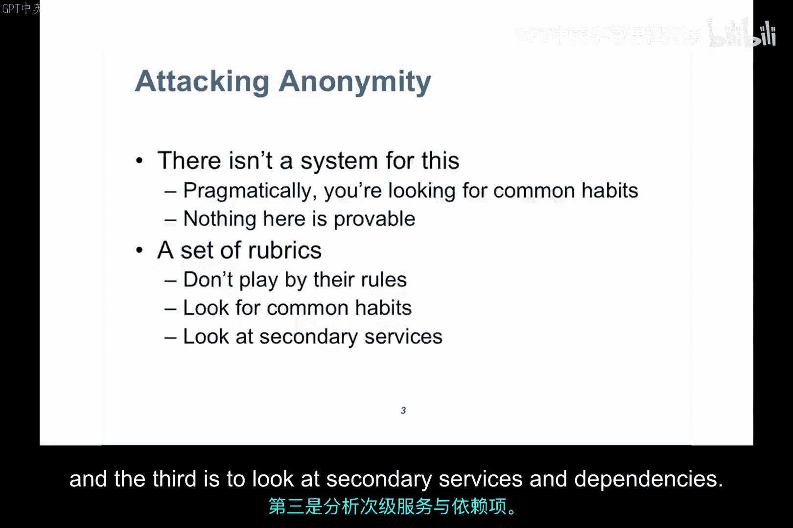

Provide anonymity under specific design assumption One of the things about the history of anonymity is it's been covered by a very mathematically minded collection of researchers as a result these researchers have a tendency to talk in terms very explicit boundaries within which the system provides anonym the first thing you do you're looking anonym system you look for things that they have ignored or avoid you don't attack them via attacks they discuss as an example of this know we're discussing tour I do not look at compromising the tour network as a mechanism I look at the traffic that comes out of an exit to see what I could identify in that traffic for tracing user identity I'm not going to pay attention to how To itself operates if I can avoid it designed to defend against there's a lot of things I look for but the big one in particular with web traffic is to take a look at communications with subsidiary websites like Google Facebook and Twitter important to note about these situations is that it is completely possible user will not even know that they're visiting site an awful lot of time advertising special。

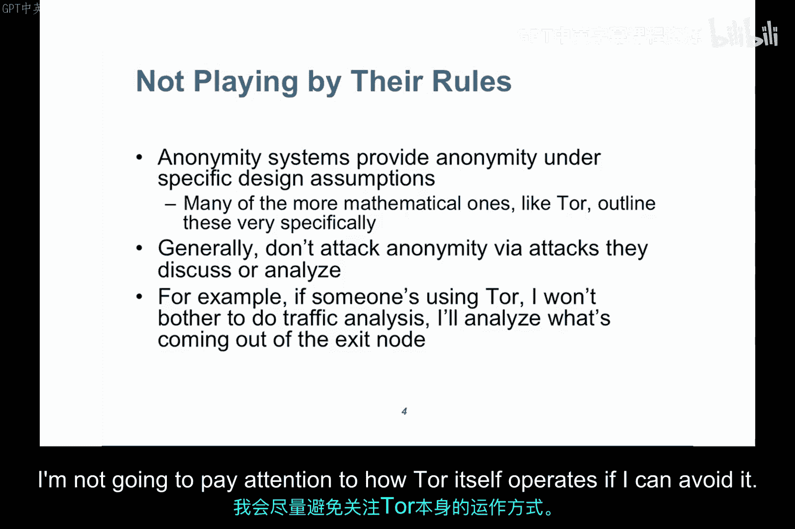

Targeted advertising provided to you using cookies that you're passing back and forth without your wear other things Id for include malware spyware invasive browser installations things like that the phone way of identifying demographic information as well you look at as commons can off the click was supposed to open your eyes there are a variety of configuration issues in browser set passed back and and a lot of user is passed back and forth by like preference application preferencess all those things can be used to identify unique other look at at this is the long tail a lot of users have odd or unique sets of sites they visit regularly is a classic example what we callto distribution 80% goes to 20 of visit Google a lot probably another dozen major regularly Google YouTube you can go Alexa and you can a top 20 list of the busiest sites of the web and you'll find goes。

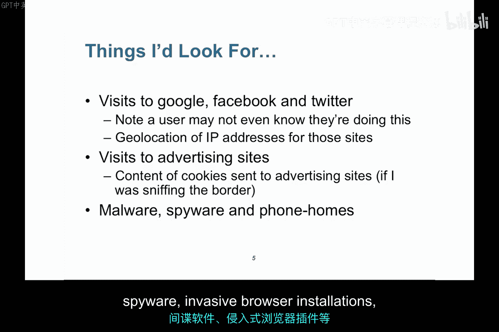

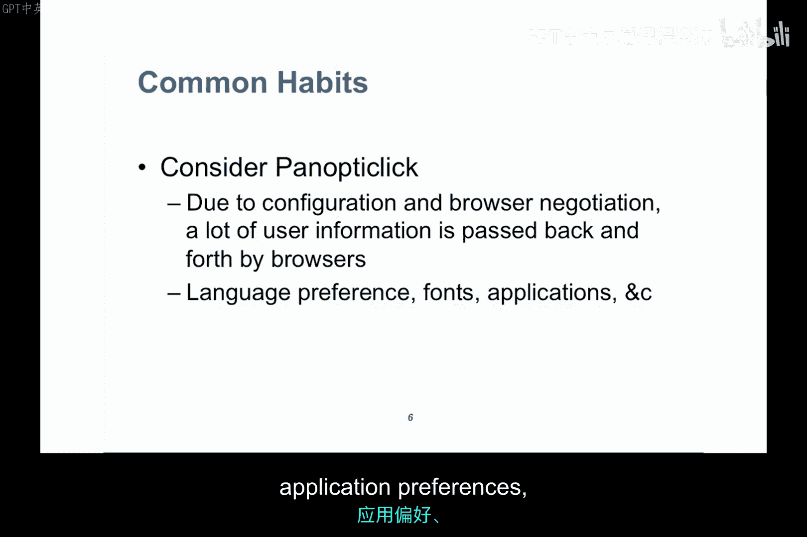

This distribution has a long tail so for every Google there's approximate there's a few hundred thousand sites that are visited by a limited number of people this includes things like odd blogs。

 particularly political or hobby oriented blog the web topics it can be hobby sites things like things they visit regularly and distinctively that are not visited by every the easiest way to deanonymize data in general is to look for sequences of low entropy information what I mean by this information where there's a lot of structure in and to give you an example that even more advanced technique I want to talk about a paper that we mention in the readings uncovering spoken phrases an encrypted voiceover IP conversation this is a good example that data mining technique applied for the purposes of deonym sure idea of the paper is that you can decode voiceover IP messages using their size this is even after the messages have been encrypted so ideally there is nothing in that payload of the message itself that can be used to identify the message。

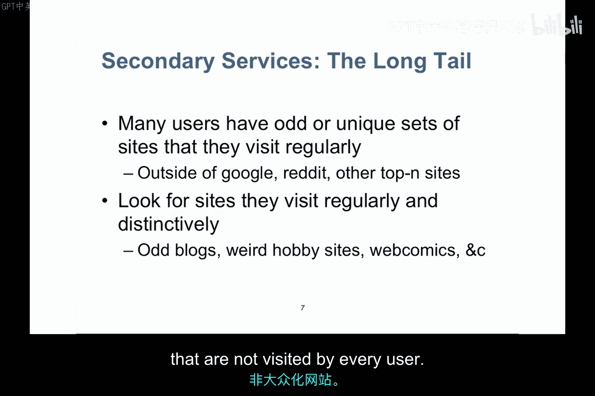

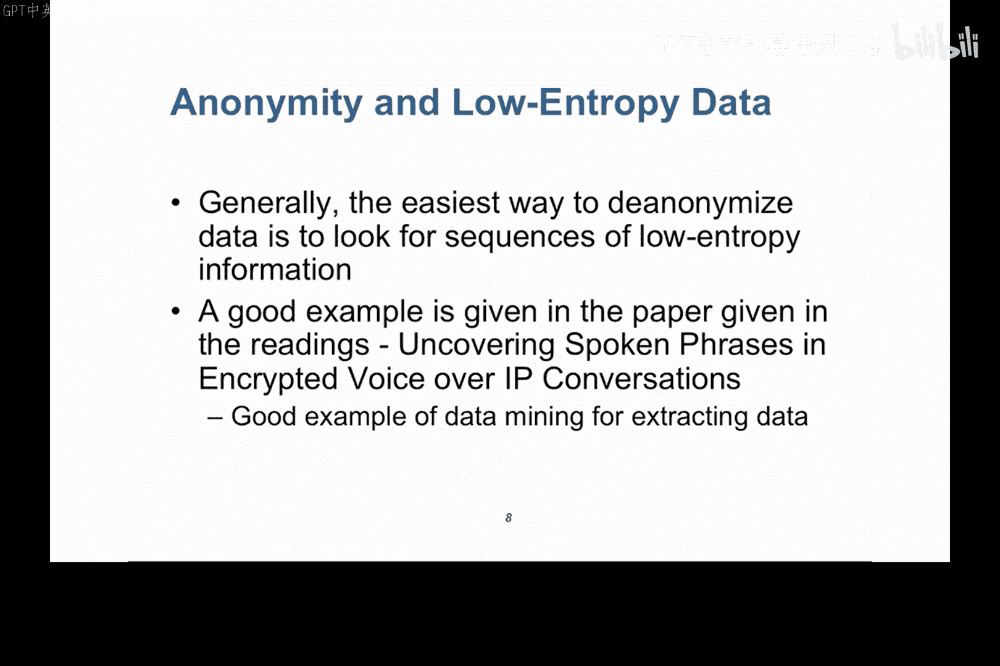

It's going to look like wine noise used for encrypt dissecting audio data encode a different sounds at different bit rate as an example one of the codes they mentioned speak encodes vowels of a higher rate thanativeatives are sounds like f or as or which involve air passing through two surfaces because that different sounds at a different bit I to keep that in mind because it's an example of performance when anon language is low language structure the general consensus is that in English we have around 50 phos phome is not the same thing as a phome is a distinctive atomics that shows up in a language's about 50 it's between 40 and 60 Now what this means is that when you make it when you create an English word or when you say an English word you're going to combine some sequence of these individual phony can be sounds look at them we use the same letter for things like that phome sequences themselves are not evenly distributed this means is that there are。

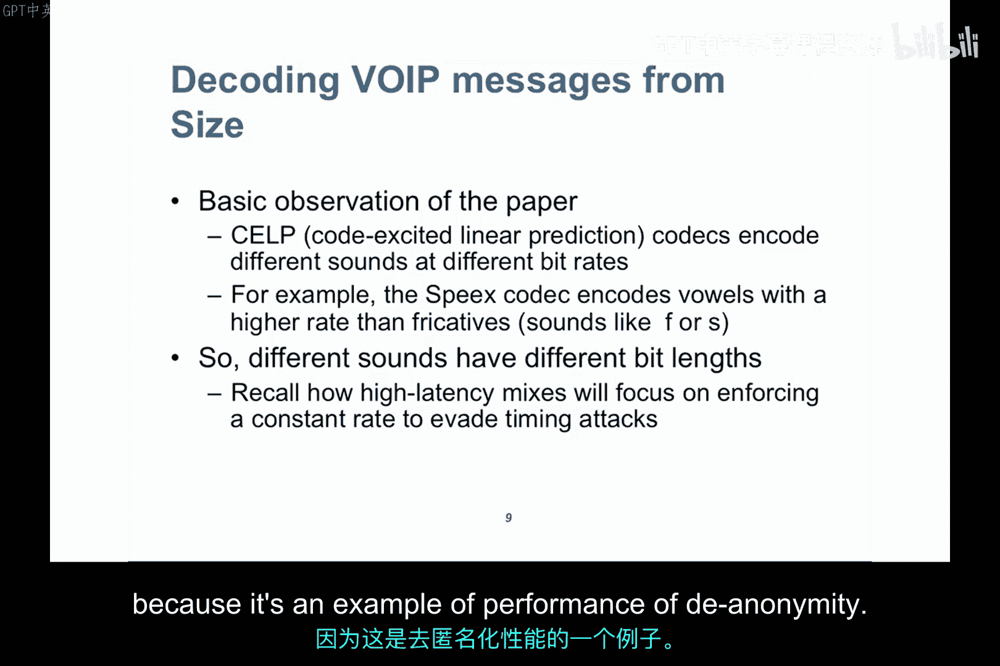

Combinations of phonemes that used to make words and certain combinations are very common。

 For example， I never say anything that involves a choose sound and X sound of a Z sound next to each other my tongue will not do it on the other hand I also make the noise combine combine the and the phonemes together to make a sound if you can figure out the probability of those sequences then you can make a good guess as to what a particular sequence of packet set the way we do this we what's called Markov Markov machine or a Markov process is a statistical process that's called memory what that means is that the decisions made by the process are a function of date that is currently when you look at a Markov machine you will normally see a graph and the graph consists of a sequence of transitions each of which is labeled with a probability for example you can see that theres a transition of 02 to t transition of 08 so 80% of the time I'm going to see the sequence E what I see an E I'm going to see an。

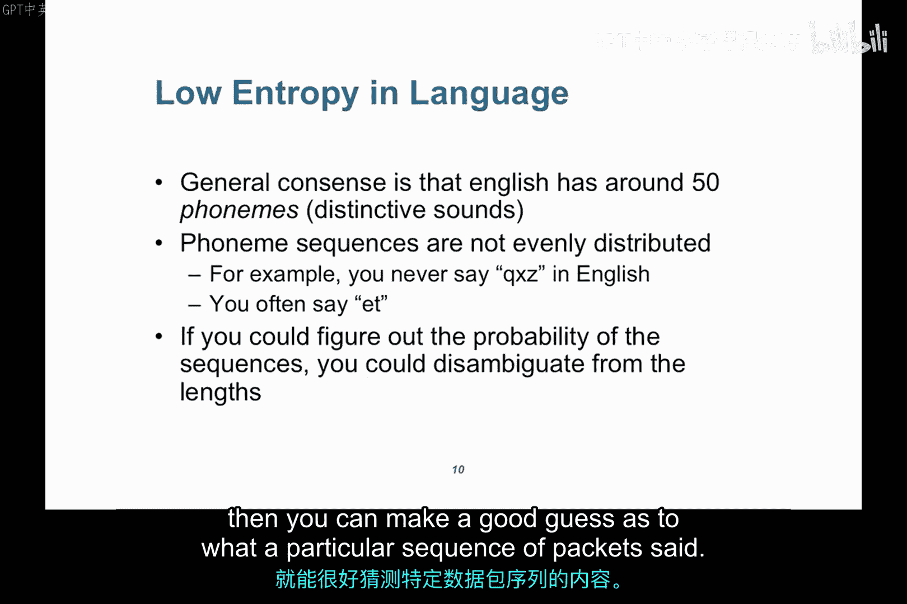

And follow with that so 80% of the time are way to get sequence EAS out of this Markov 20% of the time I'll get ET and then I'll either get ET as or ET Markov models are effectively sequences of conditional probability So their way of saying what's the probability of getting this sequence out of this process machine learning you use what are called hidden Markov or hidden Markov models it's an AI technique that figures out a Markov model using output you take the output of the Markov models example bunch of sentences in the English language then you use HM run machine learning algorithm to get an HMM Markov a hidden Markov model describes describes the probabilities of those various transitions occurring you train a Markovtrain you train it with where the quick ground talk strip over the lazy dog having a bad day having a good day or so on system goes through those sounds breaks them down and figures out with the probabilitybabilities are the various transitions and then it can say what's the probability of the good thing。

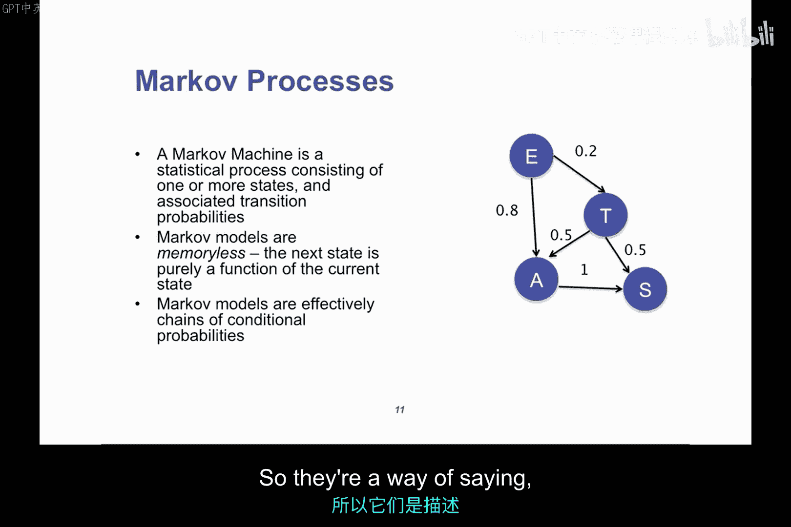

Or the probabilities we say get paper right a company have written uses hidden markov models on packet length to figure out what the likely sounds are Now the key thing here is that packet length in the right model are associated with multiple morph with multiple phoneme but once you start combining them in sequence it's easier to identify what they are likely to be and this hits the core problem with implementing anonym of anonymity techniques is low entropy data things that have a lot of structure user habits the internet's engineering mean that you're going to find a distribution that favors a particular set of elements that makes anonym to make it effective anmous system you have to ensure that pretty much everything that the attacker can observe is uniformly distributed goes to the example of the high latency mixes whereas I mentioned in the previous lecture they'll control packet timings and packet sizes in order to ensure anonymity is achieved problem is that making everything uniform means that you're losing efficiency anonymity and convenience fight against each other for privacy because it makes。

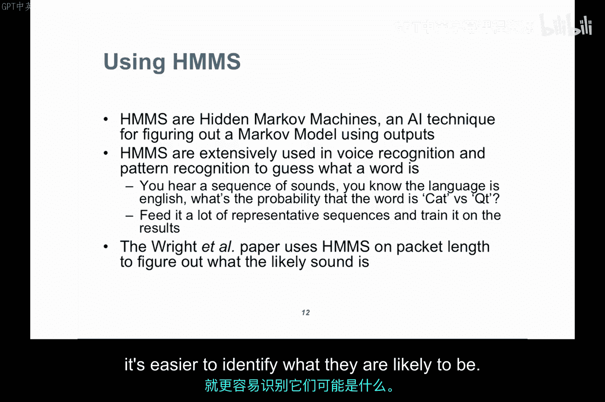

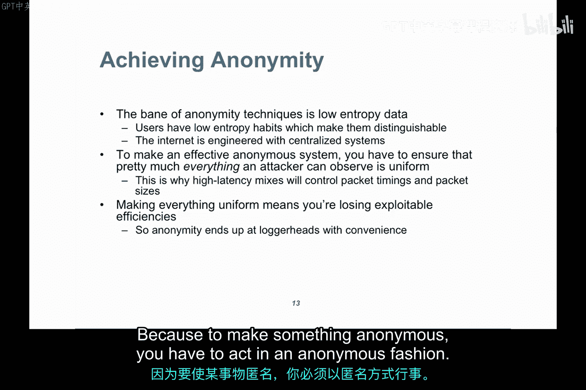

Anon you have to act in an anonymous fashion and an anonymous fashion is in a conclusion we' done to the informal overview of techniques for breaking in and they day the key thing to came in mind is that it involves fighting attributes which are low entropy there's a bunch of these you could look at biometrics。

 surfing habits， sping habits， location， things like that are all viable techniques for identifying user behavior。

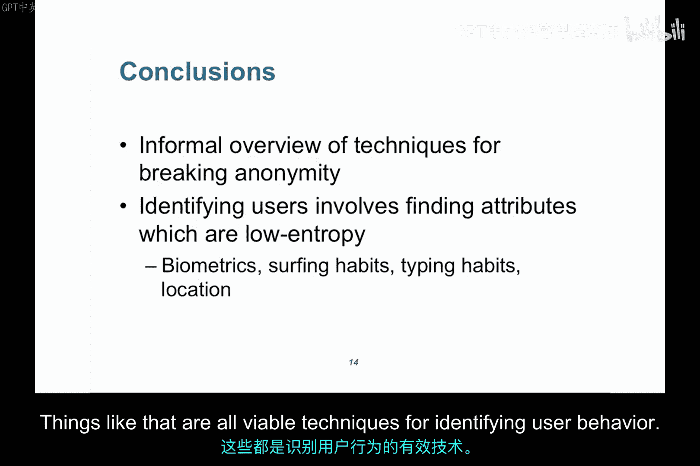