# 约翰霍普金斯大学《信息保障分析｜Information Assurance Analysis》中英字幕 p25 5_DNS协议概述.zh_en -BV1Qz8EzYENX_p25-

Yes。This is module 7。1 of Class 675741 information assurance analysis。

 The topic of this module is DNS。 The topic of this entire section。

Is DNS and the purpose of this module is to provide you with a high level overview of DNS。

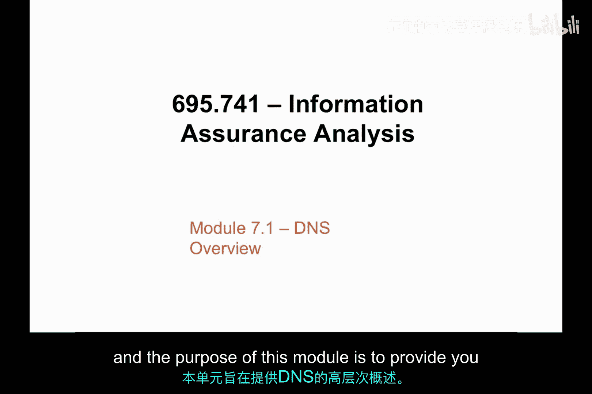

The reason that I say a high level overview is you're going to be sick of DNS by the end of this section DNS is a phenomenaly complicated protocol that is encunced into the inter infrastructure in a variety of ways now it is not complicated theoretically it's fairly simple you ask a question it's a database that brings back an answer associating a number to a name the reason it's complicated is because it is so fundamental。

To the Internet， the people have been hacking and modifying and making it important or unimportant or critical or non criticalit in different ways for the past 35 years。

 As a result， it is very cut。 It is very deeply encoced， very messy。

 and has a whole lot of cls to make it operate， okay。This module is a top level overview。

 this is to get you started as we start going into the more complicated and messy aspects of the protocol okay。

 so what I want you to do at this point is understand the role of DNS。

 the basics of name resolution and the centrality of DNS okay now。

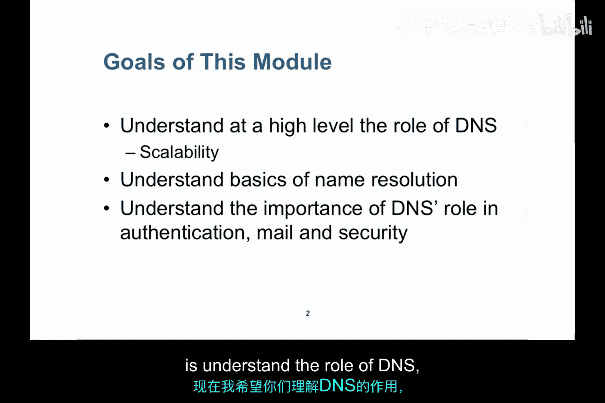

At its heart， DNS is about making the Internet people friendly， as you know。

 Internet addresses are a number between one and2 to the 302。

 and we don't really use them that much instead we use names。 Www。jH Eduu things like that。

 Nas are convenience for users。 DNS provides several mechanisms for making them such user convenience。

 and the other thing， of course， is that DNS is deeply stitched into infrastructure as a result。

 Some of this comes from its original design。 For example， DN DNS is used heavily in the mail system。

 We talk a lot about SMTP for transferring mail， but DNS is also used to figure out where to route mail DNS is also the underpinning of trust and certificates。

 domain names show up in X509 certificates and consequently you end up with trust issues associated with them as well。

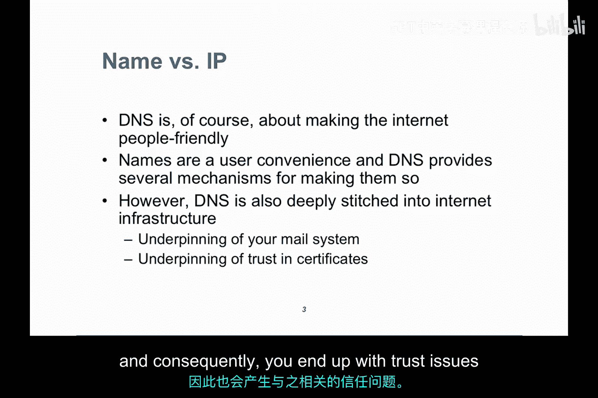

No。Let's talk about the beginning of DNS。The very first Dna's equivalent is what we call hosts on Uniuch systems it's generally called Etsyhos。

 and you will hear we call it Etsyhos in general when I'm talking about this because I have a Uniix nerd。

 Now， Etsyhoss is a file， which contains a simple correspondence between names and addresses。

 Now in Windows can be in system root system 32 drivers， etc cetera hosts。

 but you'll notice again it's Etsyhos。 it's a simple table of address to name correspondence。

 The other thing to note about the names here is the names can be fairly arbitrary Now。

 names do not have to be what we call a fully qualified domain name at this point。

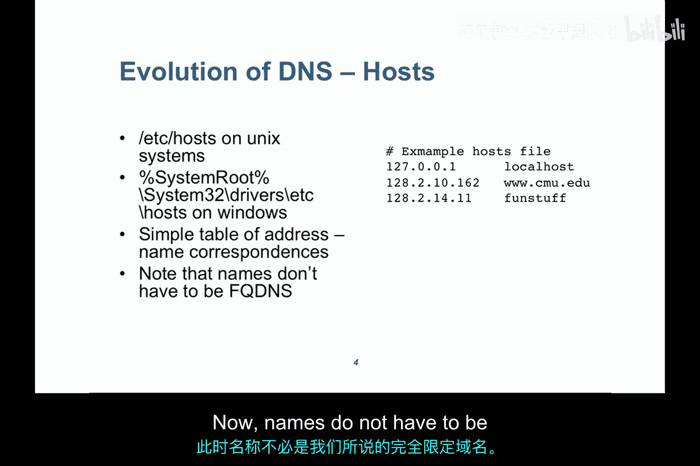

Okay， we'll talk about what if Q D N is more and later。 Now， hosts is still wrapped。

 If you go on to your machines today， you can go cat Esyho or cat before location system root and find it。

 hosts is the or name resolution software on your computer。 And this is important。

 because malware will often attack Etsyhos。 For example。

 what most viruses will do these days or most Trojans will they enter your system。

 The first thing they will do is they will go to Etsy hosts and they will add in the names of every major antivirus vendor and set the address of that Aphi vendor to 127。

0，0，1。 The reason to do this。 Anytime we then talk to Ksperssky or semantic or whatever。

 you're going right back home and your disabling updates。 okay。

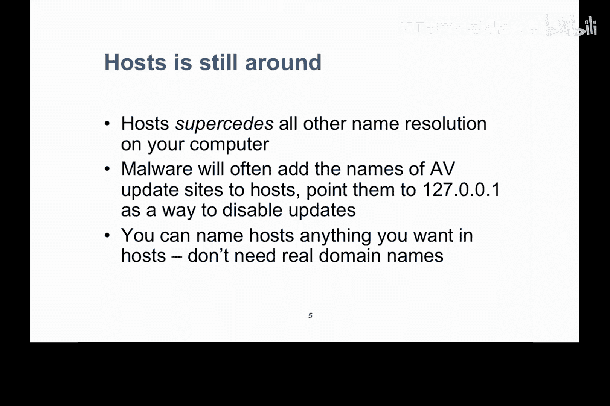

No。嗯。I mentioned this idea of the FQ D N， the fully qualified domain name。

 we should talk a bit about it before we get into DN S Prop。 As you know， you know。

 you may not have ever thought about it much， but， you know in your gut that there is a sort of syntax to domain names。

 for example。www。pp。ju。edu okay， you know that you know that generally we put the most specific name on the left and on the right we've got this sort of grab bag of Eduu org it country codes。

 things like that that go on the right。Now this sort of structured name is what we call a fully qualified domain name。

 it is roughly the equivalent of an absolute path for a file。And like an absolute path。

 it has a root。 Look at the example I put have here w EP dochange E。

 you will notice that I put a period at the end here。 that's not a typo。

 That is at the root domain okay。that is an explicit specification of the DNS root itself Most DNS resolution is done with some implicit domain。

 for example， if I'm sitting in js。edduu and I do Epp， it'll resolve to Epp。j。edu Okay。

 if you have absolutely no assumptions it's going to go to the root。

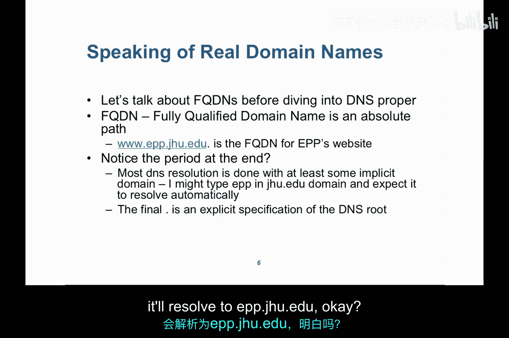

All right， so if you want， think of DNS as a tree with that period at the root， then underneath that。

 you've got JHU， et cetera， et cetera， et cetera， and so forth， okay， now。

Obviously hosts is limited we're not copying host files so amonging each other training them to get into hot sites that's because it's just insanely difficult to do that when you've got 4 billion plus hosts passing information back and forth the solution is DNS。

 the domain name system Now DNS is a hierarchical dictionary which relates names to typeP addresses it is。

 as I said effectively this treat the way that it works is that you've got these root servers which delegate authority to subzs and with subzs that handle their own names okay。

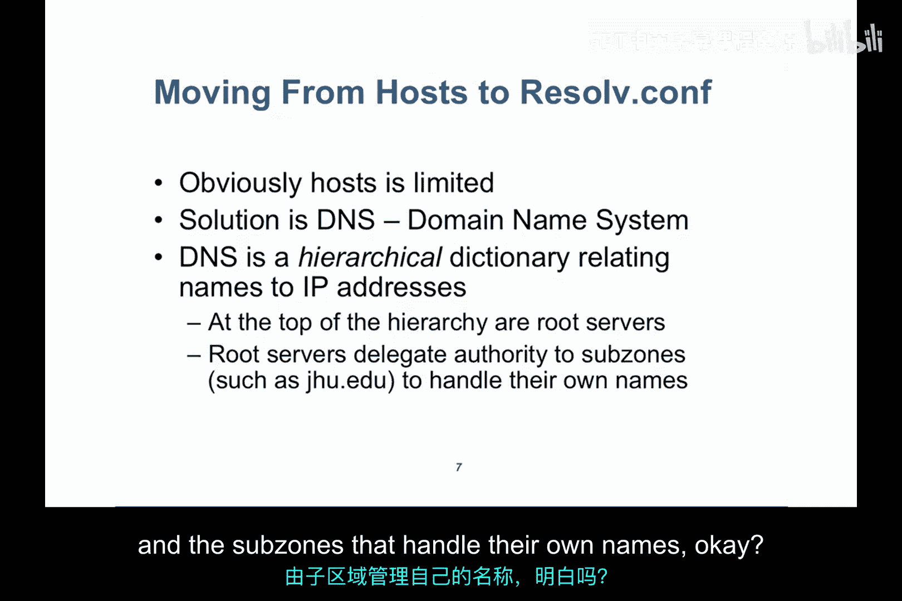

The fully qualified domain name also specifies the order in which these lookups are done so for example。

 many many wound ago I worked in the physics department of CMU and for those of you who are not familiar with it quarks。

 which are the fundamental sumatomic particle aren't you guys glad to know that you learn all sorts of things in this class anyway there are six varieties of quarks up down charm strange top and bottom math used to be truth and beauty but we are not going to get into that anyway。

The whimsical system administrator in the physics department decides that we were going to have six servers named Corrk at Clarkrk。

 and there were going to be an up quark， down quark， strange quark， et cetera。

 never underestimate the humor of system administrators with DNS anywhere。

So if I want to do a query on this incredibly long name。

 the first thing that happens is it goes to the top level domain。

 which is ED ED so goes to Edu and it says I'm looking for CMu。

edu EduU says here's the server for CMU okay CMU I'm looking for Phizz here's the server for Fizz Fiz I'm looking for the server for quark Here's server for quark quark goes here's the server for up so it is this process of passing these names progressively down on the tray。

And so when you look at it， that is actually what's going on。

 it's a set of instructions for which server to talk to starting with your root server。

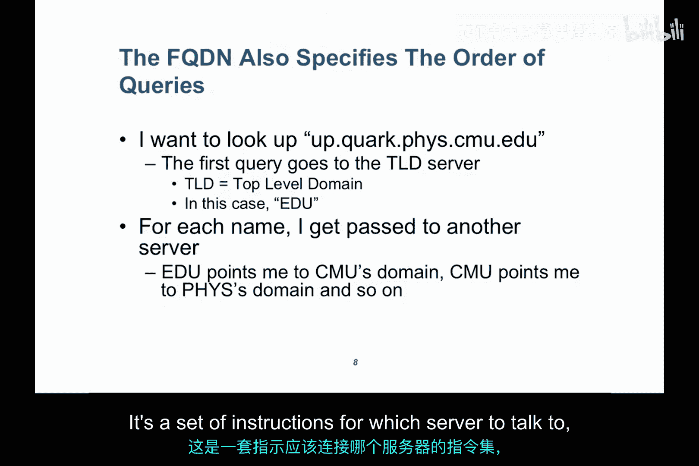

你 here。Now you might ask yourself how does DNS know that CMu owns cmu。edduu。

 Obviously there's a database somewhere who owns that database。

 How do I I' youroral purchase the re and the answer is the registrars。

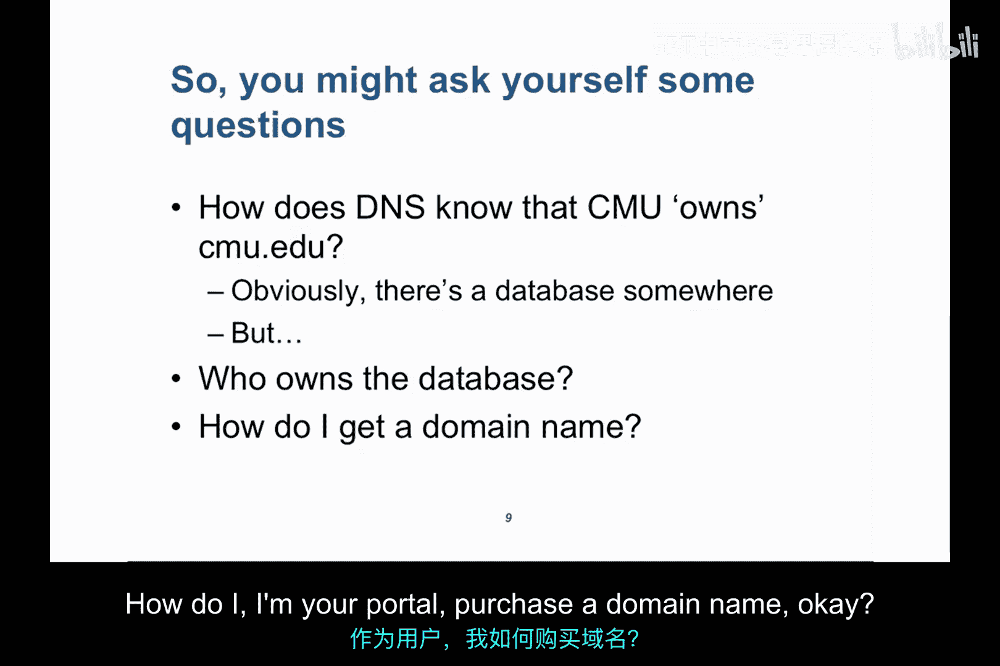

All right， a registrar is a company that has an arrangement with IKin， which is the root registrar。

To sell names at the highest leveler we call the generic and country code TlDs generic a generic TlD is an organization like a doorg。

edu。int or Verign which runs co oreduccause which runs Eduu these are the organizations that are delegated by ican with the authority to give names in that domain Now depending on the organization you're talking to there might be different requirementsorg does have some basic requirements like you've got to be an nonprofit Euse Ecause is going to only pass to accredited educational organizations there are also country code Tlds this includes things like novanet which is the UK registrar Now these registrars in turn sell out delegate authority to registrars under them Verign for example。

 has arrangements with Pe Nickck which is，A Pittsburgh resident regiiststrar and GoDady。

 which you're， of course， all familiar with because like all good people you are watching the Super Bowl and you see those ads that they run during the Super Bowl。

The similar thing happens to the UK nomininate has an agreement with UK Regdge。

 and there are various other companies you can go and you can get registration agreements from。

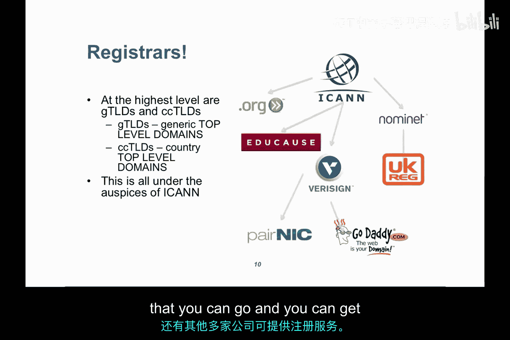

Okay， no。If you want to register a name， registrars have the authority to update the database and this is actually a chain of payments。

 so I pay God， Godddy pays Ver assigned Ver sign pays I can't， all right。Now。

 this is a formal agreement， if you want to become a registrar。

 you can go talk to Veride about becoming a。com registrar and work out the arrangement with them。Now。

The key thing there， of course， is that that means that these GtLD organizations basically establish the policy for how you add additional sites。

 like I said。org。edu。end these groups have specific requirements。com， anyone can join。com。

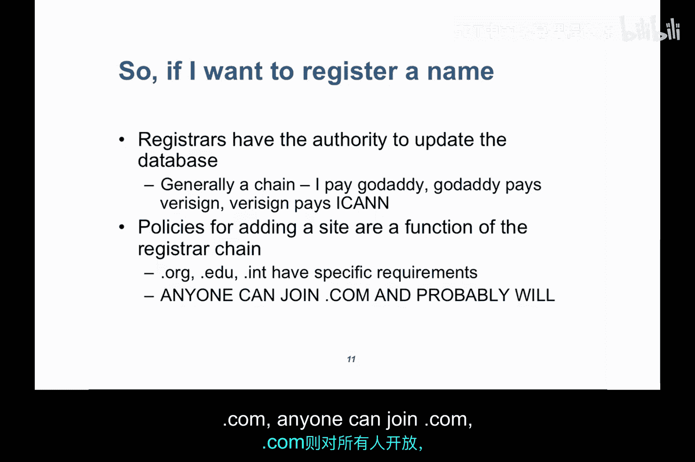

Quite franklyly， they probably will。All right， now。Over time we've added more TLDs。

 the original set of TlDs was specified in RFc 920 and 1984。 This included co。ed。gov。m。org。net。

 The doarpa domainin was added in 1985， It's a special domain。

 ARPpanet was the predecessor to the internet Int was added in 1988 Int incidentally is not internet it is international。

 You're practically never going to see anything in the dot int domain The only things I know of off the top of my head The Un has dot int domain go to un int and Intelat has a dot int domain。

Now Ican， the Internet Corporation for signed name numbersumb。

 which was created by which was created by the US government a little bit before 2000。

 then started adding additional domains， the first batch in 2000 werearrowero Bz infofo Coop museum name and all right additional ones that have been added since then Asia cat jobs。

 Moby tell travel ICcanN is currently planning to add unrestricted TLDs。

Pretty much now how far this will go， nobody really does。

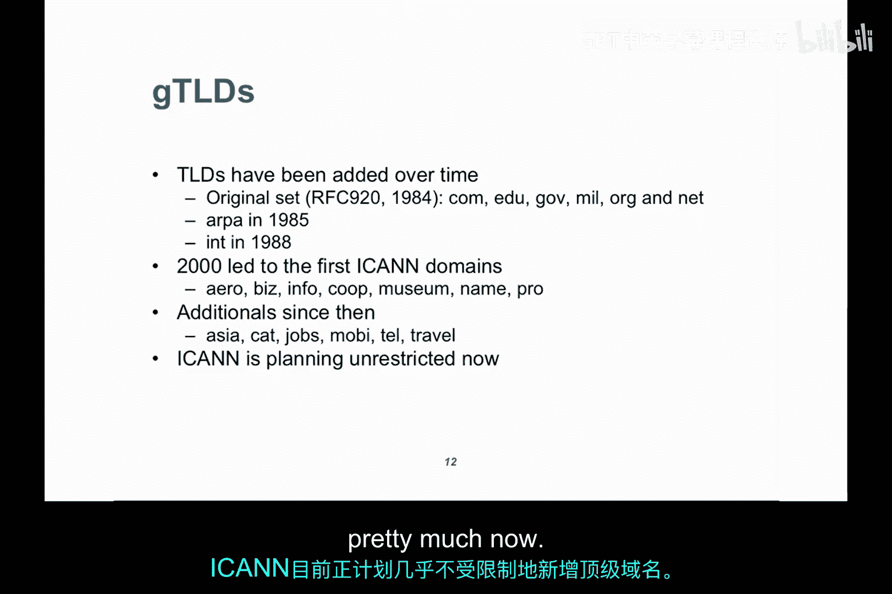

Now the other thing of course to add here is the history of stupid country puns involving TlDs CC TLDs have historically been two letter codes are you for Russia。

iQfor Iraqq and so on okay now what's happened as a result is that certain domains have become very popular because they're capable of adding stupid puns to them。

 for example， do new for newe。Dto for Tangga， I have a friend， for example， who world Boie to。

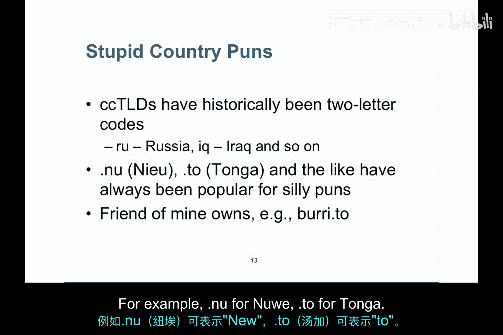

Right。Now。This is about how you get names now how do you get I addresses to go with those names Well。

 ISP provide those ISP operate under the auspices of Iana Iana allocates I space to various Rs which are regional internet registries for our purposes there are five of them appic which is the Asiapacific one Aaron which is the US one Aphroic which is Africa's Lachnic which Latin Americas and ripe。

 which is Europes Now I've made a jump here that might confuse some of you so let me be clear about this but we talked about for the past few slides has been about purchasing names for DNS I can purchase an name and then I can just sit on the thing it doesn't have to actually do anything Okay so I can sit you know I can buy www Mike is awesome co if it's not already take and which it probably is and just sit on it but if I want to do something with it I have to wire it to a computer which means I if there a computer that's plugged into the Internet that。

Per's got to have an IP address and then they've got to associate those things so we've talked about it until this point is how do you get the NA now we're talking about how you get the IP address and the answer is that on the whole you don't get IP addresses you rent IP addresses from internet service providers they get ISPI addresses from other Internet service providers who in turn get them from RIRs which are regional internet registries。

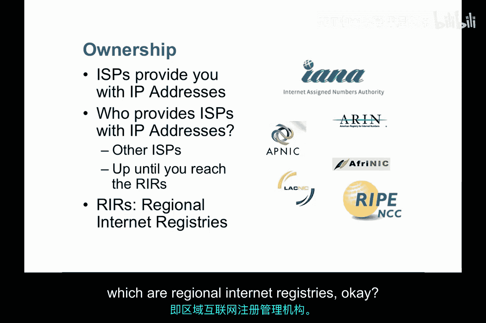

Okay。😊，What happens is RIRs allocate addresses to other organizations。

 the process of allocation will vary from country to country， for example。

 KR has Korea has I think called KR NC。Okay。What happens is the RIR passes the addresses over to the NIC they get allocated over to ISPs and eventually to you really this is just a mechanism for managing the relationship between I between IP addresses and DNS names the thing to remember in particular is that the IPV4 which theoretically should be dying out but we'll see what happens is limited we've reached the upper limits of what's available there all of those addresses have actually been allocated at this point and now what's happening is when're sort of going back and forth in trading on。

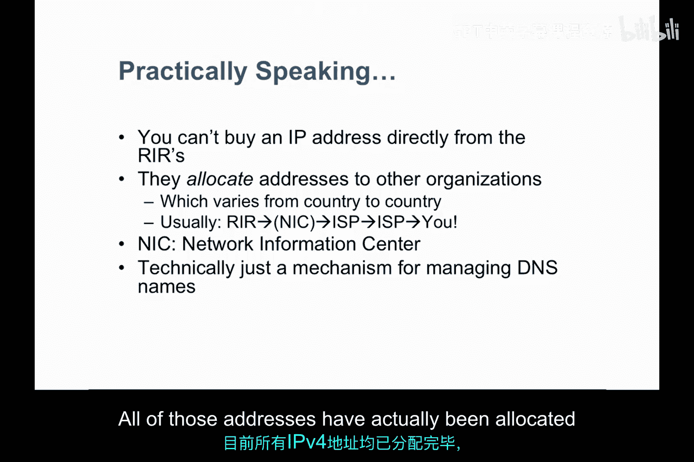

There it。So just to review this okay， you get an IP address from your ISP your ISP gets it from an RIR there are far fewer potential IP addresses in IPV4 that there are names available in DNS you get a DNS name from a registrar registrars get the authority to allocate those names from TlD registrars。

 toplevel domain registrars， so for example， I cannot get a do EDu domain unless I found a university okay I get acom domain because thereon will sell V one quite happily。

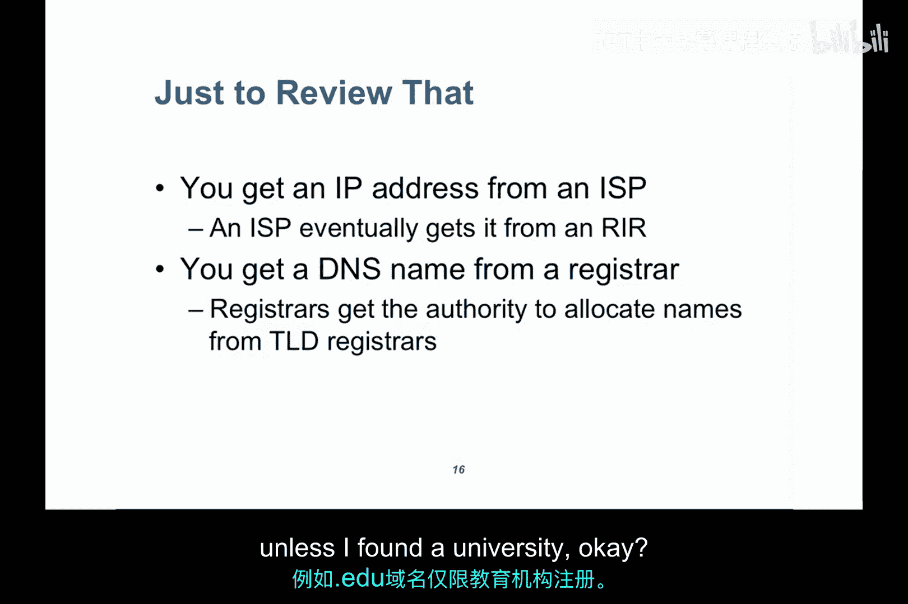

Now， how do you track all of this stuff， The core tool is who is All right。

 you do this on the commanded line， who is or who is dash H， Okay。

 the reason that you want to keep paying attention to the dash H is because who is is。

Who is is a terrible？Aable database who is is one step above three by5 index cards information isn't shared。

 there is no common formatting in the information half the time people don't bother to fill it in and kind。

So you will often find that you will want to use multiple who is servers to try and find somebody Okay now the other thing is that the various Rs provide you with a web based who is front end so these URLs that I've put here should get you to the who is servers now the problem is that this is a moving target so if any of these URLs are out of date just use the actual name there and you should be able to find it。

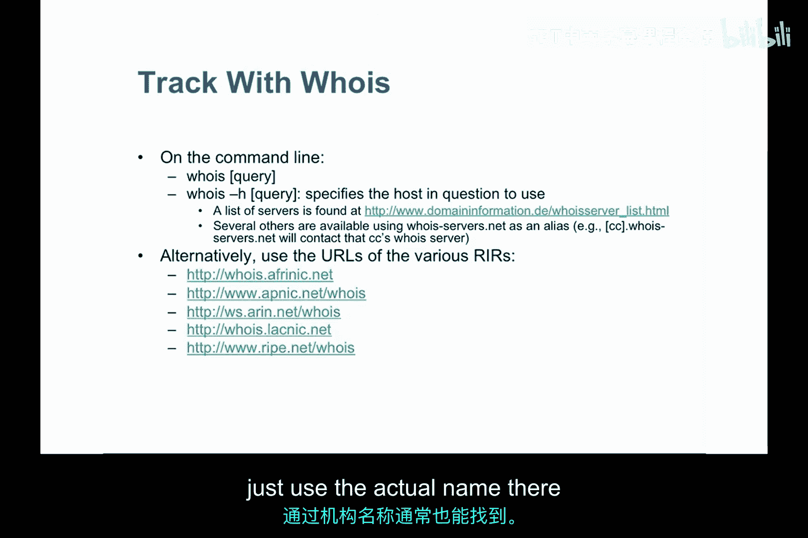

Okay。Now if you query a name in who is you should should get an entry showing the owner the address etc of the name。

 the problem is that these entries are irregular， they're registergistrar specific and they're eccentrally enforced okay the truth of the matter is that there's no hard and fast requirement that this information be publicly available and consequently you can't guarantee it's going to be in a database right。

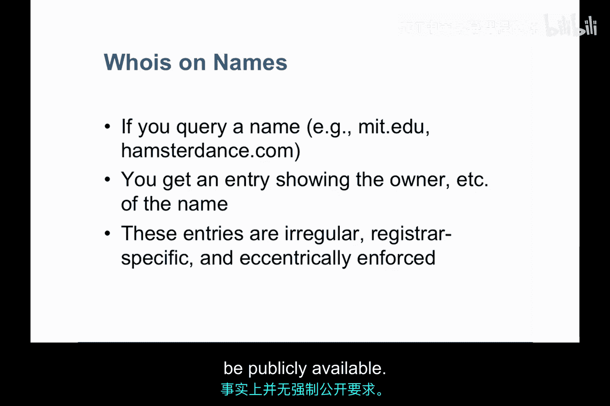

That means that oftentimes you have to engage in some tricks and now in two modules I'm going to go through an extensive walkthrough of doing these type of queries。

 but for now the important things for you to do are drill down as fast as possible one of the things you'll find with who is is that it is hierarchical so for example you might do who is query on an RIR and it'll direct you to another who is server go to that who is server and take a look there as well the thing is take a look around an address individuals don't own individual IP addresses instead they generally get a slash 27 from an ISP generally gets to slash 27 and allocates it to a bunch of people the point being though except just looking at that specific address。

 bounce around a little take a look at what's in its neighborhood to see what else you can find。

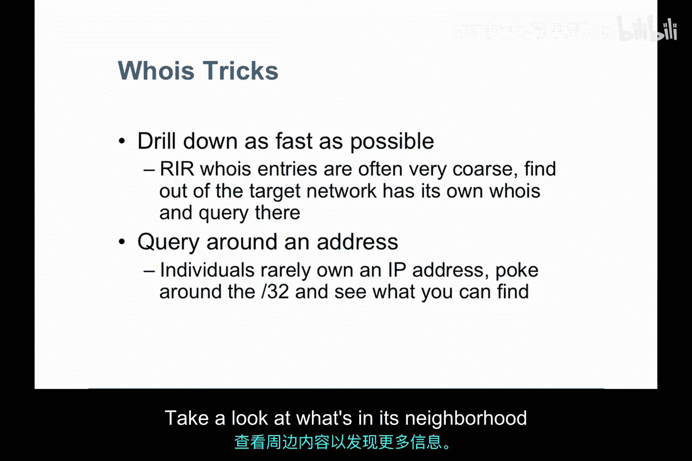

Al right。Now。So， this is DNS in all it's registering。It's all social convention。 Keep that in mind。

 The reason that you have a DN S server to go to is because somebody's told you what server to go to。

 Okay， you don't have to follow this。 All right， There are， in fact。

 a variety of alt roots out there。 If you do a Google search， you'll be able to find them。

The problem with alt roots historically is that it's easy to start one， but they don't scale well。

 when I say they don't scale well， what I really mean is that they don't have the o impetus behind them that the I can backed DNS infrastructure does。

 I'll talk a bit about the root servers later on but the actual root servers that maintain the DNS network。

They they're fairly beefy computing clusters with a lot of bandwidth with allocated to them and you know consequly if you're going to start an alt route。

 you can do that， but you're going to find rather rapidly that if people adopt your alt route。

 you're going to have to start thinking about serious cache in an allocation in order to keep the beast up and running。

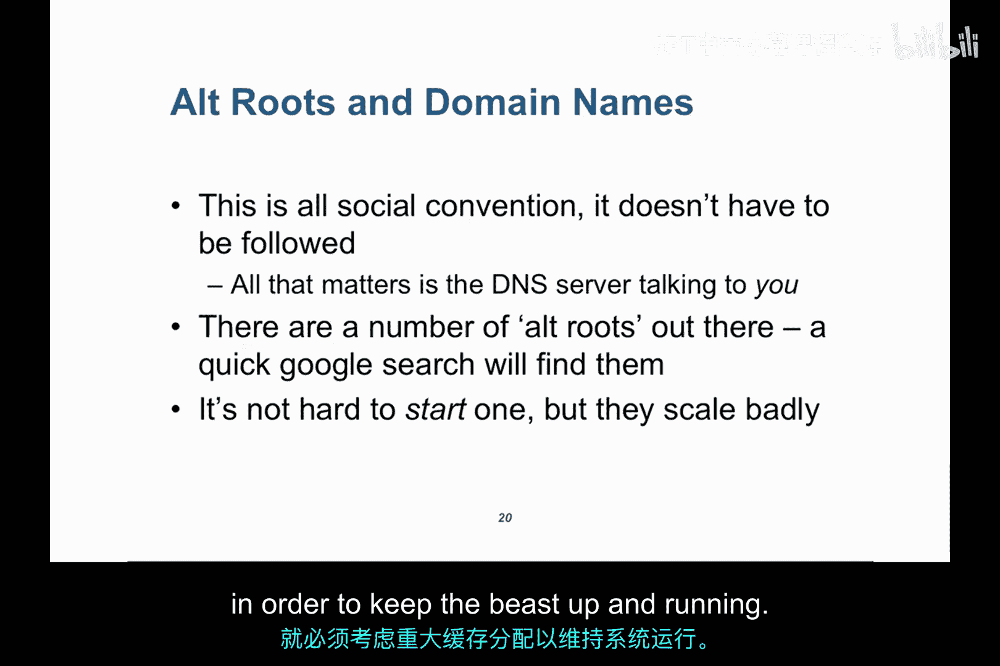

Okay， so in conclusion we've discussed the role of DNS we've discussed how names are created and installed and we've discussed who is in right inration now really I have not done anything on the technical details of how DNS operates that's going to be the next module。

 but what I wanted to do is give you sort of a top level view of how it works。

 what the results of queries are， all of those messy details thatll get you going as we start that'll give you sort of a general framework to hang on to as we start diving into the ugly technical details。

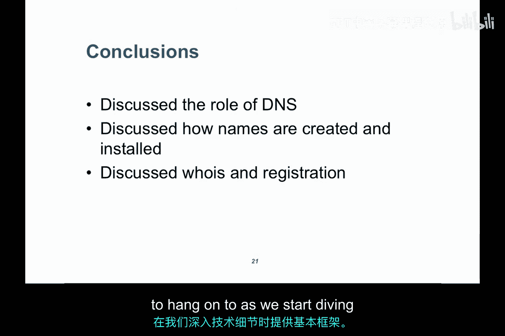